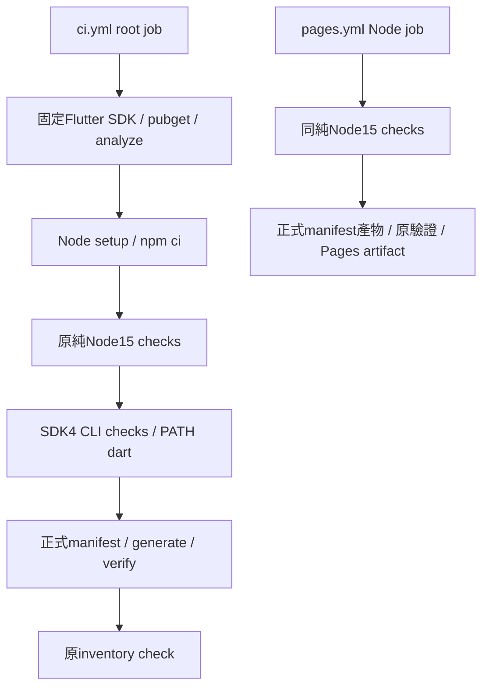

# 發布與驗證工作流程

工作流程由repository整合owner維護，SDK／套件CI、example checks、Docs Pages artifact與deploy各有既有job，不以新增docs展示放寬既有閘門。YAML依語法使用空格，不以tab破壞設定。

## CI-REFERENCE-EXTRACT-1（READY）

修訂CI-REFERENCE-EXTRACT-r1，BUILD只write ci.yml在既有Flutter root job的「參考網站產生與驗證」步驟加入npm run test:extract --prefix tool/reference_site，位於既有npm test之後。此job已setup Flutter與pubget，SDK check用PATH dart；純Node Pages仍跑15網站checks並讀正式已驗證manifest，不新增Flutter/Krepis依賴。SDK檢查4原斷言與錯誤保留仍必跑，沒有skip或例外。不得改SDK／permissions／triggers／其他jobs、移除analyze、golden、inventory、公開元件或發布路徑。

cold1k～2k/5～15分鐘，單M1：workflow runner/順序與原checks保留、local同SDK4Green、scope1/diff；3k20或其他workflow改動回PLAN。CI實際remote job要在最後push後才觀察，不把本地Windows Green當作Ubuntu執行成功。

| 設定 | 實際責任 |
| --- | --- |
| ci.yml env／jobs.react | 固定SDK facts／React tokens/build/tests/example/pack |
| ci.yml jobs.root | Flutter pubget/analyze、Node15 website與SDK4 extractor、generate/verify及inventory新鮮度 |
| ci.yml jobs.test／jobs.example | 原Windows golden及Flutter example checks，平台保持 |
| pages.yml jobs.build／jobs.deploy | Node網站tests、正式manifest產物驗證與Pages上傳／受既有條件約束deploy |
| 其他workflow | 不屬本slice write boundary，不在這次改動推定其新責任 |

