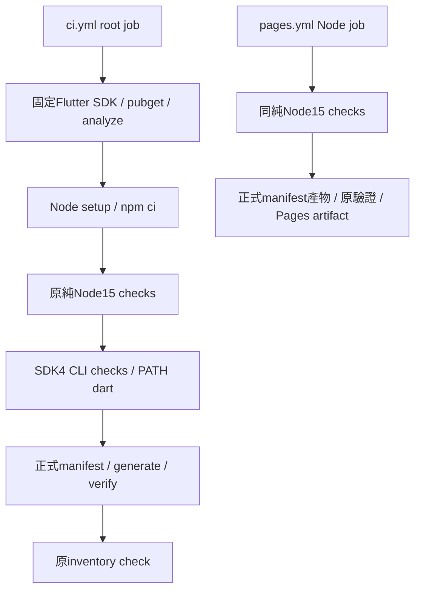
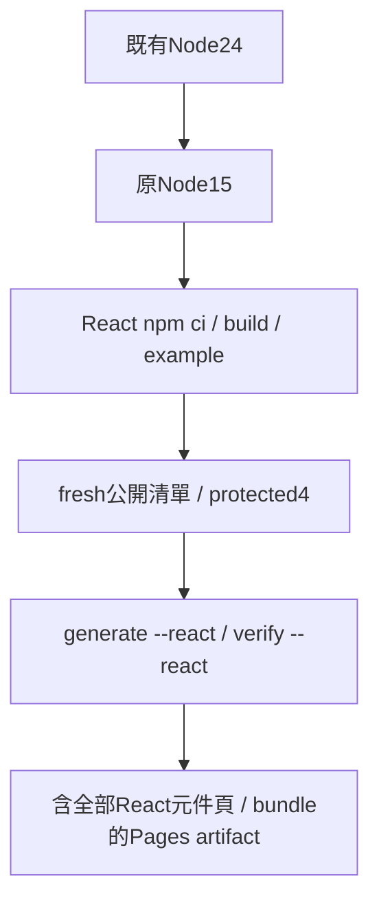
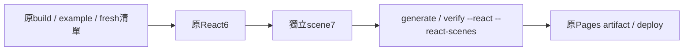

# 發布與驗證工作流程

工作流程由repository整合owner維護，SDK／套件CI、example checks、Docs Pages artifact與deploy各有既有job，不以新增docs展示放寬既有閘門。YAML依語法使用空格，不以tab破壞設定。

## CI-REFERENCE-EXTRACT-1（COMPLETE）

修訂CI-REFERENCE-EXTRACT-r1，BUILD只write ci.yml在既有Flutter root job的「參考網站產生與驗證」步驟加入npm run test:extract --prefix tool/reference_site，位於既有npm test之後。此job已setup Flutter與pubget，SDK check用PATH dart；純Node Pages仍跑15網站checks並讀正式已驗證manifest，不新增Flutter/Krepis依賴。SDK檢查4原斷言與錯誤保留仍必跑，沒有skip或例外。不得改SDK／permissions／triggers／其他jobs、移除analyze、golden、inventory、公開元件或發布路徑。

cold1k～2k/5～15分鐘，單M1：workflow runner/順序與原checks保留、local同SDK4Green、scope1/diff；3k20或其他workflow改動回PLAN。CI實際remote job要在最後push後才觀察，不把本地Windows Green當作Ubuntu執行成功。

BUILD26cc05f4 exact ci.yml單行加入既有Flutter root步驟；原15網站與4 SDK checks本機Green，scope1／diff Green。Pages、SDK版本、權限、觸發條件、其他jobs與發布閘門保持；Ubuntu執行pending最終push後證據。

| 設定 | 實際責任 |
| --- | --- |
| ci.yml env／jobs.react | 固定SDK facts／React tokens/build/tests/example/pack |
| ci.yml jobs.root | Flutter pubget/analyze、Node15 website與SDK4 extractor、generate/verify及inventory新鮮度 |
| ci.yml jobs.test／jobs.example | 原Windows golden及Flutter example checks，平台保持 |
| pages.yml jobs.build／jobs.deploy | Node網站tests、正式manifest產物驗證與Pages上傳／受既有條件約束deploy |
| 其他workflow | 不屬本slice write boundary，不在這次改動推定其新責任 |

## CI-REACT-DOCS-1（COMPLETE；Ubuntu執行pending）

修訂CI-REACT-DOCS-r1。BUILD exact pages.yml，既有Node24、權限、triggers/deploy/uploads保留。Pages build在純Node15 checks後加入React npm ci／public build／example build／fresh reference-components extractor、獨立4 public registry checks；generate/verify改--react mandatory，產物必有全部React公開元件頁及同prefixbundle，不上傳缺項或幽靈清單。保留Node-only環境，不引入Flutter SDK/Krepis，Flutter全量展示另一stage未完成，不能以此宣稱全goal發布完成。React package與鎖檔唯讀，沿用現有腳本，不重做package或放寬tests。

本機重跑相同npm ci/build/example/extract/checks/generate/verify、scope1/diff與workflow順序；Ubuntu actual執行仍pending最終push後觀察。不加鏡像config tests。歷史CI-reference slice估1k～3k/10～25分鐘；單M1 public pipeline完整（3k25）；5k40或SDK/lock變動返回PLAN。YAML按語法保留既有空格。Task Packet/module root .github/workflows。

BUILD exact1 pages.yml。local npm ci初次EPERM為先前本工作樹Vite5182與5180程序鎖rolldown binary；逐一核對CommandLine確為本隔離react/node_modules/vite後關閉12956／11228，再同npm ci成功，lock/source未改。public build／example build／fresh23 extract／protected4／generate --react／verify --react均Green，scope1/diff；602.78KB既有bundle提示保留，未放寬門檻。原Node15已在本輪網站slice全Green；Pages現Node-only mandatory React，實際Ubuntu runner仍pending最終push，不冒稱remote完成。

獨立TestAuthor擴充同react_specimens.test.mjs至6項（原4＋CLI2），Pages既有同檔命令自動執行全部6；local6Green零skip，無需更改workflow或弱化閘門。

## CI-REACT-SCENES-1（COMPLETE；Ubuntu執行pending）

修訂CI-REACT-SCENES-r1，exact pages.yml。在既有React6測試之後加入node --test tool/reference_site/test/react_scenarios.test.mjs（獨立7），generate／verify各加--react-scenes，保留--react。既有Node24／純Node15／React build/example/fresh清單與assets／artifact/deploy／permissions／triggers保持。scene metadata與bundle由React example擁有，Pages不能漏正式scene頁；舊Node-only測試fixture仍無額外環境需求。YAML使用語法必要空格。

單M1 local同protected7與正式generate/verify、inspect順序、scope1/diff；原15/6本輪已Green，不重裝不變套件。估1k～2k/5～15分鐘，參考CI-REACT-DOCS-1；3k20或外module回PLAN。architecture/test/config除此exact workflow皆唯讀；Ubuntu實際執行pending最終push，本機不冒稱remote。

BUILD exact1 pages.yml，既有component6之後新增獨立scene7；generate／verify明示--react --react-scenes。local同protected7已Green零skip，正式完整生成／驗證Green，scope1/diff；diff確認其他runner/權限/triggers/上傳/deploy未改。Ubuntu實際執行仍待原goal最終push後觀察。

## CI-FLUTTER-SCENES-1（READY）

修訂CI-FLUTTER-SCENES-r1，exact pages.yml。既有Pages先純Node15／React builds/fresh清單/6＋7保持，再加入subosito/flutter-action@v2固定3.44.4 stable（與既有rootCI facts相同），flutter/example工作目錄pub get、analyze lib/gui_scenarios.dart lib/gui_scenario_metadata.dart、同protected39、release web --no-tree-shake-icons --base-href /Kallopis/examples/flutter/；Node獨立Flutter docs9，generate/verify保留React雙flag並加--flutter-scenes。此example套件本機pubspec只有Flutter本庫/svg/file_selector，沒有Krepis路徑依賴，不增加替身package。package/config/locks/SDKrootjob唯讀；不改permissions/triggers/部署條件/upload或放寬tests。YAML依語法空格。

驗收本機本slice同9、metadata39/analyze/prefixbuild已有同sourceGreen證據不重跑未改，正式三flag生成驗證、workflow順序/diff/scope1；Ubuntu actual待finalpush，不能以Windows宣稱Linux成功。估1k～3k/10～25分鐘，參考CI-REACT-SCENES-1；M1 required pipeline/scope（3k25）；5k40或相依/SDK契約改變回PLAN。無鏡像config新tests。

