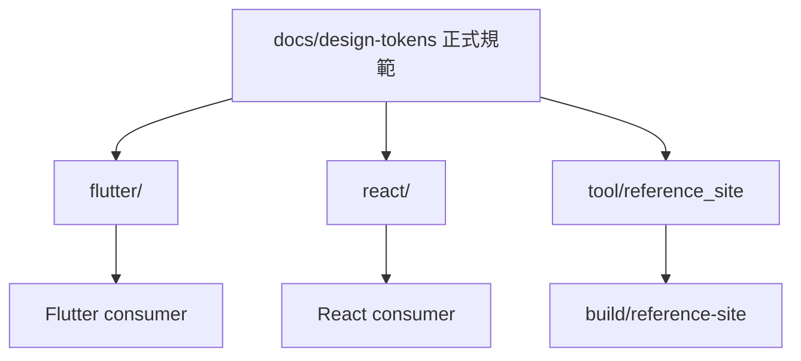
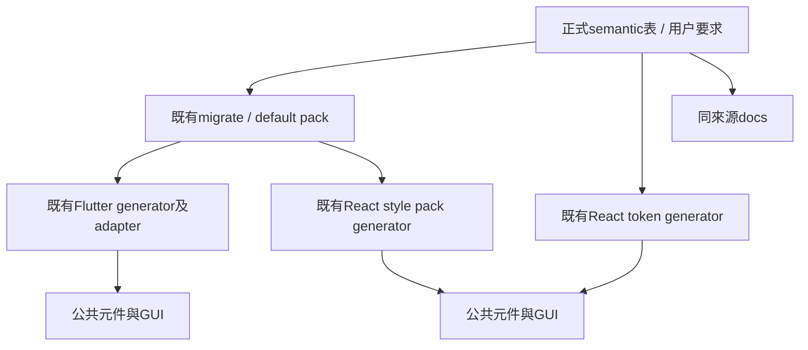

# Kallopis Repository Integration

修訂：`MULTI-FRAMEWORK-r1`；已實作；驗證及既有失敗見 [整合紀錄](docs/architecture/multi-framework-verification.md)。

根目錄擁有共通視覺規範、docs 網站及框架整合；各框架庫為第一層子目錄。契約見 [目標](spec/multi-framework-design-system.md)、[框架目錄](spec/framework-directory-v1.md)、[React v1](spec/react-foundation-v1.md)。

## 目前整合切片

`FRAMEWORK-MOVE-1` 只負責 FD-01～04。搬移 `lib/`、`assets/`、`test/`、`example/`、`pubspec.yaml`、`pubspec.lock`、`analysis_options.yaml` 至 `flutter/`；根 Flutter 專用 tool 及 support 移至 `flutter/tool/`，`tool/reference_site` 留根。既有路徑內引用保持框架相對路徑；只調整指向共通 spec／docs 的根路徑。版本與 package 名稱不改。

PLAN owner 可寫本檔、相關共通規格與框架架構。搬移 worker write boundary 為以上原位置／新位置、`.github/workflows/ci.yml`、`.gitignore`、`.vscode` 接入設定、`README.md`、`AGENTS.md`、`docs/ai` 與架構入口，以及 reference-site 的 extractor／操作文件／package script。新 React 程式不屬本切片；既有測試只能機械搬移，斷言及 baseline 不能被弱化。

驗收：搬移 source digest 對照；pub get、Flutter 靜態分析與既有局部／CI 閘門；example 接入；inventory 新鮮度；reference manifest 可抽取且 docs 產生／驗證通過。若既有工作樹本身已有 failure，先取得搬移前 baseline，再分離新路徑問題與既有問題。

根 CI 的 Flutter jobs 使用 `flutter/` working directory；website 指令顯式從根執行。React 的 CI gate 隨 React module integration 接入，發布設定不變。Flutter release 版本讀取 `flutter/pubspec.yaml`，CHANGELOG 暫保留 repository 根。

里程碑：M1 完整保留與搬移；M2 工具／CI／文件接線；M3 新目錄驗證及消費指南。冷啟動估算 6k–12k tokens／30–75 分鐘；無可靠歷史耗時。任何需要修改產品 repo、元件 API 或規範數值時先回 PLAN。

## 子模組

本階段新增：[Workbench v1 整合計畫](docs/architecture/workbench-stage-v1.md)，執行已接受的双框架 Workbench、所有元件互動 docs、GUI 範例及可替換風格；狀態與 slices 以該文件及各 module 架構為準。

- [共通 style pack](styles/architecture.md)（STYLE-PACK-r1，PLAN READY，尚未切換資料權威）

- [Docs 網站](tool/reference_site/architecture.md)
- Flutter 模組架構由原 `lib/architecture.md` 隨搬移保留至 `flutter/lib/architecture.md`。
- React 核心庫架構位於 `react/architecture.md`。

BUILD 使用隔離工作樹及真實 base revision；主工作樹既有變更不重設、不無差別 stage。完成後只同步本目標的新變更，主工作樹若有新的同檔編輯則先比對，不覆寫。

整合完成：Flutter source／資產與既有測試已機械搬移，工具、VS Code 與 CI 路徑接回新目錄；React 核心庫與語意生成器完成，CI 接入 build／test／check:tokens／example 型別及建置檢查。產品使用指南依框架分開，docs 網站統一提供來源頁及搜尋；未部署或發布。

## COMPACT-DEFAULT-STYLE-1（READY）

修訂 COMPACT-DEFAULT-STYLE-r1；2026-10-13使用者已授權降低按鈕對比與版面區塊總gap一律8px。正式值權威仍docs/design-tokens/semantics.md，不改舊匯出快照或品牌名稱；四mode主動作底色theme.colors.brand改為現有柔和中性primitive（light parchment250、dark/transparent parchment700、ultraDark ink700），文字由既有primaryForeground算法解析，不新增secondtheme。accent/interaction/status語意保持。layout parent owns total8：space2/contentStack/chrome及resizeHandle既有8保持，itemGap/groupGap/navigationSectionGap/base改space200；PanelFrame/dockMargin改space0，避免8gutter+兩側4變16。其他內距、字級與chrome高度不隨此要求全部變8，零尺寸時仍按既有solver縮配。可替換pack能力及consumer顯式prop保持，不硬編碼算法8。

example另一份風格只改buttonPaddingX為24，不再把區塊gap改24或actionGap改12；雙框架GUI及component展示一起接回。ADVANCED-FORM十四source M1保留但native未驗證、不計入176已驗證數。

BUILD跨module整合exact paths：docs/design-tokens/semantics.md；styles/kallopis-v1.json由既有migrate生成；Flutter生成data/manifest（flutter/lib/src/styling/style_pack/generated.dart、source-manifest.json）；React由既有生成器產生react/src/generated.ts、tokens.css、source-manifest.json、style-pack-data.ts、style-pack-manifest.json；example Flutter component_specimens.dart/gui_scenarios.dart及React example/specimens.tsx/scenarios.tsx只調替換pack參數。scripts/runtime/catalog/schema/庫algorithm/tests/config皆唯讀。正式表格增加規則文字而無新ID，仍350semantic與269primitive。

獨立Test Author exact styles/test/compact-default-style.test.mjs，公開resolveStylePack與defaultpack/catalog保護四mode主動作底色與component底對比低於2.5（保留文字現有算法），layout gap IDs8與default dockMargin0；實作前behavior Red，SHA記錄；既有tests不能由worker改。M1 acceptedpreset資料與generated freshness/原114+新增checks；M2 Flutter protectedstyle19與必要Reactprovider、build、雙框架nativebutton及Dock實際gap8/同consumer資料；M3 docs及guard main sync。估5k～12k/30～75分鐘；M1累計5k30、M2累計10k60、M3累計12k75；18k110或新algorithm修改回PLAN。視覺感官human-pending；單taskusage null。

## MODERN-PRODUCTIVITY-v1（IMPLEMENTED）

共通契約由 [現代風生產力佈局框架契約](docs/architecture/modern-productivity-layout-contract.md) 擁有，產品需求由 [規範](spec/modern-productivity-layout-v1.md) 擁有。使用者已擴大目標為可迭代公開模板，PSS-10～14 由 r2 契約與以下 consumer／docs slices 接入。核心切片保留，完整 stage 包含公開細節調整、最小 starter、真實預覽及文件站接入；六個主切片與公開清冊接入均已實作，局部 scope gates／consumer 與 browser 證據已完成；遠端 CI／部署另記實際結果。

| 順序／slice | 模組與 BUILD write_paths | 對應需求與驗收 |
| --- | --- | --- |
| 1 MODERN-PRODUCTIVITY-FLUTTER-1 | flutter；lib/src/features/workspace/layout/klp_modern_productivity_layout.dart、lib/kallopis_foundation.dart | PSS-01～06／08／09／11 的核心責任；公開 Widget 幾何、受控切換與保留面板、語意與錯誤；公開 consumer analyze |
| 2 MODERN-PRODUCTIVITY-REACT-1 | react；src/modern-productivity-layout.tsx、src/index.ts | PSS-01～06／08／09／11 的核心責任；同共同樣本／有限幾何／inactive focus／stable id；package build 與 typed consumer |
| 3 MODERN-PRODUCTIVITY-FLUTTER-TEMPLATE-1 | flutter/example；lib/main.dart、lib/modern_productivity_starter.dart、lib/modern_productivity_preview.dart | PSS-10～13；public consumer、r2 調整／重設／草稿／複製設定的真實 browser 證據 |
| 4 MODERN-PRODUCTIVITY-REACT-TEMPLATE-1 | react；example/main.tsx、example/modern-productivity-starter.tsx、example/modern-productivity-preview.tsx | PSS-10～13；typed consumer、相同 r2 設定與 browser 證據 |
| 5 MODERN-PRODUCTIVITY-TEMPLATE-DOCS-1 | docs/templates；modern-productivity-layout.md | PSS-10／13／14；starter 來源、參數／semantic 對照、版本及實際預覽 URL，未交付明示 |
| 6 MODERN-PRODUCTIVITY-TEMPLATE-SITE-1 | tool/reference_site；documents.mjs | PSS-14；新模板頁／搜尋／連結、既有 bundle 的 template 路由，原 generate／verify |

每個 slice 為一個框架內完整公開元件；實作文件不跨模組寫入。框架先後只為減少協調，不使 React 依賴 Flutter 私有實作。Test Author 先建立共同契約的保護檢查，精確路徑見共同契約；BUILD 不得更改。獨立角色的 dispatch 在 BUILD 階段進行，本次 PLAN 不建立 agent。

估算皆為 cold-start：Flutter 5k–10k tokens／40–80 分鐘，React 5k–10k／40–80 分鐘；參照 FLUTTER-LAYOUT-2、REACT-LAYOUT-2 與既有 consumer fixtures 的責任規模，非已量測耗時。模型沿用 session 設定，工具使用本機 SDK／Node 及既有測試環境。每 slice M1 為 public API／兩欄與受控切換（累計 4k–6k／30–45 分鐘，public analyze／build 與核心檢查）；M2 為面板保留／inactive 隔離／極端幾何與公開 consumer（累計 5k–10k／40–80 分鐘，受保護測試及渲染 artifact）。超過 15k tokens／120 分鐘、需要改 solver／theme／測試環境或新增業務狀態層，停止 BUILD 回 PLAN。完成每個 milestone 才報結構化 checkpoint；感官 human-pending。

下一個 Task Packet 建立前，先重查 Git 狀態並選可用隔離 checkout，將已接受契約與必要原有內容帶入，記錄真實 base revision、精確 write_paths、獨立 tests hash 及 milestone；主工作目錄 dirty tree 不作可直接提交的基線。不得直接以舊交接 checkpoint 發派或無差別 stage。

模板 slices 的 cold-start 估算：每框架 consumer／preview 4k–8k tokens／30–60 分鐘，參照既有 component-specimen 與雙框架 GUI 接線；文件與站接入各 1k–3k／10–20 分鐘，參照 DOCS-STAGE-1。模型沿用 session 設定，本機 SDK／Node 與 CUA browser。Preview M1 是 starter 與路由可執行（累計 3k–5k／20–35 分鐘，public analyze／build），M2 是真實調整、草稿保留與片段重套用（累計 4k–8k／30–60 分鐘，browser artifact）。12k／90 分鐘或需要改 core／pack schema 回 PLAN。Docs／site 各只有 M1（來源與頁面／搜尋／版本／連結）；4k／30 分鐘或 renderer／workflow 新能力回 PLAN。

所有本 stage P1 已分配責任與證據；實作順序 core→對應 starter／preview→文件→站接入。每個 BUILD Task Packet 固定所在模組的 exact write_paths，consumer、文件與 core 不混派。GitHub 整合／部署沿用既有發布流程並另外觀察結果；不變更套件 private 標記、不宣稱 npm 已發布。

## MODERN-PRODUCTIVITY：公開清冊接入

既有 extraction 已觀察 Flutter 563 canonical 與 React 24 元件；新增公開 API 需接入 Catalog／specimen，依兩框架架構的 MODERN-PRODUCTIVITY-CATALOG-1／REFERENCE-1 exact boundaries。不修改既有清冊閘門或列入假 coverage。API manifest 與 inventory 由整合 owner 從真實 source 刷新；公開欄位 dartdoc 由 API-DOCS-1 精確主檔維護。
