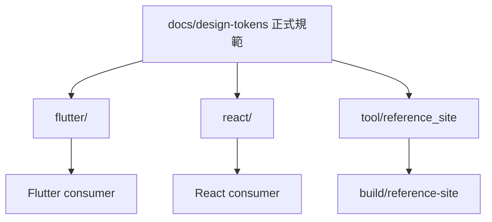

# Kallopis Repository Integration

修訂：`MULTI-FRAMEWORK-r1`；已實作；驗證及既有失敗見 [整合紀錄](docs/architecture/multi-framework-verification.md)。

根目錄擁有共通視覺規範、docs 網站及框架整合；各框架庫為第一層子目錄。契約見 [目標](spec/multi-framework-design-system.md)、[框架目錄](spec/framework-directory-v1.md)、[React v1](spec/react-foundation-v1.md)。

## 目前整合切片

`FRAMEWORK-MOVE-1` 只負責 FD-01～04。搬移 `lib/`、`assets/`、`test/`、`example/`、`pubspec.yaml`、`pubspec.lock`、`analysis_options.yaml` 至 `flutter/`；根 Flutter 專用 tool 及 support 移至 `flutter/tool/`，`tool/reference_site` 留根。既有路徑內引用保持框架相對路徑；只調整指向共通 spec／docs 的根路徑。版本與 package 名稱不改。

PLAN owner 可寫本檔、相關共通規格與框架架構。搬移 worker write boundary 為以上原位置／新位置、`.github/workflows/ci.yml`、`.gitignore`、`.vscode` 接入設定、`README.md`、`AGENTS.md`、`docs/ai` 與架構入口，以及 reference-site 的 extractor／操作文件／package script。新 React 程式不屬本切片；既有測試只能機械搬移，斷言及 baseline 不能被弱化。

驗收：搬移 source digest 對照；pub get、Flutter 靜態分析與既有局部／CI 閘門；example 接入；inventory 新鮮度；reference manifest 可抽取且 docs 產生／驗證通過。若既有工作樹本身已有 failure，先取得搬移前 baseline，再分離新路徑問題與既有問題。

根 CI 的 Flutter jobs 使用 `flutter/` working directory；website 指令顯式從根執行。React 的 CI gate 隨 React module integration 接入，發布設定不變。Flutter release 版本讀取 `flutter/pubspec.yaml`，CHANGELOG 暫保留 repository 根。

里程碑：M1 完整保留與搬移；M2 工具／CI／文件接線；M3 新目錄驗證及消費指南。冷啟動估算 6k–12k tokens／30–75 分鐘；無可靠歷史耗時。任何需要修改產品 repo、元件 API 或規範數值時先回 PLAN。

## 子模組

本階段新增：[Workbench v1 整合計畫](docs/architecture/workbench-stage-v1.md)，執行已接受的双框架 Workbench、所有元件互動 docs、GUI 範例及可替換風格；狀態與 slices 以該文件及各 module 架構為準。

- [共通 style pack](styles/architecture.md)（STYLE-PACK-r1，PLAN READY，尚未切換資料權威）

- [Docs 網站](tool/reference_site/architecture.md)
- Flutter 模組架構由原 `lib/architecture.md` 隨搬移保留至 `flutter/lib/architecture.md`。
- React 核心庫架構位於 `react/architecture.md`。

BUILD 使用隔離工作樹及真實 base revision；主工作樹既有變更不重設、不無差別 stage。完成後只同步本目標的新變更，主工作樹若有新的同檔編輯則先比對，不覆寫。

整合完成：Flutter source／資產與既有測試已機械搬移，工具、VS Code 與 CI 路徑接回新目錄；React 核心庫與語意生成器完成，CI 接入 build／test／check:tokens／example 型別及建置檢查。產品使用指南依框架分開，docs 網站統一提供來源頁及搜尋；未部署或發布。
