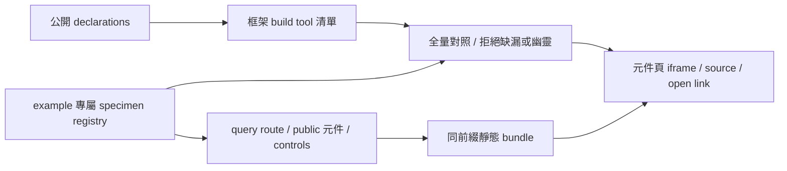

# 互動元件清單契約

修訂 `IDOC-COMPONENT-REGISTRY-r1`，READY。來源為已接受 interactive-docs-v1 的 IDOC-01～03、06～08。本階段交付公開元件識別、專屬展示路由及兩框架 bundle；GUI 場景依原完整規格接續，不縮減範圍。

## 公開清單與展示責任

React build tool 從公開 `dist/index.d.ts` 的 TypeScript exports 解析 callable 的明確 React JSX.Element／ReactElement／ReactNode return annotation（包含 nullable union、泛型及 barrel alias），排除 interface／type／資料 class／一般函式；不掃 private source、不以 Klp 前綴猜測元件。公開 alias 使用 export name，canonical ID 為 `@kallopis/react#<exportName>`。輸出 schemaVersion 1、framework react、entrypoint @kallopis/react、components，按 export name UTF-16 排序；每筆 id、name、source（package-relative declaration 檔）、signature（對應公開 callable declaration）、propsType（首參數公開型別文字，可空）。無編譯錯誤、重複 ID、無效輸入或缺失入口才可輸出，錯誤不得覆蓋舊產物。

Flutter 清單仍從三個公開 barrel manifest 推導實際 Widget subtype；所有具體 class modifiers 都包含，abstract 不要求可直接實例化的 specimen。公開 inherited／host Widget 以自己的參數或 host callback 變化示範；enum／資料／extension 不算呈現元件。不得恢復固定254清冊或以 coveredComponents／只有名稱的 Catalog 項目當作可操作展示證據。

展示 registry 由各 example 擁有，key 是 canonical ID／export name，value 為實際公開元件組裝、可改參數／資料、callback 狀態、重設及使用例。共享 compound fixture 可以供多個元件，但每個 route 必須選中當次元件並呈現它的控制，不退回無關總覽。找不到 route／build 顯示明確未完成狀態；完整網站發布閘門拒絕缺項／幽靈項目，不用 placeholder 完成 coverage。

## 網頁接線

兩框架 consumer 讀 `?specimen=<publicName>`，可直接刷新並保留 selected specimen；bundle 位於 `/Kallopis/examples/react/`、`/Kallopis/examples/flutter/`。網站每個實際可呈現元件頁嵌入帶 title 的對應 URL，提供獨立開啟及公開使用例。頁面的 loading／load error 可識別；sandbox 不阻止必要的鍵盤／clipboard／drag操作，不跨窗執行產品業務。單一展示可切四模式、另一 style pack及可用寬度；原產品輸入在風格切換時保留，重設由使用者明確要求。

跨 module 規則由本契約擁有；各 module root architecture 指定當前 BUILD write boundary。新測試只保護跨框架／發布清單邊界、alias與排除錯誤，不建立固定數量快照；感官品質 human-pending。
