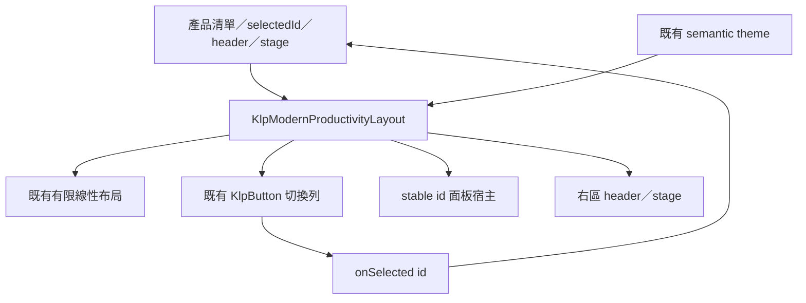
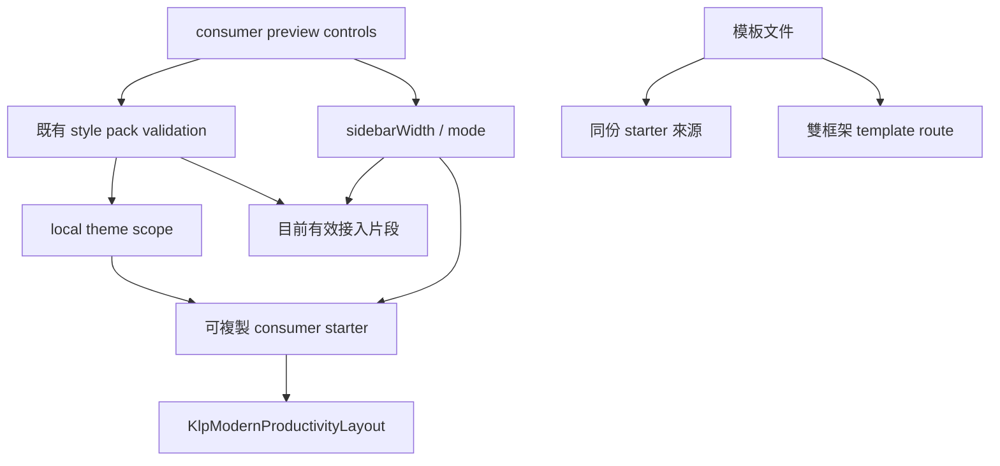

# 現代風生產力佈局：框架共同契約

修訂：`MODERN-PRODUCTIVITY-r2`。核心元件 IMPLEMENTED；依 [已接受規範](../../spec/modern-productivity-layout-v1.md)。本檔的核心元件 slice 為 Flutter／React 可重用受控元件。完整交付目標已擴為可迭代公開模板；PSS-10～14 的公開細節調整、consumer 起始範例、互動預覽與文件接入已納入下方 r2 PLAN，不能以兩個核心元件 slice 關閉模板交付。現有核心 worker 邊界不因此自動擴張。感官品質 human-pending。

## 公開邊界

兩框架公開名稱皆為 `KlpModernProductivityLayout`；功能資料為 `KlpModernProductivityPanel`。Flutter 從 foundation 匯出，React 從 package index 匯出。這是視覺組合，不是 Dock、導航 registry 或產品 runtime。

| 輸入 | 共同含義 |
| --- | --- |
| panels | 非空、有序功能清單；每項為非空唯一 id、非空 label 及框架原生 content。label 同時用於切換按鈕的可存取名稱。 |
| selectedId | 必須存在於清單；目前選取由產品擁有。 |
| onSelected | 接收按下的另一項 id；可為 null／undefined，此時所有切換按鈕停用，仍顯示目前選取。按目前項不發事件；元件不自行提交選取。 |
| header | 必要的框架原生內容，只放在右區頂部。 |
| stage | 必要的框架原生主工作內容，放在右區 header 下方。 |
| sidebarWidth | 可選的有限正值；省略時讀 theme.geometry.layout.primaryPaneWidth。是期望寬度，宿主空間不足時依既有有限布局規則縮配。 |

框架原生 content 為 Flutter Widget／ReactNode；不要求 consumer 引用 private API。React 函式 props、Flutter constructor 的具體型別由各框架映射以上共同契約。新增 API 不改既有右側欄與 Dock 能力。

## 幾何與樣式

宿主提供有限寬高；零尺寸合法並裁切，無界尺寸明確回報開發者使用錯誤。外層兩欄：左側全高 sidebar，右側 header／stage。Header 不跨左欄，也不在左欄插入對齊空白。Stage 分配剩餘高度。沒有 rightSidebar／trailingPanel 插槽。

優先組合既有一般線性布局及有限尺寸解析，不新增 solver。Root inset 與欄間距由既有 layout 語意擁有，一處配置，不疊加 dock margin。側欄遵循 frame-sidebar 語意、右區遵循 stage-frame／surface-stage；header 最小尺度讀 chromeHeader。Switch 按鈕沿用既有 KlpButton selected／disabled／hover 配方，切換列在側欄內橫向排列；超寬時列本身可橫向捲動，不擠出第二側欄或隱藏功能。

現有 Flutter KlpSidebarButtonGroup 為垂直且必需 icon 的導航群組，不適用本契約的橫向文字按鈕列；不改其既有 API。Flutter 可重用 KlpStageFrame；React 以既有公開 Frame／layout／Button 與同語意組成。不得複製按鈕樣式或新增色彩預設。

## 狀態、生命週期與錯誤

產品擁有清單、選取與內容資料。使用穩定 id 維持面板元素身分；切換保持所有清單面板掛載，只有選中內容參與布局、繪製、可存取樹與焦點。Flutter 使用 IndexedStack／Offstage 對應能力、ExcludeFocus 與 TickerMode；React 保持具 id key 的面板 mounted，以 hidden 隔離非作用面板。換 theme 或 header 不重建清單面板。

移除 id 才釋放該面板；產品須同步提供仍有效的 selectedId。元件不自動挑第一項、不儲存到 localStorage、不持有產品 controller、不接管正文或 undo。按鈕使用原生鍵盤操作與選取語意，不宣稱為具方向鍵契約的 tabs。切換不強制移動焦點到面板內容。

空清單、重複／空 id、空 label、不存在的 selectedId、非法 sidebarWidth，皆在公開邊界回報 ArgumentError／TypeError；失敗不發切換事件或改產品資料。無界尺寸錯誤由框架宿主邊界回報，不回傳 Infinity／NaN。產品原右側欄的功能對照清單由產品擁有，不由共用元件分析功能樹。

## 責任與依賴

| 類別／函式責任 | 擁有者 |
| --- | --- |
| KlpModernProductivityPanel | immutable 呈現資料；不含 repository、業務命令或持久化 |
| KlpModernProductivityLayout | 公開輸入驗證、兩欄組合、受控事件與 semantic 投影 |
| validate inputs（框架私有函式） | 同一公開邊界的清單／選取／寬度檢查；不建立新 validator layer |
| build／render switcher | 既有按鈕及選取、停用、回呼映射 |
| build／render panels | stable id 掛載與 inactive 隔離；產品持有資料 |

選擇單一受控組合元件，因多作品需要一致的角色限制與面板切換生命週期。只寫產品範例會重複這些共通責任；套用 Dock 會引入與本 stage 無關的右／底區、拖放與保存。後續窄版、收合、resize 仍另行接受，不預造 controller 或通用 slot tree。

## 本 stage 的證據與保護

PSS-01／PSS-05：兩框架公開 import 的 consumer 編譯。PSS-02／PSS-03：最上層元件有限／零／窄尺寸、不同 header 高度的矩形與裁切檢查。PSS-04／PSS-08：只有 sidebar 與 stage-region，兩功能切換／controlled update／null callback／選中回呼，沒有右側欄。PSS-06：theme 切換及非預設 semantic width／gap 可觀察，沒有額外材質／gap。PSS-09：輸入不變、草稿 A→B→A、重排 stable id、非作用面板無焦點與可存取輸出；非法輸入明確拒絕。

幾何、inactive 焦點及生命週期有人工難以可靠涵蓋的回歸風險，必要測試由獨立 Test Author 固定；BUILD 只能讀與執行。Flutter 唯一新測試路徑 flutter/test/modern_productivity_layout_test.dart；React 為 react/test/modern-productivity-layout.test.mjs，使用既有 Node／jsdom 環境。既有 workbench-layout.test.mjs 已提供 ResizeObserver／CSS 尺寸的測試 seam 可作參考；jsdom 不代表真實瀏覽器布局或焦點，實際渲染與 inactive 鍵盤巡訪仍需瀏覽器證據。若既有環境不能量測 DOM／focus，先回 PLAN，不能用 SSR 字串冒充這項證據或修改測試配置。

架構、共通規範、theme、tokens、solver、既有 tests／fixtures／goldens、example、網站、配置與 CI 皆對 BUILD 唯讀。驗收 scoped analyze／React build、受保護局部測試、public consumer；不預設新增 golden。必要 rendered artifact 與人類感官接受分開記錄。

## 模板整合的新增邊界

需求權威為規範 PSS-10～14，消費端入口為 [模板文件契約](../templates/modern-productivity-layout.md)。原 core plan 的 sidebarWidth 已提供一項調整入口；Header、gap、radius 與按鈕尺度透過現行 style pack 的精確映射與適用範圍，以下方 r2 表格為準。不要為了調參添加另一份 defaults、任意 CSS escape 或替換 pack parser。

完整模板 PLAN 已由下列調整契約及根整合 slices 補齊。所有 slice 通過前，禁止宣稱公開模板已可快速套用。

## r2：可調整模板與預覽契約（IMPLEMENTED）

模板只有同一公開元件與兩框架的最小 consumer starter，不新增 KlpModernProductivityTemplate 別名、第二份 layout renderer 或設定 store。Starter 是可複製的產品接線，預覽匯入並使用它；文件連到同一來源，不維護第二個過期範例。

| 調整 | 公開入口／權威 | 適用範圍 |
| --- | --- | --- |
| 側欄寬度 | sidebarWidth／theme.geometry.layout.primaryPaneWidth | 本模板左欄；屬期望寬度，有限 host 可縮配 |
| Header 最小尺度 | theme.spacing.chromeHeader | 右區 header；內容較高時仍依原 Stage contract |
| Root／兩欄間距 | theme.spacing.space2 | 同 scope 一次 inset／gutter；不可疊加側欄 margin |
| 按鈕列間距 | theme.spacing.actionGap | 側欄內 switcher |
| 側欄 Frame 圓角 | theme.shape.panel | frame-sidebar；不把原本沒有 radius 的 stage 強加圓角 |
| 切換按鈕尺度 | theme.geometry.control.buttonHeight（預設中尺度）及既有按鈕配方 | 沿用正式按鈕 resolver；不以全域 CSS 固定高度 |

Core 元件在既有 role／resolver 下落實以上用途；若現有公開元件不能正確映射，不擅改其他元件或新增另一份值，回本 PLAN 補上必要契約。Local style pack override 使用目前作用 mode 的 canonical IDs，preview 可選四 mode，參數缺省讀真正 defaults。所有值使用既有 pack parser／catalog 驗證；非法值顯示錯誤並保留上一份有效設定與 consumer 草稿，不提交半套參數。

Preview 入口皆為 ?template=modern-productivity-layout。只有此 id 合法；空值／未知 id 明確顯示錯誤，不回無關 Catalog。現有 scenario／specimen 路由保持；若 template 與兩者並存明確拒絕歧義。Preview 在模板外放控制區，模板內仍只有左欄與 Header／Stage；有兩個示例面板，其中一個代表原右側輔助功能，並各有可輸入草稿。調整數值、切換 mode、A→B→A 後兩面板草稿與 selectedId 都保留，重設設定僅清除 overrides，不重設產品資料。

設定輸出為可複製的框架接入片段：目前 sidebarWidth、作用 mode、標準 style pack overrides 及使用公開 parser／override API 的程式碼。它是既有 props／pack 的投影，不新增設定交換 schema、匯入執行器或任意程式執行；同份 overrides 應在兩框架驗證得到一致的 canonical 值。片段標記 template id、契約版本 v1 及實際 package version。複製動作提供成功／失敗回饋，並保留可手動選取的文字輸出。

測試與證據：core 獨立 tests 增加上述 semantic width／gap／radius／header／button-height 的用途，不測鏡像實作。Preview 與 starter 由 public analyze／typed build、真實 browser 的調整／重設／切換／草稿／輸出重套用證據驗收，感官 human-pending。Docs 原有 generate／verify 保護頁面與搜尋；不新增鏡像文案測試。發版相容性由既有套件版本與變更記錄維護，schemaVersion 不強塞入 layout 元件 props。

