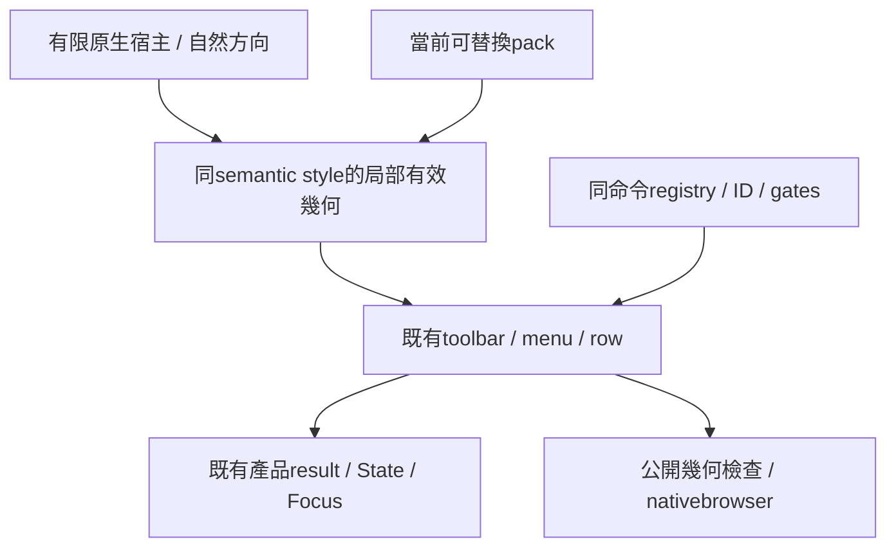

# Registered command入口的有限幾何

WB-COMMAND-ENTRY-GEOMETRY-r1 READY，依[入口契約](workbench-command-entry-contract.md)、[style pack](../../spec/style-pack-v1.md)及[Workbench](../../spec/workbench-v1.md)。目標是既有toolbar／menu在有限宿主及合法可替換風格下保持布局語意；公開constructor、命令清冊、順序、角色、鍵盤、focus／async生命周期不改。這是錨定／context menu重用既有menu的前置，不重寫rows或handler到第二份popup模型。

## 共同有限規則

- width／height、padding／icon／gap／minimum讀當前原生constraints及同semantic style；有限尺寸先非負化，非法NaN／Infinity幾何值退化為0。有限宿主的有效寬高不可超出父槽；零尺寸合法，內容clip／scroll且不RenderFlex overflow。自然／unbounded方向保持既有自然測量，不以Infinity當可用像素也不把自然模式硬改零。
- menu偏好width沿geometry.layout.commandMenuWidth；實際width<=有限宿主width。menu外padding讀spacing.tight，<=實際width/2，有限height時也<=height/2。沒有空間時先限制padding，不能讓它增加有限宿主外尺寸。
- row左右padding以目前menuPadding或原toolbar buttonInsets解析，有限width時总水平padding<=row width；對稱padding各<=width/2，非對稱padding按原比例縮配。剩餘width非負；decorative icon<=剩餘width/2；有icon才保留gap，gap<=剩餘width-icon。沒有icon不預留空槽。文字槽占剩餘、nowrap／ellipsis／clip，不破壞ID／order／enabled／checked。
- row自然height／minimum保持同style，有限scrollport可裁切或捲動；不將原style值寫回風格檔、registry或產品資料。toolbar wrap依可用width，不能讓單row內圖示／內距／gap造成水平RenderFlex overflow；finite viewport裁切scroll內容。
- 同style／viewport變化保留產品controller／State、同ID focus owner、checked／pending與命令結果；背景產品資料仍由產品擁有。hover／focus／checked保持原semantic selectionWash。不得copy第二份預設theme或在consumer繞過resolver。

## Native接入

Flutter既有command_entries唯一source擁有constraints／row有效幾何；menu自然scroll及原Focus/Semantics不改。只使用public theme與原生LayoutBuilder／constraints。React既有command-entries與其scope CSS擁有DOM實際可用尺寸與有效CSS變數；client geometry優先、ResizeObserver可用時刷新並安全cleanup，無layout DOM保留合理自然fallback。不得修改Provider／style parser或以viewport window寬度取代真實有限容器寬度；不把paint transform尺寸當布局像素。兩端有效值是局部呈現，原pack保持。

## 必要證據／責任

fresh獨立TestAuthor各有新檔：Flutter test/registered_command_entry_geometry_test.dart、React test/command-entry-geometry.test.mjs。最低直接保護公開入口的檢查：零／極窄有限宿主、巨大合法padding／icon／gap／menu width、icon有無、缺乏可用空間的clip／scroll；原ID順序／toggle／權限與同State／focus／controller在style／size更新保持；標準足量host不無故改style。不是pixel／golden／感官評分；若DOM環境無layout，author明示fixture量測與nativebrowser必驗，不sourcepattern／私有helper鏡像。

原Flutter23與React12 protected入口checks唯讀，改同入口的Yellow需重驗。Flutter BUILD只既有command_entries source；React BUILD只command-entries.tsx與其styles.css區段，index／theme／core／其他CSS區段／palette／tests／config／example／architecture唯讀。各framework architecture READY後發exact packet、cleanbase、estimate／milestones及hash。nativebrowser正常與極端style矩陣另記，全部GUI／逐元件docs與快捷鍵仍未完成。

## 已觀察實作證據

Flutter BUILD1bdd6321：新6＋原23共29checks Green，publicanalyze／scope1／releaseweb通過，正常native入口可操作並保留草稿。React BUILDaff1eaf4：新11 Node tests（含父項）＋原12共23Green，librarybuild／consumer typecheck／scope2通過；native正常及百萬pixel參數完整JSON import、default還原均保留草稿／checked。Test Author檔案與原tests hashes保持，細節見各framework architecture。

零／窄有限槽與極端參數已有deterministic保護；Flutter極端native及Reactfiniteheight／精確窄viewport矩陣仍pending。此次Reacttab10 override未實際套用，不宣稱其320×180通過。感官接受human-pending；不以此宣稱完整參數audit、全部網站互動或GUI完成。

