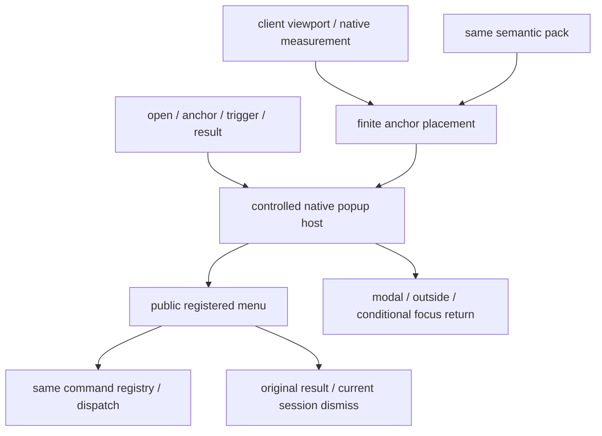

# 錨定與 context 命令選單

WB-COMMAND-POPUP-r1 READY，依[Workbench WB-09／10／16](../../spec/workbench-v1.md)、[registered入口](workbench-command-entry-contract.md)與[有限入口](workbench-command-entry-geometry-contract.md)。當前stage只增加受控popup宿主；同一registered menu擁有rows、registry查詢、keyboard及dispatch。產品擁有開關、錨點與觸發事件，不新增handler、業務context或產品路由模型。

## 公開資料與組合

兩端公開generic `KlpRegisteredCommandPopup<C>`，必填registry／getContext／items／label／emptyLabel／onResult，沿既有menu型別；另必填open、anchor及onDismiss。Flutter anchor為原生Rect，React anchor為readonly `{ x, y, width, height }`，使用同一宿主視窗的邏輯viewport座標，不乘devicePixelRatio。x／y須有限，width／height須有限非負；違反以ArgumentError／TypeError拒絕。Rect零寬高合法，代表context pointer位置；按鈕選單使用按鈕bounds。產品在錨點移動時更新受控anchor；庫不巡查產品Widget／DOM tree，也不自行接管所有右鍵事件。

Flutter key與React className／id只作原生宿主定位；不公開能覆蓋內部geometry的style入口。Flutter公開enum `KlpCommandPopupDismissReason { escape, outside, executed }`；React同字串union。onDismiss只輸出意圖，不改open；產品採用false才移除。同session同意圖最多一次，忽略後保持選單可操作；重新open建立新session。

Popup直接組合公開KlpRegisteredCommandMenu，autoFocus=true，onDismiss接Escape、onResult接產品原結果。menu仍依items順序／kind／registry gates呈現，disabled／running不執行、error保持open。成功先交產品onResult，再在同session且仍open時輸出executed；callback拋錯沿宿主error通道且不自動關閉。close／reopen／unmount／registry replacement隔離過期結果與dismiss，不能關掉新session。

## 有限位置與風格

viewport取原生可用client／overlay constraints，非有限尺寸非負退化0。inset讀目前geometry.layout.overlayViewportInset，非有限退化0，限制於viewport短邊的一半。panel偏好寬讀同commandMenuWidth，實際寬<=扣inset後的viewport；無空間為0。anchor邊先夾入viewport再運算，不讓巨大合法座標相加溢位。

水平方向先依Directionality排列（LTR對齊anchor左緣，RTL對齊右緣），最後夾入有效viewport。垂直先放anchor下方；內容可容納則不翻轉，下方不足且上方可容納時放上方；兩邊都不足選可用空間較大的一側，同量選下方，height受該側限制並可scroll。anchor已在邊外時仍有限。原生內容量測只影響位置及scrollport，不改items／registry／stylepack；尺寸及style變更保留同ID焦點和產品State。

初次量測與後續native resize採同值guard，安全解除observer／listener／postframe owner，不持續排程frame。不使用transform後rect當viewport像素。React menu自然scrollHeight可作內容高度參考；Flutter原生menu RenderBox的受限內容量測可逐frame收斂，不能讀私有row或複製一套測量模型。

## Modal 與生命週期

單一popup為modal選單：背景pointer及可操作語意暫停，沒有背景click-through。外側pointer只輸出outside；背景controller／State不卸載。可命名的原生外側dismiss亦可操作，不能只依Windows ModalBarrier的不可達語意。關閉或卸載解除modal層，若焦點仍屬本popup才回到開啟前仍存在且可聚焦的owner；產品已移焦到其他owner時不搶回。Tab留在menu可用入口（無可用項時root），Escape只一次。既有menu keyboard契約不重寫；popup不新增文字輸入或第二份IME權威，組字保護由文字宿主及後續快捷鍵契約承擔。沒有submenu／多層menubar／完整assistive-tech認證宣稱。

Flutter獨立OverlayEntry刷新同caller captured Theme／locale／Directionality；BlockSemantics放在locale容器外層，原生Focus scope閉合。React native dialog showModal取得top layer／inert，dialog保留在同Provider DOM內沿原CSS scope繼承，無需portal或第二Provider/default。全viewport透明dialog提供外側pointer與命名dismiss，有限menu容器負責錨定；aria menu／menuitem仍由registered menu提供。關閉時只移除此owner資源，不呼叫registry.dispose或修改產品資料。

## slices 與證據

fresh TestAuthor各只新增一份公開popup UI測試，最少保護：anchor point／矩形及四邊有限位置、偏好下方與翻轉、零viewport／極大合法style、同menu順序／checked／gate／結果、controlled Escape／outside／executed／error、stale session、focus與background State／controller保留、modal可操作語意及cleanup。非pixel／golden／私有helper鏡像；缺native layout時明示fixture供應的量測及nativebrowser另驗。

Flutter library slice只新command_popup來源與stablefoundation匯出；React只新command-popup.tsx／index.ts匯出／styles.css追加popup scope。既有menu／palette／core／theme／tests／config唯讀；如menu公開能力不足必須回PLAN，不在popup複製rows。library完成後另packet接公開consumer的button及右鍵point觸發，實際browser觀察及網站Guide／API頁，不以synthetic checks代替。

依據：[Flutter OverlayEntry](https://api.flutter.dev/flutter/widgets/OverlayEntry-class.html)的insert／remove／dispose生命週期、[原生dialog modal](https://developer.mozilla.org/en-US/docs/Web/API/HTMLDialogElement/showModal)的top layer及同document inert、[contextmenu事件](https://developer.mozilla.org/en-US/docs/Web/API/Element/contextmenu_event)作產品trigger。iframe外層頁面不由iframe內dialog鎖定；瀏覽器保留操作仍屬平台限制。

