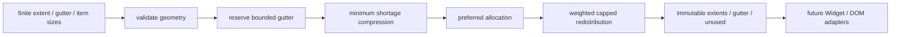

# Workbench 線性尺寸契約

修訂 `WB-LINEAR-r1`；READY。對應 WB-02／03／21、KLP-0024。共通契約只擁有有限主軸上的尺寸分配，不持有 Widget／React tree、panel、內容、產品狀態或儲存。

## 幾何與錯誤

輸入 extent、gutter 為有限非負 logical length，gutterCount 為非負整數。每個 item 有 minimum（預設 0）、maximum（可省略）、preferred（預設 0）、flex（預設 1）；各值有限非負，maximum 若提供不得小於 minimum。flex 可以是非整數；maximum 省略表示沒有額外上限，不接受 Infinity 作為輸入。非法資料直接拒絕，不修改 caller。

回傳 extents（與 items 次序一致）、實際 gutter、unused 與 compressed。所有輸出有限且非負；extents 加 gutter × gutterCount 加 unused 等於 extent（浮點誤差容許 1e-6 × max(1, extent)）。空 items 合法，仍保留指定 gutter 空間與 unused。輸入及輸出互相隔離，輸出不可變。

1. 先扣 gutter。實際 gutter 為 min(指定 gutter, extent／gutterCount)，count 為 0 時 gutter 為 0；所以極大風格間距最多占滿可用主軸，內容可退化為零，不溢出。
2. 若 minimum 總和超過內容預算，依 minimum 比例縮小到預算；只有此退化可低於 minimum。使用比例正規化避免巨大有限數值加總溢位。此時 compressed 為 true。
3. 否則先取每項 clamp(preferred, minimum, maximum)。若總和超出預算，按每項超出 minimum 的部分等比例縮小；minimum 不受侵犯。
4. 尚有空間時，只分給 flex > 0 且未達 maximum 的項目。按 flex 比例分配，達 maximum 的項目移出下一輪，剩餘空間再次分配；有限迭代，不能因巨大 flex 溢位或產生 NaN。
5. 沒有可增長項目時保留 unused；元件由 start／end alignment 決定留白的位置。不得為了填滿而突破 maximum。compressed 只表示 gutter 壓縮或 minimum 不可滿足，不表示 preferred 較小。

## 公開 adapter

Flutter 從 kallopis_foundation.dart 匯出 `KlpLinearItem`（const 資料類別）與 `KlpLinearLayoutResult`、`resolveKlpLinearLayout({required double extent, required double gutter, required int gutterCount, required List<KlpLinearItem> items})`。Item 欄位名稱 minimum／maximum／preferred／flex；函式負責正式執行時驗證，不能只靠 assert。Result 欄位 extents（List<double>）、gutter／unused（double）、compressed（bool）。

React 公開同名 `KlpLinearItem`／`KlpLinearLayoutResult` 型別與 `resolveKlpLinearLayout({extent,gutter,gutterCount,items})`，item optional 欄位使用上述預設，結果 deeply frozen。共通接口不同語法但同一可觀察算法；函式不依賴 React、DOM、style pack 或事件系統。

此 geometry utility 是已接受尺寸算法的可用邊界，不是一般 UI node model。元件接入時自己投影 preferred／flex／constraint，讀取 scope semantic gutter；不公開可序列化產品 UI tree。Dock 可使用私有 adapter，但保持既有固定區域及受控模型。無限主軸、intrinsic measurement、clip、root inset 與具體 Widget／DOM 接入由下一個布局 slice 擁有，不能以 geometry utility 通過宣稱整個布局完成。

## 當前 slice：LINEAR-GEOMETRY-1

Flutter 與 React 分別 BUILD 其純函式、公開 exports；保留全部既有元件 API，不在此 slice 修改 Row／Column、Dock 或 LayoutResizeHandle。獨立 Test Author 跨框架保護一般 flex、受限最大值留白、preferred 壓縮、不足 minimum、極大 gutter／有限數值、零空間、非法輸入、次序及 immutable caller／result；此風險難以用視覺人工準確判斷。

估算 cold-start 6k–12k tokens／40–90 分鐘，參照 STYLE-PACK-2 的跨語言不可變邊界；M1 公開算法及確定性幾何，M2 protected tests／build／scope。超過 18k tokens 或需要改風格權威／Dock 狀態時回 PLAN。完成後才進元件接入 slice。

完成證據：React dcc15e4f、Flutter a8124a62；各 21 項受保護公開 checks 通過，library build／native analyze、scope gate 通過。實際 Widget／DOM 接入、完整風格下布局保護及互動展示仍待後續。

## 直接元件接入：WB-LINEAR-UI-r1

本階段把已驗證算法接到一般布局，不改 Dock 或產品內容模型。有限主軸先扣實際 gutter，再投影每個 child 的 minimum／maximum／preferred／flex；所有內容槽限制在所得尺寸內並裁切，最大尺寸留下的 unused 按 start／end 對齊。巢狀每層只扣自己的 gutter，不重複 root inset。

相鄰普通 child 在 standard spacing 時有一份 scope 的 theme.spacing.space2；none 沒有自動間距。顯式 divider 占一份相同 gutter，其前後不再加普通間距；連續 divider 各占一份。Root standard inset 只套一次，有限軸每側 min(semantic inset, axis extent／2)，不產生負內容尺寸。最小值不足或極大 gutter 的行為沿用上文；不增加拖曳 callback 或持久狀態。

Flutter 公開新增 const `KlpLayoutBounds({double minimum=0,double? maximum,double? preferred})`；`KlpLayoutNode.bounds` 預設空 bounds，自訂 subclass 仍可沿用既有 flex getter。LayoutRow／LayoutColumn／LayoutSpacer／KlpLayoutPane／KlpAppFrame 增加 optional bounds；LayoutColumn 增加 alignment（預設 start），不改既有參數。新增無手勢 `KlpLayoutDivider`；既有 LayoutResizeHandle／onResize 保留來源及行為相容，但只作既有 caller 遷移用，新通用展示使用無手勢 divider。

有 preferred 時先用明確值；沒有 preferred 且 flex>0 時從 minimum 開始，保持既有 Expanded 語意；flex=0 時從 child 的自然尺寸開始（包括既有 trailing pane／frame role 寬度）。主軸無上限時使用自然尺寸總和、gutter 與 bounds 的 preferred，flex 不嘗試填滿無限空間；每個 content 仍須能給出有限自然尺寸，否則以明確例外拒絕，不能產生無限 geometry。交叉軸有上限時填滿，沒有上限時取 children 的自然最大值；不能無條件 stretch Infinity。Consumer 內容是否支援 intrinsic／自然 measurement 仍屬其 Widget 契約；庫不驗證完整 Widget tree。

Flutter render 私有部分可量測及配置直接 Widgets，但不得變成外部 node／adapter／renderer runtime。既有 theme／Frame 表面、內容群組與 floatingAction 保持；本 slice 不重新設計視覺。React 對應直接元件在其下一個 module packet 定義，由 DOM 尺寸觀察轉同一 geometry，不要求產品建立 Flutter 模型。

本次 FLUTTER-LAYOUT-2 的驗收為公開 bounds、巢狀 row／column、gutter 不重複、min／max／preferred、有限不足空間、極大 scope gutter／root inset、自然尺寸 fallback、resize／theme 更新、divider 無手勢、舊公開 API 相容。獨立 Test Author 保護可觀察 Widget 尺寸及非感官互動；渲染檢視使用既有公開 Catalog consumer，感官品質仍由人類接受。
