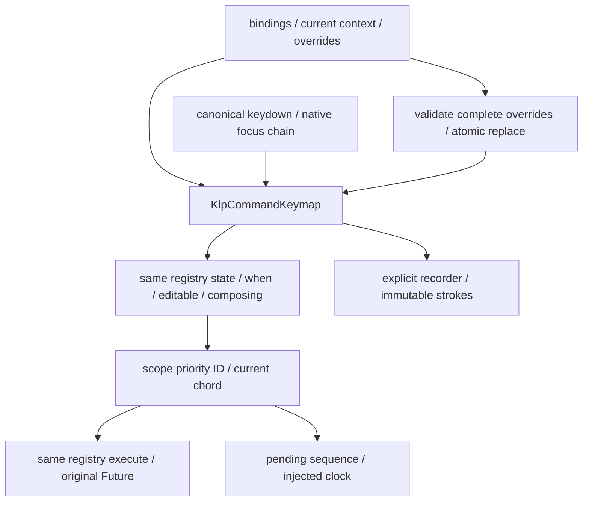

# Registered 快捷鍵核心

WB-SHORTCUT-CORE-r1 READY，擁有[WB-09／12～14／16](../../spec/workbench-v1.md)目前的純解析、chord、錄製及原子覆寫stage。命令仍由現有registry擁有；native keyboard／focus／composition轉換、互動GUI及website是後續獨立packet，不能用本core冒充完整快捷鍵交付。既有Flutter KlpKeyBinding／Controller／Host／Region公開caller保持，不修改或另接管其事件。

## 公開資料

兩端公開KlpCommandKeymap<C>；Flutter constructor required registry，named platform（KlpShortcutPlatform.mac／other，預設other）、chordTimeoutMs（預設1000，1～600000整數）、now（可選double Function()）；React constructor(registry, options?)的platform為'mac'／'other'、同timeout、now:()=>number。預設clock使用原生monotonic毫秒，測試注入finite非負monotonic clock；非法clock值拒絕且不部分更新狀態。keymap不dispose產品registry，也不新增handler、l10n或storage。

| 型別 | 必填／可選欄位與語意 |
| --- | --- |
| KlpShortcutStroke | key:string必填；primary／ctrl／alt／shift／meta預設false；immutable。primary在mac對應meta、other對應ctrl，與explicit modifier做OR後精確比對所有modifier，不忽略多餘modifier |
| KlpShortcutInput | 沿stroke，另repeat／composing預設false；純keydown資料，keyup由nativehost排除 |
| KlpShortcutScope | Flutter enum／React union：app、page、region、component |
| KlpShortcutFocus | focusId:string必填非空，pageId／regionId／componentId可選非空，editable預設false；代表原生焦點身分與其有效scope鏈，不序列化產品tree |
| KlpShortcutBinding<C> | id／commandId非空；sequence為1～4 stroke；scope必填；app不得scopeId，其餘scopeId必填非空；priority預設0有限整數、allowRepeat／allowInEditable預設false、when:bool Function(C)可選；metadata複製而when保持產品函式 |
| KlpShortcutHandlingState | ignored、prefix、executed、cancelled、recording；executed只代表dispatch已開始，成功／錯誤仍讀execution原結果 |
| KlpShortcutHandling | handled:boolean與state必填；bindingId／commandId僅prefix或executed有值；execution僅executed有Future／Promise<KlpCommandExecutionResult>，其他為null／undefined；immutable |
| KlpShortcutConflict | kind為exact／prefix；bindingIds為兩個lexical ID排序的immutable清單，winnerId依固定解析優先序；不推測未知產品條件 |

key使用canonical logical key：單一Unicode scalar的小寫字元（空白除外），或enter／escape／tab／space／backspace／delete／insert／home／end／pageup／pagedown／arrowup／arrowdown／arrowleft／arrowright／f1～f24。Binding非法key拒絕；native未知key／純modifier／Dead／Process／Unidentified不作command key，handle傳入不支援key時ignored，不儲存prefix。不是physical scan-code或任意字符串parser；鍵盤布局差異由native adapter明示，無跨layout等價宣稱。modifier欄位必須bool，不能以字串或數字默默轉型。

Flutter immutable資料constructor採上述同名欄位；Input extends Stroke允許直接傳入同stroke欄位。Reactreadonly interfaces沿同shape；KlpCommandKeymapOptions公開platform／chordTimeoutMs／now，KlpShortcutPlatform及KlpShortcutConflictKind為union。不用框架內部FocusNode／DOM或產品context作序列化資料。Flutter scopeId可null表示缺省，React可省略；app不得有非空scopeId。Conflict kind為Flutter KlpShortcutConflictKind enum／React union。keymap公開唯讀platform／chordTimeoutMs供native宿主接入。

## 方法與固定解析

`register(binding)`回傳唯一owner的disposer；重複id為StateError／Error，invalid definition為ArgumentError／TypeError，disposed keymap拒絕新增。disposer idempotent，舊owner不能移除同ID重新註冊的另一owner。解除時同ID override移除，pending chord取消；不解除command。keymap `dispose()` idempotent，清除自己的binding／override／recording／prefix；`isDisposed`可讀，dispose後handle只ignored，不查commandregistry。

`handle(input, focus, context)`同步輸出KlpShortcutHandling；context仍是產品當次資料。先驗證輸入／focus，檢查composition、焦點鏈與editable，再解析；composition一律ignored並清prefix，不execute、不錄製。focusId或任一scope ID／editable改變取消舊prefix。app常有效，其餘scopeId必須命中focus對應ID；editable時只有allowInEditable=true參與。repeat只allowRepeat=true參與。

同scope及目前context以when與registry.getState(commandId,context)重新判斷；when=false／throw、missing／hidden／disabled／running／disposed command不參與，不能攔截原生鍵。只有匹配prefix、實際dispatch、明確取消或record成功才handled=true；無匹配ignored=false。優先序固定component > region > page > app，其次priority高優先，最後binding id依UTF-16 lexical升序，無註冊時序依賴。

把目前prefix＋input作序列匹配，依上述順位選最佳候選：完整序列即呼叫同registry.execute(commandId,context)一次、清prefix並交原typed execution；最佳仍為較長sequence則保存prefix與當前focus鏈並重設該步開始時刻。不同command可獨立pending；無第二份running權威。chord未完成時不先執行較低順位短命令；若較高順位完整短序列遮蔽較低長序列，由conflicts診斷prefix關係，不延遲已匹配短命令。

未命中合法續鍵先清prefix，再將該keydown當全新單鍵重新解析一次；仍無匹配不攔截。不支援key／純modifier只ignored，除focus變動／composition／逾時外保留已有prefix，避免modifier keydown破壞chord。pending時無modifier escape只cancelled／handled=true，清prefix不dispatch。`cancelChord()`回bool是否有prefix；`expireChord()`依clock的elapsed>=timeout清prefix並回bool，idle回false；每次handle會先expire，逾時輸入當新鍵。`pendingSequence`回不可變snapshot；nativehost後續以同timeout安排一次timer呼叫expireChord，core不自行開timer或維持第二事件loop。

## 衝突與原子覆寫

`conflicts(focus, context)`只比較當前有效、可執行、editable允許且same scope／scopeId的bindings；不dispatch、不依when字符串、不宣稱能推測未來條件。實際modifier（含primary平台投影）與序列完全相同為exact，任一為另一的proper prefix為prefix；每對只一筆，bindingIds排序，各筆以兩ID lexical排序，winnerId依固定scope／priority／id。另scope可覆蓋較廣scope不當作same-scope衝突。

`setOverride(id, sequence)`用1～4合法stroke替換，sequence=null停用binding；unknown id拒絕。`restore(id)`移除該覆寫回default；unknown id拒絕。register／disposer／setOverride／restore／import成功都清chord，不修改產品default binding或command，recording不因重綁自動失效。

`exportOverrides()`回可序列化DTO：schemaVersion=1，bindings為ID→stroke清單或null。只含使用者覆寫，沒有函式、context、scope tree或產品資料。`importOverrides(value)`接受該DTO，完整validate版本／object／已註冊ID／sequence／modifier／canonicalkey後原子替換override集合；空map清除所有override，任何非法輸入保留舊override與pending chord。Flutter以Map<String,Object?>輸入／輸出，React公開KlpShortcutOverrides readonly interface及unknown import。所有輸入／輸出巢狀資料隔離caller mutation。DTO只允許schemaVersion／bindings兩欄，stroke只允許key及五modifier；unknown欄拒絕。version為整數1。

## 錄製

`beginRecording(focusId)`驗證非空後清chord，建立explicit錄製session並清上次內容；`isRecording`、`recordedSequence`可讀immutable snapshot。錄製中handle不dispatch，成功canonical keydown加入實際modifier stroke（primary=false）、handled=true／recording；最多4個，滿後新鍵ignored且不部分加入，repeat與不支援key不錄製／不攔截。無modifier escape清recording並cancelled／handled=true；composition不錄製但保留錄製session；focusId改變取消錄製、清內容並ignored，不把該次event意外當command。

`finishRecording()`交不可變清單（可空）並結束錄製，保留recordedSequence供產品顯示；產品決定套給哪個binding及setOverride，core不自行猜command。`cancelRecording()`結束並清內容，idle安全。輸入editable在explicit錄製session可捕捉，因使用者正在指定組合；nativehost仍先保護composition／已處理event。錄製不宣稱能攔截OS／browser保留鍵。dispose後beginRecording／其他設定mutation拒絕StateError／Error；dispose後讀snapshot安全空、cancel／expire／finish為安全無操作。

## 現行stage與證據

核心每端新source＋公開export exact2；同registry／legacykeybinding／native UI／theme／tests／config唯讀。fresh隔離TestAuthor各新增唯一publiccore測試，保護modifier平台／scope與固定衝突／chord取消逾時及focus／text composition repeat／原command結果及gates／ownerdisposer／atomic import與mutation隔離／錄製不dispatch。無private鏡像或pixel判斷；缺public API是Yellow，不能稱behavior Red。實作後同hash檢查、publicanalyze／librarybuild及scope2。

本契約採命令ID、scope/context與可錄製組合之通用能力，參考[VS Code快捷鍵](https://code.visualstudio.com/docs/configure/keybindings)的編輯／衝突／command dispatch概念；固定解析順位是Kallopis自己的契約，沒有複製其註冊時序。native stage依[KeyboardEvent.isComposing](https://developer.mozilla.org/en-US/docs/Web/API/KeyboardEvent/isComposing)及[Flutter KeyEvent](https://api.flutter.dev/flutter/services/KeyEvent-class.html)轉換；庫不保證收到OS或瀏覽器已攔截事件。

