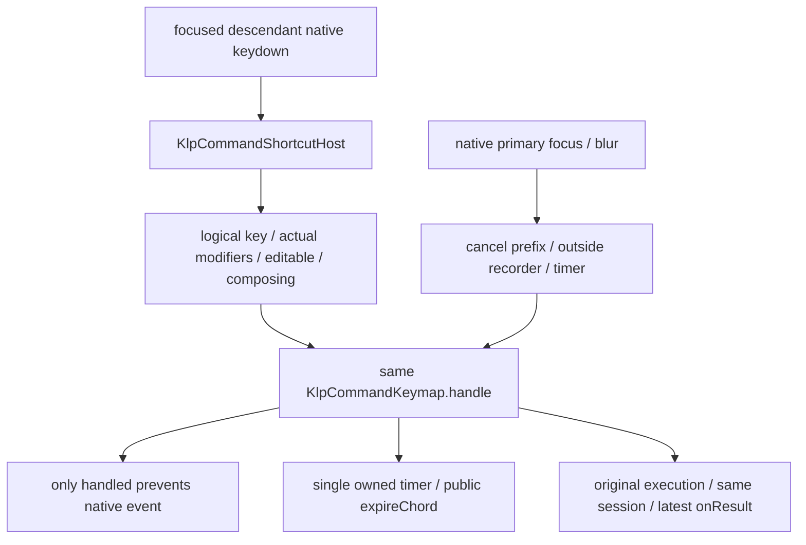

# Registered 快捷鍵原生宿主

WB-SHORTCUT-HOST-r1 READY，承接[純核心](workbench-shortcut-core-contract.md)的WB-12～14原生event／focus／composition stage。兩端公開KlpCommandShortcutHost<C>，只借用產品keymap及registry結果；binding／scope／override／錄製仍由purecore擁有。產品可保留原生Widget／DOM自由組合，不新增widget tree schema、第二handler／theme／l10n或global keyboard listener。互動重綁與Commands consumer是下一獨立packet。

## 公開介面與組合

Flutter StatefulWidget constructor required named keymap:KlpCommandKeymap<C>、getContext:C Function()、getFocus:KlpShortcutFocus Function()、getIsComposing:bool Function()、onHandling:void Function(KlpShortcutHandling)、onResult:void Function(KlpCommandExecutionResult)、child:Widget；optional key。React公開readonly KlpCommandShortcutHostProps<C>同keymap／getContext／onHandling／onResult，getFocus:(target:EventTarget|null)=>KlpShortcutFocus，children:ReactNode；無getIsComposing，直接讀原生event及composition session。兩端無style／width／token覆寫、無預設commands。platform沿keymap選項，不自行猜OS。

Flutter使用非可聚焦／skipTraversal的原生Focus包child，事件只在目前focused descendant忽略後才向上處理，不註冊HardwareKeyboard全域handler。React使用display:contents的neutral div包children，以onKeyDown bubble接原生事件；不增加tab stop、語意role或尺寸；結構上的DOM wrapper存在，產品CSS selector須依public組合認知。只在root內接事件，不portal或document listener。consumer每個keymap同時只掛一個宿主，嵌套不同keymap時最內層handled事件不得再dispatch到外層。

產品getFocus投影scope IDs／focusId。宿主以目前原生文字輸入保護editable：React target的input／textarea／有效contenteditable（含祖先）與product editable做OR；contenteditable=false的明示子區域不視為editable，非HTMLElement target沿最近Element安全判定；Flutter目前primaryFocus.context的EditableText及product editable做OR。scope ID／identity不由宿主造出第二權威。Flutter getIsComposing供產品upstream/custom editor投影；再與目前EditableText.controller.value.composing.isValid且非collapsed做OR，避免產品省略正在組字的原生狀態。不是用KeyEvent.character推測IME。

## 原生事件與命令權威

只接keydown及repeat：Flutter KeyDownEvent／KeyRepeatEvent，KeyUpEvent與synthesized忽略；React只onKeyDown。React event.defaultPrevented時直接返回，不查context／focus／registry或呼叫onHandling。Flutter子Focus已handled／skipRemainingHandlers時根本不向上傳遞。

canonical mapping以logical key為準：Flutter LogicalKeyboardKey已知enter／escape／tab／space／backspace／delete／insert／home／end／pageup／pagedown／arrows／f1～f24對應共同named keys，其餘keyLabel.toLowerCase；React KeyboardEvent.key小寫，單一空白轉space，其餘Enter／ArrowDown／F1等沿共同名字；不使用physical key／code或任意shortcut字串parser。pure modifier／Dead／Process／Unidentified無法匹配時交core ignored以保留合法pending（composition例外）。四個modifier讀原生HardwareKeyboard或KeyboardEvent當次旗標，primary=false；repeat沿原生類型／旗標。不宣稱跨keyboard-layout等價，也不保證收到OS／browser保留鍵。

React composing判斷nativeEvent.isComposing、宿主compositionstart～end旗標或legacy keyCode=229的OR；compositionstart立即keymap.cancelChord，但保留explicit recording，compositionend清旗標。Flutter依上述public callback與EditableText原生值。composing資料仍交core，讓其清prefix、保留recordsession且不dispatch；不得先preventDefault。文字、游標、soft keyboard及IME仍由原生editor擁有。editable key只有binding allowInEditable=true或explicit recording才可handled。

每次未被子元件處理的keydown以當次getFocus／getContext呼叫同keymap.handle一次。只有結果handled=true才React preventDefault與stopPropagation／Flutter回KeyEventResult.handled；ignored保留原生事件。onHandling接同immutable原結果（含ignored），在native攔截決定已完成後才呼叫，供產品呈現prefix／recording。若execution存在，等待原Future／Promise後交latest onResult，value／error不clone、不改status；不同命令仍獨立pending、core running仍唯一權威。

產品getContext／getFocus／getIsComposing或core validation拋錯時，宿主交FlutterError.reportError／React reportError（無該API用console.error），該次ignored而不dispatch。onHandling／onResult拋錯也交同宿主通道；onHandling錯誤不取消已決定的handled，不重試handler。不把宿主回呼錯誤改成registry error或吞掉diagnostic。

## 計時與生命週期

宿主每次core.handle後檢查timer；idle時取消，合法prefix新步才取消舊timer並以keymap.chordTimeoutMs排一個原生一次timer，只呼叫keymap.expireChord，不自行比較／改寫private prefix或clock。pure modifier ignored仍保留pending及既有timer，不得延長目前step期限；若prefix由外部publiccore建立且尚無timer，可排一次timeout。expiry若注入clock尚未達期限，保持prefix並可用一次同timeout重試，沒有continuous frame或zero-delay loop；正常原生clock準時expiry。timer也檢查same mounted keymap session；錯誤交宿主並停該timer。timeout不dispatch、不呼叫onResult，無onHandling虛构event。

焦點由宿主內任何descendant移到另一個descendant時，只取消chord（下一event仍由core驗證實際focus鏈）；若離開宿主，取消chord及recording、composition旗標與timer。React onBlur bubble用relatedTarget/root.contains判斷；Flutter監聽同原生FocusManager primaryFocus變動與host FocusNode.hasFocus，不維護產品focus。不是每次component render取消prefix：同keymap的callback或theme更新保留session及deadline。

keymap替換、unmount取消旧timer／chord／recording，移除該owner原生focus listener，不dispose借用keymap或registry。replacement以identity更新session；非同步結果只在同keymap、same mounted session仍有效才交當次latest onResult，舊session結果只留registry/core，不更新新宿主。same keymap callback更新前開始的execution可交最新callback；StrictMode setup／cleanup可重入，無重複listener/timer、無全域listener或已卸載setState。

## Current stage 與必要驗證

Flutter新flutter/lib/src/features/actions/command_shortcut_host/klp_command_shortcut_host.dart＋foundationexport exact2；React新react/src/command-shortcut-host.tsx＋indexexport exact2，neutral display:contents是布局常數，不加CSS檔。purecore／registry／legacykeybinding／entry／palette／popup／style／config／example／其他module唯讀。fresh獨立TestAuthor各只新增公開宿主測試：Flutter test/command_shortcut_host_test.dart；React test/command-shortcut-host.test.mjs。必要native事件、IME、focus與async lifetime風險需獨立checks，不能用私有helper鏡像或pixel assertion。基線缺公開API為compile Yellow；真正native browser、GUI與感官後續分別標示。

P1 maps：event轉換→原生bubble handler；text/IME→native editable/composing＋core gates；chord期限→single owned timer＋publicexpire；焦點→native listener＋core chain；結果→same registry Future及session/latestcallback；cleanup→owned timer/listener；purecore mutation與儲存→現有publiccore。全部有責任、介面與對應publiccheck，PLAN READY。

參考[Flutter Focus onKeyEvent](https://api.flutter.dev/flutter/widgets/Focus/onKeyEvent.html)的child-to-parent處理、[KeyEvent](https://api.flutter.dev/flutter/services/KeyEvent-class.html)的logical model與repeat／synthesized、[React common DOM events](https://react.dev/reference/react-dom/components/common)的bubble與focus，以及[KeyboardEvent.isComposing](https://developer.mozilla.org/en-US/docs/Web/API/KeyboardEvent/isComposing)。Focus硬體事件本身不提供soft keyboard或完整IME來源，因此Flutter保留產品composition投影並直接讀原生EditableText。

