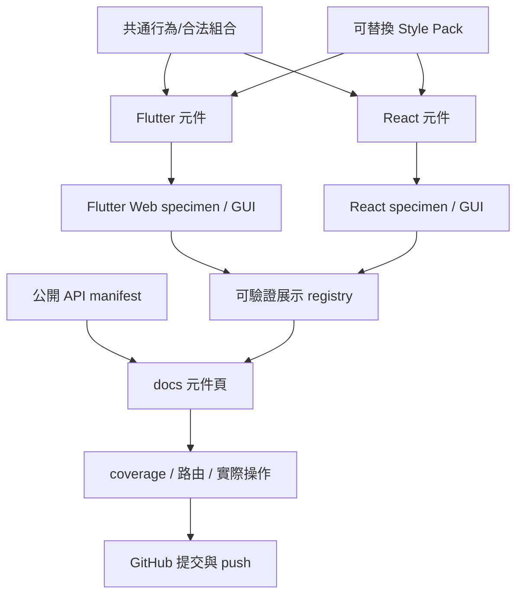

# Workbench v1 本階段計畫

修訂：`WORKBENCH-STAGE-r1`；2026-10-12。使用者已接受執行並建立持續 goal；本表是整合順序，不代表已完成。

本階段包含 [Workbench](../../spec/workbench-v1.md)、[可替換風格](../../spec/style-pack-v1.md) 與 [互動 docs／GUI 範例](../../spec/interactive-docs-v1.md)。各 module 的 packet 必須先完成公開契約與架構，再開始其 BUILD；依賴尚未完成時不建立偽造 revision。

| 次序 | 工作 | Owner／範圍 | 完成證據 |
| --- | --- | --- | --- |
| 1 | 現有風格完整抽出版本化 JSON 與 parser | `styles/`，STYLE-PACK-1／2 | 逐項保留來源、非法引用／版本／循環拒絕、跨語言 fixture；既有生成仍有效 |
| 2 | 雙框架中立元件與可注入風格 adapter | `react/`、`flutter/`，各自獨立 packet | 雙 provider 隔離、預設相容、公開參數與未映射清單、布局不變條件 |
| 3 | 一般布局與 Dock 公開契約及雙框架補齊 | `react/`、`flutter/` | WB-02～08；拖放／分割／縮放／分頁、保存還原與失敗保留狀態 |
| 4 | 命令 registry、工具列／選單／面板及快捷鍵 | `react/`、`flutter/` | WB-09～14；解除註冊、disabled、async error、chord、作用域、衝突及重綁 |
| 5 | 雙框架所有元件 specimen 與三種 GUI | 各框架 `example/`，公開 imports | specimen registry 完整、可操作場景、風格切換；產品示意內容留在 example |
| 6 | docs API／元件页嵌入及場景頁 | `tool/reference_site/` | 公開元件 → specimen → bundle → route 全鏈 coverage；前綴及資產檢查 |
| 7 | 權威切換、CI、文件與提交 push | repository 整合 owner | SP-01～08、IDOC-01～08、WB-01～21 evidence；繼承失敗另列、精確提交與 push 記錄 |

已觀察進度：STYLE-PACK-1／2 完成（269 原料、350 語意 × 4、118 原文配方；114 checks、CLI check 及 scope check 通過）。REACT-STYLE-1 完成：公開 JSON 風格匯入、原子覆寫、全量 scoped Provider、獨立套件 runtime，21 項 React checks 通過；瀏覽器觀察替換／拒絕／還原與窄畫面。docs 五份來源已接線，15 項網站檢查及 519 canonical API 頁／25 文件生成與 verifier 通過。FLUTTER-STYLE-1 的完整 pack 接入已完成；recipe 全部視覺參數、Workbench 布局及網站互動 bundle 尚未完成。

## 合作邊界

通用 spec 擁有行為；style pack 擁有視覺資料；各框架擁有 native component 與平台轉換；example 擁有場景 state；網站只組裝公開 reference 與已建置展示。reference site 不手寫替代 Flutter／React 元件，不匯入 private src，也不建立全產品 UI schema。

## 驗收責任

幾何守恆、保存及風格跨語言契約由獨立 Test Author 定義最小保護；BUILD 可讀可執行，不可改斷言或 baseline。新 tests 只在對應 slice 有可執行公開契約時派送，不一次生成所有預想測試。

網站 coverage 不使用固定 254 項舊清冊，而是以當前可達公開元件的 manifest 驗證；data、enum、extension 不算可呈現元件。既有 Flutter catalog 可作為 specimen 起點，但不能用未定位元件的總覽 iframe 宣稱完成。

先維持 Markdown 值權威，直到 pack 遷移與 adapter 驗證通過；届時更新正式維護規則及生成表格，禁止雙份人工維護值。所有現有差異依 platform-notes 明示，不在 migration 悄悄修正。

GitHub push 已授權，無需重問；仍需先確認範圍及實際檢查。主工作樹有既有搬移與其他未提交變更，隔離基線僅作保留／驗證，不代表所有基線變更已審核可發布。

## 下一個可執行步驟

FLUTTER-STYLE-1 已完成公開 pack／Theme 接入，19 項跨語言／native／scope checks 通過，350 欄位全映射，41 項既有 theme／accent checks 通過；局部 analyze、generator freshness、scope gate 及 test hash 通過。recipe 展開、元件全部視覺對齊與布局保護尚未完成。

FLUTTER-LINEAR-1／REACT-LINEAR-1 已完成 [有限幾何算法](workbench-linear-contract.md)：各 21 項獨立 tests、native analyze／library build、scope gate 通過；公開 min／max／preferred／flex、間距退化與 unused。DOCS-LINEAR-1 已接入正式網頁，15 項既有 checks、524 API generate／verify 通過。

雙框架 Row／Column／Pane 已接入有限算法。Flutter 保留現有公開 API；React 提供直接元件及自然尺寸模式。Dock 保持獨立 Stage／Left／Right／Bottom 模型。一般布局完成不代表全部 UI 或風格保護已完成。

FLUTTER-LAYOUT-2 已完成：18 Widget checks／4 既有 checks、analyze／scope 及 Catalog 渲染證據。REACT-LAYOUT-2／EXAMPLE-1 已完成：9 checks含hydration、library／consumer TypeScript／example build／scope；native browser 確認尺寸守恆、minimum 壓縮、end 留白、極大 gap／root inset、自然量測、輸入保留及375px無水平溢出。下一步 PLAN Dock 契約與雙框架直接接入，沿用既有保存／受控狀態責任。

FLUTTER-DOCK-STATE-1完成69771496：依 [WB-DOCK-STATE-r1](workbench-dock-contract.md)新增公開版本化codec／policy／restore診斷；7獨立checks、analyze／scope通過。先完整驗證再對清冊，失敗不改state；深層不可變結果。下一步React同一wire接入，再完成兩框架Dock UI／有限style尺寸保護。此保存slice不代表WB-04～08全部完成。

REACT-DOCK-STATE-1完成c6af55f6：native readonly資料／encode／restore與Flutter使用同一保存wire，7 protectedchecks、librarybuild／publicconsumer／scope通過。雙端保存邊界完成不代表Dock UI完成；接續公開操作契約及兩框架分頁／拖放／resize／style幾何。
