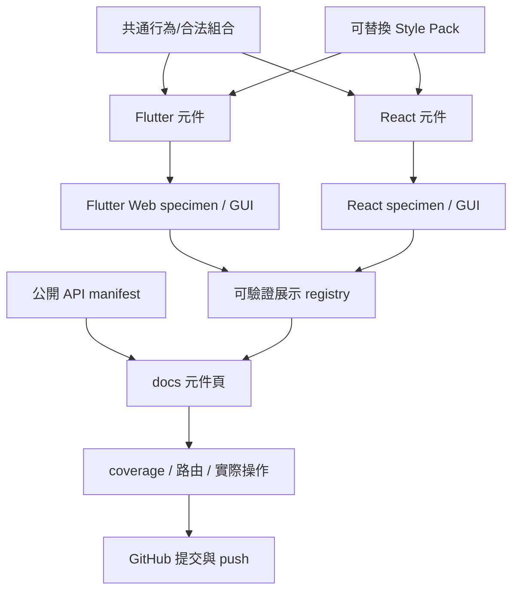

# Workbench v1 本階段計畫

修訂：`WORKBENCH-STAGE-r1`；2026-10-13。使用者已接受執行並建立持續 goal；本表是整合順序，不代表已完成。

本階段包含 [Workbench](../../spec/workbench-v1.md)、[可替換風格](../../spec/style-pack-v1.md) 與 [互動 docs／GUI 範例](../../spec/interactive-docs-v1.md)。各 module 的 packet 必須先完成公開契約與架構，再開始其 BUILD；依賴尚未完成時不建立偽造 revision。

| 次序 | 工作 | Owner／範圍 | 完成證據 |
| --- | --- | --- | --- |
| 1 | 現有風格完整抽出版本化 JSON 與 parser | `styles/`，STYLE-PACK-1／2 | 逐項保留來源、非法引用／版本／循環拒絕、跨語言 fixture；既有生成仍有效 |
| 2 | 雙框架中立元件與可注入風格 adapter | `react/`、`flutter/`，各自獨立 packet | 雙 provider 隔離、預設相容、公開參數與未映射清單、布局不變條件 |
| 3 | 一般布局與 Dock 公開契約及雙框架補齊 | `react/`、`flutter/` | WB-02～08；拖放／分割／縮放／分頁、保存還原與失敗保留狀態 |
| 4 | 命令 registry、工具列／選單／面板及快捷鍵 | `react/`、`flutter/` | WB-09～14；解除註冊、disabled、async error、chord、作用域、衝突及重綁 |
| 5 | 雙框架所有元件 specimen 與三種 GUI | 各框架 `example/`，公開 imports | specimen registry 完整、可操作場景、風格切換；產品示意內容留在 example |
| 6 | docs API／元件页嵌入及場景頁 | `tool/reference_site/` | 公開元件 → specimen → bundle → route 全鏈 coverage；前綴及資產檢查 |
| 7 | 權威切換、CI、文件與提交 push | repository 整合 owner | SP-01～08、IDOC-01～08、WB-01～21 evidence；繼承失敗另列、精確提交與 push 記錄 |

已完成stylepack parser／catalog（269原料、350語意×4、118原文recipe）及雙框架注入；finite linear／Dock／命令核心與入口／palette／popup和公開consumer亦交付。原生shortcut及兩端consumer已完成；recipe全參數audit／default權威切換、逐元件網站互動及3GUI×2仍未完成。當前reference561API／34Markdown；詳細可觀察證據與下一步只讀[交接](../workbench-handoff.md)。

## 合作邊界

通用 spec 擁有行為；style pack 擁有視覺資料；各框架擁有 native component 與平台轉換；example 擁有場景 state；網站只組裝公開 reference 與已建置展示。reference site 不手寫替代 Flutter／React 元件，不匯入 private src，也不建立全產品 UI schema。

## 驗收責任

幾何守恆、保存及風格跨語言契約由獨立 Test Author 定義最小保護；BUILD 可讀可執行，不可改斷言或 baseline。新 tests 只在對應 slice 有可執行公開契約時派送，不一次生成所有預想測試。

網站 coverage 不使用固定 254 項舊清冊，而是以當前可達公開元件的 manifest 驗證；data、enum、extension 不算可呈現元件。既有 Flutter catalog 可作為 specimen 起點，但不能用未定位元件的總覽 iframe 宣稱完成。

先維持 Markdown 值權威，直到 pack 遷移與 adapter 驗證通過；届時更新正式維護規則及生成表格，禁止雙份人工維護值。所有現有差異依 platform-notes 明示，不在 migration 悄悄修正。

GitHub push 已授權，無需重問；仍需先確認範圍及實際檢查。主工作樹有既有搬移與其他未提交變更，隔離基線僅作保留／驗證，不代表所有基線變更已審核可發布。

## 下一個可執行步驟

2026-10-13，完整goal ACTIVE；當前細節與唯一執行入口見[Workbench交接](../workbench-handoff.md)。以下只保留當前stage，不將已取代的下一步混入規格。

| 能力 | 已交付 | 當前接續 |
| --- | --- | --- |
| style pack | common parser／catalog、350 semantics×4、Flutter／React theme接入 | typed recipes／全部參數與元件audit／default值權威切換 |
| finite linear | 雙框架pure算法與原生Row／Column／Pane、公開consumer | 網站逐元件specimen整合 |
| Dock | 雙框架codec／atomic operations／有限geometry／原生UI／公開example | browser hoverpreview／cancel矩陣、resize callback平台差異audit |
| 命令 | 雙框架registry／toolbar／menu／palette／popup及公開consumer；popup Flutter16＋原23、React12＋原12 checks；button／右鍵native證據 | 網站專屬互動接入；極端style／窄native完整矩陣另pending |
| 快捷鍵 | 純core Flutter11／React9 protected checks、analyze／build／exact2scope；chord／scope／conflict／atomic remap／recording | native host Flutter10／React6公開checks已完成；consumer React e56976aa／Flutter f9118c25及native重綁已完成；完整IME／style矩陣pending |
| 網站 | 34Markdown／561 canonical API／17modules／三surfaces；Flutter真實Widget分類273項，React23個專屬routes、Flutter29個專屬routes已有參數／回呼／風格／reset觀察；generate／verify與15checks通過 | Flutter其餘244項；元件頁iframe、bundle／registry／全量coverage；3GUI×2框架 |
| GitHub | 隔離精確commits，guarded同步main並保留index | 全部目標完成、保留發布閘門後精確push；尚未push |

公開清冊或單一總覽iframe不能當作全部互動展示完成；protected deterministic code、nativebrowser觀察與人類感官接受分別記錄。anchor／context menu library與公開consumer已完成，接續網站逐元件專屬互動registry／bundles；不重做已完成style／linear／Dock／command foundations。

Flutter專屬route使用`?specimen=<公開名稱>`；目前basic六項為KlpText／KlpSurface／KlpBadge／KlpButton／KlpIconButton／KlpTextField，linear六項為KlpAppLayout／KlpLayoutPane／KlpLayoutDivider／LayoutRow／LayoutColumn／LayoutSpacer。原生Row／Column對齊位置、Pane自動flex與finite壓縮、Divider合法方向、AppLayout inset與浮動動作已觀察；尺寸由實際槽約束讀取，算法仍由庫擁有。四模式與另一份pack保留草稿，reset明確還原元件資料。320目前是局部展示container寬度，不當作browser viewport證據。完整網站嵌入尚未交付，詳[consumer架構](../../flutter/example/architecture.md)。

Explorer增加KlpFileExplorer／KlpFileExplorerSection／KlpFileExplorerSectionView／KlpFileExplorerFolderView／KlpFileExplorerItemView五個專屬subject，均以公開root合法組合呈現自身資料與控制；沒有重建node/adapter。可改標籤、spacing、展開、選取、層級與空集合替代資料，原生回呼分列觀察；風格切換保留狀態，reset明確還原。這仍是example專屬routes的進度，元件文件iframe接線尚待交付。

Frame增加KlpPanelFrame／KlpPanelHeader／KlpPanelFooter／KlpFrameGroup／KlpFrameGroups／KlpAppFrame／KlpPaneCollapseControl七個subject，各自在合法compound內調整自己的內容、尺寸或style參數；使用庫的theme、有限布局與回呼。Header必須保留title或custom content，label為附加內容；AppFrame展示自然width時明示flex0／preferred null，再與bounds／flex分配情境比較。Collapse鍵盤、群組及header/footer動作、風格及finite尺寸草稿保留已有原生證據，完整網站嵌入仍pending。

命令新增KlpRegisteredCommandToolbar／KlpRegisteredCommandMenu／KlpRegisteredCommandPalette／KlpRegisteredCommandPopup／KlpCommandShortcutHost五個專屬query，沿用既有清冊與consumer owner。各頁只呈現對應入口，觀察結果／停用／錯誤／搜尋／關閉理由，host另可操作快捷鍵與設定；原生Ctrl+S、chord與草稿作用域已有證據。風格／局部320切換保留草稿與結果，明確reset才歸零。BUILD e754f791、public analyze／releaseweb／exact2 scope通過；Flutter目前29/273，React23/23 example routes。全量元件網頁嵌入、其他244項、場景GUI與風格audit仍接續，尚未push。
