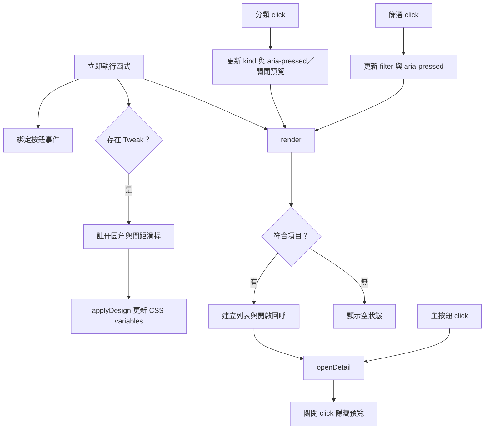

# 暖墨收藏架構

## 責任與檔案

此目錄是一個文件示例模組，保存已接受的風格及操作原型；不修改 Flutter／React 公開 library。

| 檔案 | 責任 |
| --- | --- |
| [preview.html](preview.html) | 唯一可編輯畫面來源：root-scoped CSS、語意 HTML、記憶體示例資料、互動腳本 |
| [index.html](index.html) | 由來源匯出的獨立瀏覽包裝；更新來源後重新產生，不手動維護雙份邏輯 |
| [tokens.md](tokens.md) | 已接受視覺數值與角色 |
| [layout.md](layout.md) | 組合、響應式與狀態轉移 |
| [README.md](README.md) | 收藏狀態、使用入口及限制 |

## 函式與狀態

沒有自訂 class。所有示例行為由來源中的立即執行函式封裝，避免全域名稱污染。

| 符號／回呼 | 責任 |
| --- | --- |
| 立即執行函式 | 取得根節點，建立資料與狀態，綁定事件與可選 Tweak，首次呼叫 render |
| `entries` | Map：分類名稱映射列表；每項陣列依序為縮寫、標題、說明、是否加星號 |
| `kind` | 目前分類；初始為專案 |
| `filter` | `all` 或 `star`；只決定顯示，不修改原資料 |
| `render()` | 篩選資料，重建列表、標題、計數或空狀態 |
| `render()` 內 filter 回呼 | 依星號條件選取資料 |
| 列表 action click 回呼 | 將該列標題交給 openDetail |
| `openDetail(title)` | 使用 textContent 建立預覽內容及關閉按鈕，顯示面板 |
| 預覽 close click 回呼 | 隱藏面板 |
| 分類 forEach／click／選中更新回呼 | 更新 kind、各按鈕 aria-pressed，關閉預覽並 render |
| 篩選 forEach／click／選中更新回呼 | 更新 filter、各按鈕 aria-pressed 並 render |
| 主按鈕 click 回呼 | 開啟固定示例專案預覽 |
| `design.radius` | 大容器圓角，單位 px；初始 12 |
| `design.gap` | 功能方塊間距，單位 px；初始 12 |
| `applyDesign()` | 將 design 值寫入 root CSS variables |
| 可選 `Tweak` | container 指向 root；onChange 指向 applyDesign。滑桿 label 為顯示名稱，min/max 限定範圍，unit 為 px。宿主不存在時跳過，不影響主要互動 |

## 執行流程

只有本機示例狀態，沒有遠端請求、儲存、權限、交易或業務錯誤處理。重新載入重設分類與篩選。輸入文字透過 textContent 呈現。

## 消費者邊界與後續整合

風格層擁有視覺角色、圓角、字體層級及共用互動表現；產品層擁有內容資料、分類、路由與畫面組合。將本風格接入正式框架庫時，應經框架無關規範及既有 semantic resolver 映射，公開型別沿用 Klp；此收藏不宣告新的 API 或強制產品模板。

## 匯出維護

`index.html` 使用 visualize 的 render.py 從 `preview.html` 匯出。其宿主 runtime 是生成相依，不是本模組自行撰寫的元件；不將宿主工具樣式當作暖墨 token。收藏來源保留可選 Tweak 保護條件，沒有 Tweak 時也能正常展示與操作。
