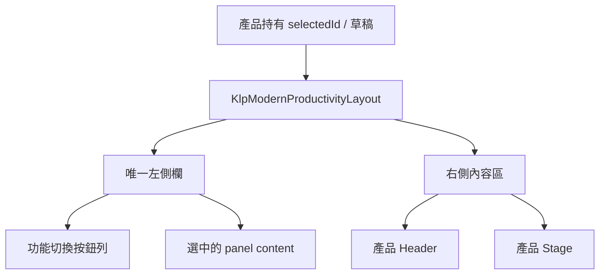

# Modern productivity

狀態：draft，待使用者迭代與確認。沿用已存在的 modern-productivity-layout starter，不將原有交付紀錄當作本輪畫面核准。

[Flutter 組裝](flutter.md) · [React 組裝](react.md) · [既有設定與版本限制](../../templates/modern-productivity-layout.md)

## 組裝規範

產品提供 panels、selectedId、onSelected、header 與 stage。面板 ID 維持穩定；切換選取時保留產品草稿。宿主提供有限寬高；窄版重排、收合、resize 與 Dock 不屬於此布局 v1。

## Token 選用

產品內容內距使用 `theme.spacing.contentInset`；共用側欄、標頭與選取狀態交給布局元件解析。`sidebarWidth` 是產品可選的局部幾何輸入，省略時沿用目前 theme。需要更換整體風格時使用合法 style pack，不將示範尺寸複製為第二份預設。

[正式 token 與配方](../../design-tokens/KALLOPIS-DESIGN-MAP.md) 擁有數值；現代風外觀與布局能力分開記錄。核准後在本頁補實際截圖、模式與 viewport。
