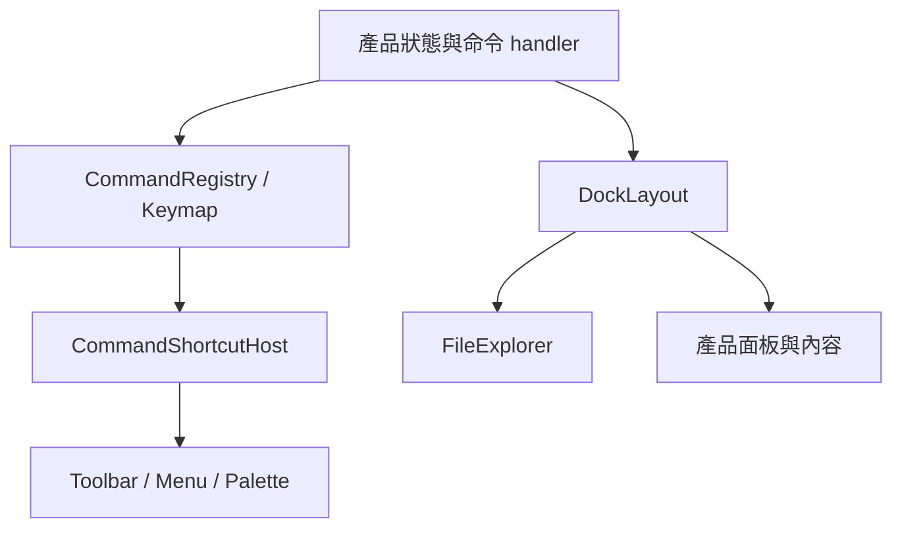

# Workbench

狀態：draft，待使用者迭代與確認。

以導覽、命令、停靠面板與內容區構成工作畫面。沿用 example 中的 VS Code、Blockbench、Blender 三種既有組裝，示意內容不提供上游產品的業務能力。

[Flutter 組裝](flutter.md) · [React 組裝](react.md) · [參考研究](../../research/workbench-reference-survey.md)

## 組裝規範

產品持有 layout、選取、面板政策、草稿與保存目的地；命令入口共用同一 registry。將 Dock action 接回產品更新 layout，不在元件內保存第二份業務狀態。只為實際跨產品重用能力新增公開元件。

## Token 選用

| 用途 | 正式語意 | 規則 |
| --- | --- | --- |
| 面板內容內距 | `theme.spacing.contentInset` | 從當前 scope 解析 |
| 內容垂直間距 | `theme.spacing.contentStackGap` | 產品組合區塊使用相同語意 |
| 操作列間距 | `theme.spacing.actionGap` | 不複製固定 px |
| 共用元件狀態 | 元件本身的 semantic resolver | 不覆寫元件內部 hover／selected 配方 |

[正式規範](../../design-tokens/KALLOPIS-DESIGN-MAP.md) 擁有數值與合法範圍；本頁只記錄選用理由。面板初始尺寸是產品布局資料，不能冒充共用 token 預設。
