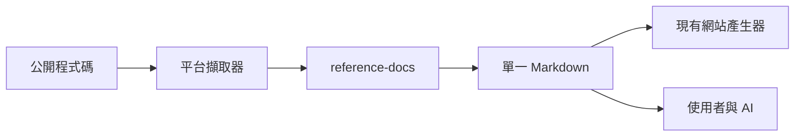

# 開發者 Reference

修訂：REFERENCE-DOCS-r1。2026-10-16 使用者接受文件架構與單元件頁格式，授權全面套用。擁有 docs/reference；網站投影由 tool/reference_site 擁有。範例正文由 docs/examples 擁有，產品與框架程式庫 API 不變。

## 責任與權威

每個公開宣告一頁，Flutter 與 React 分開。原始碼擁有簽名、參數、預設值與公開可達性；Markdown 擁有使用說明、範例及限制。API 區塊可重新產生，人工正文不得被更新工具覆蓋。共用視覺語意只連 docs/design-tokens 正式來源。框架繼承成員連官方 API。

分類為 components（依能力）、types、controllers、styling、utilities、platform；同名不同來源以穩定識別碼區分。Stable／Experimental 由公開入口判定。不為缺少的平台能力製造空頁。

## 目前切片與寫入邊界

本次由文件整合 owner 在現有工作目錄整合已接受修改，保留既有未提交搬移；不是另起乾淨 revision 的 BUILD worker。寫入：docs/reference/**、docs/examples/**、docs/ai/**、docs/guides/**、docs/verification/reference-docs*、docs/README.md、README.md，以及 tool/reference_site 的擷取、Markdown 產生、來源路由、網站與文件契約。react/src、flutter/lib 與既有 tests 唯讀。新增保護測試由獨立 Test Author 擁有。

1. M1：擷取兩平台公開清冊與成員，產生可重複更新的 Markdown，清冊與頁面雙向驗證。
2. M2：拆分既有指南、補齊速成入口與情境草稿；單一頁面保留完整 API。
3. M3：同一 Markdown 接入網站、舊路由導向新頁、搜尋與連結驗證；記錄感官待確認。

M1–M3 已完成文件與工具整合；證據見 [本輪驗證](../verification/reference-docs-2026-10-16.md)。範例視覺接受與核准截圖仍待使用者迭代確認，不計為已完成的人工驗收。

冷啟動估算：20k–40k tokens／60–120 分鐘；Node 24、現有 Dart analyzer 與 TypeScript 7，不新增套件。若公開來源無法解析，保留原文件並回報，不將舊快照當成新擷取。

## 驗收

公開清冊和頁面一一對應，成員與參數完整、無 private import、範例縮排為 tab。沿用網站驗證閘門；新 extraction／projection 保護由 Test Author 定義。代表性例子做編譯驗證，畫面審核與截圖需使用者接受。

