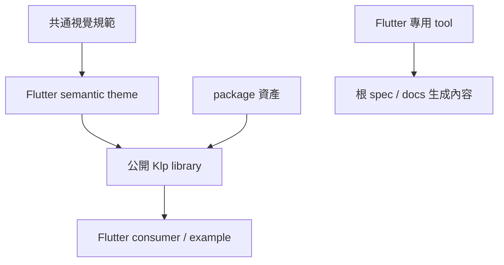
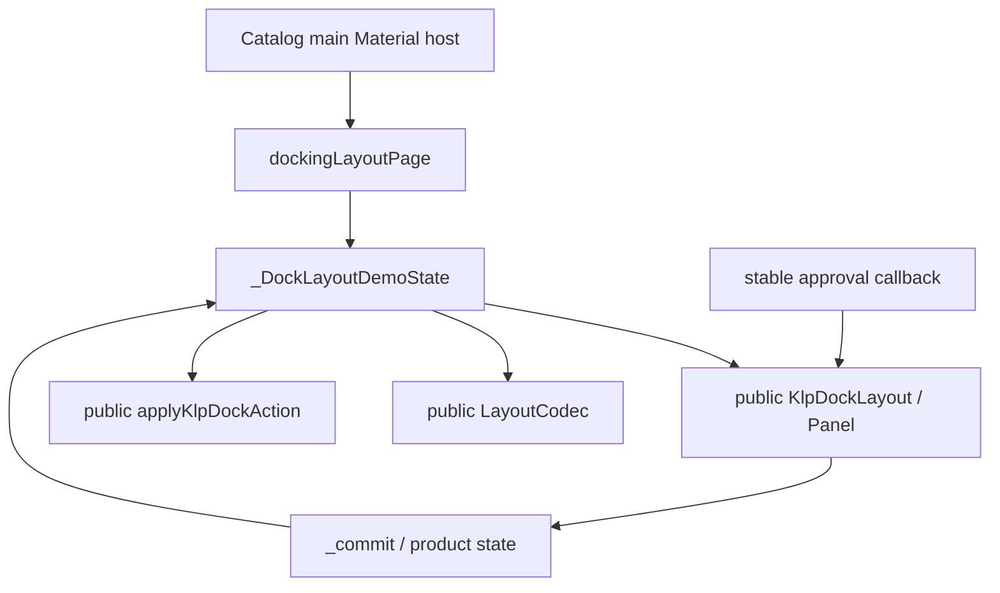
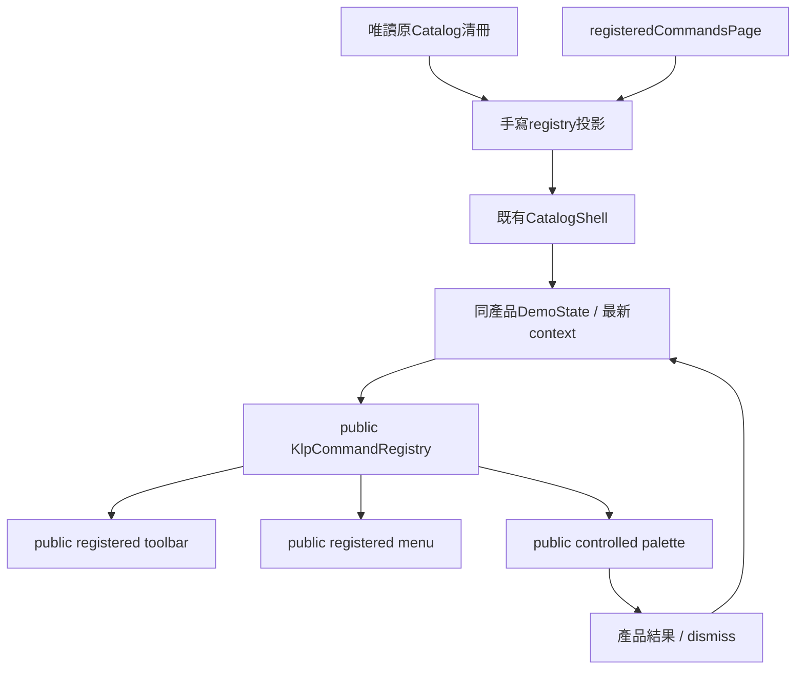
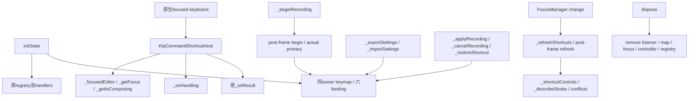
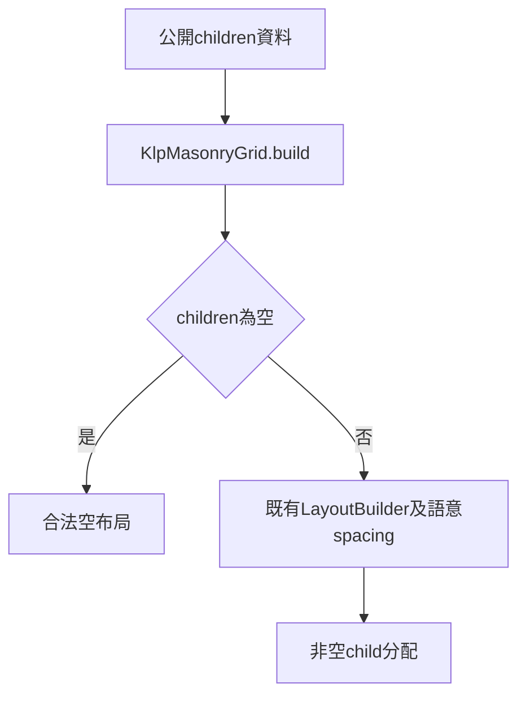
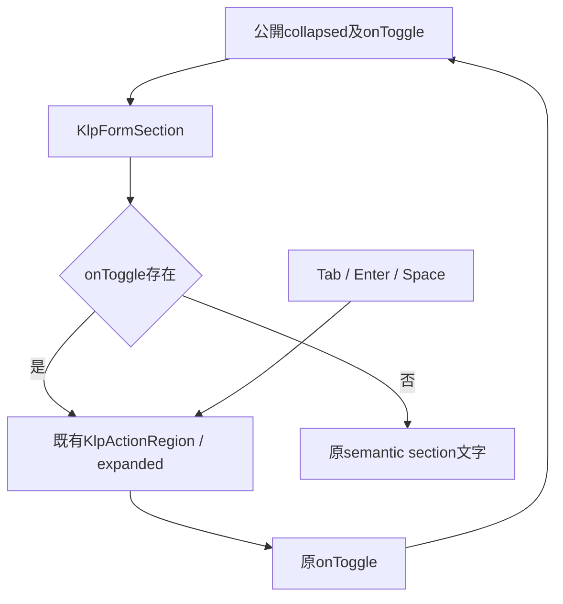

# Flutter package

## FLUTTER-PUBLISH-REPAIR-1（READY）

修訂 `FLUTTER-PUBLISH-REPAIR-r1`。使用者已授權整合 main、修復既有 CI 後發布。只修復已重現的 import cycle／package-root directives、icon hover 回饋、Dock protected setState 用法、命令型別 dartdoc、開發者錯誤文字與動態 chord timer 的單位換算；不改公開呼叫契約、theme 預設權威或產品流程。原 assertions、baseline、golden、測試配置與 CI 門檻保留。

`KlpThemeVariant` 移至同 theme module 的獨立 leaf 並由原檔匯出，style pack 只依賴 leaf，切斷 builder → pack → builder cycle。生成 JSON 的 recipe 原文是交換 metadata；generator 使用標準 JSON Unicode escape 保存等價字串，避免被 UI 文字 scanner 誤認；解碼資料與原文保持完全相同。動態 chord deadline 使用公開 Duration 單位常數換算，仍由 keymap timeout 擁有，不混用動畫 token。

BUILD 精確路徑：actions 下 command_entries／command_keymap／command_palette／command_popup／command_registry／command_shortcut_host 六個主檔；`lib/src/styling/legacy_theme/klp_theme.dart`、新增 `klp_theme_variant.dart`；`lib/src/styling/style_pack/klp_style_pack.dart`、`generated.dart`、`source-manifest.json`；`lib/src/features/actions/button/internal/klp_icon_button_style.dart`；Dock 的 `klp_dock_layout.dart` 與 `internal/klp_dock_close.dart`；`tool/generate_style_pack.mjs`。tests 預設唯讀，由獨立 Test Author 僅在已分配的十四檔做 SDK 等價遷移。架構 owner 另負責生成 inventory 與 API 文件證據。驗收為原八個失敗檢查、style pack／Dock／命令局部檢查、fatal-infos 分析及完整既有發布 CI。

## FLUTTER-LAYOUT-2（完成）

一般布局接入 [WB-LINEAR-UI-r1](../docs/architecture/workbench-linear-contract.md)，保留現有直接 Flutter API。責任與公開 bounds／divider 契約見 [layout](lib/src/features/workspace/layout/architecture.md)。BUILD write_paths 只含 `flutter/lib/src/features/workspace/layout/klp_app_layout.dart`、`flutter/lib/src/features/workspace/layout/internal/klp_linear_render.dart`；foundation 已匯出主檔，不須更動。architecture、純 geometry helper、tests、FrameGroups、example、Dock、風格檔及配置唯讀。獨立 Test Author 可寫 `flutter/test/workbench_layout_test.dart`。M1 finite geometry／bounds／root inset 接入，M2 natural fallback／protected checks／原公開入口與 Catalog 渲染證據；cold-start 8k–16k tokens／60–120分鐘，參照 FLUTTER-LINEAR-1。超過24k tokens或需要改 Dock／產品 state 回 PLAN。

本 module 為原 Flutter package 的完整機械搬移，擁有 `flutter/`。公開入口及實作責任保持 [library 架構](lib/architecture.md) 與 [實作架構](lib/src/architecture.md)；不引入跨框架 runtime。

## FLUTTER-LINEAR-1（完成）

沿用 [WB-LINEAR-r1](../docs/architecture/workbench-linear-contract.md)，先實作公開有限尺寸解析，下一個 slice 才接入既有直接 Widget。Item／result／函式由 foundation 匯出，具體責任見 layout module。BUILD 只可寫 `flutter/lib/src/features/workspace/layout/klp_linear_layout.dart` 與 `flutter/lib/kallopis_foundation.dart`；architecture、tests、既有 Widget、Dock 與風格資料唯讀。獨立 Test Author 可寫 `flutter/test/linear_layout_test.dart`，保護跨語言尺寸守恆及退化規則。此 slice 的公開 utility 不代表 WB-03 的全部 UI 已完成。

`lib/` 提供 Klp 公開元件與 theme；`assets/` 保有 package 字型、圖示及授權；`test/` 維持原斷言；`example/` 為產品資料投影的 Flutter consumer；`tool/` 產生 inventory／Catalog 與執行既有閘門。指向共通 spec／docs 的工具路徑為 `../spec/`／`../docs/`，docs 網站 extractor 留在 repository 根。

搬移不修改元件行為。分析及 inventory 檢查通過；既有測試中的圖示 hover 與 Catalog 缺項在搬移前後相同，詳見 [整合紀錄](../docs/architecture/multi-framework-verification.md)。

## FLUTTER-STYLE-1（完成）

需求沿用 SP-02／03／04／07。新增 styling/style_pack 純資料解析及 adapter，依其 architecture 公開契約。既有 context.klp 與 ThemeExtensions 繼續供全部元件使用，不新增 environment 或產品 renderer。元件不匯入品牌 pack；框架入口生成預設資料。

BUILD write_paths：`flutter/lib/src/styling/style_pack/**`（architecture 除外）、`flutter/lib/src/styling/legacy_theme/klp_theme.dart`、`flutter/lib/kallopis_theme.dart`、`flutter/tool/generate_style_pack.mjs`、`flutter/README.md`。其他 preset／legacy JSON decoder／tests／example／pubspec 皆唯讀。本 slice 完成公開 pack／theme 接入及跨語言證據；example 全元件與 GUI 接續後續既定 stage。

Test Author 唯一可寫 `flutter/test/style_pack_test.dart`；跨語言風險保護完整四 mode、非法 pack／cycles／constraints、override isolation、現有 theme extension／context scope，以及 metadata。既有 inherited icon hover／Catalog failures 不改斷言規避。估算 8k–15k tokens／60–110 分鐘，M1 parser／generator，M2 Theme adapter／scope。若需要改 preset／legacy JSON schema 或切换全庫默認權威，回整合 PLAN。

實作 `17119f2b`；19 項独立 style pack checks、36 項既有 ThemeExtension／VisualStyle checks、5 項既有 accent／builders checks 通過。公開四模式／350 native 映射與 Theme scope 完整；局部 analyze、generator freshness、scope gate 及受保護 test hash 通過。詳見 style_pack module 的完成證據。未切換正式值權威；recipe 參數及布局保護仍為後續工作。

FLUTTER-LINEAR-1 實作 a8124a62：21 項獨立幾何 checks、公開入口 analyze 及 scope gate 通過；Test Author SHA256 26F406F0C231B0362C2C73760740117771B097C25043DCB8FE484A7D647A653F 未變。既有 Widget／Dock 未改。

FLUTTER-LAYOUT-2 實作 273a0b4f：公開 bounds／divider、Row／Column solver、有限 inset、槽裁切及 unbounded natural fallback 已接入；18 新 Widget checks、4 既有 workspace checks、analyze／scope 通過。既有 Catalog 已實際渲染，視覺接受仍由人類判斷。

## FLUTTER-DOCK-STATE-1（完成）

Dock 保存邊界依 [WB-DOCK-STATE-r1](../docs/architecture/workbench-dock-contract.md)，責任見 [Dock module](lib/src/features/workspace/shell/docking/architecture.md)。新增純 codec／policy／restore diagnostics，保留既有 const model 與受控 UI。write_paths 僅 codec 與 foundation 新增 export；獨立 Test Author 保護保存失敗、identity、跨語言格式與 registry reconciliation。一般布局及 Dock UI 皆唯讀；不把此 slice 宣稱成全部 WB-04～08 完成。

FLUTTER-DOCK-STATE-1 實作69771496：7 protected codec checks、public analyze、scope通過，schema／reconciliation／深層不可變結果完成。React相同wire、Dock互動與style尺寸保護尚未完成。

## FLUTTER-DOCK-OPS-1（完成）

修訂FLUTTER-DOCK-OPS-r1；依共通WB-DOCK-OPS-r1與[Dock module](lib/src/features/workspace/shell/docking/architecture.md)提供typed const action／destination／area／result與applyKlpDockAction。BUILD write_paths只含operations.dart及foundation新export；獨立TestAuthor唯一寫flutter/test/dock_layout_operations_test.dart。既有codec、model、Widget與style不改，原caller保持；新操作保存偏好及受控轉移，UI尺寸與drag接入尚未完成。

FLUTTER-DOCK-OPS-1實作b08d80e6／243d9f98：10獨立checks、publicanalyze No issues、scope通過；protectedhash未變，原codec／model／Widget保留。兩端純操作對齊，仍需Dock UI／style尺寸與產品callback接入。

## FLUTTER-PANEL-GEOMETRY-1（完成）

修訂 FLUTTER-PANEL-GEOMETRY-r1；依 WB-PANEL-GEOMETRY-r1，責任見 panel/architecture.md。有限 PanelFrame chrome 與 margin、內半徑，以及庫 PanelHeader／Footer inset／內容槽，先完成 Dock 壓缩前置。BUILD 僅五個 panel 來源；獨立 TestAuthor 唯一可寫 flutter/test/panel_geometry_test.dart。公開 layout 元件為只讀依賴；theme、Dock、config、tests 不由 worker 修改。default style/constructor 保留，內容 State 不因尺寸與合法 theme 更新丟失。

FLUTTER-PANEL-GEOMETRY-1完成5e18ccd6：finite chrome/margin/inset與slot clip、非負inner radius、title/label viewport；9獨立checks、publicPanelanalyze No issues及5paths scope通過，protectedhash未變。內容Element/State在resize/theme更新保留。Dock保存尺寸直接布局尚待有限viewport/effectivegutter接入。

## FLUTTER-DOCK-GEOMETRY-1（完成）

修訂FLUTTER-DOCK-GEOMETRY-r1；依WB-DOCK-GEOMETRY-r1完成bounded root/groups/actualhandles與resize預算。Dock module contract固定4個來源write_paths，独立TestAuthor擁有flutter/test/dock_geometry_test.dart。只讀既有public linear utility/PanelFrame/theme；不改codec/pureoperations/models/dragcallback/配置與產品state。Public Widget constructor不變，render不回寫保存偏好。

FLUTTER-DOCK-GEOMETRY-1完成296e7cab：root/group有限配額、effectivehandle/resizebudgets/Stage提示、Headerzeroslot/menu与Statecontinuity；13protectedchecks、publicanalyze No issues、4paths scopepass，testhash未變。原保存偏好不回寫。React Dock UI/Flutter受控操作接入仍未完成。

WB-DOCK-PREVIEW-r1 READY：hover僅instance presentation，cancel/end清除，success保留保存extent；Flutter當前PREVIEW-1不改publicAPI、geometry或pureoperations，React native Dock接入時遵循同一生命週期，不在此slice修改React。

FLUTTER-DOCK-PREVIEW-1完成3064c359：hover為局部presentation、cancel/miss不保存、success保留原extent，7preview+13geometry checks/publicanalyze/2paths scope通過。公開constructor未變，pureoperations接入與close metadata仍待接續。

FLUTTER-DOCK-UI-r1 READY：optional Panel isPinned/isDirty/onCloseRequested FutureOr<bool>/closeLabel及全部UI pureOPS commit；欄位由Panel擁有，公開foundation原export已可達無需變更。geometry/preview/codec不可重做。

FLUTTER-DOCK-UI-1完成4ff1c999：全部pointer提交pureOPS／single finalcallback；optional Panel isPinned/isDirty/onCloseRequested/closeLabel、async pending stale/error lifecycle。33 protectedWidgetchecks/publicDockPanelanalyze/scope5paths通過；新metadata尚未nativebrowser example證據，ReactDock/commands/keybindings/GUI/docsregistry/style權威切換未完成。

## FLUTTER-DOCK-EXAMPLE-1（完成）

修訂FLUTTER-DOCK-EXAMPLE-r1。既有example/lib/catalog/docking_layout_page.dart擁有此產品展示資料、Stage輸入、控制器、保存JSON與操作計數；使用穩定foundation入口，不引用src。panels清冊保留原能力、穩定callback，增加pinned/dirty/approve/deny/delay；metadata不進wire。LayoutCodec保存/還原，pureOPS visibility/open/merge，非法JSON保持layout並顯示diagnostics，Stage輸入由產品controller持有並dispose。宿主寬320/760/1040與高180/480由產品選擇，實際宽clamp到Catalog可用寬度；內部Dock配額樣式不複製。

KlpDockHeader specimen文案改為semantic chromeTab與finite viewport，不寫固定32；actions需顯示實際操作結果，不保留空callback。main.dart只允許替Catalog home加Material透明宿主，解決已有browser黃色雙底線的DefaultTextStyle祖先；不得改主題權威或Catalog導航。BUILD write_paths僅此兩example來源；庫/tests/config/generated/architecture及其他module唯讀。

責任清冊：dockingLayoutPage提供兩個公開Widget specimens；_DockLayoutDemo/createState連接產品state；_DockLayoutDemoState擁有_initialLayout/_panels/_policies/JSON與Stagecontrollers/closemode/count/message/width/height；_panel建立內容metadata與stableapprovecallback；dispose释放controllers；_approveClose只讀產品closemode，delay1200ms；_commit比較保存值/計數；_action委派pureOPS；_toggleArea/_clearBottom/_resetLayout/_saveLayout/_restoreLayout/_openPanel/_mergeGroups為產品意圖；build/_controls/_dock/_json組裝有限外部宿主與公開元件。_DockHeaderDemo/State只擁有action回饋；main KallopisCatalogApp與其State保持原生命週期，build只新增Material ancestor。

M1public consumer/analyze/type/2pathscope，M2releaseweb --no-tree-shake-icons與nativebrowser select/save/load/close/resize/有限尺寸；拖放可用時確認，未觀察明示pending，感官human-pending。新測試無必要，既有33Widgetchecks不變，不以snapshot評分。參照React Dock example，cold-start5k–9k tokens/25–50分鐘；12k/70分鐘或需要library改動回PLAN。後续三個GUI×雙框架與全component網頁specimens仍保留完整goal。

實作39d263e0；2pathscope與兩個example來源analyze No issues。releaseweb保留全部圖示建置成功60.6s，標頭外部loose限制修正後再建置成功52.1s（session3558 exit0）；未改庫/tests/assets/config。nativebrowser tab9/port5192：History選取+Bottom收合2次、deny0次、approve/open/merge各1次；invalidJSON保留，合法還原成功；Stagecontroller在320×180及760×180/1040×480後保留。delayed批准完成1次，pending停用的當下browser狀態未取得，不宣稱該項感官證據。Inspector跨area合併與正文後半split各1次，split保存106+106=(220−8)/2；area220→250沿既有continuous pan產生8次callback，不宣稱整個resize gesture一次提交。新release120寬header呈現更多選單，選設定顯示已執行設定。error/warn空；Material祖先後實際截圖無原黄色雙底線。header hoverpreview/cancel的完整nativebrowser矩陣仍待接續。

| 型別／定義 | 來源 | 責任 |
| --- | --- | --- |
| dockingLayoutPage | [docking_layout_page.dart](example/lib/catalog/docking_layout_page.dart) | 公開Dock/LayoutHeader specimens接入Catalog |
| _DockHeaderDemo／_DockHeaderDemoState | 同上 | createState/build、_width外部120/220限制、_action與overflow回饋 |
| _DockLayoutDemo／_DockLayoutDemoState | 同上 | createState/产品layout、初始groups/policies/controllers与stableclosecallback |
| _approveClose／_panel／dispose | 同上 | 产品批准模式与metadata、有限panel內容、controller释放 |
| _commit／_action／_area／_toggleArea／_clearBottom／_resetLayout | 同上 | publicpure結果採用/計數、area意圖與明確清空展示布局 |
| _saveLayout／_restoreLayout／_openPanel／_mergeGroups | 同上 | schema1資料邊界、错误保留、capability重開、同區合併 |
| _controls／_dock／_json／build | 同上 | 公開元件controls、外部有限宿主与Stage、JSON產品輸入 |
| KallopisCatalogApp／_KallopisCatalogAppState.build | [main.dart](example/lib/main.dart) | 原App/Theme生命週期；本slice只加Material透明祖先 |

## Flutter 命令 core契約（COMPLETE）

依[WB-COMMAND-r1](../docs/architecture/workbench-command-contract.md)，generic KlpCommandDefinition/C與immutable state/result、status/errorphase enums及ChangeNotifier registry由新增lib/src/features/actions/command_registry擁有，stablefoundation公開匯出。pureconditions/nativecontext/ownerdisposer/同tokenpending/typederrors/版本通知與React一致；icon型別沿既有KlpIconData，observer沿FlutterError。既有CommandMenu/WorkspaceCommand/KeyBindingController及產品handlers保持原API，不在core slice改寫。

具體責任及FLUTTER-COMMAND-CORE-r1見[command registry](lib/src/features/actions/command_registry/architecture.md)（COMPLETE）。單一原生來源與stablefoundation匯出；notification中dispose立即語意關閉，原生ChangeNotifier資源收尾延後到最外層通知返回。fresh獨立TestAuthor先保護publiccore，BUILD只寫該來源與foundation，不自行發明共通規則；已交付b2cdee54＋9cffc7e8，24項獨立checks、public analyze與2path/1path scope通過；observer原生解除與subscribe owner已隔離。命令入口及shortcut接入仍待後續stage。

## Flutter registered command入口邊界（COMPLETE）

依[WB-COMMAND-ENTRY-r1](../docs/architecture/workbench-command-entry-contract.md)，KlpCommandReference、KlpRegisteredCommandToolbar/Menu將以現有controls／CommandMenu風格呈現同registry資料，產品只給ID/order/kind與getContext/onResult。原CommandMenu models/caller保持原API，沒有新handler或context權威。local architecture與fresh TestAuthor已完成，兩框架registered入口均交付。anchor/context menu仍屬已接受stage接續能力；palette已完成。

FLUTTER-COMMAND-ENTRY-r1 COMPLETE見[registered入口](lib/src/features/actions/command_entries/architecture.md)：BUILD ae01ca96新來源+stablefoundation兩path，23項protected公開Widgetchecks、analyze No issues及scope通過；native Focus/語意與同registry生命周期。React ENTRY已完成d05dca0e，兩端都不改舊CommandMenu/core/theme。popup及shortcut未完成，browser及全style參數audit待展示stage。

## Flutter registered command palette邊界（COMPLETE）

FLUTTER-COMMAND-PALETTE-r1 COMPLETE見[原生palette](lib/src/features/actions/command_palette/architecture.md)：BUILD 2a069faf新module單一source及foundation export兩path，OverlayEntry每owner build刷新同Theme/locale投影並獨立附著modal語意、native Focus/IME、共同UTF16 search、async session隔離與finite geometry。21項protected公開checks、public analyze No issues及exact2path scope通過；未修改tests／既有core／controls／theme／config。consumer browser及感官另接續。

依[WB-COMMAND-PALETTE-r1](../docs/architecture/workbench-command-palette-contract.md)，已公開KlpRegisteredCommandPalette<C>與KlpCommandDismissReason enum；registry/getContext/open/label/searchLabel/emptyLabel/onResult/onDismiss共同。全registry可見清冊、多詞field/subsequence固定排序、native TextField/IME/Focus、受控open與原native焦點還原、async session隔離均依共同契約。保留現有CommandMenu及registered入口API。

## FLUTTER-COMMAND-EXAMPLE-1（COMPLETE）

修訂FLUTTER-COMMAND-EXAMPLE-r1。依已完成公共registry／registered toolbar／menu／palette，新增example/lib/catalog/registered_commands_page.dart：單一產品展示State擁有registry、最新DemoContext、草稿controller、canSave／grid／showFailure／open／resultCount／message／dismissReason。initState註冊save（800ms Future）、grid toggle及顯式開關failure；registry每次查詢讀最新context；產品條件更新refresh；dispose釋放產品registry／controller。handler不複製到入口，error由原typed result呈現；onDismiss記錄reason並關閉受控open。same State保持controller與registry，主題／viewport更新不重建權威。

展示使用stablefoundation公開KlpText／TextField／Button／RegisteredCommandToolbar／Menu／Palette；單一palette specimen包含可操作的toolbar／menu／palette，coveredComponents記錄其餘兩個publicWidget exactname，避免重複建立三份產品清冊。欄位與metadata以中文註解理由；文字、spacing與內部呈現沿semantic theme，外部Column／Wrap只組裝產品展示。沒有copy樣式／src引用／新增預設theme／產品業務命令。

Catalog registry.dart為手寫整合入口：import原generated清冊並維持順序，附加一個產品展示group；hide generated catalogGroups／catalogPages／catalogedComponents，再從同投影計算pages／coverage。保留其他generated公開constants。避免改semantic manifest或generated artifact來加入獨立consumer展示；generated來源與全部existingpages唯讀。選用wrapper而不手改generated避免後續生成覆蓋展示；不另建導航或第二套catalogmodel。

BUILD exact2paths：新registered_commands_page.dart及registry.dart。architecture／tests／main／generated／theme／lib／config／網站／其他module唯讀。M1publicconsumer analyze No issues與scope2；M2 release web --no-tree-shake-icons、nativebrowser搜尋／gates／pending／error留面板／controlleddismiss／原focus／草稿保留與同theme更新，未觀察項明示pending。此可逆產品demo無必要新增鏡像測試，既有protected palette21checks保持。感官human-pending；全部網站互動與3GUI×2仍未完成。

cold-start4k～8k tokens／20～45分鐘，參照REACT-COMMAND-EXAMPLE-1／FLUTTER-DOCK-EXAMPLE-1，假設既有Flutter3.44.2與本機browser可用。M1累計3k／15分鐘、M2累計8k／45分鐘；12k／70分鐘或需改library／test／config回PLAN。

FLUTTER-COMMAND-PALETTE-MODAL-r1 COMPLETE：公開CommandsDemo browser的scrim點擊竟啟動背景導航，modal回歸見[palette local](lib/src/features/actions/command_palette/architecture.md)。freshauthor只new modal test，BUILD只palette source；保持公開API／產品內容與原21protected檢查，不改consumer或全域theme。consumer實作04cc372f已可建置與操作；修正35614d5b後5＋21protectedchecks、analyze／scope1與nativebrowser同座標outside通過。

FLUTTER-COMMAND-EXAMPLE-1公開consumer04cc372f：analyze No issues／scope2／releaseweb成功；native搜尋sv 文件／canvas、pending三入口同步、原error留面板／Tab／Escape／executed、草稿保留。library35614d5b後補outside／原生Dismiss／背景排除／candidate pointer與實際320×180有限panel觀察。sense／browser theme與完整style矩陣仍human-pending；三GUI×2及全部元件網站互動未完成。

| 展示責任 | 函式／來源 |
| --- | --- |
| Catalog頁投影 | [registered_commands_page.dart](example/lib/catalog/registered_commands_page.dart)的registeredCommandsPage／_buildCommands；單一palette specimen包含toolbar／menu，coveredComponents記錄組合 |
| 最新context／owner | _DemoContext；_CommandsDemo.createState；_CommandsDemoState.initState／_getContext／dispose |
| 產品handler | _save（800ms）、_toggleGrid／_fail；同清冊執行且refresh最新條件 |
| 結果／意圖 | _onResult／_onDismiss／_openPalette／_toggleSave／_toggleFailure |
| 公開元件組裝 | _controls／build，草稿controller不由入口代管 |
| 原導覽保留 | [registry.dart](example/lib/catalog/registry.dart)只資料投影catalogGroups／catalogPages／catalogedComponents，原generatedconstants仍公開，無新函式或生成來源修改 |

FLUTTER-COMMAND-ENTRY-GEOMETRY-r1 COMPLETE：BUILD1bdd6321單一source完成有限width／padding／icon／gap；新6＋原23共29Green、analyze／scope1／releaseweb及正常native consumer通過；極端native矩陣仍pending。見[local入口](lib/src/features/actions/command_entries/architecture.md)與[共同契約](../docs/architecture/workbench-command-entry-geometry-contract.md)。publicAPI／protectedtests／palette與theme保持；anchor／context popup接續PLAN。

FLUTTER-COMMAND-POPUP-r1 COMPLETE：[local popup](lib/src/features/actions/command_popup/architecture.md)擁有受控open／anchor Rect／dismiss意圖、有限位置及native modal；直接組合stable registered menu。BUILD d17be03f只新來源與foundation匯出，fresh公開16＋原23checks、analyze與scope2通過。consumer及網站另packet。

## FLUTTER-COMMAND-POPUP-EXAMPLE-1（COMPLETE）

FLUTTER-COMMAND-POPUP-EXAMPLE-r1：只修改example/lib/catalog/registered_commands_page.dart，增加同registry的受控popup、GlobalKey按鈕原生bounds與右鍵pointer point；產品維護popupOpen／anchor／dismissReason，右鍵區域用同庫Surface／Text，不加業務功能或共享內部樣式。Native GestureDetector onSecondaryTapDown交globalPosition；BrowserContextMenu僅在example mounted owner停用原生選單並於dispose還原。既有palette／草稿／handler維持，catalog coveredComponents投影新增公開popup。library/tests/config/generated/其他module唯讀。

此reversible consumer無必要新測試。M1 publicanalyze及exact1scope（2k／15分鐘）；M2 releaseweb與native button／右鍵／outside／Escape／一次執行／focus／draft觀察（4k／30分鐘）；cold2k～5k／15～35分鐘，參照FLUTTER-COMMAND-EXAMPLE-1；7k／45分鐘或其他路徑返回PLAN。未觀察項明示pending，感官human-pending。

BUILD173cc9e9只該source，analyze／scope1及releaseweb52.0s通過。_openPopup／_openButtonPopup／_openPointPopup／_dismissPopup擁有產品觸發與關閉；_controls／build接庫Button／Surface／Text與同registered popup，initState／dispose只在demo暫停及还原原生context menu。native新tab12 http://127.0.0.1:5193/ 明確指向隔離新建置；舊5192還載入舊內容不算新證據。button錨定／右鍵point、AX背景操作消失、Escape原focus、outside(200,350)不啟動背景導航、儲存結果1及pointergrid結果2／兩入口checked同步、草稿「快顯保留草稿」保持，error／warn空。AX locator Space聚焦不等於Flutter roving選取，因此不拿該操作聲稱grid鍵盤證據。main build/evidence/flutter-command-popup.png；窄native／完整style矩陣與感官pending。

## FLUTTER-COMMAND-KEYMAP-1（COMPLETE）

FLUTTER-COMMAND-KEYMAP-r1依[共同快捷鍵core](../docs/architecture/workbench-shortcut-core-contract.md)及[local](lib/src/features/actions/command_keymap/architecture.md)。目前純core新source＋stablefoundation exact2；同registry execute、scope／固定ranking／chord與clock／錄製／atomic override；不改legacy KeyBinding caller、不開timer／native eventloop。fresh TestAuthor只test/command_keymap_test.dart。cold6k～12k／30～60分鐘；M1公開protected checks（6k／30）、M2 analyze／scope2（12k／60），15k／75或其他source回PLAN。native IME／focus／既有鍵盤接入、GUI及網站另packet，不冒充WB-12～14完整完成。

BUILD188273b8只兩source，fresh protected11 checks／public analyze No issues／scope2通過。實際型別、所有helper與call chain由上述local architecture擁有；沒有native事件接入或GUI完成宣稱。
## FLUTTER-COMMAND-SHORTCUT-HOST-1（COMPLETE）

FLUTTER-COMMAND-SHORTCUT-HOST-r1依[共同native宿主](../docs/architecture/workbench-shortcut-host-contract.md)及[local責任](lib/src/features/actions/command_shortcut_host/architecture.md)。新source＋foundationexport exact2，借用keymap與產品context/focus/composition回呼；原生Focus bubble、EditableText protection、single timer、nativefocus清理及same-session/latestresult。cold5k～10k／25～50分鐘，M1protected事件checks5k／25，M2analyze／scope2 10k／50；13k／65或其他write回PLAN。fresh TestAuthor唯一新publicWidget test，其餘所有module/config/tests唯讀；GUI與網站consumer另packet。

BUILD4a3b1088 pure native host exact2source，protected10 checks／publicanalyze No issues／scope2通過；actual allmethods／helpers／Mermaid由local擁有。consumer及nativebrowser尚未接入，不改legacy鍵盤API。
## FLUTTER-COMMAND-SHORTCUT-EXAMPLE-1（COMPLETE）

FLUTTER-COMMAND-SHORTCUT-EXAMPLE-r1只example/lib/catalog/registered_commands_page.dart exact1，在同State/registry之下產品建立並dispose公開keymap，以stable KlpCommandShortcutHost包原頁內容；coveredComponents包含host，但不以單一palette specimen冒充全部網站互動。平台用產品原生platform投影mac/other，UI明示目前primary。既有draft/controller、handlers、toolbar/menu/palette/popup不複製。

bindings與React沿同stage：app document.save.primary primary+s／save.chord primary+k→s皆allowInEditable；page commands的grid.primary與低priority duplicate同primary+g診斷exact；component draft grid.editor同primary+g且allowInEditable，精確scope勝page；region commands fail.region alt+shift+f沿同showFailure gate。產品以FocusManager.primaryFocus identityHashCode形成穩定非空focusID、原草稿controller所屬EditableText投影component draft，其餘scopepage/region commands。getIsComposing讀產品draft composing與custom recorder投影，宿主亦保護原生EditableText；onHandling讀同coreprefix/record及conflicts，onResult沿既有一次result出口。

UI publicButton／Surface／Text／TextField及產品原生Wrap/Focus組合；專用FocusNode包庫Surface/Text作錄製target，產品requestFocus完成後beginRecording該實際focusID（不用按鈕的旧ID），Focus變動重繪讀同core狀態。finish非空才setOverride(save.primary)、cancel／restore；JSON controller作export/import來源，JSONDecode後publicimport完整驗證、invalid保留原設定。scope/record/JSON狀態由產品caller擁有，所有共用內部風格沿context.klp；沒有產品Widgettree驗證或另defaultstyle。產品dispose錄製Focus/controller、keymap，再registry；library／所有tests/config/generated／React唯讀。

reversibleconsumer無必要新鏡像tests。cold4k～8k／25～50分鐘，參照FLUTTER-COMMAND-POPUP-EXAMPLE-1；M1 publicanalyze／scope1（4k／25）；M2 releaseweb及nativebrowser同React矩陣（8k／50）；11k／65或其他path返回PLAN。精確browser事件用真實focused target，AX聚焦不等於Flutter focus；IME完整/native極端style及感官明示pending。websitebundle/全元件specimen另stage。

實作f9118c25 exact1source，analyze No issues／scope1／diff及release web（no-tree-shake-icons，46.4秒）通過。初次編譯Red為新增dart:convert匯入被放到宣告後方，移到檔案頂部後原analyze Green，無Green fallback。native browser實際pointer進入草稿及開始錄製後FocusNode提交，再使用當前鍵盤目標；已觀察save primary／chord、draft grid.editor／page grid.primary與exact衝突、record Ctrl+Shift+Y不執行／套用儲存／四組上限／Escape及按鈕取消／restore。JSON有效Ctrl+Shift+U可儲存，unknown binding拒絕後export仍是Y覆寫，語法錯誤有原回饋；disabled save ignored、regionfailure原Bad state。結果0到8為save×5／grid×2／failure×1，草稿「保留這份草稿與游標Flutter 快捷鍵保留草稿」保持。完整IME／風格切換與極端參數／窄viewport／感官pending。

### Flutter Commands 快捷鍵增量職責

| 定義 | 實際責任 |
| --- | --- |
| initState／dispose | 同State建立registry與keymap及六binding；FocusManager重繪listener、recorderFocus／settings由產品清理，keymap先於registry |
| _focusedEditor／_getFocus／_getIsComposing | 公開原生EditableText與controller投影草稿／設定editable、scope、focus identity及當前composing |
| _refreshShortcuts／nested refresh | 合併一次post-frame焦點重繪；mounted guard，不建立第二chord timer |
| _onHandling | 保存原handling顯示，core仍擁有錄製／prefix |
| _beginRecording／nested begin | requestFocus後檢查mounted及實際primary recorder，再beginRecording |
| _applyRecording／_cancelRecording／_restoreShortcut | 非空finish套save.primary／取消／還原 |
| _exportSettings／_importSettings | 公開DTO JSON暫存及原子核心匯入，原錯誤產品回饋 |
| _describeStroke | 平台primary與修飾鍵顯示，沒有鍵盤演算法 |
| _shortcutControls／nested conflict mapper | public元件組裝、最新conflicts及core snapshots；空值回饋；原生Wrap僅布局 |
| _CommandsDemoState 增量fields | _keymap借同registry；_settings產品JSON；_recorderFocus原生目標；_handling最後事件；_settingsMessage回饋；_refreshScheduled重繪合併，非錄製／計時權威 |
| build | 同public host包既有children與新controls，原result handler共用 |

## FLUTTER-ANALYZER-RUNTIME-1（COMPLETE）

修訂FLUTTER-ANALYZER-RUNTIME-r1，integration owner依IDOC-FLUTTER-RENDERABLE-r1處理工具/SDK相容性。現dev analyzer10.1把Dart3.12合法私有具名參數報experimental，阻擋新的全量reference extract；不可改source語法或忽略診斷。只write pubspec.yaml中analyzer exact13.0.0及pubspec.lock由pubget解析；runtime .dart_tool為ignored工具產物。13.0支援已用語法且meta^1.18.0相容SDK固定1.18.0；14.4要求meta^1.18.3不合，保持SDK／CI版本／dependencies／public庫不變。官方版本來源 https://pub.dev/packages/analyzer/versions/13.0.0 ，本機已cached。

本slice只交付可解析dev tool版本；新analyzer的公開API適配由根reference_site的DOCS-ANALYZER-API-1後續exact1source擁有，不在Flutterworker修改工具。acceptance為pubget及lock delta、實際analyzer13/meta1.18.0/_fe_analyzer_shared版本、scope2/diff。沒有新產品行為或鏡像tests，後續沿同protected4CLI tests保護namespace/diagnostics/full extraction。cold1k～3k/10～20分鐘，參照dependency接入；單M1 resolvedruntime/scope2（3k20），4k30或新增非必要runtime dependency回PLAN。

BUILD c84bd254 exact2，pubget只變analyzer10.1→13.0與_fe_analyzer_shared95→100，meta保持1.18.0；scope2/diff Green。根extractor原API無須另改，新runtime同protected4checks與全量561／273renderable成功；公開元件及SDK／CI不變。

## FLUTTER-MASONRY-EMPTY-1（COMPLETE）

修訂 FLUTTER-MASONRY-EMPTY-r1；公開 KlpMasonryGrid.children 接受空集合，空集合必須呈現空布局、不得拋例外；nonempty→empty→nonempty 必須恢復原child且不改資料次序、語意間距或既有minimumColumnWidth解析。此為已接受公開consumer資料狀態，不改constructor或其他布局策略。native元件展示的空集合暴露當前clamp(1,0)例外。

BUILD唯一可寫 lib/src/foundation/layout/klp_masonry_grid.dart；公開barrel/其他library/theme/example/config/tests禁止寫。只修空集合邊界，保留非空欄分配算法；既有space縮排檔修改時轉為tab2，保持有效Dart與中文欄位理由。獨立Test Author唯一可寫 test/masonry_empty_test.dart，只讀本契約、公開foundation/theme入口及最接近layout tests，保護公開空集合與非空轉移，不讀實作原因或改產品來源。測試先Red、記hash，實作worker不得修改斷言。

M1 public regression Red；M2 最小修正、同check Green/publicanalyze/scope1；M3 prefix web與nativeMasonry空/恢复，回原example驗收。估2k～5k/15～35分鐘，M1累計2k15、M2累計4k25、M3累計5k35；8k60或需要改其他layout回PLAN。感官human-pending，單taskusage未量測null。

| Source / class / function | 責任 |
| --- | --- |
| KlpMasonryGrid fields/constructor/build | child集合、nullable最小欄寬及空集合布局边界 |
| LayoutBuilder builder | 非空集合的現有欄數解析與child分配，不建立第二算法 |
| masonry_empty_test public widget checks | 獨立保護空集合與恢復 |

驗證：獨立 test commit316aaa67，兩個公開widget檢查在實作前皆ArgumentError Red；protected SHA256 051E261E93503E9E12E2A46CDD5D8E2FAAE94DA4510BAFC98CAF873FBCC04829。source b3cff636只改空集合early return並將既有縮排轉tab，非空算法保持；同兩checks Green、public source analyze No issues、scope exact1及diff通過，測試檔hash仍051E261E93503E9E12E2A46CDD5D8E2FAAE94DA4510BAFC98CAF873FBCC04829。prefix release45.7秒；fresh native tab14實際12→60→0→12，空集合無item／selected−1，恢復後item0可操作child2/root0。fresh error/warn空，原錯誤歷史保留於layout utility JSON，修正證據另存masonryFixed與PNG；感官human-pending，單taskusage null。

## FLUTTER-FORM-SECTION-KEYBOARD-1（COMPLETE）

修訂 FLUTTER-FORM-SECTION-KEYBOARD-r1；IDOC-08接受可操作控制的鍵盤入口。公開KlpFormSection在onToggle非null時，標題必須可以Tab取得焦點，以Enter或Space一次觸發原onToggle；consumer仍擁有collapsed，收合/展開children及草稿權威不變。onToggle=null保持安全靜態標題，不觸發回呼。constructor與公開barrel不變；標題section字體沿semantic style；互動hover/focus/expanded沿現有KlpActionRegion，不新增鍵盤算法、樣式或controller。

BUILD唯一可寫 lib/src/features/forms/core/klp_form_section.dart，以直接import既有interaction原語，不擴大internal dependencies barrel。修改檔轉tab2、中文欄位理由；tests/config/example/其他library唯讀。獨立Test Author唯一可寫 test/form_section_keyboard_test.dart，只讀公開契約/入口及klp_form_core_test.dart慣例；黑箱Tab/Enter/Space與consumer collapsed轉移、null安全，不能讀private實作或改條件。M1 same public checks實作前behavior Red、記hash；M2最小source修正、same checks Green/publicanalyze/scope1；M3 prefix release及native同展示標題Enter/Space與草稿保持。不重跑無关Green。估2k～6k/20～45分鐘；M1累計2k15、M2累計4k30、M3累計6k45；9k70或跨檔改動回PLAN。感官human-pending，單taskusage null。

| Source/class/function | 責任 |
| --- | --- |
| KlpFormSection fields/constructor/build | consumer區段資料、靜態/互動標題組裝與children呈現 |
| existing KlpActionRegion | 已有focus/鍵盤/語意/hover，不新增第二算法 |
| independent public keyboard tests | 真實Tab及activation、consumer轉移與null安全 |

驗證：獨立test aff4bf5e／SHA256 723DC6A384DEDF305D236232A0369D87AB4F6490B7019C0E8209E79BA3B56E20，實作前Enter及Space各expected1/actual0 Red，受控轉移與null安全兩checks Green。source8d8bf6b2改用原ActionRegion，新增expanded，null保留靜態文字；scope exact1、same四checks/public analyze Green，prefix45.1秒。native Tab取得標題、Enter collapsed true/root1、Space false/root2與草稿保持，發現label重複報讀後dcc3dbed只排除装飾標題文字的重複語意，原label權威不變；same四checks／analyze／scope1 rerun Green、protected hash未改，finalprefix49.0秒。最終native單一「表單資料」button／tabindex0／aria-expanded true，實際Tab/Enter/Space root0→1→2、input2草稿保持；callback=null靜態文字、root2保持。error/warn空，build/flutter-form-section-keyboard-native.json及PNG。要求viewport320×740後既有及fresh tab皆實際1280×720，已reset override並關probe，記not-applied而非窄畫面成功；actual窄viewport另整合驗證。感官human-pending，單taskusage null；總goal仍未完成。

## COMPACT-DEFAULT-STYLE-r1 整合契約

依根architecture.md的已接受使用者preset修訂，正式semantic權威與既有生成流程保持，模組algorithm/config/既有tests唯讀。common主動作底色低對比、parent總gap8及dockMargin0；framework generated artifact僅由既有generator更新。example alternative pack改buttonPaddingX而不改block/action gap。此為值修訂，不切換正式值權威。獨立common測試由styles/test/compact-default-style.test.mjs擁有，其餘worker不得改tests。
