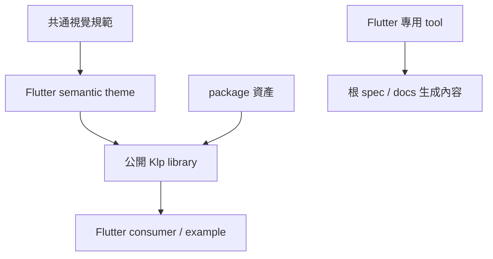

# Flutter package

本 module 為原 Flutter package 的完整機械搬移，擁有 `flutter/`。公開入口及實作責任保持 [library 架構](lib/architecture.md) 與 [實作架構](lib/src/architecture.md)；不引入跨框架 runtime。

`lib/` 提供 Klp 公開元件與 theme；`assets/` 保有 package 字型、圖示及授權；`test/` 維持原斷言；`example/` 為產品資料投影的 Flutter consumer；`tool/` 產生 inventory／Catalog 與執行既有閘門。指向共通 spec／docs 的工具路徑為 `../spec/`／`../docs/`，docs 網站 extractor 留在 repository 根。

搬移不修改元件行為。分析及 inventory 檢查通過；既有測試中的圖示 hover 與 Catalog 缺項在搬移前後相同，詳見 [整合紀錄](../docs/architecture/multi-framework-verification.md)。

## FLUTTER-STYLE-1（完成）

需求沿用 SP-02／03／04／07。新增 styling/style_pack 純資料解析及 adapter，依其 architecture 公開契約。既有 context.klp 與 ThemeExtensions 繼續供全部元件使用，不新增 environment 或產品 renderer。元件不匯入品牌 pack；框架入口生成預設資料。

BUILD write_paths：`flutter/lib/src/styling/style_pack/**`（architecture 除外）、`flutter/lib/src/styling/legacy_theme/klp_theme.dart`、`flutter/lib/kallopis_theme.dart`、`flutter/tool/generate_style_pack.mjs`、`flutter/README.md`。其他 preset／legacy JSON decoder／tests／example／pubspec 皆唯讀。本 slice 完成公開 pack／theme 接入及跨語言證據；example 全元件與 GUI 接續後續既定 stage。

Test Author 唯一可寫 `flutter/test/style_pack_test.dart`；跨語言風險保護完整四 mode、非法 pack／cycles／constraints、override isolation、現有 theme extension／context scope，以及 metadata。既有 inherited icon hover／Catalog failures 不改斷言規避。估算 8k–15k tokens／60–110 分鐘，M1 parser／generator，M2 Theme adapter／scope。若需要改 preset／legacy JSON schema 或切换全庫默認權威，回整合 PLAN。

實作 `17119f2b`；19 項独立 style pack checks、36 項既有 ThemeExtension／VisualStyle checks、5 項既有 accent／builders checks 通過。公開四模式／350 native 映射與 Theme scope 完整；局部 analyze、generator freshness、scope gate 及受保護 test hash 通過。詳見 style_pack module 的完成證據。未切換正式值權威；recipe 參數及布局保護仍為後續工作。
