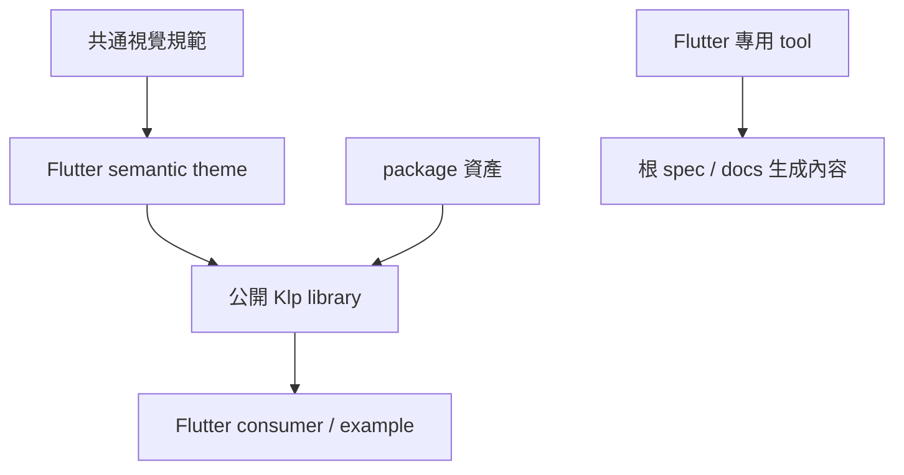

# Flutter package

## FLUTTER-LAYOUT-2（完成）

一般布局接入 [WB-LINEAR-UI-r1](../docs/architecture/workbench-linear-contract.md)，保留現有直接 Flutter API。責任與公開 bounds／divider 契約見 [layout](lib/src/features/workspace/layout/architecture.md)。BUILD write_paths 只含 `flutter/lib/src/features/workspace/layout/klp_app_layout.dart`、`flutter/lib/src/features/workspace/layout/internal/klp_linear_render.dart`；foundation 已匯出主檔，不須更動。architecture、純 geometry helper、tests、FrameGroups、example、Dock、風格檔及配置唯讀。獨立 Test Author 可寫 `flutter/test/workbench_layout_test.dart`。M1 finite geometry／bounds／root inset 接入，M2 natural fallback／protected checks／原公開入口與 Catalog 渲染證據；cold-start 8k–16k tokens／60–120分鐘，參照 FLUTTER-LINEAR-1。超過24k tokens或需要改 Dock／產品 state 回 PLAN。

本 module 為原 Flutter package 的完整機械搬移，擁有 `flutter/`。公開入口及實作責任保持 [library 架構](lib/architecture.md) 與 [實作架構](lib/src/architecture.md)；不引入跨框架 runtime。

## FLUTTER-LINEAR-1（完成）

沿用 [WB-LINEAR-r1](../docs/architecture/workbench-linear-contract.md)，先實作公開有限尺寸解析，下一個 slice 才接入既有直接 Widget。Item／result／函式由 foundation 匯出，具體責任見 layout module。BUILD 只可寫 `flutter/lib/src/features/workspace/layout/klp_linear_layout.dart` 與 `flutter/lib/kallopis_foundation.dart`；architecture、tests、既有 Widget、Dock 與風格資料唯讀。獨立 Test Author 可寫 `flutter/test/linear_layout_test.dart`，保護跨語言尺寸守恆及退化規則。此 slice 的公開 utility 不代表 WB-03 的全部 UI 已完成。

`lib/` 提供 Klp 公開元件與 theme；`assets/` 保有 package 字型、圖示及授權；`test/` 維持原斷言；`example/` 為產品資料投影的 Flutter consumer；`tool/` 產生 inventory／Catalog 與執行既有閘門。指向共通 spec／docs 的工具路徑為 `../spec/`／`../docs/`，docs 網站 extractor 留在 repository 根。

搬移不修改元件行為。分析及 inventory 檢查通過；既有測試中的圖示 hover 與 Catalog 缺項在搬移前後相同，詳見 [整合紀錄](../docs/architecture/multi-framework-verification.md)。

## FLUTTER-STYLE-1（完成）

需求沿用 SP-02／03／04／07。新增 styling/style_pack 純資料解析及 adapter，依其 architecture 公開契約。既有 context.klp 與 ThemeExtensions 繼續供全部元件使用，不新增 environment 或產品 renderer。元件不匯入品牌 pack；框架入口生成預設資料。

BUILD write_paths：`flutter/lib/src/styling/style_pack/**`（architecture 除外）、`flutter/lib/src/styling/legacy_theme/klp_theme.dart`、`flutter/lib/kallopis_theme.dart`、`flutter/tool/generate_style_pack.mjs`、`flutter/README.md`。其他 preset／legacy JSON decoder／tests／example／pubspec 皆唯讀。本 slice 完成公開 pack／theme 接入及跨語言證據；example 全元件與 GUI 接續後續既定 stage。

Test Author 唯一可寫 `flutter/test/style_pack_test.dart`；跨語言風險保護完整四 mode、非法 pack／cycles／constraints、override isolation、現有 theme extension／context scope，以及 metadata。既有 inherited icon hover／Catalog failures 不改斷言規避。估算 8k–15k tokens／60–110 分鐘，M1 parser／generator，M2 Theme adapter／scope。若需要改 preset／legacy JSON schema 或切换全庫默認權威，回整合 PLAN。

實作 `17119f2b`；19 項独立 style pack checks、36 項既有 ThemeExtension／VisualStyle checks、5 項既有 accent／builders checks 通過。公開四模式／350 native 映射與 Theme scope 完整；局部 analyze、generator freshness、scope gate 及受保護 test hash 通過。詳見 style_pack module 的完成證據。未切換正式值權威；recipe 參數及布局保護仍為後續工作。

FLUTTER-LINEAR-1 實作 a8124a62：21 項獨立幾何 checks、公開入口 analyze 及 scope gate 通過；Test Author SHA256 26F406F0C231B0362C2C73760740117771B097C25043DCB8FE484A7D647A653F 未變。既有 Widget／Dock 未改。

FLUTTER-LAYOUT-2 實作 273a0b4f：公開 bounds／divider、Row／Column solver、有限 inset、槽裁切及 unbounded natural fallback 已接入；18 新 Widget checks、4 既有 workspace checks、analyze／scope 通過。既有 Catalog 已實際渲染，視覺接受仍由人類判斷。

## FLUTTER-DOCK-STATE-1（READY）

Dock 保存邊界依 [WB-DOCK-STATE-r1](../docs/architecture/workbench-dock-contract.md)，責任見 [Dock module](lib/src/features/workspace/shell/docking/architecture.md)。新增純 codec／policy／restore diagnostics，保留既有 const model 與受控 UI。write_paths 僅 codec 與 foundation 新增 export；獨立 Test Author 保護保存失敗、identity、跨語言格式與 registry reconciliation。一般布局及 Dock UI 皆唯讀；不把此 slice 宣稱成全部 WB-04～08 完成。
