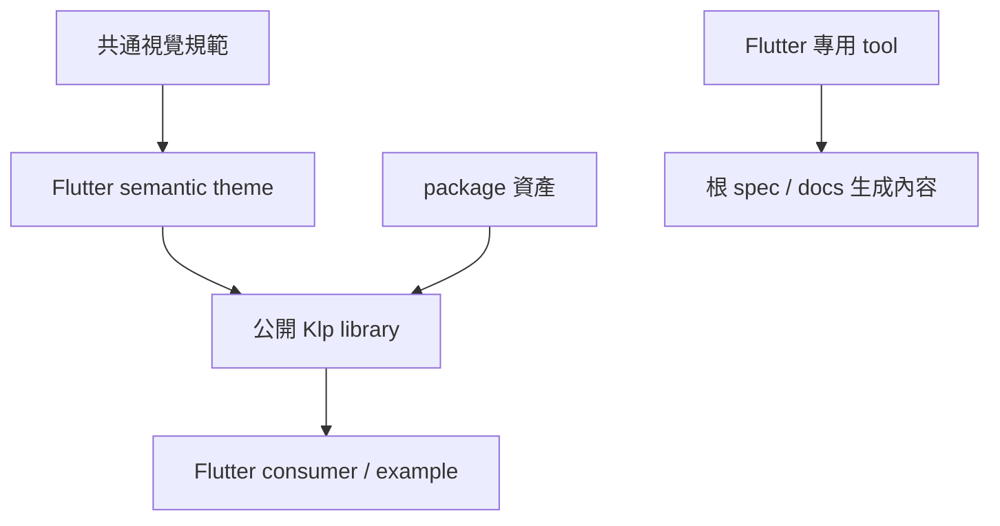

# Flutter package

本 module 為原 Flutter package 的完整機械搬移，擁有 `flutter/`。公開入口及實作責任保持 [library 架構](lib/architecture.md) 與 [實作架構](lib/src/architecture.md)；不引入跨框架 runtime。

`lib/` 提供 Klp 公開元件與 theme；`assets/` 保有 package 字型、圖示及授權；`test/` 維持原斷言；`example/` 為產品資料投影的 Flutter consumer；`tool/` 產生 inventory／Catalog 與執行既有閘門。指向共通 spec／docs 的工具路徑為 `../spec/`／`../docs/`，docs 網站 extractor 留在 repository 根。

搬移不修改元件行為。分析及 inventory 檢查通過；既有測試中的圖示 hover 與 Catalog 缺項在搬移前後相同，詳見 [整合紀錄](../docs/architecture/multi-framework-verification.md)。
