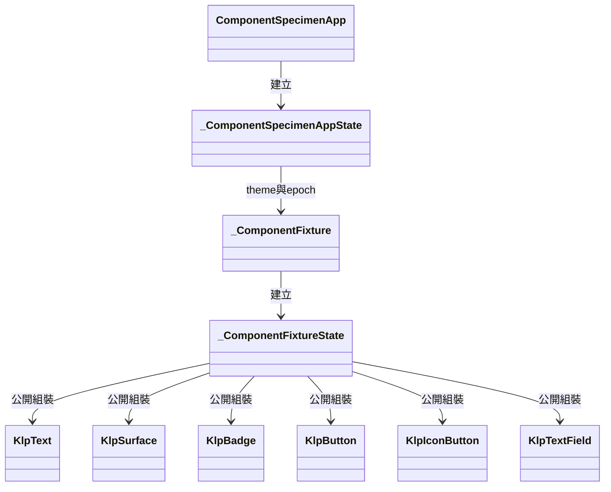
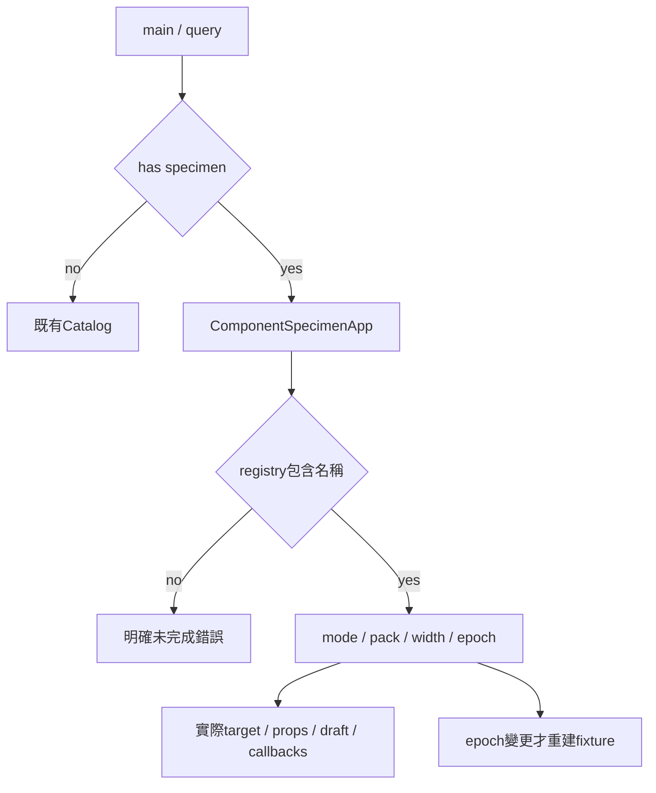

# Flutter 公開 consumer 範例

目前目標：IDOC-COMPONENT-REGISTRY-r1 的公開元件專屬路由。庫擁有樣式及互動，example擁有展示資料、控制、回呼觀察與重設。不得引用package:kallopis/src；舊Catalog的coveredComponents／空build不算互動coverage。全量273個可渲染元件仍需逐項真實fixture；本slice只交付6個，不宣稱全部完成。

## FLUTTER-COMPONENT-SPECIMENS-1（READY）

修訂FLUTTER-COMPONENT-SPECIMENS-r1，write lib/main.dart及lib/component_specimens.dart兩path。main只新增公開query入口：Uri.base.queryParameters有specimen時執行ComponentSpecimenApp，沒有則保留原Catalog；空值／未知名稱明確錯誤，不退總覽。新來源只匯入Flutter與stable foundation/theme，const名稱registry包含KlpText／KlpSurface／KlpBadge／KlpButton／KlpIconButton／KlpTextField，所有名稱都有真實組裝與當次target自己的props控制。

ComponentSpecimenApp擁有四模式、base／spacious同正式pack、760／320有限可用寬度、epoch重設；只改Theme不得清掉Fixture State／draft，reset明確重建。spacious用同正式spacing IDs與space600／space300引用，不能另寫共用theme。fixture擁有text controller、enum index、selected／disabled／secondary參數與callback計數；自身參數變更與原生輸入可觀察。使用例文字必須符合實際constructor，公開入口明示。不能用現成整個catalog頁冒充target；compound共享只接受當次target控制。

後續相同module增量補其餘真實fixtures，網站registry／bundle／全量coverage由reference-site module依共同契約接續，本BUILD不得修改generator、manifest、styles、庫、generated或tests。

cold4k～8k／30～60分鐘，M1 source與analyze/build（5k40）；M2原生route、6target參數/callback、模式及窄尺寸/重設觀察、scope2（8k60）。12k90或需要新public API返回PLAN。既有public typecheck與release web為Yellow，無新核心演算法／persist層，不新增鏡像tests；感官human-pending。全量網站閘門不得在273仍缺項時放行。

## 責任及依賴

| Source／class | 責任 |
| --- | --- |
| lib/main.dart：main／KallopisCatalogApp／_KallopisCatalogAppState | query分流；既有Catalog選取、theme／品牌及window lifecycle保持 |
| lib/component_specimens.dart：ComponentSpecimenApp／_ComponentSpecimenAppState | 專屬公開名稱驗證與展示環境、同pack四模式、fixture reset |
| lib/component_specimens.dart：_ComponentFixture／_ComponentFixtureState | 當次元件的資料、props控制與回呼計數，controller生命週期 |
| lib/catalog_shell.dart：CatalogShell／_CatalogShellState／_CatalogNavigation／_CatalogStage／_SpecimenBlock | 原Catalog導航與page／specimen容器；非專屬coverage authority |
| lib/catalog_theme_scope.dart：CatalogThemeScope | 既有Catalog品牌更新投影；專屬host不用此第二theme來源 |
| lib/catalog_model.dart／lib/catalog/** | 既有展示資料與各Catalog頁，generated註冊不改；命令與Dock已完成public consumer沿用既有契約 |

