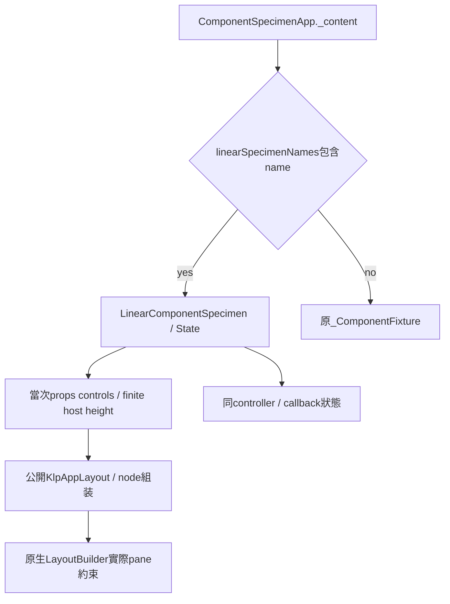
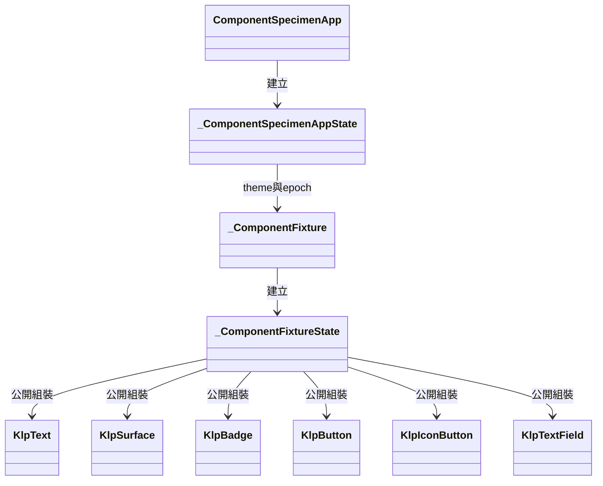
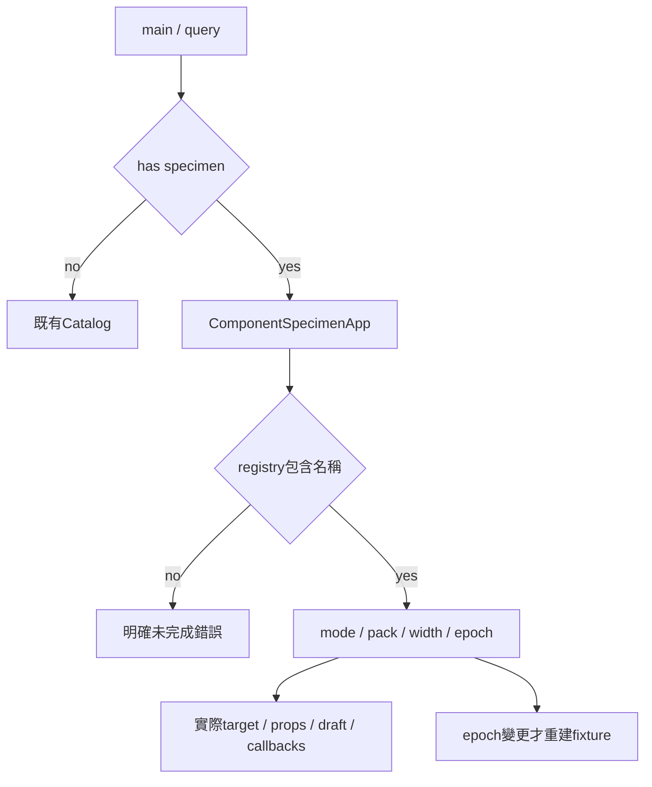
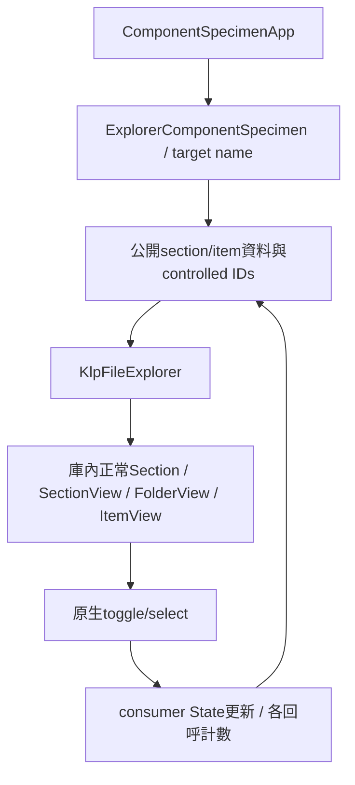

# Flutter 公開 consumer 範例

目前目標：IDOC-COMPONENT-REGISTRY-r1 的公開元件專屬路由。庫擁有樣式及互動，example擁有展示資料、控制、回呼觀察與重設。不得引用package:kallopis/src；舊Catalog的coveredComponents／空build不算互動coverage。目前有12個真實fixture；全量273個可渲染元件仍需逐項補足，不宣稱全部完成。

## FLUTTER-COMPONENT-SPECIMENS-1（COMPLETE）

修訂FLUTTER-COMPONENT-SPECIMENS-r1，write lib/main.dart及lib/component_specimens.dart兩path。main只新增公開query入口：Uri.base.queryParameters有specimen時執行ComponentSpecimenApp，沒有則保留原Catalog；空值／未知名稱明確錯誤，不退總覽。新來源只匯入Flutter與stable foundation/theme，const名稱registry包含KlpText／KlpSurface／KlpBadge／KlpButton／KlpIconButton／KlpTextField，所有名稱都有真實組裝與當次target自己的props控制。

ComponentSpecimenApp擁有四模式、base／spacious同正式pack、760／320有限可用寬度、epoch重設；只改Theme不得清掉Fixture State／draft，reset明確重建。spacious用同正式spacing IDs與space600／space300引用，不能另寫共用theme。fixture擁有text controller、enum index、selected／disabled／secondary參數與callback計數；自身參數變更與原生輸入可觀察。使用例文字必須符合實際constructor，公開入口明示。不能用現成整個catalog頁冒充target；compound共享只接受當次target控制。

後續相同module增量補其餘真實fixtures，網站registry／bundle／全量coverage由reference-site module依共同契約接續，本BUILD不得修改generator、manifest、styles、庫、generated或tests。

cold4k～8k／30～60分鐘，M1 source與analyze/build（5k40）；M2原生route、6target參數/callback、模式及窄尺寸/重設觀察、scope2（8k60）。12k90或需要新public API返回PLAN。既有public typecheck與release web為Yellow，無新核心演算法／persist層，不新增鏡像tests；感官human-pending。全量網站閘門不得在273仍缺項時放行。

BUILDde4fd31c exact2source，public analyze No issues／release web49.9秒／scope2／diff通過。原生6route載入及各target控制觀察；Button tone/size/selected/disabled與callback1、Icon tone/size/quarterTurns/selected與callback1、Text role/tone/maxLines、Surface tone/frosted/padding、Badge tone/variant/dot、TextField size/outlined/multiline/change1。light／dark／ultraDark／transparent及spacious/local320切換保留實際canvas草稿；reset元件還原count0與props但保留環境。Flutter未focused的DOM textarea空值不作資料丟失結論，canvas截圖確認原文仍在。Unknown明確error不退總覽。main build/flutter-component-specimens.png為dark／spacious／local320 Button證據；browser viewport未縮至320，只有展示container。其餘267 Flutter展示、網站bundle與iframe仍pending。

| 已定義函式／方法 | 實際責任 |
| --- | --- |
| flutterSpecimenNames | 六個有實際fixture的公開名稱，後續coverage只讀真實registry |
| ComponentSpecimenApp.createState／_ComponentSpecimenAppState.build／_content | host生命週期、Theme唯一pack、未知名稱拒絕、環境controls、有限width與epoch |
| _ComponentFixture.createState／_ComponentFixtureState.dispose | fixture/controller生命週期，theme重建不清draft |
| _record／_edit／_cycle／_controls | 真實callback記錄／原draft重畫／公開控制按鈕／當次target參數投影 |
| _target／_usage／build | 只組裝當次公開元件／正確constructor示例／可用寬度內controls與狀態 |
| nested callbacks | 各環境State setter、enum cycle、LayoutBuilder寬度夾限、TextField原callback；無新業務handler |

## 下一個 PLAN 入口

接續同module的finite linear專屬target：KlpAppLayout、KlpLayoutPane、KlpLayoutDivider、LayoutRow、LayoutColumn、LayoutSpacer（以正式公開名稱為準，不能照React名稱猜測）。以公開manifest constructor與linear共同契約形成下一exact Task Packet，finite280高／可用container寬度，自己的bounds/flex/alignment/spacing或合法host方向控制；Divider沒有可改自己的風格props，只展示合法compound方向，不新增假的公開參數。其餘widgets不是未完成placeholder coverage。

## FLUTTER-LINEAR-SPECIMENS-1（COMPLETE）

修訂FLUTTER-LINEAR-SPECIMENS-r1，exact lib/component_specimens.dart及新lib/linear_specimens.dart。前者只加入六個真實route與選中target的fixture分流，原六target／environment不改。後者公開LinearComponentSpecimen(name)與linearSpecimenNames，僅stable foundation／Flutter imports；自身State擁有draft controller與finite120／280高、bounds minimum40／100、preferred100／180、maximum220／300、flex1／3、spacing/alignment、pane size與root inset enum。每個route只顯示自身props controls：row/column自己的bounds/flex/spacing/alignment；pane自己的bounds/flex/size；spacer自己的bounds/flex；root自身inset與floatingAction callback；divider無props，提供合法宿主row/column方向與內容變更。真實LayoutBuilder顯示分配後pane尺寸，不自寫算法結果冒充rendered幾何。120／280是展示host高度不是公開元件props。

有限KlpAppLayout宿主組裝實際public KlpLayoutNode，data僅consumer state。row／column target嵌在同方向parent內以觀察自己的bounds／flex；divider兩旁不再加假的consumer間距；spacer留白以兩旁真實pane觀察。parent finitewidth沿原host，不重複設root inset；原draft controller跨theme保持，epoch明確重設。回呼計數只root實際floatingAction及原生draft change，不聲稱布局有resize callback。

驗收public analyze／release web、六個query真實target及controls native觀察、有限size/style／draft／reset、registry集合與正式manifest可渲染名稱一致、scope2/diff。原library/tests/style/generator/generated不可寫；沒有新算法及persist風險，不新增鏡像tests。感官human-pending。冷啟動4k～8k／30～60分鐘（參照FLUTTER-COMPONENT-SPECIMENS-1）；M1 source/type/build（5k40），M2六routes幾何與操作/scope（8k60）；12k90或公開layout contract不足回PLAN。

BUILD417e18a8 exact2source，6名稱對應正式renderable；public analyze No issues、release web48.0秒、scope2及diff通過。初次只有sort_child_properties_last info，改參數順序後同analyze Green，未改設定。有限槽內容自有scroll支持壓縮，不改庫算法。原生6routes及props操作：Row start/end實際A x12→124、Column y196→274；Pane auto flex使target220→100，local320／120高／large bounds／flex3為target279、伴槽33，草稿及callback1跨dark/spacious保留，reset props/count0且環境保留；Spacer兩旁262→24.8；Divider row376×280→column760×56；AppLayout standard368×264→none376×280，floatingAction回呼1。最後error/warn空。main build/flutter-linear-specimens.png為Pane窄container證據；browser viewport未缩320，感官human-pending。

_LinearComponentSpecimenState的_bounds／_flex解析consumer參數；dispose清controller；_record記原回呼；_cycle／_controls只投影當次target合法參數；_paneContent讀原生約束與consumer scroll；_pane／_fixedPane分別提供伸展槽及有上限自然槽，後者使alignment unused可觀察；_node組裝公開合法compound；_usage顯示有效constructor；build配置finitehost及狀態。nested callbacks為enum/bool更新、LayoutBuilder measurement與input callback，沒有新業務handler。Pane自動flex可切回null以觀察size角色，避免明示flex掩蓋此參數。

| class／function | 責任 |
| --- | --- |
| linearSpecimenNames／LinearComponentSpecimen | 六個實際target名稱與公開consumer輸入 |
| _LinearComponentSpecimenState | controller生命週期、bounds/enum/host state與回呼計數；build與controls/target/usage分工 |
| component host fixture分流 | 保留epoch與environment，把linear名稱交到LinearComponentSpecimen，其他六個原fixture保持 |

## 責任及依賴

| Source／class | 責任 |
| --- | --- |
| lib/main.dart：main／KallopisCatalogApp／_KallopisCatalogAppState | query分流；既有Catalog選取、theme／品牌及window lifecycle保持 |
| lib/component_specimens.dart：ComponentSpecimenApp／_ComponentSpecimenAppState | 專屬公開名稱驗證與展示環境、同pack四模式、fixture reset |
| lib/component_specimens.dart：_ComponentFixture／_ComponentFixtureState | 當次元件的資料、props控制與回呼計數，controller生命週期 |
| lib/catalog_shell.dart：CatalogShell／_CatalogShellState／_CatalogNavigation／_CatalogStage／_SpecimenBlock | 原Catalog導航與page／specimen容器；非專屬coverage authority |
| lib/catalog_theme_scope.dart：CatalogThemeScope | 既有Catalog品牌更新投影；專屬host不用此第二theme來源 |
| lib/catalog_model.dart／lib/catalog/** | 既有展示資料與各Catalog頁，generated註冊不改；命令與Dock已完成public consumer沿用既有契約 |

## FLUTTER-EXPLORER-SPECIMENS-1（READY）

修訂FLUTTER-EXPLORER-SPECIMENS-r1，exact lib/component_specimens.dart及新lib/explorer_specimens.dart。維持AGENTS Explorer只用KlpFileExplorer直接consumer；五個公開renderable target（root、Section、SectionView、FolderView、ItemView）分別專屬query，但views只能經公開root及section/item資料的合法compound渲染，不另做adapter/node/renderer。實際公開root build確實插入Section._render與SectionView，Folder／Item亦為正常root後代，故不以空的Section standalone build當展示。此owner讀直接source只為釐清renderability／consumer邊界衝突，BUILD不得讀私有part。

Registry只含五個真實fixture。ExplorerComponentSpecimen(name) State擁有標籤controller、spacing index、section/folder expanded、selectedId、level0/1、collapsible、item badge/tone、增加項目及root空sections/emptyStateSections控制。各route顯示自己props：root sections/emptyStateSections、spacing及controlled state；Section title/items/expanded/collapsible；SectionView section.title/isExpanded/spacing及native callbacks；FolderView item/level/isExpanded/isSelected/spacing；ItemView item/level/isSelected/spacing。Section expanded與root expanded IDs保持一致，callback由consumer同步資料；不假稱Standalone Section可顯示。level由合法額外folder資料及展開IDs造成，不能傳私有node。

使用例固定stablefoundation import＋KlpFileExplorer合法組裝，說明views經root投影。Controller不隨theme變更；primitive回呼分列sectionToggle／itemToggle／itemSelected次數及最後ID，不把controls按鈕算元件callback。每route有finite280高的Explorer viewport，未註冊名稱仍拒絕。前12target與原host四模式／pack／width／reset保持。

驗收public analyze/release web、五名稱對正式renderable、原生五routes自己的props/回呼、level/expand/selected/空fallback、style與reset/draft、scope2/diff。庫及tests/generated/style/generator不可寫；沒有新算法/persist不加鏡像tests；感官human-pending。參照前兩specimen slice估4k～8k／30～60分鐘；M1 source/type/build（5k40），M2 native5/routes/回呼/scope（8k60）；12k90或root不能投影必要view行為回PLAN。

| class／function | 責任 |
| --- | --- |
| explorerSpecimenNames／ExplorerComponentSpecimen | 五個真實公開target名稱／選中target輸入 |
| _ExplorerComponentSpecimenState | 公開section/item資料、受控展開/選取、原native回呼計數及controller生命週期 |
| host fixture分流 | explorer優先分流，保留前12與unknown gate、epoch lifecycle |

