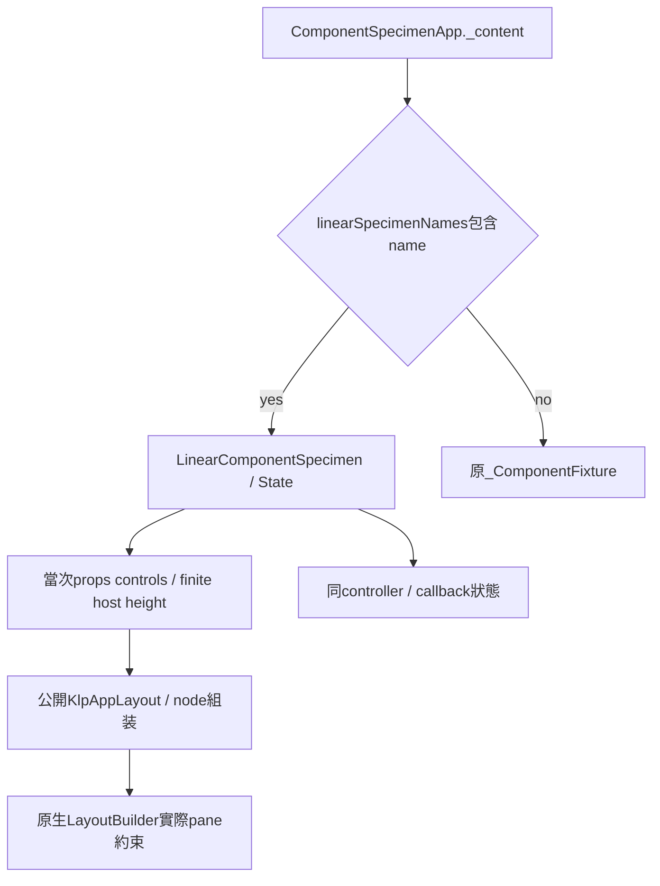
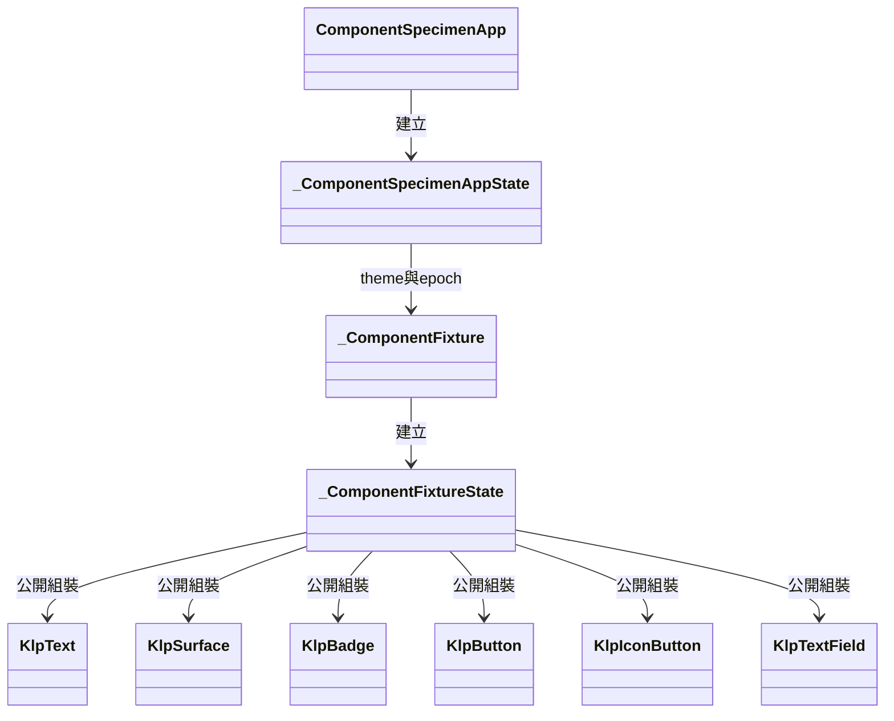
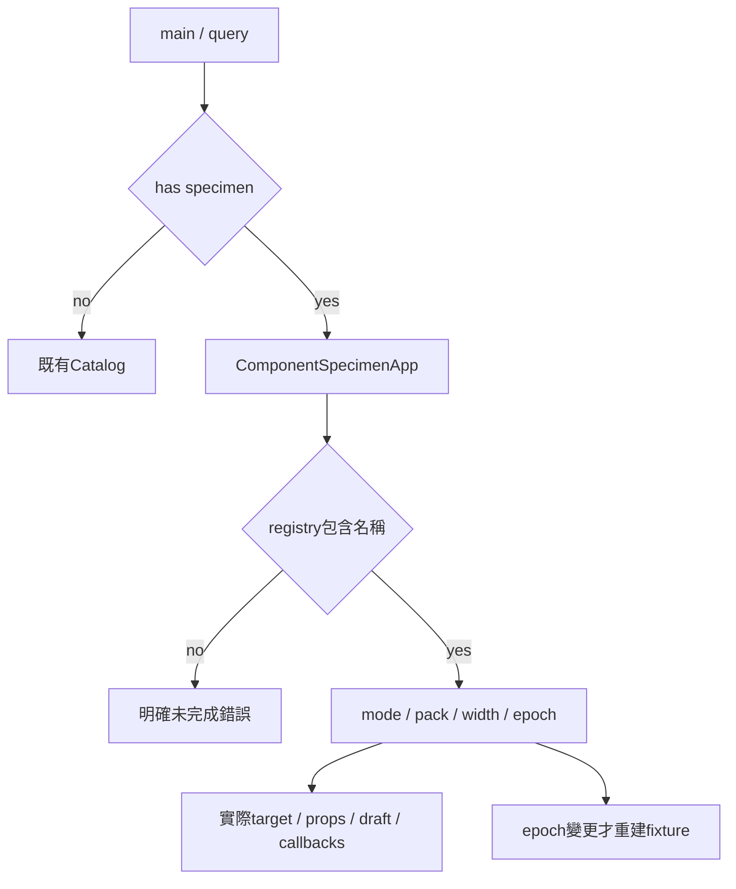
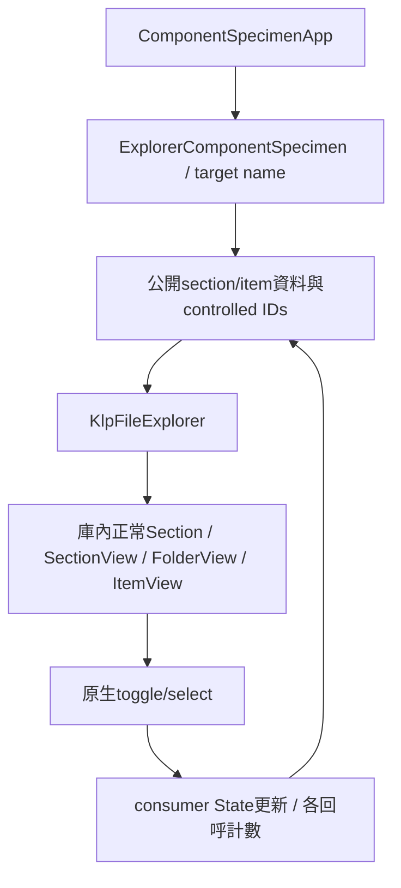
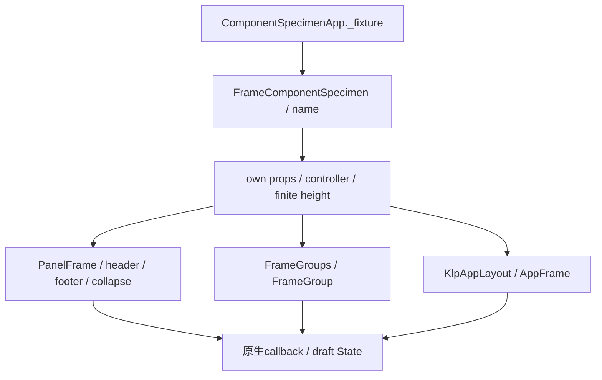
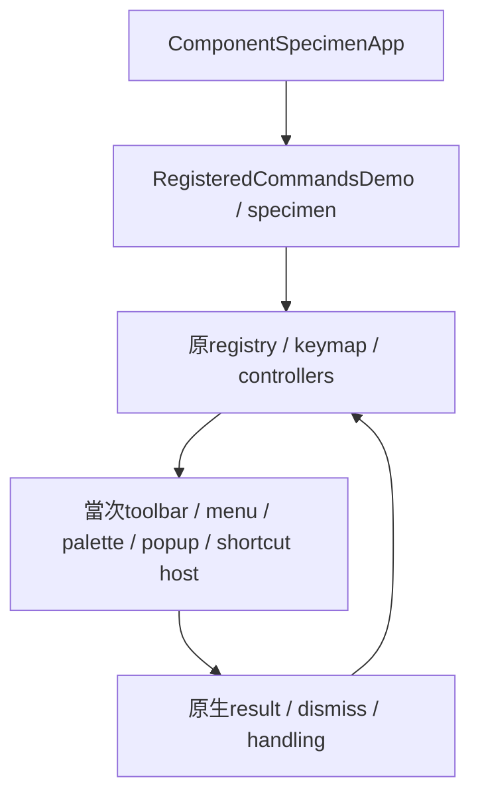

# Flutter 公開 consumer 範例

目前目標：IDOC-COMPONENT-REGISTRY-r1 的公開元件專屬路由。庫擁有樣式及互動，example擁有展示資料、控制、回呼觀察與重設。不得引用package:kallopis/src；舊Catalog的coveredComponents／空build不算互動coverage。目前有24個真實fixture；全量273個可渲染元件仍需逐項補足，不宣稱全部完成。

## FLUTTER-COMPONENT-SPECIMENS-1（COMPLETE）

修訂FLUTTER-COMPONENT-SPECIMENS-r1，write lib/main.dart及lib/component_specimens.dart兩path。main只新增公開query入口：Uri.base.queryParameters有specimen時執行ComponentSpecimenApp，沒有則保留原Catalog；空值／未知名稱明確錯誤，不退總覽。新來源只匯入Flutter與stable foundation/theme，const名稱registry包含KlpText／KlpSurface／KlpBadge／KlpButton／KlpIconButton／KlpTextField，所有名稱都有真實組裝與當次target自己的props控制。

ComponentSpecimenApp擁有四模式、base／spacious同正式pack、760／320有限可用寬度、epoch重設；只改Theme不得清掉Fixture State／draft，reset明確重建。spacious用同正式spacing IDs與space600／space300引用，不能另寫共用theme。fixture擁有text controller、enum index、selected／disabled／secondary參數與callback計數；自身參數變更與原生輸入可觀察。使用例文字必須符合實際constructor，公開入口明示。不能用現成整個catalog頁冒充target；compound共享只接受當次target控制。

後續相同module增量補其餘真實fixtures，網站registry／bundle／全量coverage由reference-site module依共同契約接續，本BUILD不得修改generator、manifest、styles、庫、generated或tests。

cold4k～8k／30～60分鐘，M1 source與analyze/build（5k40）；M2原生route、6target參數/callback、模式及窄尺寸/重設觀察、scope2（8k60）。12k90或需要新public API返回PLAN。既有public typecheck與release web為Yellow，無新核心演算法／persist層，不新增鏡像tests；感官human-pending。全量網站閘門不得在273仍缺項時放行。

BUILDde4fd31c exact2source，public analyze No issues／release web49.9秒／scope2／diff通過。原生6route載入及各target控制觀察；Button tone/size/selected/disabled與callback1、Icon tone/size/quarterTurns/selected與callback1、Text role/tone/maxLines、Surface tone/frosted/padding、Badge tone/variant/dot、TextField size/outlined/multiline/change1。light／dark／ultraDark／transparent及spacious/local320切換保留實際canvas草稿；reset元件還原count0與props但保留環境。Flutter未focused的DOM textarea空值不作資料丟失結論，canvas截圖確認原文仍在。Unknown明確error不退總覽。main build/flutter-component-specimens.png為dark／spacious／local320 Button證據；browser viewport未縮至320，只有展示container。其餘267 Flutter展示、網站bundle與iframe仍pending。

| 已定義函式／方法 | 實際責任 |
| --- | --- |
| flutterSpecimenNames | 六個有實際fixture的公開名稱，後續coverage只讀真實registry |
| ComponentSpecimenApp.createState／_ComponentSpecimenAppState.build／_content | host生命週期、Theme唯一pack、未知名稱拒絕、環境controls、有限width與epoch |
| _ComponentFixture.createState／_ComponentFixtureState.dispose | fixture/controller生命週期，theme重建不清draft |
| _record／_edit／_cycle／_controls | 真實callback記錄／原draft重畫／公開控制按鈕／當次target參數投影 |
| _target／_usage／build | 只組裝當次公開元件／正確constructor示例／可用寬度內controls與狀態 |
| nested callbacks | 各環境State setter、enum cycle、LayoutBuilder寬度夾限、TextField原callback；無新業務handler |

## 下一個 PLAN 入口

接續同module的finite linear專屬target：KlpAppLayout、KlpLayoutPane、KlpLayoutDivider、LayoutRow、LayoutColumn、LayoutSpacer（以正式公開名稱為準，不能照React名稱猜測）。以公開manifest constructor與linear共同契約形成下一exact Task Packet，finite280高／可用container寬度，自己的bounds/flex/alignment/spacing或合法host方向控制；Divider沒有可改自己的風格props，只展示合法compound方向，不新增假的公開參數。其餘widgets不是未完成placeholder coverage。

## FLUTTER-LINEAR-SPECIMENS-1（COMPLETE）

修訂FLUTTER-LINEAR-SPECIMENS-r1，exact lib/component_specimens.dart及新lib/linear_specimens.dart。前者只加入六個真實route與選中target的fixture分流，原六target／environment不改。後者公開LinearComponentSpecimen(name)與linearSpecimenNames，僅stable foundation／Flutter imports；自身State擁有draft controller與finite120／280高、bounds minimum40／100、preferred100／180、maximum220／300、flex1／3、spacing/alignment、pane size與root inset enum。每個route只顯示自身props controls：row/column自己的bounds/flex/spacing/alignment；pane自己的bounds/flex/size；spacer自己的bounds/flex；root自身inset與floatingAction callback；divider無props，提供合法宿主row/column方向與內容變更。真實LayoutBuilder顯示分配後pane尺寸，不自寫算法結果冒充rendered幾何。120／280是展示host高度不是公開元件props。

有限KlpAppLayout宿主組裝實際public KlpLayoutNode，data僅consumer state。row／column target嵌在同方向parent內以觀察自己的bounds／flex；divider兩旁不再加假的consumer間距；spacer留白以兩旁真實pane觀察。parent finitewidth沿原host，不重複設root inset；原draft controller跨theme保持，epoch明確重設。回呼計數只root實際floatingAction及原生draft change，不聲稱布局有resize callback。

驗收public analyze／release web、六個query真實target及controls native觀察、有限size/style／draft／reset、registry集合與正式manifest可渲染名稱一致、scope2/diff。原library/tests/style/generator/generated不可寫；沒有新算法及persist風險，不新增鏡像tests。感官human-pending。冷啟動4k～8k／30～60分鐘（參照FLUTTER-COMPONENT-SPECIMENS-1）；M1 source/type/build（5k40），M2六routes幾何與操作/scope（8k60）；12k90或公開layout contract不足回PLAN。

BUILD417e18a8 exact2source，6名稱對應正式renderable；public analyze No issues、release web48.0秒、scope2及diff通過。初次只有sort_child_properties_last info，改參數順序後同analyze Green，未改設定。有限槽內容自有scroll支持壓縮，不改庫算法。原生6routes及props操作：Row start/end實際A x12→124、Column y196→274；Pane auto flex使target220→100，local320／120高／large bounds／flex3為target279、伴槽33，草稿及callback1跨dark/spacious保留，reset props/count0且環境保留；Spacer兩旁262→24.8；Divider row376×280→column760×56；AppLayout standard368×264→none376×280，floatingAction回呼1。最後error/warn空。main build/flutter-linear-specimens.png為Pane窄container證據；browser viewport未缩320，感官human-pending。

_LinearComponentSpecimenState的_bounds／_flex解析consumer參數；dispose清controller；_record記原回呼；_cycle／_controls只投影當次target合法參數；_paneContent讀原生約束與consumer scroll；_pane／_fixedPane分別提供伸展槽及有上限自然槽，後者使alignment unused可觀察；_node組裝公開合法compound；_usage顯示有效constructor；build配置finitehost及狀態。nested callbacks為enum/bool更新、LayoutBuilder measurement與input callback，沒有新業務handler。Pane自動flex可切回null以觀察size角色，避免明示flex掩蓋此參數。

| class／function | 責任 |
| --- | --- |
| linearSpecimenNames／LinearComponentSpecimen | 六個實際target名稱與公開consumer輸入 |
| _LinearComponentSpecimenState | controller生命週期、bounds/enum/host state與回呼計數；build與controls/target/usage分工 |
| component host fixture分流 | 保留epoch與environment，把linear名稱交到LinearComponentSpecimen，其他六個原fixture保持 |

## 責任及依賴

| Source／class | 責任 |
| --- | --- |
| lib/main.dart：main／KallopisCatalogApp／_KallopisCatalogAppState | query分流；既有Catalog選取、theme／品牌及window lifecycle保持 |
| lib/component_specimens.dart：ComponentSpecimenApp／_ComponentSpecimenAppState | 專屬公開名稱驗證與展示環境、同pack四模式、fixture reset |
| lib/component_specimens.dart：_ComponentFixture／_ComponentFixtureState | 當次元件的資料、props控制與回呼計數，controller生命週期 |
| lib/catalog_shell.dart：CatalogShell／_CatalogShellState／_CatalogNavigation／_CatalogStage／_SpecimenBlock | 原Catalog導航與page／specimen容器；非專屬coverage authority |
| lib/catalog_theme_scope.dart：CatalogThemeScope | 既有Catalog品牌更新投影；專屬host不用此第二theme來源 |
| lib/catalog_model.dart／lib/catalog/** | 既有展示資料與各Catalog頁，generated註冊不改；命令與Dock已完成public consumer沿用既有契約 |

## FLUTTER-EXPLORER-SPECIMENS-1（COMPLETE）

修訂FLUTTER-EXPLORER-SPECIMENS-r1，exact lib/component_specimens.dart及新lib/explorer_specimens.dart。維持AGENTS Explorer只用KlpFileExplorer直接consumer；五個公開renderable target（root、Section、SectionView、FolderView、ItemView）分別專屬query，但views只能經公開root及section/item資料的合法compound渲染，不另做adapter/node/renderer。實際公開root build確實插入Section._render與SectionView，Folder／Item亦為正常root後代，故不以空的Section standalone build當展示。此owner讀直接source只為釐清renderability／consumer邊界衝突，BUILD不得讀私有part。

Registry只含五個真實fixture。ExplorerComponentSpecimen(name) State擁有標籤controller、spacing index、section/folder expanded、selectedId、level0/1、collapsible、item badge/tone、增加項目及root空sections/emptyStateSections控制。各route顯示自己props：root sections/emptyStateSections、spacing及controlled state；Section title/items/expanded/collapsible；SectionView section.title/isExpanded/spacing及native callbacks；FolderView item/level/isExpanded/isSelected/spacing；ItemView item/level/isSelected/spacing。Section expanded與root expanded IDs保持一致，callback由consumer同步資料；不假稱Standalone Section可顯示。level由合法額外folder資料及展開IDs造成，不能傳私有node。

使用例固定stablefoundation import＋KlpFileExplorer合法組裝，說明views經root投影。Controller不隨theme變更；primitive回呼分列sectionToggle／itemToggle／itemSelected次數及最後ID，不把controls按鈕算元件callback。每route有finite280高的Explorer viewport，未註冊名稱仍拒絕。前12target與原host四模式／pack／width／reset保持。

驗收public analyze/release web、五名稱對正式renderable、原生五routes自己的props/回呼、level/expand/selected/空fallback、style與reset/draft、scope2/diff。庫及tests/generated/style/generator不可寫；沒有新算法/persist不加鏡像tests；感官human-pending。參照前兩specimen slice估4k～8k／30～60分鐘；M1 source/type/build（5k40），M2 native5/routes/回呼/scope（8k60）；12k90或root不能投影必要view行為回PLAN。

BUILD96dc07d9 exact2source，public analyze No issues／releaseweb50.9秒／5名稱對正式renderable／scope2/diff Green。原生5route：root select1與sectionToggle1，空集合fallback真正呈現／原生收合回呼2，再關fallback為空；Section title與items增加／collapsible停用；SectionView spacing＋select/toggle各1；Folder箭頭itemToggle1，標籤原生既有行為同時toggle至2／select1，沒有改庫手感；Folder label／level1／badge／tone／selected跨dark／spacious／local320保留，reset所有計數0／資料與level還原且環境保留；Item leaf原生select1、改label／level／badge／tone／selected clear觀察。error/warn空。main build/flutter-explorer-specimens.png為正常public root內Folder實際呈現；非全量完成、keyboard/IME矩陣與感官仍pending。

_ExplorerComponentSpecimenState._folderTarget／_itemTarget／_targetId／_initialLabel選擇當次subject；dispose清controller；_onSectionToggle分project/fallback保持資料與控制ID一致，_onItemToggle更新同expandedSet，_onItemSelected更新selectedId，三者分開計數；_control／_controls只投影own props；_items建立合法level樹資料，_explorer組裝唯一publicroot；_usage说明root投影，build呈現finiteviewport／draft／回呼。host新_fixture按explorer／linear／basic分流並保留epoch。nested callbacks為props更新／文字重畫，不計入原生回呼。没有重新引入node/adapter/renderer。

| class／function | 責任 |
| --- | --- |
| explorerSpecimenNames／ExplorerComponentSpecimen | 五個真實公開target名稱／選中target輸入 |
| _ExplorerComponentSpecimenState | 公開section/item資料、受控展開/選取、原native回呼計數及controller生命週期 |
| host fixture分流 | explorer優先分流，保留前12與unknown gate、epoch lifecycle |

## FLUTTER-FRAME-SPECIMENS-1（COMPLETE）

修訂FLUTTER-FRAME-SPECIMENS-r1，exact lib/component_specimens.dart及新lib/frame_specimens.dart。七個真實query：KlpPanelFrame／KlpPanelHeader／KlpPanelFooter／KlpFrameGroup／KlpFrameGroups／KlpAppFrame／KlpPaneCollapseControl，stable公開組裝與當次own controls；FrameGroup合法位於FrameGroups，AppFrame合法在KlpAppLayout／LayoutRow，Panel header/footer合法在PanelFrame，不退到整個無關Catalog。

FrameComponentSpecimen State擁有title與draft controllers、callbacks及finite120/280 host。PanelFrame controls tone/elevation/headerSize與header/footer有無；Header title/titleRole/label/leading/actions/content；Footer child內容與null／semantic/directional padding；FrameGroup content數量及style.padding/divider/contentSpacing；FrameGroups groups數量/footer；AppFrame role/surface/bounds/flex/optional width；Collapse collapsed/onToggle enabled/icon/label。可調數值是產品展示選擇，共用gap/color/padding讀context.klp；不寫第二theme。原state跨四模式/pack/width保留，epoch重設；native actions與input callbacks分別記錄，不把controls計入。finite正文自有scroll支持壓縮，槽分配仍庫擁有。

驗收public analyze/releaseweb、7名稱與正式renderable一致、native每target自己的props與callback、finite/style/draft/reset及scope2/diff；原17與unknown gate保持。library/tests/config/generated/styles/generator不可寫，無新算法/persist不加鏡像tests，感官human-pending。冷估4k～9k/30～70分鐘；M1 source/type/build（5k40），M2 native7/scope（9k70）；14k100或compound契約不足回PLAN。

BUILDab49a75a exact2source；7名稱對正式renderable、public analyze No issues／最終releaseweb53.6秒／scope2及diff通過。三個非const constructor誤用const在consumer修正；Header非法label模式清掉title/content在debug native重現assert，最小修正保留title或custom content，再同nativecase確認title與輔助label皆呈現且callback1。歷史錯誤跨navigation保留曾在AppFrame頁讀到，不能歸因AppFrame；以最終5201 URL篩選error/warn空。未改庫、tests或任何斷言。

原生七route及own controls：PanelFrame tone/elevation/headerSize、可選header/footer、finite120高/local320、dark/spacious保留draft與動作1／正文change1，reset0且環境保留；Header titleRole/custom content/label/leading/actions1；Footer null/semantic/directional padding及action1；Group style.padding/divider/contentSpacing與content1→3 action1；Groups1→3/footer action1；Collapse Enter callback1、collapsed／disabled／icon；AppFrame width180時明確flex0且preferred null，同層x316→196，另bounds preferred200/flex3/auxiliary/raised/finite與theme保持canvas草稿。width自然尺寸fixture不能被明示preferred掩蓋，controls顯示實際使用值。main build/flutter-frame-specimens.png為PanelFrame dark/raised/spacious/finite證據；局部320不是browser viewport，感官human-pending。

_FrameComponentSpecimenState的_appFlex／_appPreferred解析展示的明示width或bounds情境；dispose清兩controllers；_action／_collapse／_change記實際動作及正文回呼；_control／_controls投影當次props；_draftField／_body配置公開輸入與正文scroll；_panelHeader保留合法內容與輔助label，_panelFooter以semantic padding示範方向值；_group構造合法內容組，_target選中當次公開compound，_usage顯示有效constructor，build提供finitehost/狀態。nested callbacks為props更新與文字重畫，不計入原生動作。host _fixture加入frame分流，同epoch owner保留。

| class／function | 責任 |
| --- | --- |
| frameSpecimenNames／FrameComponentSpecimen | 真實公開target registry及name輸入 |
| _FrameComponentSpecimenState | controller生命週期、own props、finitehost與callback結果；只組裝public compound |
| host _fixture | frame／explorer／linear／basic分流，同epoch owner |

## FLUTTER-COMMAND-SPECIMENS-1（READY）

修訂FLUTTER-COMMAND-SPECIMENS-r1。exact lib/component_specimens.dart、lib/catalog/registered_commands_page.dart；將既有命令consumer暴露RegisteredCommandsDemo(specimen可選)，預設保留完整Catalog。五個獨立query為RegisteredCommandToolbar、RegisteredCommandMenu、RegisteredCommandPalette、RegisteredCommandPopup、CommandShortcutHost（均Klp前綴）。沿用同registry/keymap/controller/results，不複製handler或建立第二命令核心。

當次route只插入自己的entry；toolbar/menu投影允許儲存與失敗可見性，palette提供open/search/dismiss/error，popup提供button anchor與右鍵area/open/dismiss/error；host提供原生草稿快捷鍵、chord、scope/conflicts、record/import/export。共用result/draft顯示；host wrapper可作其他entry的必要依賴，但不因此計入host coverage。其他兩個命令renderable不在此slice。使用例標示公開constructor及同owner資料。既有overview不變，前24query及unknown gate保持。controller/theme/width保留State，epoch只在明確reset更換。

驗收public analyze/releaseweb；五route own target/control/native callback；disabled/error/dismiss與host原生save/chord；theme/width保留draft/results/reset；exact2 scope/diff。protected library/tests/其他modules不可寫。不新增演算法或持久權威，無新鏡像測試。感官human-pending。依Frame/Explorer已完成consumer估4k～9k/30～70分鐘，M1 public source/type/build（5k40），M2 native5/closure（9k70），14k100或公開契約不足回PLAN。

| class／function | 責任 |
| --- | --- |
| commandSpecimenNames | 僅五個實際route |
| RegisteredCommandsDemo／State | 原命令owner，specimen選擇自己的controls與entry；null保持overview |
| ComponentSpecimenApp._fixture | 以同epoch把命令route接到公開consumer |

