# Flutter 公開 consumer 範例

目前目標：IDOC-COMPONENT-REGISTRY-r1 的公開元件專屬路由。庫擁有樣式及互動，example擁有展示資料、控制、回呼觀察與重設。不得引用package:kallopis/src；舊Catalog的coveredComponents／空build不算互動coverage。目前有157個真實fixture；全量273個可渲染元件仍需逐項補足，不宣稱全部完成。

## FLUTTER-COMPONENT-SPECIMENS-1（COMPLETE）

修訂FLUTTER-COMPONENT-SPECIMENS-r1，write lib/main.dart及lib/component_specimens.dart兩path。main只新增公開query入口：Uri.base.queryParameters有specimen時執行ComponentSpecimenApp，沒有則保留原Catalog；空值／未知名稱明確錯誤，不退總覽。新來源只匯入Flutter與stable foundation/theme，const名稱registry包含KlpText／KlpSurface／KlpBadge／KlpButton／KlpIconButton／KlpTextField，所有名稱都有真實組裝與當次target自己的props控制。

ComponentSpecimenApp擁有四模式、base／spacious同正式pack、760／320有限可用寬度、epoch重設；只改Theme不得清掉Fixture State／draft，reset明確重建。spacious用同正式spacing IDs與space600／space300引用，不能另寫共用theme。fixture擁有text controller、enum index、selected／disabled／secondary參數與callback計數；自身參數變更與原生輸入可觀察。使用例文字必須符合實際constructor，公開入口明示。不能用現成整個catalog頁冒充target；compound共享只接受當次target控制。

後續相同module增量補其餘真實fixtures，網站registry／bundle／全量coverage由reference-site module依共同契約接續，本BUILD不得修改generator、manifest、styles、庫、generated或tests。

cold4k～8k／30～60分鐘，M1 source與analyze/build（5k40）；M2原生route、6target參數/callback、模式及窄尺寸/重設觀察、scope2（8k60）。12k90或需要新public API返回PLAN。既有public typecheck與release web為Yellow，無新核心演算法／persist層，不新增鏡像tests；感官human-pending。全量網站閘門不得在273仍缺項時放行。

BUILDde4fd31c exact2source，public analyze No issues／release web49.9秒／scope2／diff通過。原生6route載入及各target控制觀察；Button tone/size/selected/disabled與callback1、Icon tone/size/quarterTurns/selected與callback1、Text role/tone/maxLines、Surface tone/frosted/padding、Badge tone/variant/dot、TextField size/outlined/multiline/change1。light／dark／ultraDark／transparent及spacious/local320切換保留實際canvas草稿；reset元件還原count0與props但保留環境。Flutter未focused的DOM textarea空值不作資料丟失結論，canvas截圖確認原文仍在。Unknown明確error不退總覽。main build/flutter-component-specimens.png為dark／spacious／local320 Button證據；browser viewport未縮至320，只有展示container。其餘267 Flutter展示、網站bundle與iframe仍pending。

| 已定義函式／方法 | 實際責任 |
| --- | --- |
| flutterSpecimenNames | 六個有實際fixture的公開名稱，後續coverage只讀真實registry |
| ComponentSpecimenApp.createState／_ComponentSpecimenAppState.build／_content | host生命週期、Theme唯一pack、未知名稱拒絕、環境controls、有限width與epoch |
| _ComponentFixture.createState／_ComponentFixtureState.dispose | fixture/controller生命週期，theme重建不清draft |
| _record／_edit／_cycle／_controls | 真實callback記錄／原draft重畫／公開控制按鈕／當次target參數投影 |
| _target／_usage／build | 只組裝當次公開元件／正確constructor示例／可用寬度內controls與狀態 |
| nested callbacks | 各環境State setter、enum cycle、LayoutBuilder寬度夾限、TextField原callback；無新業務handler |

## 下一個 PLAN 入口

接續同module的finite linear專屬target：KlpAppLayout、KlpLayoutPane、KlpLayoutDivider、LayoutRow、LayoutColumn、LayoutSpacer（以正式公開名稱為準，不能照React名稱猜測）。以公開manifest constructor與linear共同契約形成下一exact Task Packet，finite280高／可用container寬度，自己的bounds/flex/alignment/spacing或合法host方向控制；Divider沒有可改自己的風格props，只展示合法compound方向，不新增假的公開參數。其餘widgets不是未完成placeholder coverage。

## FLUTTER-LINEAR-SPECIMENS-1（COMPLETE）

修訂FLUTTER-LINEAR-SPECIMENS-r1，exact lib/component_specimens.dart及新lib/linear_specimens.dart。前者只加入六個真實route與選中target的fixture分流，原六target／environment不改。後者公開LinearComponentSpecimen(name)與linearSpecimenNames，僅stable foundation／Flutter imports；自身State擁有draft controller與finite120／280高、bounds minimum40／100、preferred100／180、maximum220／300、flex1／3、spacing/alignment、pane size與root inset enum。每個route只顯示自身props controls：row/column自己的bounds/flex/spacing/alignment；pane自己的bounds/flex/size；spacer自己的bounds/flex；root自身inset與floatingAction callback；divider無props，提供合法宿主row/column方向與內容變更。真實LayoutBuilder顯示分配後pane尺寸，不自寫算法結果冒充rendered幾何。120／280是展示host高度不是公開元件props。

有限KlpAppLayout宿主組裝實際public KlpLayoutNode，data僅consumer state。row／column target嵌在同方向parent內以觀察自己的bounds／flex；divider兩旁不再加假的consumer間距；spacer留白以兩旁真實pane觀察。parent finitewidth沿原host，不重複設root inset；原draft controller跨theme保持，epoch明確重設。回呼計數只root實際floatingAction及原生draft change，不聲稱布局有resize callback。

驗收public analyze／release web、六個query真實target及controls native觀察、有限size/style／draft／reset、registry集合與正式manifest可渲染名稱一致、scope2/diff。原library/tests/style/generator/generated不可寫；沒有新算法及persist風險，不新增鏡像tests。感官human-pending。冷啟動4k～8k／30～60分鐘（參照FLUTTER-COMPONENT-SPECIMENS-1）；M1 source/type/build（5k40），M2六routes幾何與操作/scope（8k60）；12k90或公開layout contract不足回PLAN。

BUILD417e18a8 exact2source，6名稱對應正式renderable；public analyze No issues、release web48.0秒、scope2及diff通過。初次只有sort_child_properties_last info，改參數順序後同analyze Green，未改設定。有限槽內容自有scroll支持壓縮，不改庫算法。原生6routes及props操作：Row start/end實際A x12→124、Column y196→274；Pane auto flex使target220→100，local320／120高／large bounds／flex3為target279、伴槽33，草稿及callback1跨dark/spacious保留，reset props/count0且環境保留；Spacer兩旁262→24.8；Divider row376×280→column760×56；AppLayout standard368×264→none376×280，floatingAction回呼1。最後error/warn空。main build/flutter-linear-specimens.png為Pane窄container證據；browser viewport未缩320，感官human-pending。

_LinearComponentSpecimenState的_bounds／_flex解析consumer參數；dispose清controller；_record記原回呼；_cycle／_controls只投影當次target合法參數；_paneContent讀原生約束與consumer scroll；_pane／_fixedPane分別提供伸展槽及有上限自然槽，後者使alignment unused可觀察；_node組裝公開合法compound；_usage顯示有效constructor；build配置finitehost及狀態。nested callbacks為enum/bool更新、LayoutBuilder measurement與input callback，沒有新業務handler。Pane自動flex可切回null以觀察size角色，避免明示flex掩蓋此參數。

| class／function | 責任 |
| --- | --- |
| linearSpecimenNames／LinearComponentSpecimen | 六個實際target名稱與公開consumer輸入 |
| _LinearComponentSpecimenState | controller生命週期、bounds/enum/host state與回呼計數；build與controls/target/usage分工 |
| component host fixture分流 | 保留epoch與environment，把linear名稱交到LinearComponentSpecimen，其他六個原fixture保持 |

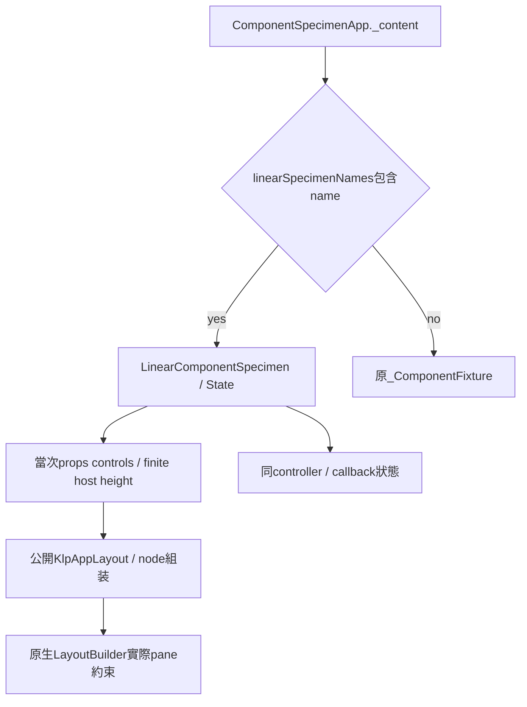

## 責任及依賴

| Source／class | 責任 |
| --- | --- |
| lib/main.dart：main／KallopisCatalogApp／_KallopisCatalogAppState | query分流；既有Catalog選取、theme／品牌及window lifecycle保持 |
| lib/component_specimens.dart：ComponentSpecimenApp／_ComponentSpecimenAppState | 專屬公開名稱驗證與展示環境、同pack四模式、fixture reset |
| lib/component_specimens.dart：_ComponentFixture／_ComponentFixtureState | 當次元件的資料、props控制與回呼計數，controller生命週期 |
| lib/catalog_shell.dart：CatalogShell／_CatalogShellState／_CatalogNavigation／_CatalogStage／_SpecimenBlock | 原Catalog導航與page／specimen容器；非專屬coverage authority |
| lib/catalog_theme_scope.dart：CatalogThemeScope | 既有Catalog品牌更新投影；專屬host不用此第二theme來源 |
| lib/catalog_model.dart／lib/catalog/** | 既有展示資料與各Catalog頁，generated註冊不改；命令與Dock已完成public consumer沿用既有契約 |

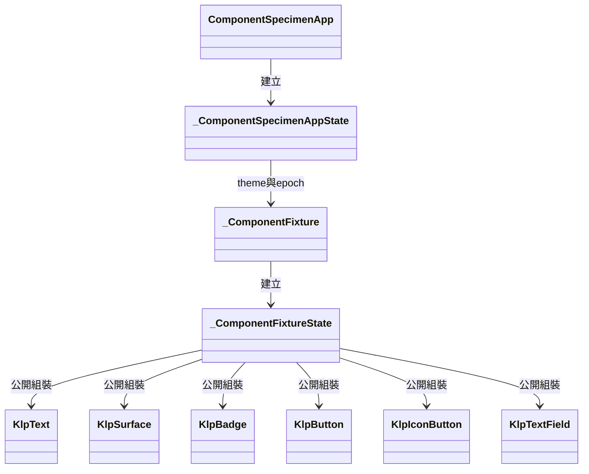

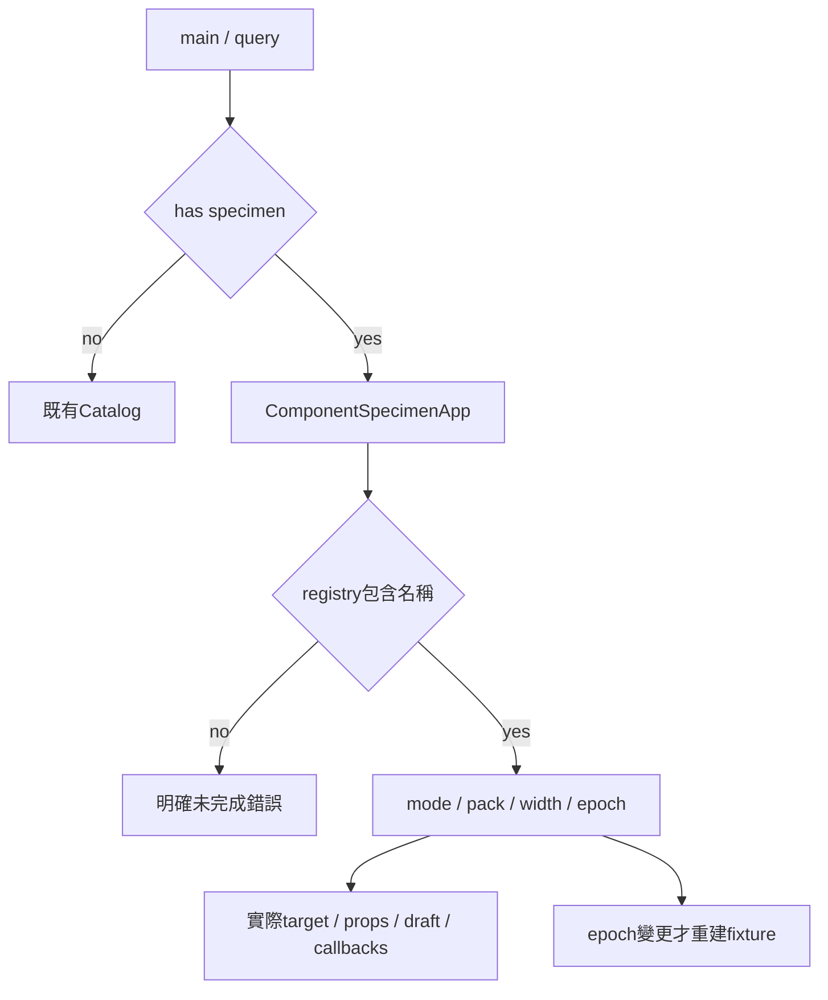

## FLUTTER-EXPLORER-SPECIMENS-1（COMPLETE）

修訂FLUTTER-EXPLORER-SPECIMENS-r1，exact lib/component_specimens.dart及新lib/explorer_specimens.dart。維持AGENTS Explorer只用KlpFileExplorer直接consumer；五個公開renderable target（root、Section、SectionView、FolderView、ItemView）分別專屬query，但views只能經公開root及section/item資料的合法compound渲染，不另做adapter/node/renderer。實際公開root build確實插入Section._render與SectionView，Folder／Item亦為正常root後代，故不以空的Section standalone build當展示。此owner讀直接source只為釐清renderability／consumer邊界衝突，BUILD不得讀私有part。

Registry只含五個真實fixture。ExplorerComponentSpecimen(name) State擁有標籤controller、spacing index、section/folder expanded、selectedId、level0/1、collapsible、item badge/tone、增加項目及root空sections/emptyStateSections控制。各route顯示自己props：root sections/emptyStateSections、spacing及controlled state；Section title/items/expanded/collapsible；SectionView section.title/isExpanded/spacing及native callbacks；FolderView item/level/isExpanded/isSelected/spacing；ItemView item/level/isSelected/spacing。Section expanded與root expanded IDs保持一致，callback由consumer同步資料；不假稱Standalone Section可顯示。level由合法額外folder資料及展開IDs造成，不能傳私有node。

使用例固定stablefoundation import＋KlpFileExplorer合法組裝，說明views經root投影。Controller不隨theme變更；primitive回呼分列sectionToggle／itemToggle／itemSelected次數及最後ID，不把controls按鈕算元件callback。每route有finite280高的Explorer viewport，未註冊名稱仍拒絕。前12target與原host四模式／pack／width／reset保持。

驗收public analyze/release web、五名稱對正式renderable、原生五routes自己的props/回呼、level/expand/selected/空fallback、style與reset/draft、scope2/diff。庫及tests/generated/style/generator不可寫；沒有新算法/persist不加鏡像tests；感官human-pending。參照前兩specimen slice估4k～8k／30～60分鐘；M1 source/type/build（5k40），M2 native5/routes/回呼/scope（8k60）；12k90或root不能投影必要view行為回PLAN。

BUILD96dc07d9 exact2source，public analyze No issues／releaseweb50.9秒／5名稱對正式renderable／scope2/diff Green。原生5route：root select1與sectionToggle1，空集合fallback真正呈現／原生收合回呼2，再關fallback為空；Section title與items增加／collapsible停用；SectionView spacing＋select/toggle各1；Folder箭頭itemToggle1，標籤原生既有行為同時toggle至2／select1，沒有改庫手感；Folder label／level1／badge／tone／selected跨dark／spacious／local320保留，reset所有計數0／資料與level還原且環境保留；Item leaf原生select1、改label／level／badge／tone／selected clear觀察。error/warn空。main build/flutter-explorer-specimens.png為正常public root內Folder實際呈現；非全量完成、keyboard/IME矩陣與感官仍pending。

_ExplorerComponentSpecimenState._folderTarget／_itemTarget／_targetId／_initialLabel選擇當次subject；dispose清controller；_onSectionToggle分project/fallback保持資料與控制ID一致，_onItemToggle更新同expandedSet，_onItemSelected更新selectedId，三者分開計數；_control／_controls只投影own props；_items建立合法level樹資料，_explorer組裝唯一publicroot；_usage说明root投影，build呈現finiteviewport／draft／回呼。host新_fixture按explorer／linear／basic分流並保留epoch。nested callbacks為props更新／文字重畫，不計入原生回呼。没有重新引入node/adapter/renderer。

| class／function | 責任 |
| --- | --- |
| explorerSpecimenNames／ExplorerComponentSpecimen | 五個真實公開target名稱／選中target輸入 |
| _ExplorerComponentSpecimenState | 公開section/item資料、受控展開/選取、原native回呼計數及controller生命週期 |
| host fixture分流 | explorer優先分流，保留前12與unknown gate、epoch lifecycle |

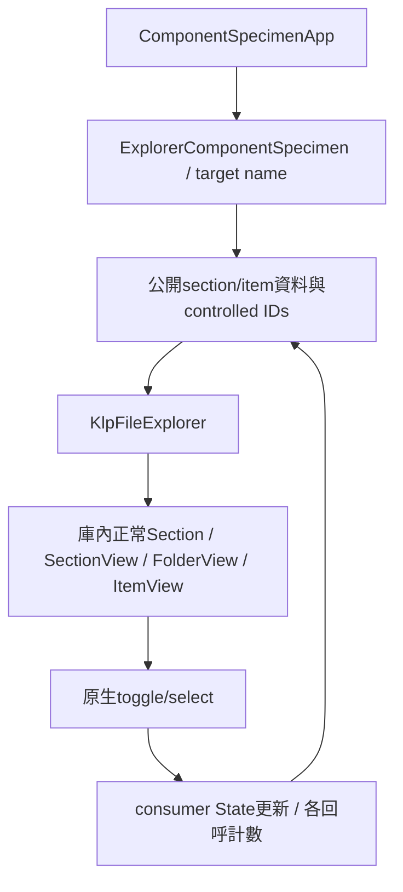

## FLUTTER-FRAME-SPECIMENS-1（COMPLETE）

修訂FLUTTER-FRAME-SPECIMENS-r1，exact lib/component_specimens.dart及新lib/frame_specimens.dart。七個真實query：KlpPanelFrame／KlpPanelHeader／KlpPanelFooter／KlpFrameGroup／KlpFrameGroups／KlpAppFrame／KlpPaneCollapseControl，stable公開組裝與當次own controls；FrameGroup合法位於FrameGroups，AppFrame合法在KlpAppLayout／LayoutRow，Panel header/footer合法在PanelFrame，不退到整個無關Catalog。

FrameComponentSpecimen State擁有title與draft controllers、callbacks及finite120/280 host。PanelFrame controls tone/elevation/headerSize與header/footer有無；Header title/titleRole/label/leading/actions/content；Footer child內容與null／semantic/directional padding；FrameGroup content數量及style.padding/divider/contentSpacing；FrameGroups groups數量/footer；AppFrame role/surface/bounds/flex/optional width；Collapse collapsed/onToggle enabled/icon/label。可調數值是產品展示選擇，共用gap/color/padding讀context.klp；不寫第二theme。原state跨四模式/pack/width保留，epoch重設；native actions與input callbacks分別記錄，不把controls計入。finite正文自有scroll支持壓縮，槽分配仍庫擁有。

驗收public analyze/releaseweb、7名稱與正式renderable一致、native每target自己的props與callback、finite/style/draft/reset及scope2/diff；原17與unknown gate保持。library/tests/config/generated/styles/generator不可寫，無新算法/persist不加鏡像tests，感官human-pending。冷估4k～9k/30～70分鐘；M1 source/type/build（5k40），M2 native7/scope（9k70）；14k100或compound契約不足回PLAN。

BUILDab49a75a exact2source；7名稱對正式renderable、public analyze No issues／最終releaseweb53.6秒／scope2及diff通過。三個非const constructor誤用const在consumer修正；Header非法label模式清掉title/content在debug native重現assert，最小修正保留title或custom content，再同nativecase確認title與輔助label皆呈現且callback1。歷史錯誤跨navigation保留曾在AppFrame頁讀到，不能歸因AppFrame；以最終5201 URL篩選error/warn空。未改庫、tests或任何斷言。

原生七route及own controls：PanelFrame tone/elevation/headerSize、可選header/footer、finite120高/local320、dark/spacious保留draft與動作1／正文change1，reset0且環境保留；Header titleRole/custom content/label/leading/actions1；Footer null/semantic/directional padding及action1；Group style.padding/divider/contentSpacing與content1→3 action1；Groups1→3/footer action1；Collapse Enter callback1、collapsed／disabled／icon；AppFrame width180時明確flex0且preferred null，同層x316→196，另bounds preferred200/flex3/auxiliary/raised/finite與theme保持canvas草稿。width自然尺寸fixture不能被明示preferred掩蓋，controls顯示實際使用值。main build/flutter-frame-specimens.png為PanelFrame dark/raised/spacious/finite證據；局部320不是browser viewport，感官human-pending。

_FrameComponentSpecimenState的_appFlex／_appPreferred解析展示的明示width或bounds情境；dispose清兩controllers；_action／_collapse／_change記實際動作及正文回呼；_control／_controls投影當次props；_draftField／_body配置公開輸入與正文scroll；_panelHeader保留合法內容與輔助label，_panelFooter以semantic padding示範方向值；_group構造合法內容組，_target選中當次公開compound，_usage顯示有效constructor，build提供finitehost/狀態。nested callbacks為props更新與文字重畫，不計入原生動作。host _fixture加入frame分流，同epoch owner保留。

| class／function | 責任 |
| --- | --- |
| frameSpecimenNames／FrameComponentSpecimen | 真實公開target registry及name輸入 |
| _FrameComponentSpecimenState | controller生命週期、own props、finitehost與callback結果；只組裝public compound |
| host _fixture | frame／explorer／linear／basic分流，同epoch owner |

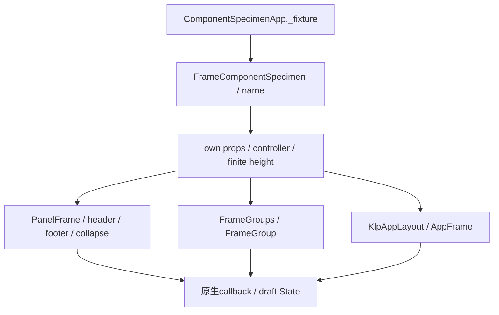

## FLUTTER-COMMAND-SPECIMENS-1（COMPLETE）

修訂FLUTTER-COMMAND-SPECIMENS-r1。exact lib/component_specimens.dart、lib/catalog/registered_commands_page.dart；將既有命令consumer暴露RegisteredCommandsDemo(specimen可選)，預設保留完整Catalog。五個獨立query為RegisteredCommandToolbar、RegisteredCommandMenu、RegisteredCommandPalette、RegisteredCommandPopup、CommandShortcutHost（均Klp前綴）。沿用同registry/keymap/controller/results，不複製handler或建立第二命令核心。

當次route只插入自己的entry；toolbar/menu投影允許儲存與失敗可見性，palette提供open/search/dismiss/error，popup提供button anchor與右鍵area/open/dismiss/error；host提供原生草稿快捷鍵、chord、scope/conflicts、record/import/export。共用result/draft顯示；host wrapper可作其他entry的必要依賴，但不因此計入host coverage。其他兩個命令renderable不在此slice。使用例標示公開constructor及同owner資料。既有overview不變，前24query及unknown gate保持。controller/theme/width保留State，epoch只在明確reset更換。

驗收public analyze/releaseweb；五route own target/control/native callback；disabled/error/dismiss與host原生save/chord；theme/width保留draft/results/reset；exact2 scope/diff。protected library/tests/其他modules不可寫。不新增演算法或持久權威，無新鏡像測試。感官human-pending。依Frame/Explorer已完成consumer估4k～9k/30～70分鐘，M1 public source/type/build（5k40），M2 native5/closure（9k70），14k100或公開契約不足回PLAN。

| class／function | 責任 |
| --- | --- |
| commandSpecimenNames | 僅五個實際route |
| RegisteredCommandsDemo／State | 原命令owner，specimen選擇自己的controls與entry；null保持overview |
| ComponentSpecimenApp._fixture | 以同epoch把命令route接到公開consumer |

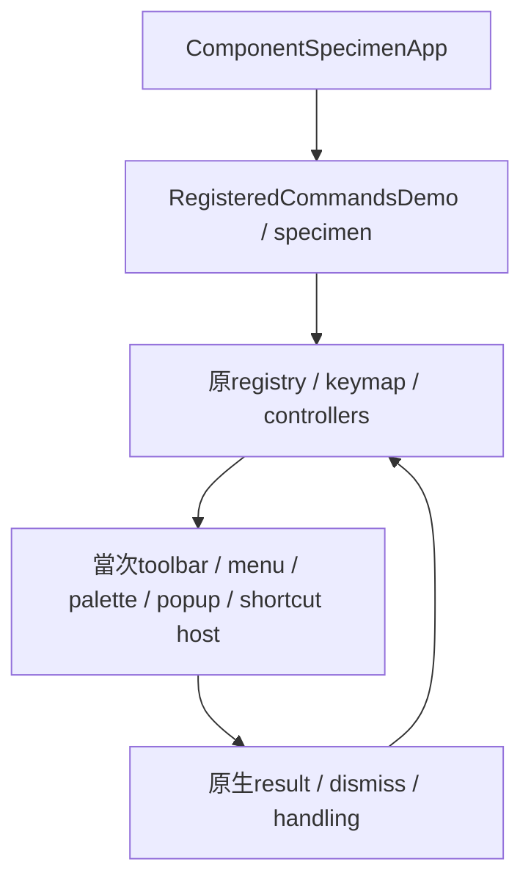

BUILDe754f791 exact2source，public analyze No issues／releaseweb46.2秒／scope2及diff通過。原生五route各自entry：Toolbar toggle後save結果2、執行中disabled及條件disabled；Menu開failure可見性、原始Bad state回饋1；Palette搜尋grid只剩格線，執行結果1且dismiss executed；Popup錨定按鈕及原生右鍵開啟、toggle結果1／dismiss executed，再Escape關閉reason escape。Host草稿Ctrl+S、Ctrl+K→S、Ctrl+G均原生執行，editor作用域勝出、離開後page衝突原樣呈現；一次跨工具呼叫逾時的chord被ignored且s成正常輸入，改同批原生連續按鍵觀察executed，未改核心timeout或測試。dark/spacious/local320保留草稿與結果3，明確reset歸零且環境保留；5202 URL error/warn空。錄製/JSON原功能沿用，這次未重新操作全矩陣。main build/flutter-command-specimens.png為Host狀態保留證據，網站iframe未完成、感官human-pending。

RegisteredCommandsDemo新增可選specimen與key，同State原owner；_shows對null維持overview、對name精確投影controls／entry；_usage只顯示當次stable公開constructor。_controls與build條件插入popup area／toolbar／menu／palette／popup／shortcutControls，不把依賴host包裝當額外coverage。host _fixture以commandNames優先分流，前24保持。初始化、dispose、registry/keymap/handler全沿用，沒有改命令庫演算法。

## FLUTTER-GUI-SCENARIOS-1（IMPLEMENTED；docs／prefix／窄版整合pending）

修訂FLUTTER-GUI-SCENARIOS-r1，依IDOC-04/05/06/07/08及已接受官方研究。exact lib/gui_scenarios.dart、lib/gui_scenario_metadata.dart、assets/gui-scenarios.json、lib/main.dart、pubspec.yaml（僅註冊新example asset，YAML語法空格）。三scene query vscode/blockbench/blender，既有specimen優先與absent Catalog維持，unknown scenario明確拒絕不退總覽。只example consumer，不在library建立產品模板。

JSON metadata是此Flutter example的id/title/reference唯一權威，與React公開registry有相同三個accepted場景含義，不複製React內部實作。JSON只含非空own清单與安全小寫route／非空title／HTTPS reference，拒絕重複title與非法資料；公開GuiScenarioMetadata.fromJson及load資料轉換由gui_scenario_metadata.dart擁有，純解析可獨立測。asset loader由GuiScenarioApp lifecycle擁有，loading/error明確可見；Node網站後stage可以讀同JSON，不建立第二Flutter名稱表。產品三種布局資料／正文示意由gui_scenarios.dart擁有，metadata是route/引用而非庫型別清單。

VS Code左Explorer/Search、右Outline、底Output/Problems、中心文件選取與草稿；Blockbench左Outliner/Tools、右Properties/Textures、底Animations及建模示意；Blender左Tools、右Outliner/Properties、底Timeline及Layout/Modeling/Animation workspace，Animation透過公開area resize改底部分配。有限height540與宿主寬度由example選擇，Dock為公開KlpDockLayout／Panel、布局唯一KlpDockLayoutData。只透過公開Codec.encode/restore/applyKlpDockAction操作與採用callback，無效JSON原error與布局保持；close批准callback穩定、availablePanels公開restore投影重開。左右/底constraints同React場景數值，不能consumer另算Dock幾何。

KlpFileExplorer真實section/items及selected/expanded callbacks；PanelFrame/Surface/Text/TextField/Button及產品繪圖／文字構成正文。3D/editor/terminal核心明示示意，不添加上游依賴。草稿與JSON controllers由State持有並dispose；mode／pack切換不換owner，明確epoch reset才重建。四mode與另一semantic spacing pack使用KlpStylePack.defaults/applyOverrides及buildKlpThemeVariant，全部共用風格由context.klp取得；繪圖色值只讀semantic，不寫第二theme。

同一KlpCommandRegistry註冊layout.save/restore/reset、scene.run、panel.bottom、command.search；最新context投影State操作，可用性refresh，供RegisteredToolbar/Menu/Palette及ShortcutHost。Primary+S保存、Primary+K→S chord保存、Primary+Shift+P開palette；FocusManager原生focus投影穩定identity／editable與controller composing，初始化listener與dispose遵守既有public consumer。命令result/handling/dismiss實際可觀察，不複製handler。每scene mode/pack/reset/導航與官方引用及公開組裝文字；reference可展示文字由docs後stage提供可點外鏈，library不新增launch API。

必要独立TestAuthor只write test/gui_scenario_metadata_test.dart，保護公開JSON邊界與authority解析非破壞、非法route/title/HTTPS/duplicate，不能改accepted JSON及source。BUILD禁止test/architecture/library/網站/其他catalog寫入。其餘是既有受保護算法的consumer，沿用public analyze/release web（既有dynamicicons需--no-tree-shake-icons）與native三scene selection/draft/command/save/restore/error/chord/theme/reset、drag/resize，scope5/diff；本機actual窄與prefix後stage整合不冒稱完整。感官human-pending，tests不足契約回PLAN。

估7k～14k/50～100分鐘，參考REACT-GUI-SCENARIOS-1與Flutter Dock/Commands consumer；M1 public解析／三scene/analyze/build（7k50），M2 protected/native3/scope（14k100）；20k150或library/config超出asset行返回PLAN。這不是完整Flutter273元件覆蓋或docs交付完成；原goal保持。

| class／function | 責任 |
| --- | --- |
| GuiScenarioMetadata.fromJson | JSON authority轉typed唯讀metadata，公開錯誤邊界 |
| GuiScenarioApp／State | asset載入、query gate、四模式／pack／epoch與場景導航 |
| GuiWorkbench／State | 唯一產品布局／controllers／Explorer／registry/keymap生命周期及結果 |
| scene layout／panel／stage helpers | 三種產品資料／示意，所有算法交公開庫 |
| main query | specimen優先、scenario自身、absent原Catalog |
| pubspec asset／JSON | package-owned metadata可部署資產，唯一route/title/reference |

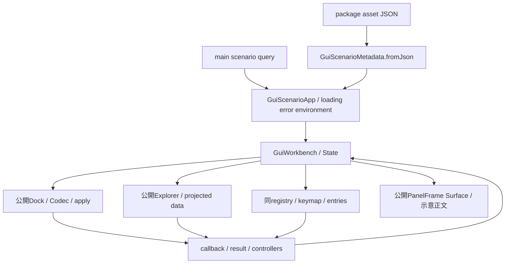

BUILD315997de exact5。獨立TestAuthor d13854de只test/gui_scenario_metadata_test.dart，SHA256 B6C1415624B31CB6BDDC14950EF6C6A50DEF0F4972E232C186FEC70FE45AABA9，39/39 Green，零skip，未取得有效行為Red。公開fromJson(Object? value)把root map轉唯讀metadata清單並排序，不改輸入；fields final，非法root/id/title/HTTPS URI與duplicate拒絕。第一輪public analyze指出Dock stage需要KlpPanelFrame，最小改return型別與建模stage同公開PanelFrame；平台取defaultTargetPlatform避免initState讀Inherited Theme，curly lint補block。相同analyze最後No issues；最終releaseweb44.9秒（既有--no-tree-shake-icons），scope5/diff通過，未改库／測試斷言／鎖檔。

Native5204已觀察：VS Code選theme.ts／正文草稿，save／Problems／restore布局2、command2，dark/spacious保持草稿與選取；Ctrl+K→S與palette搜尋執行至command4，真實分隔線drag產生8次callback到布局10，Search拖至Bottom後布局11且底部Search正文可见。無效JSONrestore command5原FormatException且布局11保持；layout reset／Outline close／重開都回寫；明確scene reset回0保持環境。Blockbench選Head、operation1／frame24及草稿模型保持、ultraDark/spacious；Blender Animation公開resize採用1、Camera選取、menu save/toggle與toolbar restore到布局3／command4。未知query明確拒絕並可返回，不退Catalog。

Flutter Web首次由瀏覽器可及性啟用按鈕Enter取得真實semantics樹，再用原生輸入/drag操作；click啟用未生效，未以JS寫widget State。main build/flutter-gui-vscode.png、flutter-gui-blockbench.png、flutter-gui-blender.png；5204 URL error/warn空。資料資產由rootBundle讀package asset，載入中／錯誤可辨識；JSON只metadata，產品config／正文state由GuiWorkbench擁有。原生3場景觀察不等於已嵌docs：Flutter標題／載入辨識及prefix assets另site整合stage，actual窄browser與人類感官仍pending；原goal全部元件／typed風格／最終push保持。

_GuiScenarioAppState._load/_content擁有asset讀取與環境，State key id＋epoch；_GuiWorkbenchState._initial/_policies僅投影產品資料，_commit/_action/_save/_restore/_openPanel/_switchWorkspace只呼叫公開codec/action；_register/_getContext/_getFocus/_getIsComposing與refresh/dispose管理同registry/keymap/原生Focus/controller。_panel/_stage/_explorer/_stack組合法public compound，_select/_onResult記錄callback；畫布旋轉及ascii方塊是示意，不另建3D模型。_SceneContext只借用當前State，metadata不固定元件清單或three-count驗證。

## FLUTTER-GUI-READINESS-1（COMPLETE）

修訂FLUTTER-GUI-READINESS-r1，依IDOC-FLUTTER-READINESS-r1。exact lib/gui_scenarios.dart，GuiScenarioApp用公開Title widget在選中真實scene內容後設定「scene.title Flutter 互動展示」，unknown與asset錯誤用自身error標題，loading不聲稱ready。_announce(context,title,child)只有包裝呈現，不改原State/controller或library；Title色值從同Kallopis建立的Material Theme primary讀取，無第二theme。unknown包含metadata存在但無產品scene config的情況，不以null assertion崩潰。

驗收public analyze、既有protected39、releaseweb --no-tree-shake-icons --base-href /Kallopis/examples/flutter/、nativeprefix實際document title與可見內容／error、scope1/diff；web產物完整copy只ignored output，網站source另一owner階段。無新演算法，不新增鏡像測試。估1k～3k/10～25分鐘，參考GUI consumer；M1 actualtitle/publicbuild（3k25）；5k40或private API需要回PLAN。感官human-pending。

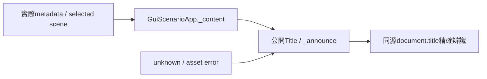

BUILD54dd1105 exact1，公開analyze No issues、同protected39全Green零skip、prefix release46.6秒、scope1/diff通過。Native5203 /Kallopis/examples/flutter/index.html?scenario=vscode 的實際title為「VS Code · 文件工作區 Flutter 互動展示」；unknown的實際title為「找不到 GUI 場景 Flutter 互動展示」，畫面顯示unknown與返回入口。初始shell title尚未ready，實際內容完成後才改Title；網站接入由DOCS-FLUTTER-SCENARIOS-1負責，感官與actual窄browser保持pending。

## FLUTTER-SPATIAL-SPECIMENS-1（IMPLEMENTED；actual窄 browser pending）

修訂FLUTTER-SPATIAL-SPECIMENS-r1，依IDOC-01/02/03/06/08。exact lib/component_specimens.dart、新lib/spatial_specimens.dart；前者只import/registry/fixture分流，既有29與環境不改。spatialSpecimenNames只包含22個正式renderable：KlpAlign、KlpBox、KlpCenter、KlpColumn、KlpConstrainedBox、KlpDirectionalPositioned、KlpDivider、KlpExpanded、KlpFit、KlpFlexible、KlpGap、KlpLayoutBuilder、KlpPositioned、KlpRegion、KlpRotate、KlpRow、KlpScrollViewport、KlpSection、KlpSpacer、KlpStack、KlpTranslate、KlpWrap。公開consumer SpatialComponentSpecimen(name)，只Flutter/public foundation imports，無private元件或新共用theme。

fixture擁有同controller草稿、自己的props indices/bools/enum與callback計數，title/body資料變更、有限180/280宿主與測量output；外host既有四mode/spacious/local320/epoch保持。各route只提供target自己的實際props：Align alignment/shrinkWidth；Box width/height/paddingSize/marginSize/tone/radius；Center widthFactor/heightFactor；Row/Column main/cross alignment/mainAxisSize/gap/children數；ConstrainedBox constraints min/max與child；DirectionalPositioned position及合法RTL宿主；Positioned left/top/width/height；Divider vertical合法host方向；Expanded/Spacer flex，Flexible flex/fit；Fit mode；Gap axis constructor/extent/semanticSize；LayoutBuilder自己的builder輸出/內容及真實傳入constraints，host尺寸只能明示展示控制；Rotate quarterTurn；Translate horizontal/vertical；Stack alignment/fit/clip/children；Wrap direction/alignment/spacingSize/runSpacingSize/children；ScrollViewport公開controller/padding、實際捲動位置（controller listener）與原生捲動／按鈕移至末尾；Region header/footer/tone/padding/content；Section title/label/trailing/child。不需要窮舉每个constructor或不合法enum组合；使用例與當次實際參數一致。

Flex targets只能在真正Row/Flex父層，Positioned只能Stack、方向以Directionality；沒有額外wrapped proxy破壞ParentData。finite內容含scroll/裁切避免自然過長致外層overflow，不能自寫分配算法。量測以target內LayoutBuilder讀真實約束，不能計算假幾何；controller listener只在mounted後更新，dispose清除，環境change不重建owner、reset才重建。三或更少args同一physical line、繁中註解/tab；共同style讀context.klp。無persist/算法/跨語言新邊界，不新增鏡像tests；公開analyze與releaseprefixbuild是Yellow。

驗收22registry正式renderable一致、public analyze、prefixrelease --no-tree-shake-icons --base-href /Kallopis/examples/flutter/、原生22route實際target及各自props可操作（批次清單可驗證可及性）、代表Flex/position/scroll量測與draft/callback/四mode/style/local320/reset、scope2/diff。actual窄browser與感官未證明仍human-pending；網站全量273coverage另stage，不能提前允許缺项。library/tests/config/generated/style/docs/site皆不可寫。

估8k～16k/60～120分鐘，參考FLUTTER-FRAME-SPECIMENS-1/LINEAR；M1 22source/registry/public analyze/build（9k65），M2 native22/props/state/scope（16k120）；24k160或公開boundary不足回PLAN，無單任務量測actual usage null。

| Source／class／function | 責任 |
| --- | --- |
| spatial_specimens.dart spatialSpecimenNames／SpatialComponentSpecimen | 真實target registry與公開consumer輸入 |
| _SpatialComponentSpecimenState | props/controller與生命週期；controls/target/usage/measure/build分工；nested callbacks依自身setter與原生input/scroll投影 |
| component_specimens.dart fixture分流 | 既有環境與epoch，名稱精確交給spatial fixture |

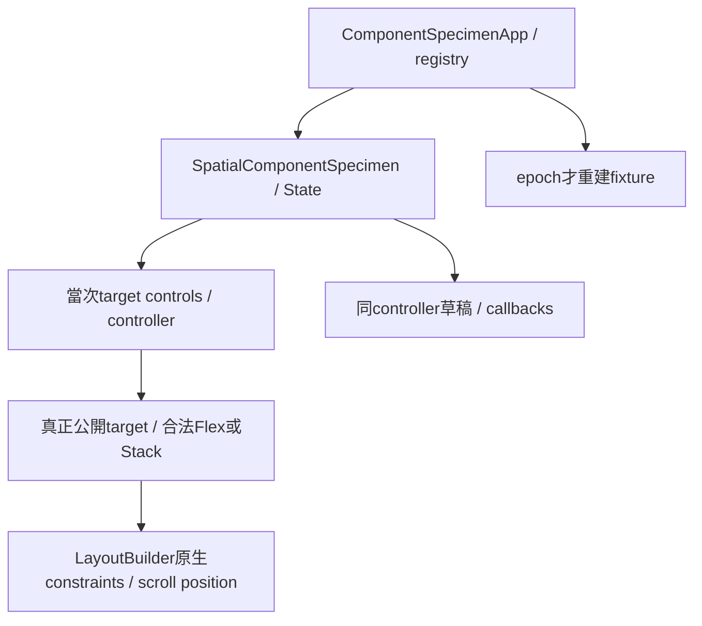


BUILD exact2source；22名稱全部對正式renderable、registry無duplicate且各有controls/target/usage。public analyze最終No issues；最終同source prefixrelease47.0秒、scope2/diff通過。沒有新增算法或persist／跨語言邊界，未新增鏡像tests；庫／設定／tests／style／網站source皆未改。

Native5203 prefix真實22route及自身controls均操作，公開title與fixture內容精確對應；Flutter可及性需要先click取得焦點，觀察仍Enable accessibility時Enter／Space才取得完整樹，不以placeholder當成功。ScrollViewport末尾操作14回呼offset792；原生wheel另記1回呼offset576。Expanded flex1→3真實約束380→570；local320／180高／dark/spacious為240×180，草稿與input回呼2跨四mode保持；明確reset回flex1、草稿初始、回呼0／高度280，保留mode/spacious/local320。Row三child/gap48/local320／180/spacious皆呈現，error/warn空；consumer Flexible children接受可用空間，不複製library算法。

Align初始natural子內容修正為120×80，最終實際文字位置(8,152)→center(328,252)，shrinkWidth後(8,252)；Center width/heightFactor1→2為(8,152)→(68,192)，效果不是滿寬子內容掩蓋。Positioned left/top12→48實際文字位置(20,164)→(56,200)。ConstrainedBox max120×80→240×120、Divider vertical改為379×280、Region關閉header/footer与semantic padding後744×264均讀真實LayoutBuilder。geometry source只用原生constraints/DOM rect，不自行計算配額。

main build/flutter-spatial-specimens.png及flutter-spatial-native.json保存觀察；actual360 browser未取得，local320不代替，感官human-pending。Flutter真實fixture51／273，剩餘222與網站全量嵌入仍原goal；本stage不是所有元件交付。

_State._controls/_target/_usage持有當次公開props投影、合法host與正確constructor；_tiles/_flexTiles提供產品child，_sample/_fixedSample/_sampleBody/_measure/_builderBody只呈現真實約束；_scrollToEnd/_onScroll使用同公開controller，initState/dispose移除listener並清controller；_onChange及cycle/toggle只consumerState。build owns finite viewport/controls/status/draft，環境由外host維持；沒有第二theme、private API或widget tree驗證。

## FLUTTER-FORM-CONTROL-SPECIMENS-1（IMPLEMENTED；actual窄 browser pending）

修訂FLUTTER-FORM-CONTROL-SPECIMENS-r1，依IDOC-01/02/03/06/08；exact lib/component_specimens.dart、新lib/form_control_specimens.dart，前者僅import/registry/fixture分流，不改原51與外host環境。24個正式renderable：KlpAffixedTextField、KlpCheckbox、KlpCompactSwitch、KlpField、KlpFieldDescription、KlpFieldError、KlpFieldLabel、KlpMultiSelectField、KlpNumberField、KlpPasswordField、KlpPhaseToggle、KlpQuantityField、KlpRadioGroup、KlpSegmentedControl、KlpSelect、KlpSelectField、KlpSlider、KlpSlidingSelection、KlpTagChip、KlpTagInputField、KlpTextArea、KlpToggle、KlpToggleIndicator、KlpTriStateToggle。formControlSpecimenNames只實際fixture；公開FormControlComponentSpecimen(name)，只Flutter與public foundation imports，不改library／private API或共用theme。

_State owner管理label/draft controllers、bool／number／index／triState／選取Set／tags與回呼log；資料和結果跨theme/width保留，epoch才reset，dispose清controller。各route控制自己的公開參數：Checkbox/Toggle value/showLabel/null callback；CompactSwitch value/null callback；ToggleIndicator value/enabled（無虛構callback）；TriStateToggle value/null callback；RadioGroup items/value/vertical/descriptions；SegmentedControl items/selected/expanded/dense/icons；PhaseToggle options/selected/enabled/icon；SlidingSelection label/options/selectedIndex/null callback。Select value/enabled/onPressed真實callback，SelectField valueLabel/options/enabled/readOnly/error與popup選取、MultiSelectField同公開選項及Set；選項使用KlpChoiceOption，沒有自製menu代替。

NumberField value/minimum0/maximum10或100/unit/error/null callback；QuantityField value/step1或5/範圍/enabled/readOnly/error／合法增減回呼；Slider value/min0/max10或100/divisions/displayValue/marks/null callback；改範圍保持合法current value，僅consumer參數fixture不重寫核心clamp算法。AffixedTextField label/controller/placeholder/prefix/action/enabled/readOnly/error；TextArea value/placeholder/error/enabled/lines/unboundedLines/outlined；PasswordField value/placeholder/error/enabled/readOnly/required/requirements（純展示字串，無真實credential）；controller和值變更同步handler，不能以text變更冒充未觸發的core回呼。

TagChip label/onRemove，remove使consumer顯示已移除結果，可restore/reset；TagInputField tags/onAdd/onRemove/onClearAll/maxCount，清單回寫且可觀察；不在sharedlibrary增加業務state。Field label/description/error/errorCode/requirement/required/status/counter及實際child；FieldLabel/Description/Error只修改各自文字。標籤及內容control使用同KlpTextField，control自身回呼與target回呼分開記錄，禁止拿control callback當target互動成功。_usage以真實constructor與handler/state為準，無fake元件名稱。finite舞台使用自身scroll容納長內容，不能擋公開popup；外host既有mode/spacious/local320/epoch保持。

驗收24registry/renderable一致、public analyze、prefixrelease --no-tree-shake-icons --base-href /Kallopis/examples/flutter/、原生24routes自己的controls與至少bool/input/number/choice/popup/multi/tag/slider真實callback、四mode/style/local320保留資料、reset，scope2/diff。無新persist／algorithm／crosslanguage，不新增鏡像tests；library/tests/style/網站/config/generated/docs禁止寫。actual窄browser與感官明示pending，所有273 docs另stage不得提前全量放行。

估8k～16k/60～120分鐘，參考FLUTTER-SPATIAL-SPECIMENS-1；M1 source24/registry/analyze/build（9k65），M2 nativecontrols/callback/state/scope（16k120）；24k160或public contract不足回PLAN。actual usage無任務量測null。

| Source／class／functions | 責任 |
| --- | --- |
| form_control_specimens.dart formControlSpecimenNames／FormControlComponentSpecimen | 真實target名稱及公開consumer輸入 |
| _FormControlComponentSpecimenState | controls/target/usage/build、controllers生命週期、callback投影／message與consumer清單；所有nested callbacks只屬自身setter或原input回寫 |
| component_specimens.dart fixture分流 | 保留環境／epoch，指定route只到自己的form fixture |

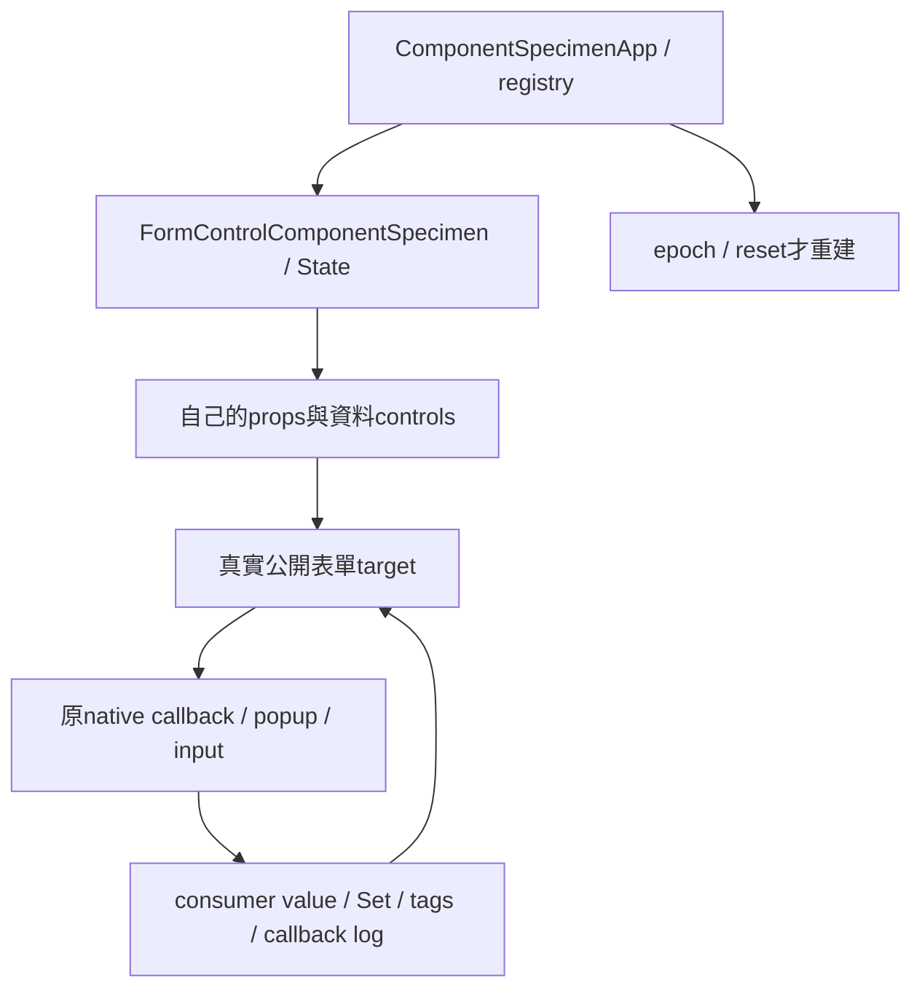


BUILD exact2source。24名稱全部對正式renderable且各有自己target/controls/usage，public analyze No issues、同sourceprefixrelease47.0秒、scope2/diff通過。展示換range時把consumer數值投影至合法range；設定tagLimit時保留最多三筆合法demo資料，這是fixture控制，不計成target回呼或建立第二核心算法。未改library／tests／style／config／網站source，無新persist或algorithm風險，不新增鏡像tests。

Native5203 prefix逐一24route操作公開參數；三個Field文字target修改內容、控制文字回呼2而target仍0；ToggleIndicator只props不虛構回呼。其餘20個具回呼target實際操作：Checkbox/Toggle/CompactSwitch value1、TriState on1、Radio/Segmented/Phase/Sliding/Select selected1、SelectField真實popup選B1、多選a+b再移除a為Set b2、Quantity增減與step5共3回呼value4、TagInput新增/移除/clear共3且空list、TagChip移除1且consumer顯示移除結果、NumberField原生7回呼1、Affixed輸入與附加動作3、Password純展示字串輸入2及顯示/requirements狀態、TextArea多行2、Field input1。所有結果與controls自己的回呼分開。

Slider原生drag9回呼到7.1315789；初始snapshot曾標disabled，補查aria-disabled null，ArrowRight真實3→3.5回呼1；停用時slider role消失且維持值，恢復後ArrowRight到4回呼2。因此未取得庫內故障證據，不修改library或把初始snapshot當缺陷。鍵盤/DOM觀察只读，不寫widget state。預設caption依公開元件輸出raw percent，非預設range的consumer可用displayValue參數；未以example改寫core百分比邏輯。

TextArea多行「表單草稿保持／第二行」在四mode、spacious/local320/outlined後同回呼2與原字串保持；reset回props初始與target0、環境spacious/local320保持。現場error/warn空。main build/flutter-form-control-specimens.png及flutter-form-control-native.json保存；actual360 browser未取得，感官human-pending。Flutterfixture75／273，剩餘198及全量docs gate仍原goal，未提前放行全部元件。

_State._controls/_target/_usage投影公開參數與正確constructor；_options/_phases/_selectionOptions僅consumer資料；onText/bool/index/choice/number/quantity/multi/triState及tag callbacks回寫State並_record；_onLabel只控制文字，toggle/cycle只自己的props，_toggleRange/_toggleTagLimit維持demo合法資料不冒充target事件。build擁有有限scroll舞台、參數編輯與兩類回呼狀態，dispose清controller；跨mode State由外host保留，epoch才重建。新增class責任與依賴仍上述module圖。

## FLUTTER-FEEDBACK-SPECIMENS-1（IMPLEMENTED；actual窄 browser pending）

修訂FLUTTER-FEEDBACK-SPECIMENS-r1，exact lib/component_specimens.dart、新lib/feedback_specimens.dart，前者只import/registry/fixture分流，既有75及host環境不改。feedbackSpecimenNames包含features.feedback全部15個renderable：KlpEmptyState、KlpErrorState、KlpFocusBoundary、KlpInlineNotice、KlpLiveRegion、KlpLoadingState、KlpPermissionState、KlpProgressOverlay、KlpRegionPlaceholder、KlpSkeletonLine、KlpStatusIndicator、KlpToast、KlpToastStack、KlpWorkflowProgress、KlpWorkflowStateSurface。公開FeedbackComponentSpecimen(name)，Flutter/public foundation only；不讀private或新增theme。

State持有title/message/draft controllers與自身bool/enum/data/回呼紀錄，theme/width不重建，epoch才reset；dispose清controller。EmptyState icon/title/message/action；ErrorState title/message/icon/retryLabel/null callback；PermissionState title/message/icon/action；InlineNotice title/message/tone/action；LoadingState label；Placeholder label/kindLabel/detail/hatched/tone/constraints/actionLabel/null callback；StatusIndicator data label/kind/active/showsIndicator及expanded；Toast title/message/tone/actionLabel/nullcallback/closeLabel/nullcallback且close由consumer移除、restore/reset可恢復；ToastStack實際children數量及各Toast child action/close回寫，不虛構stack callback。

WorkflowProgress stages/label，consumer控制active/complete/數量；WorkflowStateSurface八state/title/message/statusLabel/actionLabel/onAction/child；ProgressOverlay visible/label/child，bounded200高合法Stack，visible時觀察覆蓋、hide可操作child。FocusBoundary autofocus及自己的合法child原生input/keyboard，不虛構focus callback；autofocus變更以target key顯式重建，只重建target而draft owner保持。LiveRegion message/null與fromDescendants兩合法constructor，child動作更新呈現message；播報感受human-pending，只驗DOM/semantics及自己的呈現。SkeletonLine無可改公開props，只允許明示宿主寬度120/240與同theme，不能造fake height/tone參數。

所有target在finite280舞台且自身scroll容納內容，progress overlay另明確boundedchild，不用自製modal/演算法。自己的props controls可及，編輯title/message是控制回呼，onRetry/onAction/onClose是公開回呼；action/child Widget自己的callback獨立標明，不能冒充root不存在callback。usage正確公開constructor及當次主要參數，所有style讀semantic環境。sample純資料，非產品商業flow。

驗收15registry/renderable一致、public analyze、prefixrelease --no-tree-shake-icons --base-href /Kallopis/examples/flutter/、native15自己的controls/文字、實際retry/action/close/stack/workflow回呼、overlay及focus/live child的原生操作、四mode/spacious/local320保留draft與reset、scope2/diff。無新persist或算法不新增鏡像tests；library/tests/config/styles/generated/site/docs禁止寫。actual窄browser和感官human-pending；273網站全量閘門仍後stage。

估6k～12k/45～90分鐘，參考FORM-CONTROL/SPATIAL；M1 source15/registry/analyze/build（7k50），M2 native/state/scope（12k90）；18k120或publicboundary不足回PLAN，actual usage無單task測量null。

| Source／class／functions | 責任 |
| --- | --- |
| feedbackSpecimenNames／FeedbackComponentSpecimen | 真實公開target集合與consumer輸入 |
| _FeedbackComponentSpecimenState | controls/target/usage/build；controllers與callback/state；狀態及toast資料由consumer擁有，nested callbacks只自身setter/原native input回寫 |
| component host fixture分流 | 保留environment/epoch，只加入精確feedback route |

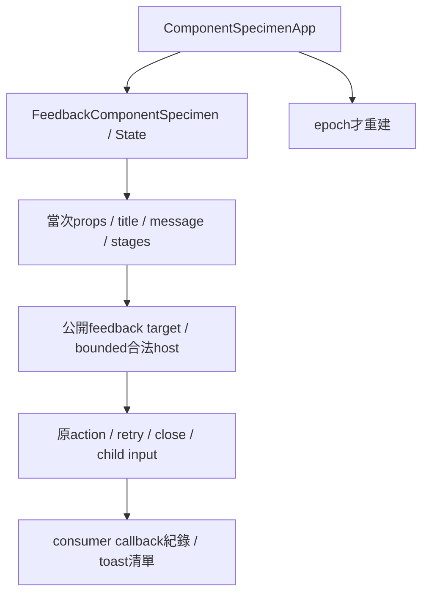


BUILD exact2source；registry精確對features.feedback全部15 renderable，沒有duplicate或placeholder target。public analyze最終No issues，同sourceprefixrelease44.1秒、scope2/diff通過。沒有改library／tests／config／theme／網站；新能力是consumer呈現／回呼投影，未新增鏡像tests。LiveRegion只提供自己的message控制；FocusBoundary的內容編輯明示child placeholder，避免無效root title參數。Skeleton只明示宿主width。

Native5203 prefix逐一15route的props與文字修改均操作。ErrorState retry1；Empty/Permission/Inline提供的action Widget各1；Placeholder公開action1；Toast公開action＋close2且consumer移除/恢復；ToastStack三child，child action＋close2後清單移除指定1；WorkflowStateSurface action1，八state empty/collecting/reviewing/ready/stale/applying/applied/failed都呈現；WorkflowProgress data active/complete/數量/label控制有效。沒有把child回呼冒充root不存在的callback。

FocusBoundary child原生文字2、Tab到child動作、Enter動作1；四mode/spacious/local320保持字串及回呼，reset回初始/0並保留環境。LiveRegion公開message route的child動作1更新實際aria-live polite內容，fromDescendants／null props另操作；播報感受human-pending。ProgressOverlay bounded200 child動作1/input2，visible後標題覆蓋可辨識，hide仍草稿及結果保持；未宣稱完整modal／pointer阻擋驗收。現場error/warn空。main build/flutter-feedback-specimens.png、flutter-feedback-native.json；actual360 browser未取得，local320不替代，人類感官pending。Flutterfixture90／273，剩餘183及網站全量gate仍原goal，未提前宣稱全交付。

_State._controls/_target/_usage持有自己的props與公開constructor；_toast/_stages只組裝consumer資料，_child/_actionWidget提供真正公開child；_action/_close/_restore管理原回呼和consumer toast清單；_onEdit只control文字、_onInput只child文字；cycle/toggles為自身參數。build finite舞台、controls/edit/status，dispose清三controller；host theme/epoch依原owner，不另建立theme、adapter或業務runtime。


## FLUTTER-CONTENT-COLLECTION-SPECIMENS-1（IMPLEMENTED；actual窄browser pending）

修訂 FLUTTER-CONTENT-COLLECTION-SPECIMENS-r1；IDOC-01/02/03/06/08。exact lib/component_specimens.dart、新 lib/content_collection_specimens.dart。十個公開 target：KlpAvatar、KlpAvatarGroup、KlpCard、KlpListTile、KlpMessageBubble、KlpMessageThread、KlpMetricCard、KlpPreviewCard、KlpSortControl、KlpTag；其餘 collections 仍待後續交付，不縮小全量273目標。

ContentCollectionComponentSpecimen(name) 只依 public foundation 與 Flutter widgets 組装。State 擁有 label/content/draft controllers、props、消息數量、tag removal 及 callback log；environment 保留 state、epoch 才 reset，dispose 清 controller。controls 修改自己的公開參數，target 使用真實 constructor，usage 顯示實際參數；child callback 與 root callback 分開記錄。AvatarGroup 用公開 KlpAvatarData，無外部 image 依賴；MessageThread loadOlder 增添 consumer messages；Tag onRemove 刪除 consumer item 並可恢復；SortControl 切 ascending 並記原 callback；ListTile 原 onPressed；Card 等無 root callback 只記明示 child action/input。

不新增 core algorithm、persist、theme、adapter 或私有 API。finite280舞台 scroll 讓長內容可達；card/message/preview child 使用公開 TextField/Button/Surface，樣式從現有 theme。公開 enum 直接 values controls，不複製 default。驗收十名稱與正式 renderable 一致、public analyze、同source prefixrelease、十route native自身 props 與 root/child callback、四mode/style/local320保留草稿及reset、scope2/diff。無新增需獨立測試的邊界，不撰寫鏡像tests。library/tests/config/styles/site/docs禁止寫；actual窄browser與感官human-pending。

估5k～10k/35～75分鐘，參考FEEDBACK/FORMS；M1 source10/analyze/build（6k40），M2 native10/state/scope（10k75）；15k100或public契約不足回PLAN，實際usage未量測null。

| Source / class / function | 責任 |
| --- | --- |
| contentCollectionSpecimenNames / ContentCollectionComponentSpecimen | 精確公開名稱與consumer輸入 |
| State controls/target/usage/build | 公開props投影、合法child、資料與callback生命週期 |
| State action/loadOlder/remove/restore/input/edit | 原生callback結果與consumer資料，不冒充library算法 |
| component_specimens fixture | 精確分流，原environment與epoch不改 |

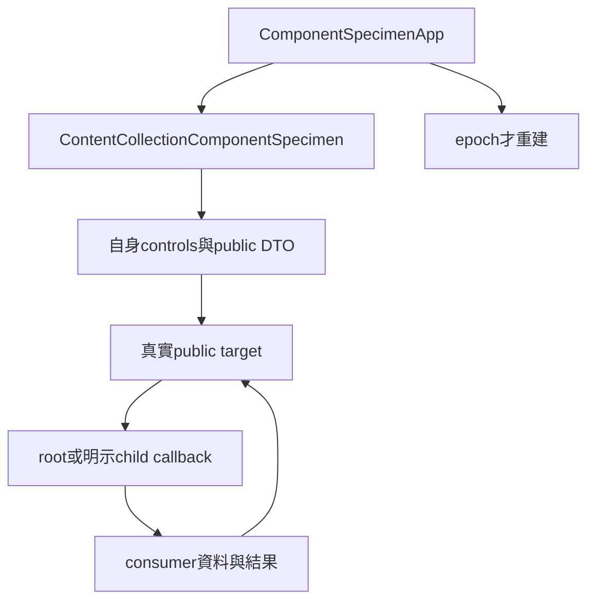


BUILD exact2；十個名称全部對正式public renderable，不以placeholder計數。初次analyze兩處sort_child_properties_last，僅移child至constructor最後，同scope rerun No issues；prefixrelease45.6秒、scope2/diff通過。無library/tests/config/style/site source改動；無新core/persist/crosslanguage邊界，不新增鏡像測試。

Native5203 prefix十route全部自己的props controls与label修改，控制文字回呼2與target分開。AvatarGroup3→5、maximum2→4真實四avatar及+1；Card自己的selected/tone/label/leading/trailing/footer；Bubble emphasis/dense/background false可選用與trailing；Preview metadata及size；Metric null/value/child/tone；均呈現target。Card/Bubble/Metric/Preview child動作各1，無虛構root callback；MessageThread真實loadOlder1由3→4message、指定訊息child動作1分開；ListTile root1；Sort root1改ascending false；Tag公開× root1使consumer移除，再restore回target。

Card child輸入2/動作1；四mode、spacious、local320保持同草稿及回呼；reset回初始props與0，環境spacious/local320維持。當次console error/warn空。main build/flutter-content-collection-specimens.png、flutter-content-collection-native.json保存證據；actual360 browser與感官human-pending，local320不替代。Flutter真實展示100／273，剩173與全量網站gate／style audit仍原goal，不提前push。

State _controls/_target/_usage對應自己的公開props，_child只提供明示consumer input/action；_sort/_loadOlder/_remove/_rootAction記root結果，_childAction/_input記child結果，_edit只control，dispose清controller，build有限scroll舞台。集合資料投影不重建library算法或theme。实际usage單task未量測null。


## FLUTTER-PROGRESS-COLLECTION-SPECIMENS-1（IMPLEMENTED；actual窄browser pending）

修訂 FLUTTER-PROGRESS-COLLECTION-SPECIMENS-r1，IDOC-01/02/03/06/08；exact lib/component_specimens.dart、新 lib/progress_collection_specimens.dart。KlpProgress、KlpStepper、KlpTaskList、KlpScheduleList、KlpTimeline 五個正式target；其餘元件仍維持全273目標。

ProgressCollectionComponentSpecimen(name) 只讀公開foundation與Flutter widgets；State擁有title/detail/draft controllers、進度值/state、step current/direction、consumer task checked Set、資料數量及 callback log。controls使用公開DTO及enum；Progress segments依analyze deprecated契約無呈現效果，不納入controls或constructor；每個target真實constructor與自身使用碼；Progress cancel只記consumer動作，TaskList原onChanged依index回寫checked Set；Timeline content明示child input/action，不能當root callback；Stepper/Schedule無callback不虛構。改數量保持stepIndex合法並移除無對應task id；環境不清state，epoch reset，dispose清controller。使用有限280舞台scroll，水平step寬度不足由consumer提供可水平捲動host，不改library算法。

驗收五registry與正式renderable、公開analyze、同sourceprefixrelease、native五頁自身controls/文字/Progress cancel與Task toggle/Timeline child、四mode/spacious/local320保留草稿及reset、scope2/diff。無core/persist/crosslanguage新風險，不新增鏡像tests；library/tests/config/style/site/docs禁止寫。actual窄browser及感官human-pending。

估3k～7k/25～55分鐘，參考CONTENT-COLLECTION；M1 source5/analyze/build（4k30），M2 native/state/scope（7k55）；12k90或public contract不足回PLAN；actual任務usage無量測null。

| Source / class / function | 責任 |
| --- | --- |
| progressCollectionSpecimenNames / ProgressCollectionComponentSpecimen | 公開名稱及自身route |
| State controls/target/usage/build | 原props與公開DTO、合法finite host |
| State cancel/task/child/input/edit/count | 原callback投影、consumer資料及controller生命週期 |
| component fixture | 精確分流，環境與epoch維持原owner |

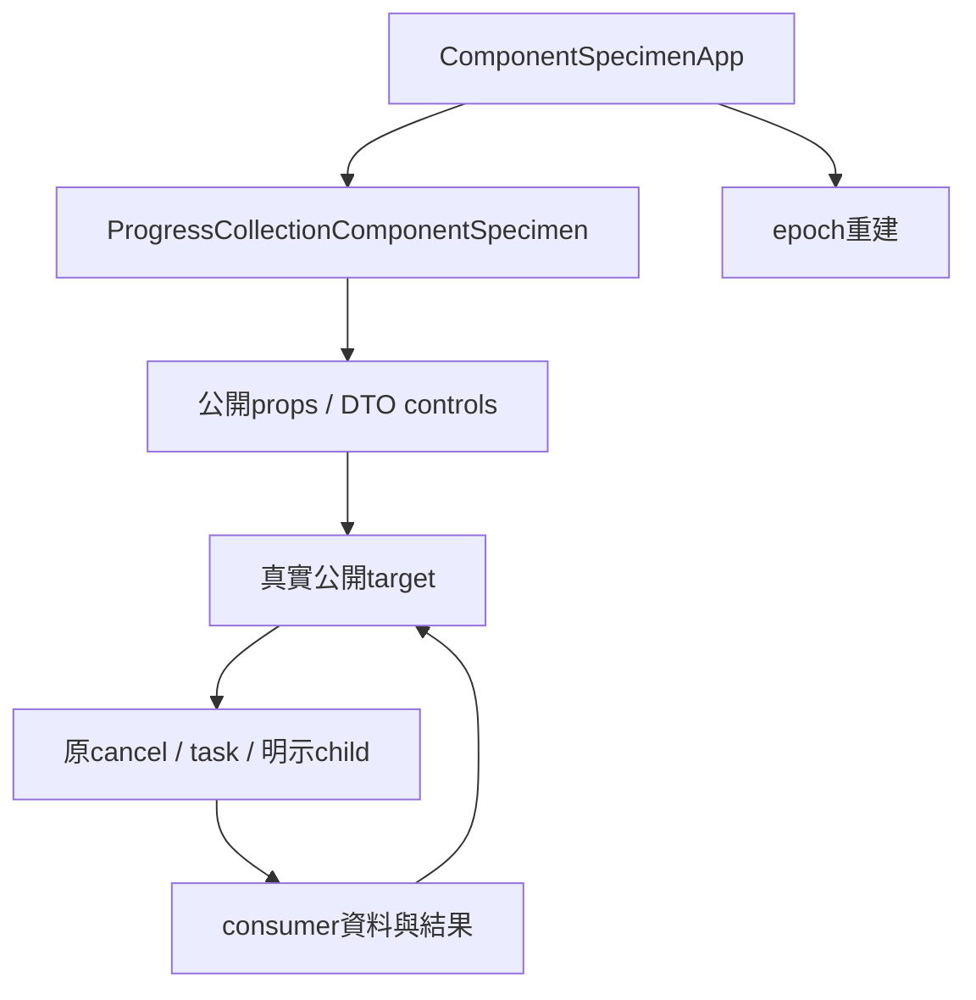


BUILD exact2；五正式public renderable與registry一致。初analyze發現deprecated segments（不影響呈現），owner修訂契約移除無效control，未抑制診斷；最終同sourceanalyze No issues、prefixrelease51.2秒（前版57.3秒不當最終）、scope2/diff通過。task全選control改直接回寫checked Set，原callback可取消其中一筆，改數量同步全選旗標；consumer資料投影沒有改library算法。無library/tests/config/style/site source更動，未新增鏡像tests。

Native5203 prefix五頁自己的controls及label修改均完成，控制文字2與target回呼分開。Progress value0.25→0.5/null、trailing/detail、四state active/paused/success/failure全部呈現，active公開cancel回呼1；其他state沒有cancel按鈕，不假設取消可用。Task原checkbox勾選0回呼1、全選後取消0回呼2得到[1,2]，縮1/恢復3清掉不存在資料且全選旗標false。Stepper原current0→1→2，縮至一筆後合法0，direction/description控制呈現；Schedule公開DTO tag/tone/數量呈現；Timeline自己的time/marker/content/highlighted呈現，指定first child input2及動作1，root0。

Timeline公開label和child草稿在四mode/spacious/local320與回呼保持；reset回初始三筆/defaultprops/0，環境保留。console error/warn空；main build/flutter-progress-collection-specimens.png、flutter-progress-collection-native.json保存證據。actual360 browser與感官human-pending，local320不替代。Flutterfixture105／273，剩168與全量网站/style audit等仍原goal，未提前push。actual task usage無單任務量測null。

State _controls/_target/_usage操作自己的公開參數與constructor，_stepper給水平原生scroll host，_timelineContent只first item持有草稿controller，其餘普通內容，避免多input共用controller；_task/_cancel只root、_input/_childAction只child、_edit只control；_countChange維護consumer合法索引/Set，_checkAll給DTO checked資料，dispose清三controller，build280有限舞台。


## FLUTTER-DATA-COLLECTION-SPECIMENS-1（IMPLEMENTED；actual窄browser pending）

修訂FLUTTER-DATA-COLLECTION-SPECIMENS-r1，IDOC-01/02/03/06/08。exact lib/component_specimens.dart、新 lib/data_collection_specimens.dart；八target Accordion/DataTable/DateGrid/JsonTree/KeyValueList/KeyValueTable/Tree/TreeItem（Klp前綴），其餘全273目標不變。

DataCollectionComponentSpecimen(name)只讀public foundation與Flutter widgets；State管理title/detail/draft controllers、公開DTO、props、selected/expanded Set與callback紀錄。DataTable onSort回寫公開sort及consumer rows順序，不實作庫排序算法；onSelected/onRowPressed分別記結果。DateGrid index回寫selected資料。Tree只現有generic public KlpTreeNode，不觸FileExplorer node/adapter；受控selected/expanded callback回寫Set，TreeItem只自己的onSelected。Accordion initialExpandedIds與multiple改變明示重建target，普通label/theme/width不改key；JsonTree defaultDepth/expandedPaths以明示initial重建控制，原native展開由target自身管理，不虛構onExpanded。KeyValueList copy與JsonTree copyPath只記原公開回呼，不宣称clipboard寫入；無callbacktarget只props，明示child action/input另記。

單一first child持controller，其餘純文字；有限280scroll舞台，DataTable/DateGrid寬內容用原生水平scroll及consumer760寬host，布局能力驗證留library專屬stage不以host當證據。KeyValue DTO設定copyable/verbatim、emptyState；公開enum原values直接切換。空清單與數量control只是consumer資料投影，環境保留controller/state、epoch reset，dispose清controller。無core/persist/crosslanguage新風險，不新增鏡像tests。禁止library/tests/config/style/site/docs寫入。

驗收八registry/publicrenderable、public analyze、同sourceprefixrelease、八native自身controls/文字/selection/sort/expand/copy callbacks、四mode/spacious/local320保留草稿與reset、scope2/diff；actual窄browser與感官human-pending。估6k～12k/40～90分鐘，參考CONTENT/PROGRESS；M1 source8/analyze/build（7k50），M2 native/state/scope（12k90）；18k120或public不足回PLAN；actual單task usage未量測null。

| Source / class / function | 責任 |
| --- | --- |
| dataCollectionSpecimenNames / DataCollectionComponentSpecimen | 真實公開名稱與自身分流 |
| State controls/target/usage/build | 公開參數／DTO投影、合法consumer host |
| State callbacks/data/child/dispose | 原root與明示child回呼分開、資料與controller生命週期 |
| component fixture | 外host環境與epoch維持 |


BUILD exact2；八名稱全部對正式public renderable與registry。初analyze只有未改動tone欄位的prefer_final_fields；改用公開KlpFeedbackTone.info固定demo資料，未抑制診斷。最終同sourcepublic analyze No issues、prefixrelease53.4秒、scope2/diff通過。沒有library/tests/config/style/sitesource更動、無core/persist/crosslanguage新風險，不新增鏡像tests。

Native5203 prefix八route自己的props、empty/恢復與label文字2均操作。DataTable公開sort回呼1將資料2/1/0，第一checkbox選row-2回呼2，原row-1點擊回呼3且選取ID保持；Date index2回呼1。TreeItem原選取item回呼1；Tree child-a選取1、parent折疊2展開3，受控Set []→[parent]、selection維持。KeyValueList detail原copy回呼1/child動作1分開；Json葉title原copy回呼1路徑$.title、nested/items原native展開到葉節點，展開不虛構copy callback。公開複製handler只記錄，未宣稱clipboard寫入；KeyValueTable無callback只自身DTO/title/width/empty。

Accordion原expand item-0回呼1、child輸入2/動作1；四mode/spacious/local320保持draft与原展開，single改開item-1原callback2只[item-1]；明示multiple重建後原操作兩項得到[item-0,item-1] callback4。reset回初始props/closed/0，環境spacious/local320保持。當次console error/warn空；main build/flutter-data-collection-specimens.png、flutter-data-collection-native.json記錄。actual360 browser與感官human-pending、consumer水平host不代替庫內narrow算法驗收。Flutterfixture113／273，剩160及全量網站/style audit等仍原goal，未提前push；actual單task usage未量測null。

State _controls/_target/_usage只自己的公開props；_table使用公開column/row/sort與consumer reversed資料投影，_node使用現有generic public KlpTreeNode不觸FileExplorer；_wide提供有限水平host，_child單一controller內容，_accordion/_selection/_row/_sort/_date/_treeSelect/_treeExpand/_copy記原root投影，_childAction/_input分開、_edit只control，dispose清三controller。TreeItem callback回寫自己selected，Tree children selected依實際id不以deleted旗標冒充。


## FLUTTER-VIEWER-COLLECTION-SPECIMENS-1（IMPLEMENTED；actual窄browser pending）

修訂FLUTTER-VIEWER-COLLECTION-SPECIMENS-r1；IDOC-01/02/03/06/08，exact lib/component_specimens.dart、新 lib/viewer_collection_specimens.dart。四target KlpCodeViewer/KlpDiffViewer/KlpFilePreview/KlpTerminal，補齊collections所有28實際renderable，仍維持全273goal。

ViewerCollectionComponentSpecimen(name)只public foundation/Flutter widgets；State管理title/content/draft controllers、公開props、語言/換行/行號/preview/expand、公開diff資料與consumer審查結果、terminal lines/clear及callback紀錄。CodeViewer公開labels、languageOptions、startLine、loading、content、viewportLimit與真實menu各回呼，preview明示consumer child，不提供第二正文/編輯核心。Diff公開KlpDiffLineType與approve/reject回呼，consumer移除已審查示意line并可restore，onCopy只callback。Terminal lines只示意日誌，clear回寫空list并可restore，不執行shell。FilePreview state/icon/metadata/textContent/preview與press/open/download皆記公開回呼，不下載/開真實外部檔。

公開viewportLimit三態null/fixed120/unbounded在有限280scroll舞台；empty/長資料屬consumer投影；onlyfirst child持controller，root與明示child回呼分開，環境保留state，epoch reset，dispose清controller。不新增core算法/persist/跨語言邊界，不新增鏡像tests；library/tests/config/style/site/docs禁止寫。

驗收四registry/formalrenderable、public analyze、同sourceprefixrelease、native四route ownprops/文字/menu/語言/wrap/line/view/expand/copy/diff review/file/terminal clear、四mode/spacious/local320保留child/reset、scope2/diff。actual窄browser与感官human-pending。估5k～10k/35～75分鐘，參考DATA/CONTENT；M1 source4/analyze/build（6k40），M2 native/state/scope（10k75）；15k100或public不足回PLAN；actual任務usage無量測null。

| Source / class / function | 責任 |
| --- | --- |
| viewerCollectionSpecimenNames / ViewerCollectionComponentSpecimen | 精確公開route |
| State controls/target/usage/build | 公開props與DTO、有限host |
| State code/diff/file/terminal handlers | 原公開回呼、consumer清單與結果，不提供產品核心 |
| State child/input/edit/dispose | child與control紀錄分開、controller生命週期 |
| component fixture | 既有environment/epoch分流 |

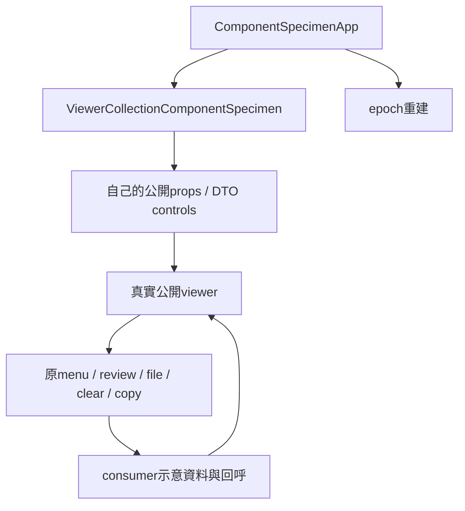


BUILD exact2；四名稱精確對正式renderable；collections四集合fixture加既有Badge精確等於正式28 renderable，沒有DTO/placeholder補數。public analyze No issues、同sourceprefixrelease52.6秒、scope2/diff通過；未改library/tests/config/style/site source，无core/persist/crosslanguage新風險，不新增鏡像tests。

Native5203 prefix四頁自己的props/control文字2操作。Terminal copy1/clear2真正移空lines，restore保持callback2；長20lines、viewport fixed120/unbounded/null可呈現。Diff copy1/approve line0 callback2/reject line1 callback3，consumer reviewed[0,1]移除兩行；三公開lineType與numbers呈現。Code原copy1、menu switch換行2/行號3、語言text4再markdown5、原view6、expand7；child input2/動作1分開，不冒充root。公開labels與自訂languageOptions均由原menu呈現；consumer preview不是正文模型。

FilePreview原group onPressed1、Open externally2、Download3，都只記公開回呼、不開實檔；ready/loading/error/unsupported四state實際呈現，preview child動作1與root3分開，textContent資料另控制呈現。Code child草稿四mode/spacious/local320保持與root7/child1/input2；reset回初始props/0且環境保持。console error/warn空；main build/flutter-viewer-collection-specimens.png、flutter-viewer-collection-native.json保存證據。actual360 browser與感官human-pending，local320不替代。Flutterfixture117／273，剩156及全量网站/style audit等仍原goal，未提前push；actual單task usage無量測null。

State _controls/_target/_usage只自己的props，_limit公開typed三態，_code/_child只consumer示意內容；_languageChange/_wrap/_lineNumbers/_toggleView/_expand/_copy/_review/_clear/_open/_external/_download記原public callbacks及consumer投影，_childAction/_input分開、_edit只control，dispose清三controller，build有限280scroll舞台。庫演算法、正文或終端執行核心沒有複製。


## FLUTTER-NAVIGATION-SELECTION-SPECIMENS-1（IMPLEMENTED；actual窄browser pending）

修訂FLUTTER-NAVIGATION-SELECTION-SPECIMENS-r1；IDOC-01/02/03/06/08。exact lib/component_specimens.dart、新 lib/navigation_selection_specimens.dart。十三target：KlpActionGroup、KlpBreadcrumb、KlpDocumentTabs、KlpPagination、KlpPreviewTree、KlpRailItem、KlpSidebarButtonGroup、KlpSidebarIdentityHeader、KlpSidebarNavigationButton、KlpSidebarNavigationGroup、KlpSidebarSectionLabel、KlpTabs、KlpViewSwitcher。NavigationRail/Navigator/PublicationProgressOverlay另slice，仍全273目標。

NavigationSelectionComponentSpecimen(name)只public foundation與Flutter widgets；State擁有label/detail/draft controllers、consumer selected/page/closed/pinned、資料數量與callback結果。每頁真實constructor/publicDTO/owncontrols/usage；DocumentTabs原selected/close/pin回呼回寫tabs，close後selected移到可用first或null，restore由consumer明示；Tabs原鍵盤/選取回寫索引，數量改變保持合法selected；ViewSwitcher ID資料投影；Breadcrumb/PreviewTree只回呼紀錄，不虛構內部狀態。Pagination用既有public caller慣例page2/count9作參考，示例page1/count5與前後publiccallback回寫，數量合法保持。Sidebar/ButtonGroup/NavigationGroup child原callbacks明示與root分開；IdentityHeader trailing提供single child input/action，avatarLabel/semanticLabel不依外部image；RailItem只自己的publiccallback不引入reorder算法。

control文字只記control；State環境保留、epoch reset、dispose清controller。有限280scroll舞台，橫向文件/tab/breadcrumb必要時原生水平scroll+consumer760寬host，不能當library narrow算法已驗收。無新core/persist/crosslanguage邊界，不新增鏡像tests，library/tests/config/style/site/docs禁止寫。

驗收十三registry/formalrenderable、publicanalyze、同sourceprefixrelease、native13 ownprops/文字/selection/close/pin/keyboard/child/page、四mode/spacious/local320保持draft/結果与reset、scope2/diff。actual窄browser與感官human-pending。估7k～14k/50～100分鐘，參考DATA/CONTENT；M1 source13/analyze/build（8k55），M2 native/state/scope（14k100）；21k150或public不足回PLAN，actual單taskusage無量測null。

| Source / class / function | 責任 |
| --- | --- |
| navigationSelectionSpecimenNames / NavigationSelectionComponentSpecimen | 自己的公開route |
| State controls/target/usage/build | 公開props與DTO、合法host |
| State select/close/pin/page/child/input/edit/dispose | 原root與明示child分開、consumer資料與controller生命週期 |
| component fixture | 保留environment與epoch |

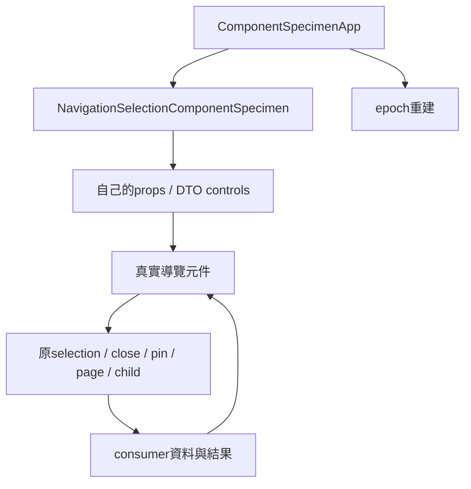


BUILD exact2；十三名稱對正式public renderable，無DTO或placeholder補數。public analyze No issues、同sourceprefixrelease44.6秒、scope2/diff通過；無library/tests/config/style/site source更動、無core/persist/crosslanguage新風險，不新增鏡像tests。

Native5203 prefix十三自己的props/文字controls（控制文字2與target分開）實際操作。ActionGroup/SidebarButtonGroup/SidebarNavigationGroup各指定child1回呼1，root0；Breadcrumb index1/root1、RailItem與SidebarNavigationButton原root1；Tabs選1/root1，另鍵盤ArrowLeft0→2/root1，縮count3→1後合法index0；ViewSwitcher view-1/root1；PreviewTree原semantic label導覽說明1實際click得到preview-1/root1，不以generic標記推斷不可互動。SectionLabel只公開文字，不虛構callback。

Document原選doc-1/root1、pin2、close doc-0回呼3且selected仍doc-1、unpin4、close selected5後doc-2、最後close6後empty及null；restore3筆與selected doc-0，回呼仍6，consumer restore不冒充native事件。Pagination前進到5/root4，下一頁實際generic非可操作button；previous到4/root5，縮count1當前page1合法、兩端generic，保留最後page4回呼結果而不把control投影算成回呼。

IdentityHeader avatarLabel提供時原元件採avatar內容且trailing不呈現（觀察已記，未改library或假設兩者同時顯示）；avatar=false真實trailing child輸入2/動作1，root0。四mode/spacious/local320保留草稿與結果；avatar切換回來仍草稿保持；reset回初始props/0與環境spacious/local320保留，再啟用trailing實際初始側欄child草稿。console error/warn空；main build/flutter-navigation-selection-specimens.png、flutter-navigation-selection-native.json保存證據。actual360 browser與感官human-pending，consumer水平host不代替library narrow算法。Flutterfixture130／273，剩143与全量网站/style audit等仍原goal，未提前push；actual任務usage未量測null。

State _controls/_target/_usage只自己的公開constructor；_labels/_available/_reconcileDocument/_toggleCount/_pinAll/_restoreDocuments為consumer資料投影，_selectIndex/_selectId/_rootAction/_documentSelect/_documentClose/_documentPin/_pageChanged記原root結果，_childAction/_input分開、_edit只control，_identityChild給單一controller內容、_wide提供水平host，dispose清三controller，build有限280scroll舞台；沒有導覽runtime或第二theme。


## FLUTTER-NAVIGATION-COMPOUND-SPECIMENS-1（IMPLEMENTED；actual窄browser pending）

修訂FLUTTER-NAVIGATION-COMPOUND-SPECIMENS-r1，IDOC-01/02/03/06/08；exact lib/component_specimens.dart、新 lib/navigation_compound_specimens.dart。KlpNavigationRail、KlpNavigator、KlpPublicationProgressOverlay；補齊正式features.navigation，不替代全273goal。

NavigationCompoundComponentSpecimen(name)只public foundation/Flutter widgets。Rail State管理top/center/bottom穩定ID順序與selected；public KlpRailItemGroup.onReorder依既有consumer caller直接removeAt/insert(newIndex)，不重寫庫索引算法；divider在同consumer清單中，menu用KlpRailMenuEntry及KlpMenuItemData。按鈕/menu entry回呼、group重排與child回呼分開；沒有模擬drag callback按鈕。原群組重排由native操作驗收，不以切props充作重排成功；不新增跨群移動。

Navigator使用既有public KlpNavigatorCategory/Element/Component、受控category/element expanded Set及selectedId，原callback回寫資料；不改FileExplorer模型或建立adapter。公開surfaceTone、collapsible、icon/badge/trailing、component child由controls投影；單一controller child只一份。PublicationProgressOverlay公開visible/progress/stages與child，以有限300高host提供；progress數量/active/complete/label與文字控制，root無callback不虛構，child原input/action另記，不宣稱未觀察完整modal/pointer阻擋。

環境保留state/controller、epoch reset，dispose清controller；Rail固定420合法bounded舞台且width讀theme.space.chromeRail，其他300高；原生scroll容納内容。無core/persist/crosslanguage新風險，不新增鏡像tests。禁止library/tests/config/style/site/docs寫入。驗收三registry/formalrenderable、publicanalyze、同sourceprefixrelease、native各ownprops/文字/Rail entry+menu+真drag重排/Navigator選取展開/overlaychild、四mode/spacious/local320保持draft/結果/reset、scope2/diff；actual窄browser與感官human-pending。

估5k～10k/35～80分鐘，參考NAVIGATION-SELECTION/DATA；M1 source3/analyze/build（6k40），M2 native/state/scope（10k80）；15k120或public不足回PLAN；actual單task usage未量測null。

| Source / class / function | 責任 |
| --- | --- |
| navigationCompoundSpecimenNames / NavigationCompoundComponentSpecimen | 精確自己的公開route |
| State controls/target/usage/build | 公開DTO／props及合法bounded host |
| State rail/navigator/child handlers | 原公開意圖回寫consumer資料，entry/root/child分開 |
| State controllers/dispose | 草稿生命週期及環境保持 |
| component fixture | 外host/epoch精確分流 |

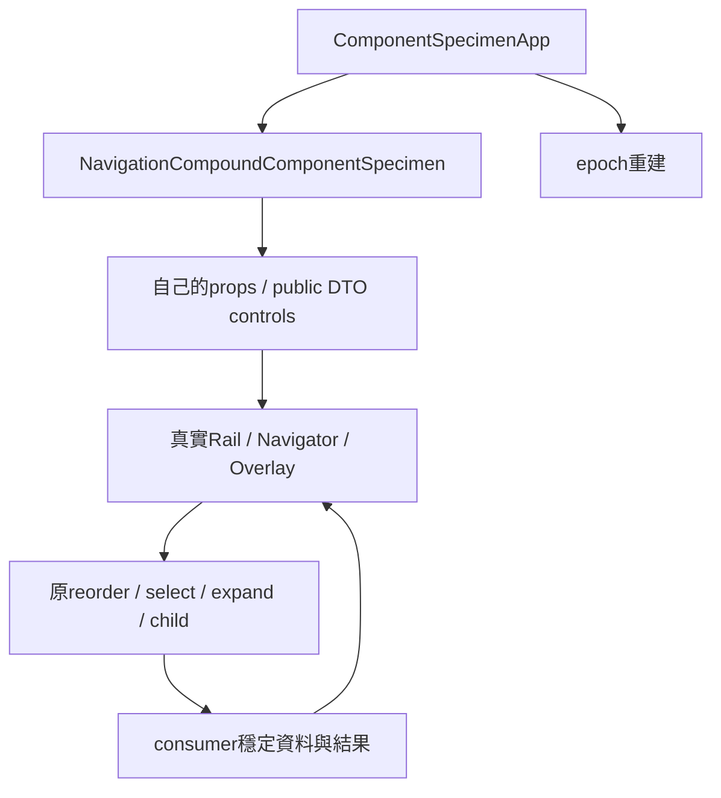


BUILD exact2；三名称對正式public renderable，compound3＋selection13＋Explorer5精確等於features.navigation正式21，不以DTO/placeholder補數。初analyze未使用helper移除，menu標籤字串插值修正於build前；最終public analyze No issues、同sourceprefixrelease55.0秒、scope2/diff通過。未改library/tests/config/style/site source，無新core/persist/crosslanguage風險，不新增鏡像tests。

Native5203 prefix三頁自己的props/label control2操作。Rail原top-b entry1、原menu child action entry2與group0分開；真實pointerdrag top index0→2 group1／top-b,top-c,top-a，center index0→1 group2／center-b,center-a；加入同資料清單divider後再拖top0→3 group3得到divider,top-c,top-a,top-b，center順序保持。沒有用control callback模擬drag或複製索引正規化。座標取fresh screenshot；只讀DOMrect曾與畫布位置差84，實際drag依screenshot位置，未寫DOM。

Navigator原child-b選取1，element折疊2/展開3、category折疊4/展開5，受控selection child-b保持；公開component child輸入2/動作1分開，entry0。四mode/spacious/local320保留草稿及root5/child1/input2；reset回initialsets、child-a/defaultprops/0，環境保持。Publication bounded300 child input2/action1 root0；visibletrue原child action變generic而progress呈現，hide後button及同草稿恢復；只記已觀察狀態，不宣稱完整modal或pointer阻擋已驗收。當次console error/warn空；main build/flutter-navigation-compound-specimens.png、flutter-navigation-compound-native.json保存證據。actual360 browser與感官human-pending。Flutterfixture133／273，剩140及全量网站/style audit等仍原goal，未提前push，actual單task usage未量測null。

State _controls/_target/_usage/_rail/_navigator持有自己的公開DTO/props，_entry/_leaf/_child提供合法資料與單一controller內容；_reorder/_topReorder/_centerReorder直接回寫原publiccallback normalizedindex，_divider控制資料包含divider故不錯置drag索引；_railSelect/_railMenu只entry，_category/_element/_select只root，_childAction/_input分開、_edit只control，dispose清三controller，build各boundedhost。不建立FileExplorer adapter、產品runtime或第二theme。


## FLUTTER-ACTION-UTILITY-SPECIMENS-1（已驗證）

修訂FLUTTER-ACTION-UTILITY-SPECIMENS-r2；IDOC-01/02/03/06/08，exact lib/component_specimens.dart、新 lib/action_utility_specimens.dart。五target KlpBulkActionBar、KlpCommandMenu、KlpEditorToolbar、KlpSearchNavigator、KlpSelectionToolbar；已完成registered五與basic button保持，全273目標不變。

ActionUtilityComponentSpecimen(name)只 public foundation、experimental 與 Flutter widgets；SelectionToolbar 使用 foundation，其他四個 target 與所需 DTO 使用既有 experimental 公開入口，host 依 target 標明公開入口，不提升 Stable、不引用 src；State擁有label/detail controllers、公開DTO props、action selected/disabled/danger、menu framed/autofocus、query/current/total與closed/selectioncount，以及entry/root/control結果。Bulk/Editor/Selection公開DTO動作只記entry callback，Selection clear是root並回寫count0；CommandMenu原item回呼與Escape分開，shortcut僅標示不假裝註冊，menu keyboard原有規則由native驗收不複製算法。autofocus變更明示重建target，環境不換key。Search initialQuery control明示套用並重建target，ordinary control編輯不偷偷重設原input；原query回呼更新query結果，previous/next只consumer示意位置投影合法1..total或0..0，close由consumer移除並可restore，不建立search引擎。

自己的constructor/controls/usage與真實callback；環境保留state/controllers，epoch reset、dispose清controller，280finite scroll舞台。無core/persist/crosslanguage新邊界，不新增鏡像tests，library/tests/config/style/site/docs禁止寫。驗收五registry/formalrenderable、publicanalyze、同sourceprefixrelease、native ownprops/文字/actions/clear/searchinput/previous/next/close/menu keyboard跳過disabled/Enter/Escape、四mode/spacious/local320保留query與callback/reset、scope2/diff。actual窄browser與感官human-pending。

估5k～10k/35～80分鐘，參考NAVIGATION/DATA；M1 source5/analyze/build（6k40），M2 native/state/scope（10k80）；15k120或public不足回PLAN；actual單taskusage未量測null。

| Source / class / function | 責任 |
| --- | --- |
| actionUtilitySpecimenNames / ActionUtilityComponentSpecimen | 精確自己的publicroute |
| State controls/target/usage/build | 公開props與DTO、finitehost |
| State action/clear/search/menu handlers | 原entry/root分開與consumer投影 |
| State controllers/dispose | label/detail及query生命週期 |
| component fixture | environment與epoch保留 |

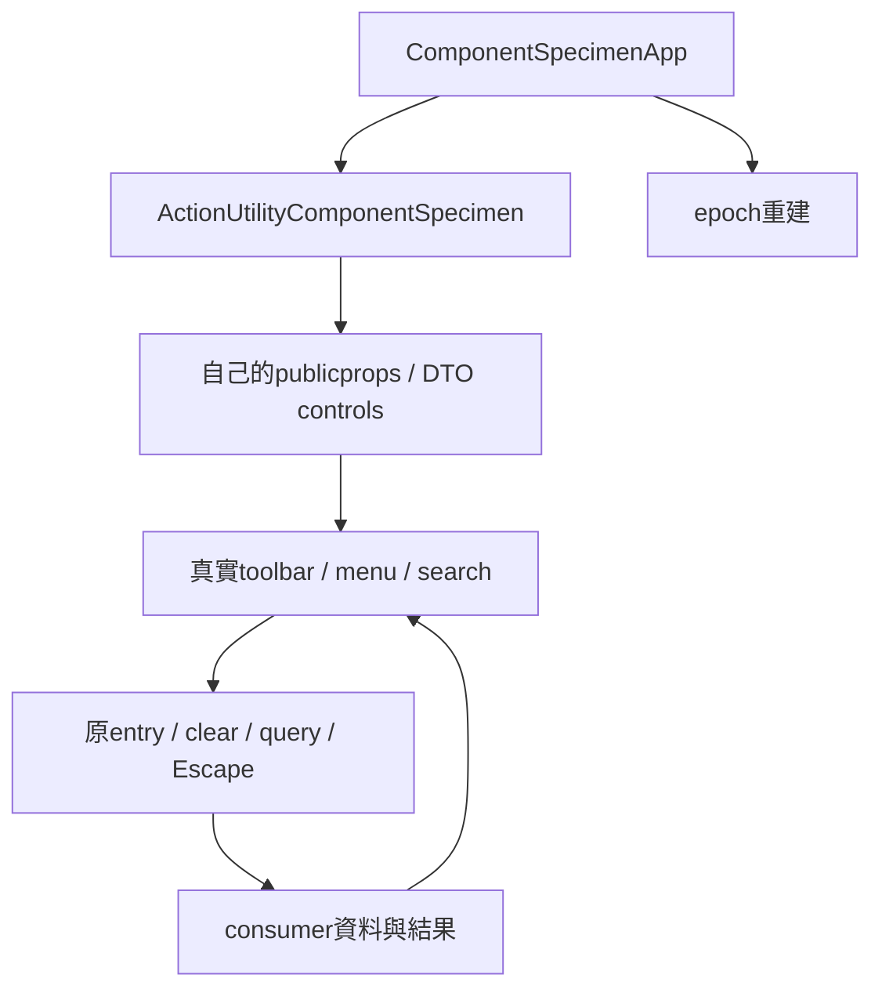

驗證：五個自己的 public target 新增後累計 138／273。public analyze No issues；同 source prefix release 51.8 秒；scope exact2 pass、diffcheck通過。native Menu Home→Down→Down→Enter 選 entry3、跳過停用 entry2，Escape root1，caption／shortcut 與 framed 控制生效；Bulk entry1／label文字2／danger／callback=null；Editor entry2／danger／selected consumer控制；Selection entry1 與 clear root1/count0 分開，restore count3、dashed false、clearLabel=null 隱藏 clear。Search queryinput2、Previous/Next root4，四 mode／寬鬆／local320保留 query，total0合法0/0、Close root5移除、restore及明示initial重建無額外callback，epoch reset原props/root0而環境保持。入口host明確顯示四 experimental／一 foundation。native JSON／PNG 位於主工作樹 build/flutter-action-utility-*；當前頁 console error/warn 無。完整窄 browser 與感官仍 human-pending，單task tokens未量測 null；全頁映射及總release尚未完成，不宣告全量覆蓋或push。

## FLUTTER-FOUNDATION-DETAIL-SPECIMENS-1（已驗證）

修訂 FLUTTER-FOUNDATION-DETAIL-SPECIMENS-r1，IDOC-01/02/03/06/08；exact lib/component_specimens.dart 及新 lib/foundation_detail_specimens.dart。十個真實 target：KlpIcon、KlpInlineCode、KlpRichText、KlpShortcutHint、KlpDashedBorder、KlpDashedDivider、KlpGeometricSpinner、KlpPresenceIndicator、KlpSegmentedProgress、KlpStrokeFrame，公開 foundation 入口及正式 manifest constructors/DTO 為契約。

Fixture State 擁有 text/draft controllers、icon weight/選擇、semanticLabel、nullable style override、rich spans/nodes/selectable/unsafe/missing/callback、presence active、progress value/segments、stroke role/state 與原生 root/child/input/control計數。style override 數值從 context.klp semantic theme 推導，null 恢復庫權威；不複製 theme。Spinner duration 變更明示 key 重建，其他環境不換key；finite280舞台，divider 方向使用 finite160host避免無界，自動換行/scroll由consumer宿主提供。rich nodes 與 spans 選擇展示公開優先規則；links/mention callback只記結果，不開外部網站；shortcut文字不宣稱註冊。static targets 沒有root callback，不增加fake互動。

M1 source10/publicanalyze/prefixrelease；M2 native10 ownprops、Rich原callback、container child input/action跨四mode/寬鬆/local320/reset、scope exact2/diff。沒有core/persist/crosslanguage新增，不新增鏡像test；library/tests/config/style/site/docs禁止寫。actual窄browser與感官human-pending。估7k～13k/45～90分鐘（參考DATA/FEEDBACK），M1累計7k45、M2累計13k90；20k130或public不足回PLAN，單taskusage未量測null。

| Source / class / function | 責任 |
| --- | --- |
| foundationDetailSpecimenNames / FoundationDetailComponentSpecimen | 精確公開target路由與name |
| _FoundationDetailComponentSpecimenState controllers/dispose | text/draft生命週期及style切換保留 |
| controls/target/usage/build | 當次公開props、合法finitehost及可觀察結果 |
| edit/input/childAction/openLink/openMention | 真正控制、原input/child/root回呼分離 |
| component fixture dispatch | environment及epoch保持 |

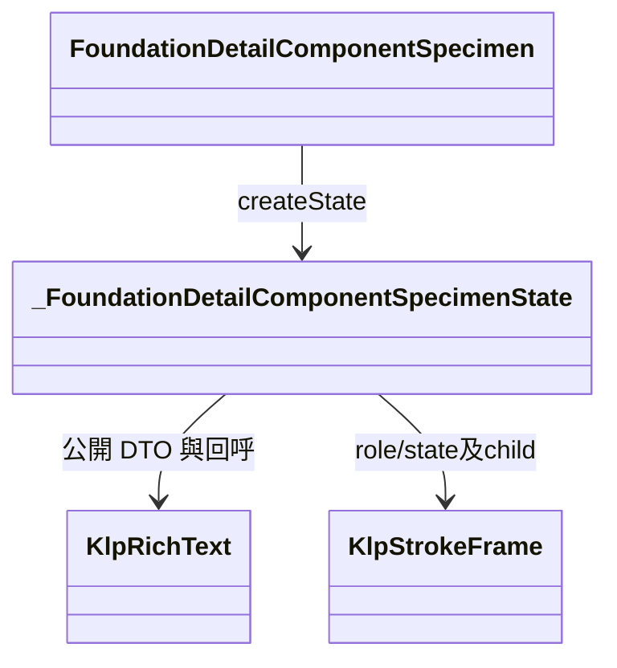
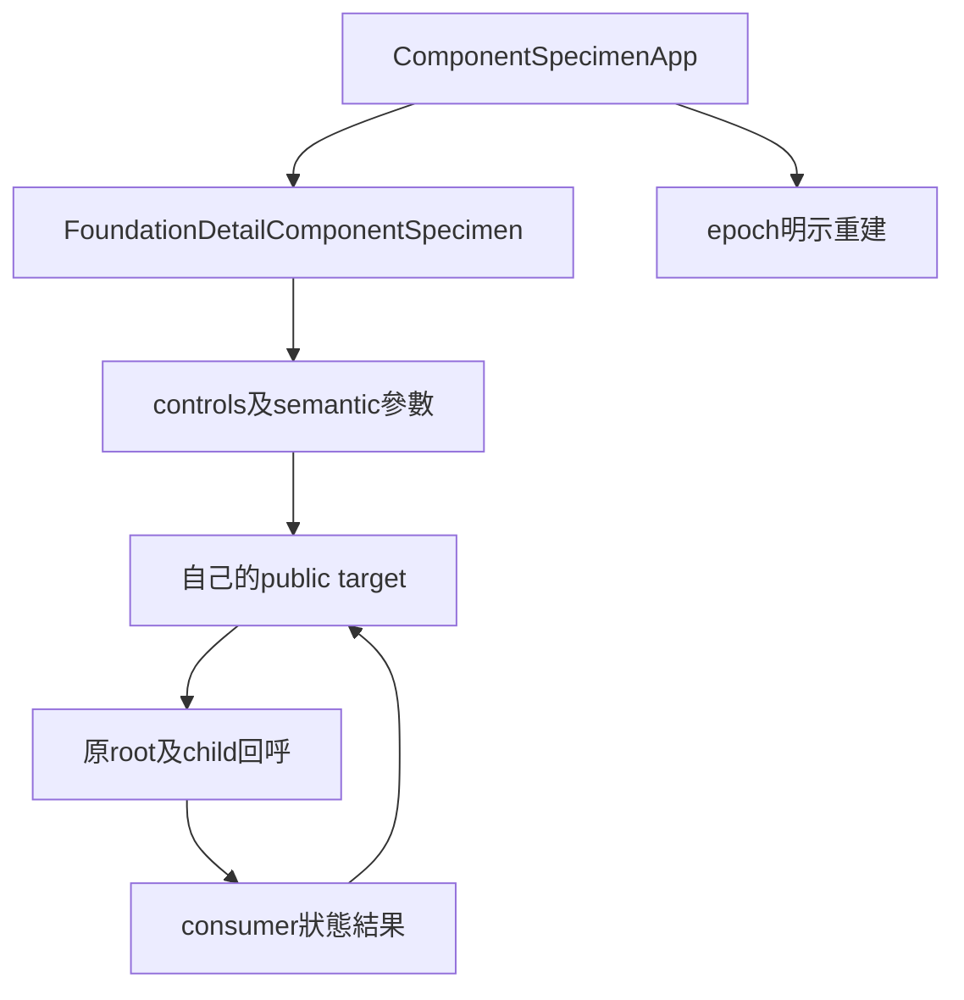

驗證：新增十個自己的真實 target，累計148／273；formal manifest十個皆renderable。初次analyze指出不存在surfaceElevated，依公開ThemeData使用surfaceRaised修正，原scope rerun No issues；same-source prefix release51.7秒，scope exact2及diffcheck pass。native十route及各公開控制，七個有文字參數route可改自己文字（Rich/框線內容亦包括）；Icon thin/folder及semantic label、Inline font/radius/color、Hint Ctrl+K Ctrl+S、Presence active、Dashed vertical/geometry/color/opacity、Spinner size/color/明示duration2400重建、Progress0.25→0.5與4→8、Stroke structure→latent/rest→hovered。Rich nodes優先spans、selectable與unsafe/missing/callback狀態，真正click link root1/https://example.com、mention root2/展示成員；只記callback不打開外部。Stroke childinput2/action1跨四mode/寬鬆/local320保持，epoch reset counters0與role/state/override恢復而environment保持；Dashed childinput2/action1 root0。Hint第一次輔助功能未ready，重新確認成功後獨立操作，未把初始shell算完成。當前console error/warn空；主工作樹build/flutter-foundation-detail-native.json及PNG為證據。actual窄browser、感官、全量元件頁映射及最終push仍未完成，單tasktokens未量測null。

## FLUTTER-INTERACTION-PRIMITIVE-SPECIMENS-1（已驗證）

修訂 FLUTTER-INTERACTION-PRIMITIVE-SPECIMENS-r1；IDOC-01/02/03/06/08，exact lib/component_specimens.dart 與新 lib/interaction_primitive_specimens.dart。九個自己的 target：KlpSemanticRegion、KlpExcludeSemantics、KlpFocusRegion、KlpGestureRegion、KlpPointerBlocker、KlpPressable、KlpStateHighlight、KlpVeil、KlpActionRegion；foundation 公開 constructors/DTO 與 Flutter widgets/services。

State 擁有label/value/draft controllers、可dispose FocusNode、callback enable、自己的 bool/nullable/enum props、pointer位移與tap/double/secondary/pan事件、focus F2原KeyDown回呼與press/hover/focus/long結果。ActionRegion builder使用其公開foreground與KlpText，不另寫surface theme。Focus autofocus變更明示重建但consumer FocusNode保持；其餘環境不換key。Gesture有限200高命中舞台，Tap/Double/Pan/Secondary各回呼分開；Pointer blocker consumer初始false方便實測，再true驗證阻擋，不能把callback=null當阻擋證據。Exclude只裝飾文字／icon，不放被隱藏的互動控件；Veil以自身child示意，無fake root callback。semantic enabled是語意參數，不冒充pointer blocker。nullable props顯示null/true/false；控制文字、root、child、draft input、hover/focus各計數分離。

M1 source9/public analyze/prefix release；M2 native9 ownprops、Action/Press/Focus F2/Gesture tap-double-secondary-pan、Pointer實際命中阻擋、Exclude語意缺席仍繪製、child草稿四mode/寬鬆/local320/reset、scope2/diff。原library/tests/style/config/site/docs禁止寫；無新核心算法/persist，不新增鏡像tests。longPress可依原生持續按壓證據驗證，不以一般click冒稱；actual窄browser與感官human-pending。估7k～14k/45～90分鐘參考DETAIL/FEEDBACK；M1累計7k45，M2累計14k90；20k130或public不足回PLAN；單taskusage未量測null。

| Source / class / function | 責任 |
| --- | --- |
| interactionPrimitiveSpecimenNames / InteractionPrimitiveComponentSpecimen | 精確public route/name |
| _InteractionPrimitiveComponentSpecimenState fields/dispose | controller/focus生命週期與自己的props |
| controls/target/child/usage/build | public組裝、有限命中舞台與結果 |
| root/key/gesture/hover/focus/childAction/input/edit | 原始事件、控制與子內容分離 |
| host fixture dispatch | environment保留與epoch重設 |

```mermaid
classDiagram
	InteractionPrimitiveComponentSpecimen --> _InteractionPrimitiveComponentSpecimenState : createState
	_InteractionPrimitiveComponentSpecimenState --> KlpActionRegion : public style builder
	_InteractionPrimitiveComponentSpecimenState *-- FocusNode : dispose
```
```mermaid
flowchart TD
	Host[ComponentSpecimenApp] --> Fixture[InteractionPrimitiveComponentSpecimen]
	Fixture --> Props[自己的公開props與child]
	Props --> Target[實際互動原語]
	Target --> Events[原生pointer／key／semantics]
	Events --> State[consumer結果]
	State --> Props
	Host --> Reset[epoch重建]
```

驗證：新增九target後累計157／273；formal manifest九個renderable，public analyze No issues，same-source prefix release46.4秒，scope exact2/diffcheck pass。native九route、自己props及label文字2；Semantic enabled/focusable/explicit/container/value，ActionRegion destructive/control/selected/active/toggled/expanded與callback=null呈disabled switch，重新enable後pointer+Enter原onPressed2。Focus child F2 root1／input2／child動作1，四mode/寬鬆/local320草稿及事件保持，epoch reset counters0且environment保持。Gesture一般tap1、次要按鍵兩個原回呼、真實pointer drag pan131.0/44.0且onPanEnd；一般工具dblclick在此會形成tap，未算double成功。依Flutter公開[雙擊最短40ms](https://api.flutter.dev/flutter/gestures/kDoubleTapMinTime-constant.html)／[最大300ms](https://api.flutter.dev/flutter/gestures/kDoubleTapTimeout-constant.html)，reload後未啟用AX overlay的實際canvas相同位置兩次click間隔80ms，真正onDoubleTap1；沒有修改library算法。Pressable真正pointer持續900ms→onLongPress1、pointer+Enter→root3/onPressed、hovertrue1/focustrue1。Pointer blocker child可操作1，blocking=true後同畫面實際命中child仍1/語意generic，解除後child2，未以nullcallback冒稱阻擋。Exclude screenshot仍有裝飾文字，語意樹不含該target文字；不放隱藏的互動子控件。Highlight none→hover→selected childaction1/root0；Veil自己的child文字/icon展示。主工作樹build/flutter-interaction-primitive-native.json／PNG為證據，當前error/warn無。actual窄browser、感官、全量頁映射、總release與push仍未完成，單tasktokens未量測null。

## FLUTTER-LAYOUT-UTILITY-SPECIMENS-1（已驗證）

修訂 FLUTTER-LAYOUT-UTILITY-SPECIMENS-r2；IDOC-01/02/03/06/08，exact lib/component_specimens.dart 與新 lib/layout_utility_specimens.dart。十target：KlpAdaptive、KlpDeviceAdaptive、KlpEnvironmentScope、KlpMasonryGrid、KlpVirtualGrid、KlpVirtualList、KlpResizablePane、KlpResizeHandle、KlpSlidingDrawerLayout、KlpSplitLayout；foundation 公開 constructors/DTO/factory 是契約。DeviceClass/Orientation/DisplayMode enum未由現行barrel公開，consumer只使用KlpPlatformInfo.current(viewportSize)及DTO已可讀欄位，不import src或擴大barrel。native factory 1400/900回傳tablet、440回傳phone；DeviceAdaptive desktop案例使用公開DTO預設deviceClass（platform windows），另外兩個案例使用factory900/440，control明示來源，Scope保留純factory採樣，不偽稱1400是desktop。

State擁有label/draft controllers、ScrollController、ValueNotifier progress並dispose；platform explicit/null、scope platform、optional builders、公開factory viewportSize採樣/環境來源、集合count/empty、grid columns/width/spacing/aspect、masonry minimumColumnWidth、pane width、handle axis/enabled/size/callback、drawer progress/tracking/extent、split size/gap/divider/center。實際LayoutBuilder呈現branch/子約束，itemBuilder只投影consumer項目並記child動作；不寫虛擬化算法或平台判別。VirtualList有限280viewport與原controller，跳尾由公開controller操作並明示consumer控制；Masonry有限舞台自己的scroll。ResizeHandle直接原onDelta/start/end與consumer bounded extent，不能以按鈕模擬drag；ResizablePane只有width沒有root resize回呼。SlidingDrawer用公開ValueNotifier 0/.5/1，與stage/drawer原child，environment不換key。Split有限760展示畫布提供horizontal scroll、child垂直scroll，不用固定舞台冒稱庫窄尺寸算法已驗收。

M1 source10/public analyze/prefix release；M2 native10 ownprops/實際branch/集合empty-restore/virtual原生scroll/handle雙axis拖曳及disabled/抽屜progress幾何/child四mode-寬鬆-local320-reset/scope2-diff。庫/tests/config/style/site/docs禁止寫；無新核心/persist算法，不新增鏡像test。scope採樣寬度與local320是consumer示意，不宣稱實際browser窄。感官與完整窄browser human-pending。估8k～16k/45～100分鐘，參考LINEAR/DETAIL；M1累計8k45，M2累計16k100；24k140或公開契約不足回PLAN，單taskusage未量測null。

| Source / class / function | 責任 |
| --- | --- |
| layoutUtilitySpecimenNames / LayoutUtilityComponentSpecimen | 精確自己的公開target路由 |
| _LayoutUtilityComponentSpecimenState fields/dispose | controller/notifier生命週期及props |
| controls/target/branch/item/pane/resize/usage/build | 公開組裝、finitehost、實際measurement |
| input/edit/childAction/delta/dragStart/dragEnd/jumpEnd | consumer事件／原回呼分離及合法投影 |
| component fixture dispatch | style環境與epoch |

```mermaid
classDiagram
	LayoutUtilityComponentSpecimen --> _LayoutUtilityComponentSpecimenState : createState
	_LayoutUtilityComponentSpecimenState *-- ScrollController : dispose
	_LayoutUtilityComponentSpecimenState *-- ValueNotifier : dispose
	_LayoutUtilityComponentSpecimenState --> KlpPlatformInfo : public factory
```
```mermaid
flowchart TD
	Host[ComponentSpecimenApp] --> Fixture[LayoutUtilityComponentSpecimen]
	Fixture --> Props[公開props/DTO/controller]
	Props --> Target[自己的public布局target]
	Target --> Layout[實際branch及constraints]
	Target --> Event[原drag／child input動作]
	Event --> State[consumer資料與回呼结果]
	State --> Props
```

驗證：fixture6afe629e exact2，原packet scope2/diff及public analyze No issues；r2 Device源prefix release46.1秒。十個正式renderable自己target累計167／273。native平台explicit勝scope；Device公開DTO desktop／factory900 tablet／440 phone，scope factory1400實際tablet。Masonry minnull cell181／min240 cell245.3；空集合發現public clamp(1,0)例外後停止原驗收，由独立FLUTTER-MASONRY-EMPTY-1修正b3cff636及受保護兩tests；同source prefix45.7秒，fresh tab14實測12→60→0→12／selected−1→0／child1→2，error/warn空，保留之前Red歷史。Grid原生scroll60 items實際20–23/選取20，List原controller跳尾53–59/選取59；兩集合空0後恢復12。Resizable width160→240真實約束；Handle真正horizontal拖曳extent120→180、delta8/start1/end1，vertical→140/delta16/start2/end2，disabled同pointer拖曳計數與extent不變。Drawer stage幾何0/.5/1實際x8/68/128，閉合stage及開啟drawer child原動作；Split finite760 leading350/center84/trailing300及公開props，不冒稱窄算法。Device childinput2/action1跨四mode/寬鬆/local320保持，epoch歸零而environment保持。build/flutter-layout-utility-native.json與兩PNG為主工作樹證據；actual窄browser、感官、全量頁映射、整體release/push仍待，單taskusage null。
