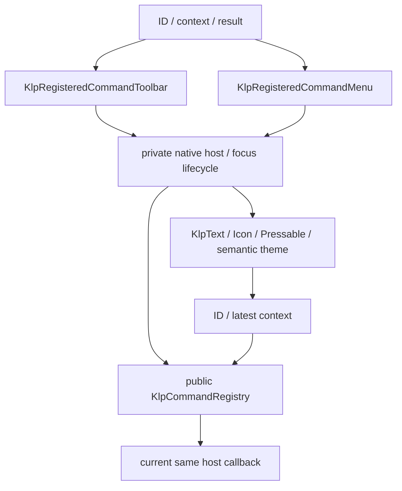

# Registered command入口

FLUTTER-COMMAND-ENTRY-r1 READY，依[共同WB-COMMAND-ENTRY-r1](../../../../../../../docs/architecture/workbench-command-entry-contract.md)。當前只交付直接原生toolbar/平面menu；popup/palette/shortcut仍待接續，既有CommandMenu/WorkspaceCommand caller不變。

## 責任及公開契約

單一`klp_command_entries.dart`擁有enum `KlpCommandKind { action, toggle }`、immutable `KlpCommandReference`（const、required commandId、kind缺省action）及兩個generic原生Widgets。stablefoundation匯出新來源。

共同Widget參數registry:KlpCommandRegistry<C>、getContext:C Function()、items:List<KlpCommandReference>、label:String、onResult:ValueChanged<KlpCommandExecutionResult>必填，key可選。Menu另emptyLabel:String必填、autoFocus:bool=false、onDismiss:VoidCallback?。可const建構；build前以ArgumentError驗證字串非空白及同入口duplicate ID，不依assert。

private共享host持registry subscription disposer/generation、root及每ID FocusNode、當前focus ID，沒有context/handler/pending鏡像。init訂閱，didUpdateWidget更換registry先解除訂閱並提升generation，dispose解除訂閱/FocusNode並隔離舊結果。query每次讀getContext一次後依items順序getState；activation再次讀最新getContext並execute ID。samehost/sameregistry完成交當前onResult；context/callback異常交FlutterError，不合成業務結果。disposed registry不訂閱、不query。

toolbar左右/menu上下、Home/End在可用項循環；Enter/Space KeyDown啟動且handled，KeyRepeat不啟動；Escape只menu onDismiss。每ID原生Focus roving skipTraversal；停用/running不能requestFocus。Menu mount/registry replacement且autoFocus=true時postframe聚焦首可用項或空root；false不偷焦點。清冊更新保留存在ID FocusNode，移除node安全收尾。

row重用KlpText/KlpIcon/KlpPressable及context.klp；Semantics label/button/enabled/focus及toggle checked，action checked null，icon裝飾不重複語音。外層Focus/語意擁有鍵盤與activation，排除Pressable內部重複focus/semantics。menu沿既有recipe width/radius/itemHeight/padding/gap，有限垂直scroll與文字裁切；toolbar換行。hover/checked同semantic wash，無新palette/default。風格/尺寸不改ID或權限。

採薄row投影而不修改舊CommandMenu模型：舊模型缺icon/action-toggle區分，修改會改caller相容性。沒有新renderer/node/adapter，沒有第二份命令狀態；舊controls/theme/core/config/tests唯讀。

## slice及證據

FLUTTER-COMMAND-ENTRY-1只寫新來源及`flutter/lib/kallopis_foundation.dart`，本檔/rootarch唯讀。fresh TestAuthor只`flutter/test/registered_command_entries_test.dart`：public Widgets/core共享metadata/gates/order/toggle、pending/latestcallback/stale、keyboard/empty/autofocus/validation/finitehost。不得測privateState或pixel。public analyze、同hash checks、2path scope必要；browser/human-pending另記。

cold-start6k–12k tokens／30–60分鐘，參照REACT-COMMAND-ENTRY-1／FLUTTER-DOCK-UI-1；Flutter3.44.2已有packageconfig，不改config。M1metadata/query/dispatch（4k/20分鐘），M2lifecycle/Focus/finitehost/checks（10k/50分鐘）；15k/75分鐘或core/public契約變更回PLAN。

原生焦點/scroll依[Flutter Focus](https://docs.flutter.dev/ui/interactivity/focus)及[SingleChildScrollView](https://api.flutter.dev/flutter/widgets/SingleChildScrollView-class.html)。row的hover/focus/checked背景由同context.klp.selectionWash解析；Pressable只提供pointer，hoverHighlight=false/selected=false，避免既有selectedWash混入不同色。這是新row內部呈現責任，舊Pressable不改。
