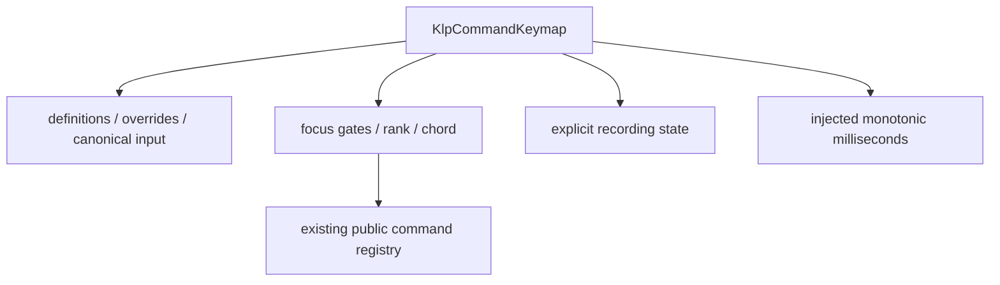
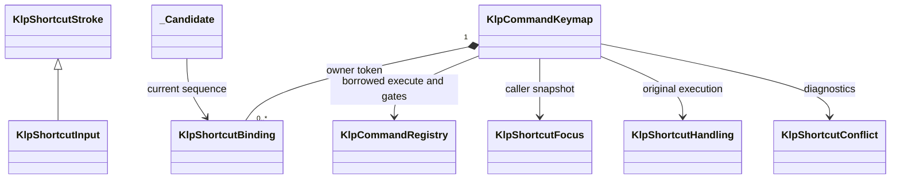
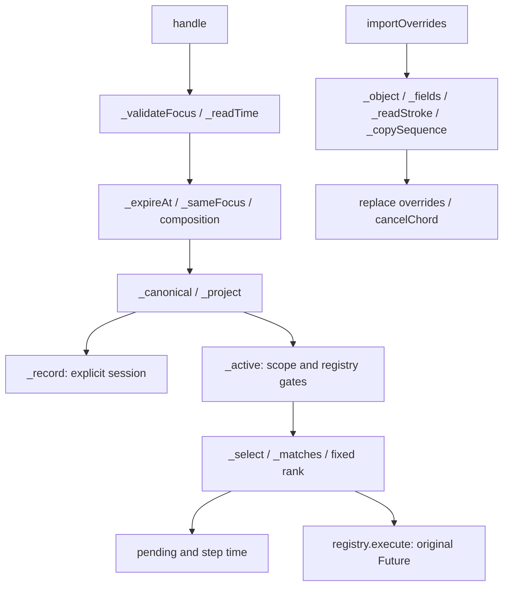

# Registered 快捷鍵核心

FLUTTER-COMMAND-KEYMAP-r1 COMPLETE，依[WB-SHORTCUT-CORE-r1](../../../../../../docs/architecture/workbench-shortcut-core-contract.md)，目前只純core與stablefoundation export。KlpCommandKeymap<C>只擁有binding token、override、chord／clock、explicit recording；command執行與條件仍讀KlpCommandRegistry<C>。不改既有KlpKeyBinding系統、不建立另一handler或Listenables／focus authority。native input／IME／focus adapter與GUI另packet，不在此BUILD。

新klp_command_keymap.dart集中公開immutable stroke／input／binding／focus／handling／conflict／enum及同core；validation／平台modifier／固定ranking／原子override／session helpers同source。無產品route／storage／theme／UI／timer；snapshot隔離輸入與輸出mutable資料。native timer日後只呼叫公開expireChord，不讀private state。

write_paths只新source與flutter/lib/kallopis_foundation.dart；arch／command registry／legacykeybinding／palette／popup／theme／tests／config／example／其他module唯讀。fresh TestAuthor只flutter/test/command_keymap_test.dart，使用公開foundation、共同contract與原registry資料，不能讀新core私有實作。核心跨語言／atomic設定與chord狀態風險成立，新checks必要。

cold-start6k～12k／30～60分鐘，參照FLUTTER-COMMAND-CORE-1與POPUP-1；Flutter3.44.2現有packageconfig、注入clock。M1公開purecore契約／protected checks（6k／30分鐘）；M2 publicanalyze／scope2及原core局部fallback必要才執行（12k／60分鐘）；15k／75分鐘或其他source需求返回PLAN。所有現在P1core條目均映射公開契約；完整WB快捷鍵native與GUI仍pending。

BUILD188273b8 exact2source，protected11 checks SHA256 2040C69AAECCF92DCFE542FC8DCB06038A82B4D617437E88B225FADDECF5EE1C保持、public analyze No issues／scope2／diffcheck通過。基線缺公開API為compile Yellow；首次實作同11全Green，未改測試。native keyboard與GUI仍pending。

## 實際型別與方法責任

下列全部宣告在[klp_command_keymap.dart](klp_command_keymap.dart)。

| 型別 | 實際責任 |
| --- | --- |
| KlpShortcutStroke／KlpShortcutInput | immutable canonical與modifier；Input繼承並加repeat／composing |
| KlpShortcutFocus | immutable原生焦點及有效scope鏈，不擁有FocusNode |
| KlpShortcutBinding | constructor複製預設sequence；metadata與when，不擁有handler |
| KlpShortcutHandling | private constructor限制狀態結果，保留原execution Future |
| KlpShortcutConflict | private constructor隔離排序後ID pair |
| _Candidate | 當次解析借用binding token及有效sequence |
| KlpCommandKeymap | constructor解析固定選項；getters提供disposed／recording／prefix／recorded snapshot |
| KlpShortcutPlatform／Scope／HandlingState／ConflictKind | 公開平台、層級、解析與診斷enum |

KlpCommandKeymap.register與其disposer隔離definition／唯一owner、解除override及取消chord；handle依_validateFocus→_readTime→_expireAt→_sameFocus→composition／_canonical→_project→_record或_active→_select→registry.execute。cancelChord／expireChord管理prefix；conflicts呼叫_active／_matches／_compareConflicts，不execute。setOverride／restore使用_requireBinding後替換設定；exportOverrides使用_strokeData作巢狀copy；importOverrides以_object／_fields／_readStroke／_copySequence完整驗證後atomic替換。beginRecording／finishRecording／cancelRecording只管理explicit錄製，dispose只清本owner。_requireOpen／_requireBinding保護mutation；_readTime驗證單調有限clock、_expireAt清期限；_record最多四鍵且Escape取消；_active讀when及registry.getState並_compareCandidates排序；_select取第一個有效prefix。

所有top-level helpers：_monotonicClock建立Stopwatch及elapsed closure；_text／_validateFocus保護非空焦點；_canonical判定single scalar／named key；_copySequence／_copyBinding隔離與驗證default；_object／_fields／_flag／_readStroke驗證wire shape及strict bool；_strokeData產生完整wire modifiers；_project消解primary；_sameStroke／_matches精確比對序列；_sameFocus比完整scope鏈；_scopeActive限制層級；_compareCandidates比較scope／priority／UTF-16 ID，_compareConflicts排序ID pairs；_plainEscape辨識取消；_handling產生非dispatch狀態。map／any callbacks只作上述欄位驗證及資料轉換，不接另一事件來源。

