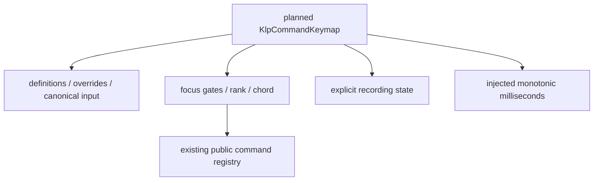

# Registered 快捷鍵核心

FLUTTER-COMMAND-KEYMAP-r1 READY，依[WB-SHORTCUT-CORE-r1](../../../../../../docs/architecture/workbench-shortcut-core-contract.md)，目前只純core與stablefoundation export。KlpCommandKeymap<C>只擁有binding token、override、chord／clock、explicit recording；command執行與條件仍讀KlpCommandRegistry<C>。不改既有KlpKeyBinding系統、不建立另一handler或Listenables／focus authority。native input／IME／focus adapter與GUI另packet，不在此BUILD。

新klp_command_keymap.dart集中公開immutable stroke／input／binding／focus／handling／conflict／enum及同core；validation／平台modifier／固定ranking／原子override／session helpers同source。無產品route／storage／theme／UI／timer；snapshot隔離輸入與輸出mutable資料。native timer日後只呼叫公開expireChord，不讀private state。

write_paths只新source與flutter/lib/kallopis_foundation.dart；arch／command registry／legacykeybinding／palette／popup／theme／tests／config／example／其他module唯讀。fresh TestAuthor只flutter/test/command_keymap_test.dart，使用公開foundation、共同contract與原registry資料，不能讀新core私有實作。核心跨語言／atomic設定與chord狀態風險成立，新checks必要。

cold-start6k～12k／30～60分鐘，參照FLUTTER-COMMAND-CORE-1與POPUP-1；Flutter3.44.2現有packageconfig、注入clock。M1公開purecore契約／protected checks（6k／30分鐘）；M2 publicanalyze／scope2及原core局部fallback必要才執行（12k／60分鐘）；15k／75分鐘或其他source需求返回PLAN。所有現在P1core條目均映射公開契約；完整WB快捷鍵native與GUI仍pending。

圖示是READY責任，不冒充已實作function索引；BUILD後owner以實際helpers與call chain替換。
