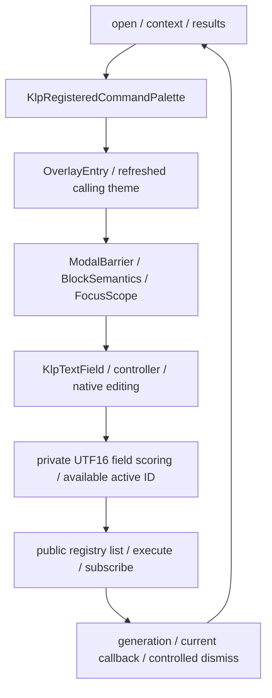

# Registered command palette

FLUTTER-COMMAND-PALETTE-r1 COMPLETE，依[共同WB-COMMAND-PALETTE-r1](../../../../../../docs/architecture/workbench-command-palette-contract.md)。BUILD 2a069faf 已交付受控原生modal命令面板；錨定/context menu、shortcut與完整網站GUI另接續，既有命令核心、入口及舊CommandMenu保持API。

## 責任與公開介面

單一新`klp_command_palette.dart`擁有enum `KlpCommandDismissReason { escape, outside, executed }`及const generic `KlpRegisteredCommandPalette<C>`；required registry、getContext、open、label、searchLabel、emptyLabel、onResult及`ValueChanged<KlpCommandDismissReason> onDismiss`，key可選。foundation匯出兩宣告。build前ArgumentError驗證三個label非空白，不依assert。無新registry/context權威、model/adapter/runtime、theme預設或產品命令。

privateState擁有OverlayEntry、每次owner build刷新CapturedThemes／Directionality／Localizations投影、搜尋TextEditingController、input FocusNode、closed-loop FocusScopeNode、registry disposer、session generation、originalFocus與activeId。原生OverlayEntry在目前Overlay獨立附著modal語意；owner每次props/query/dependency build重新捕捉既有Theme，entry以最新同caller locale/direction投影並postframe markNeedsBuild，不沿用凍結snapshot；closed輸出零尺寸宿主但沒有overlay/query/context/focus。init/update安排原生frame同步insert/remove，open才清空query並記錄originalFocus，已open registry替換保留query及return-focus owner但提升generation。close/unmount/reopen/replacement使舊Future UI結果失效，registry disposed不訂閱/query。

每次呈現讀最新getContext/list，一次候選投影包含state與score；UTF-16完整field exact/prefix/substring/subsequence及Unicode空白分詞依共同契約。Dart不得僅用ASCII空白或使用runes排序；共同ECMAScript WhiteSpace/LineTerminator集合支援U+0009～000D、0020、00A0、1680、2000～200A、2028/2029、202F、205F、3000、FEFF，U+0085保留字元不分詞，與React相同。每詞最佳score求和，原ID code units tie；不串field。disabled/running仍候選，activeId只可用；query/refresh保留可用ID，否則首可用。clear/dispose與清冊更新不改產品業務。

input持原生Focus；Focus/onKeyEvent只处理非composing的上下、Enter與Escape，KeyDown一次、KeyRepeat不執行。composing判斷controller.value.composing有效非collapsed；Home/End/左右保持原生文字游標。Tab由closedLoop scope保留在modal；候選pointer與Semantics activation都經最新context/execute，候選不可取得獨立鍵盤焦點。activation完成只同session/onResult當前callback交原core結果；executed且callback返回後same session才onDismiss executed；error或callback自身throw保留面板，callbackthrow交FlutterError。不同命令可並行。

show後原生frame聚焦input；close/unmount只有目前焦點仍在本scope或原生空root/background才還原有效原FocusNode（context != null/canRequestFocus）；產品callback已轉外部focus不能搶回。原背景controller/selection不可改。恢復與已排程frame都帶generation/mounted檢查；overlay先remove，資源按原生生命週期dispose，不讓舊frame讀disposed controller/node。

## 呈現與有限幾何

OverlayEntry原生全覆蓋child：BlockSemantics、ModalBarrier只backdrop提出outside、panel Semantics scopesRoute/namesRoute/label、closed-loop FocusScope、LayoutBuilder finite viewport與top-center定位。pointer panel與candidate不冒泡到barrier；背景阻止pointer與遍歷，產品明確外部focus仍受共同保護。只有新row內部視覺持hover，active/hover同context.klp.selectionWash；metadata讀state，decorative KlpIcon排除重複Semantics，toggle checked不混active selected。原生可觀察候選Semantics label/enabled/selected/onTap，不假造ARIA DOM。

panel重用KlpTextField/KlpText/KlpIcon/KlpPressable；同semantic overlay色/menuRadius/overlayShadow、dialogMaximumWidth/overlayViewportInset與tight/menuItemHeight/menuPadding/overlayItemGap/iconSmall。viewport先finite非負、inset<=短邊/2、panel寬高<=available；padding<=panel短邊/2；row padding/icon/gap依remaining寬分配。零/極窄/極高參數用ClipRect/scroll退化，不NaN/Infinity或RenderFlex overflow。field採有限width及垂直scroll宿主；rows nowrap裁切，沒有硬寫第二份風格值。theme/size只更新呈現且保留query/ID順序與權限。

原生選擇依[OverlayPortal與OverlayEntry差異](https://api.flutter.dev/flutter/widgets/OverlayEntry-class.html)、[FocusScope](https://api.flutter.dev/flutter/widgets/FocusScope-class.html)、[ModalBarrier](https://api.flutter.dev/flutter/widgets/ModalBarrier-class.html)。不以Navigator route維護第二份open；每次owner build刷新同Theme/locale投影，不重建default theme；不沿用冻结InheritedTheme snapshot。

## 唯一當前slice

BUILD 2a069faf 僅新增來源及foundation匯出兩path；21項protected公開Widget checks全部通過，public analyze No issues、exact2path scope及diff check通過。TestAuthor最終SHA256 DB279A061B5016806C1F4EFC3C43AC78D4C5B808BA97BF3543E6C0278F97EBE9保持。原生Tab固定唯一輸入焦點；Material透明祖先提供InkWell宿主，Actions處理EditableText原生Escape fallback，composition仍不關閉。browser／感官及完整style矩陣待consumer展示stage。

## 函式與依賴入口

| 責任 | 來源函式 | 呼叫方向 |
| --- | --- | --- |
| immutable公開輸入／State | `KlpRegisteredCommandPalette.createState` | 產品→State |
| 純搜尋／有限值 | `_fieldScore`、`_search`、`_finite`、local `compare` | 本次registry state→score／ID排序 |
| lifecycle／通知 | `initState`、`didUpdateWidget`、`_subscribe`、`_refresh`、`dispose` | 產品props／registry→刷新與generation |
| 原生浮層／主題 | `build`、`_scheduleOverlay`、local `synchronize`／`focusInput`、`_removeOverlay`、`_projectOverlay` | caller theme→OverlayEntry |
| 原焦點保護 | `_ownsFocus`、`_closeSession`、local `restoreFocus` | 同session／有效原節點→nativeFocus |
| 執行與鍵盤 | `_isCurrent`、`_report`、`_activate`、`_key`、`_nativeDismiss`、`_outside` | native事件→最新core→當前產品callback |
| 語意與有限呈現 | `_overlayChild`、`_panel` | 可見清冊→barrier／scope／semantic theme |
| 候選列 | `_PaletteRow.createState`、`_PaletteRowState._hover`／`build` | active／hover→同selectionWash；execute權限仍在core |

全部實作見[來源](klp_command_palette.dart)。無第二份theme／命令權威；widget tree以原生Overlay、Focus、Actions維持責任。

FLUTTER-COMMAND-PALETTE-1只寫本module新來源及`flutter/lib/kallopis_foundation.dart`；本檔、rootarch、test-owned、core/entry/controls/theme/config/其他module唯讀。fresh獨立TestAuthor只`flutter/test/registered_command_palette_test.dart`，依public foundation/theme+Flutter nativeFocus/EditableText/Semantics/events檢查共同跨語言搜尋與生命周期，不讀新productsource。

必要證據：label驗證/closed不讀context；完整field/Unicode words/order/空回饋；gates/pending/latestcontext/dispose/unregister；方向/once Enter/IME原生editing；controlled open/queryreset及theme/size/registryreplacement保留；原error/latestcallback/callbackthrow與stale close/unmount/reopen；escape/outside/executed意圖；原Focus與產品externalFocus/selection；customtheme透過overlay及finitehost。test只程式證據，sensory/browser另human-pending；publicanalyze、samehash checks、exact2pathscope。

cold-start8k～14k tokens／40～70分鐘，參照REACT-COMMAND-PALETTE-1及FLUTTER-COMMAND-ENTRY-1，本機Flutter3.44.2/packageconfig可用。M1search/registry/session（5k/25分鐘），M2原生overlay/Focus/IME/finite及檢查（12k/60分鐘）；18k/90分鐘或需改core/controls/publiccontract回PLAN，不弱化protected tests。

原生語意ACR已接受：author e5de466f確認View traversal root排除Portal候選（individual nodes仍attached），19Green/2排序Red。Portal加1px carrier探針仍同Red；由於BlockSemantics會剔除Portal語意graft的caller parent，改獨立OverlayEntry而維持現有公開介面/兩path。主題捕捉每個owner build刷新，當前open/query/session/Focus與其他module不改；closed仍零尺寸。依[OverlayPortal原生語意限制](https://api.flutter.dev/flutter/widgets/OverlayPortal-class.html)。TestAuthor修正LF單行native formatter及View root觀察，保留完整分詞/排序期待，SHA256 DB279A061B5016806C1F4EFC3C43AC78D4C5B808BA97BF3543E6C0278F97EBE9。

## FLUTTER-COMMAND-PALETTE-MODAL-1（READY）

修訂FLUTTER-COMMAND-PALETTE-MODAL-r1；公開constructor、controlled open／dismiss與全部搜尋／Focus／session契約保持。原生browser CommandsDemo在Windows web可重現：open後AX仍呈現背景Commands導航與產品按鈕；點scrim座標(200,350)原本期望outside，卻執行背景Workspace components導航且卸載demo。面板search／Tab／Enter／error與pending均已觀察正確；不能用21Green掩蓋此modal Red。

本修正只擁有palette來源中的原生semantics／backdrop呈現：開啟時背景不能經原生可存取樹被操作；panel與候選保持可見與可啟動；scrim pointer或native semantics dismiss只提出outside且不執行背景；关闭／unmount還原原生背景可存取操作。背景產品內容／State／controller不因modal暫時排除而卸載或改值。不得新增第二open／Navigator route／theme／l10n權威、改其他元件或手寫browser DOM補丁。dismiss名稱沿既有caller提供label或原生本地化，不硬寫另一套文案。

fresh獨立TestAuthor只寫flutter/test/registered_command_palette_modal_test.dart，透過publicfoundation／theme及Flutter nativeSemantics、events、平台情境驗證以上可觀察契約；必要最小層級由author判斷，nativebrowser仍是原Red重現必驗，不靠私有樹結構或sourcepattern代替。原21protected檔唯讀。BUILD單一klp_command_palette.dart；root／local architecture、test-owned、core／controls／theme／config／example／React唯讀。

M1最小native語意回歸與原21checks，M2publicanalyze／scope1／releaseweb及相同scrim座標browser重驗。cold-start3k～7k tokens／20～45分鐘，參照FLUTTER-COMMAND-PALETTE-1；M1累計3k／20分鐘、M2累計7k／45分鐘；10k／60分鐘或需要公開契約／其他source回PLAN。人類感官仍pending。

官方邊界：[BlockSemantics](https://api.flutter.dev/flutter/widgets/BlockSemantics-class.html)僅阻擋同semantic container先繪製節點；[ModalBarrier](https://api.flutter.dev/flutter/widgets/ModalBarrier-class.html)提供nativepointer阻擋，平台semantic dismissal需另依實際原生語意驗證。先以public native regression建立可反駁的證據，不能把平台差異當允許背景操作的理由。
