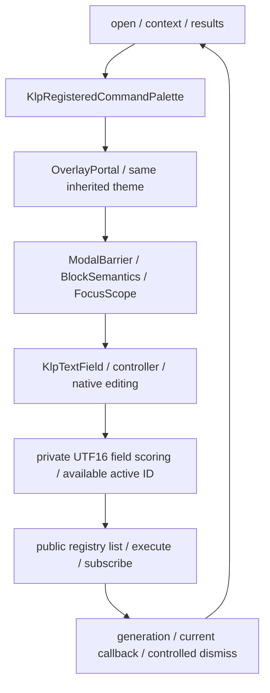

# Registered command palette

FLUTTER-COMMAND-PALETTE-r1 READY，依[共同WB-COMMAND-PALETTE-r1](../../../../../../docs/architecture/workbench-command-palette-contract.md)。當前只交付受控原生modal命令面板；錨定/context menu、shortcut與完整網站GUI另接續，既有命令核心、入口及舊CommandMenu保持API。

## 責任與公開介面

單一新`klp_command_palette.dart`擁有enum `KlpCommandDismissReason { escape, outside, executed }`及const generic `KlpRegisteredCommandPalette<C>`；required registry、getContext、open、label、searchLabel、emptyLabel、onResult及`ValueChanged<KlpCommandDismissReason> onDismiss`，key可選。foundation匯出兩宣告。build前ArgumentError驗證三個label非空白，不依assert。無新registry/context權威、model/adapter/runtime、theme預設或產品命令。

privateState擁有OverlayPortalController、搜尋TextEditingController、input FocusNode、closed-loop FocusScopeNode、registry disposer、session generation、originalFocus與activeId。OverlayPortal沿呼叫點InheritedWidgets／theme／locale更新，避免OverlayEntry捕捉過期theme；closed輸出零尺寸宿主但沒有overlay/query/context/focus。init/update安排原生frame同步show/hide，open才清空query並記錄originalFocus，已open registry替換保留query及return-focus owner但提升generation。close/unmount/reopen/replacement使舊Future UI結果失效，registry disposed不訂閱/query。

每次呈現讀最新getContext/list，一次候選投影包含state與score；UTF-16完整field exact/prefix/substring/subsequence及Unicode空白分詞依共同契約。Dart不得僅用ASCII `RegExp(r'\s+')`漏U+0085或使用runes排序；本地Unicode空白判定支援U+0009～000D、0020、0085、00A0、1680、2000～200A、2028/2029、202F、205F、3000、FEFF。每詞最佳score求和，原ID code units tie；不串field。disabled/running仍候選，activeId只可用；query/refresh保留可用ID，否則首可用。clear/dispose與清冊更新不改產品業務。

input持原生Focus；Focus/onKeyEvent只处理非composing的上下、Enter與Escape，KeyDown一次、KeyRepeat不執行。composing判斷controller.value.composing有效非collapsed；Home/End/左右保持原生文字游標。Tab由closedLoop scope保留在modal；候選pointer與Semantics activation都經最新context/execute，候選不可取得獨立鍵盤焦點。activation完成只同session/onResult當前callback交原core結果；executed且callback返回後same session才onDismiss executed；error或callback自身throw保留面板，callbackthrow交FlutterError。不同命令可並行。

show後原生frame聚焦input；close/unmount只有目前焦點仍在本scope或原生空root/background才還原有效原FocusNode（context != null/canRequestFocus）；產品callback已轉外部focus不能搶回。原背景controller/selection不可改。恢復與已排程frame都帶generation/mounted檢查；overlay先hide，資源按原生生命週期dispose，不讓舊frame讀disposed controller/node。

## 呈現與有限幾何

OverlayPortal原生全覆蓋child：BlockSemantics、ModalBarrier只backdrop提出outside、panel Semantics scopesRoute/namesRoute/label、closed-loop FocusScope、LayoutBuilder finite viewport與top-center定位。pointer panel與candidate不冒泡到barrier；背景阻止pointer與遍歷，產品明確外部focus仍受共同保護。只有新row內部視覺持hover，active/hover同context.klp.selectionWash；metadata讀state，decorative KlpIcon排除重複Semantics，toggle checked不混active selected。原生可觀察候選Semantics label/enabled/selected/onTap，不假造ARIA DOM。

panel重用KlpTextField/KlpText/KlpIcon/KlpPressable；同semantic overlay色/menuRadius/overlayShadow、dialogMaximumWidth/overlayViewportInset與tight/menuItemHeight/menuPadding/overlayItemGap/iconSmall。viewport先finite非負、inset<=短邊/2、panel寬高<=available；padding<=panel短邊/2；row padding/icon/gap依remaining寬分配。零/極窄/極高參數用ClipRect/scroll退化，不NaN/Infinity或RenderFlex overflow。field採有限width及垂直scroll宿主；rows nowrap裁切，沒有硬寫第二份風格值。theme/size只更新呈現且保留query/ID順序與權限。

原生選擇依[OverlayPortal與OverlayEntry差異](https://api.flutter.dev/flutter/widgets/OverlayEntry-class.html)、[FocusScope](https://api.flutter.dev/flutter/widgets/FocusScope-class.html)、[ModalBarrier](https://api.flutter.dev/flutter/widgets/ModalBarrier-class.html)。不以Navigator route維護第二份open；OverlayPortal theme同呼叫點動態，不用冻结InheritedTheme snapshot。

## 唯一當前slice

FLUTTER-COMMAND-PALETTE-1只寫本module新來源及`flutter/lib/kallopis_foundation.dart`；本檔、rootarch、test-owned、core/entry/controls/theme/config/其他module唯讀。fresh獨立TestAuthor只`flutter/test/registered_command_palette_test.dart`，依public foundation/theme+Flutter nativeFocus/EditableText/Semantics/events檢查共同跨語言搜尋與生命周期，不讀新productsource。

必要證據：label驗證/closed不讀context；完整field/Unicode words/order/空回饋；gates/pending/latestcontext/dispose/unregister；方向/once Enter/IME原生editing；controlled open/queryreset及theme/size/registryreplacement保留；原error/latestcallback/callbackthrow與stale close/unmount/reopen；escape/outside/executed意圖；原Focus與產品externalFocus/selection；customtheme透過overlay及finitehost。test只程式證據，sensory/browser另human-pending；publicanalyze、samehash checks、exact2pathscope。

cold-start8k～14k tokens／40～70分鐘，參照REACT-COMMAND-PALETTE-1及FLUTTER-COMMAND-ENTRY-1，本機Flutter3.44.2/packageconfig可用。M1search/registry/session（5k/25分鐘），M2原生overlay/Focus/IME/finite及檢查（12k/60分鐘）；18k/90分鐘或需改core/controls/publiccontract回PLAN，不弱化protected tests。

