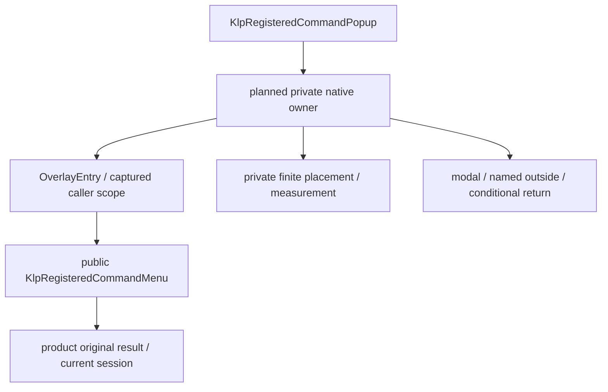

# Registered command popup

FLUTTER-COMMAND-POPUP-r1 READY，current stage為[WB-COMMAND-POPUP-r1](../../../../../../docs/architecture/workbench-command-popup-contract.md)的受控錨定／point宿主。有限入口已完成；不修改menu實作、不新增row／handler模型、不改既有CommandMenu／WorkspaceCommand caller。後續consumer及網站另packet，shortcut不在此slice。

## 公開與責任

`klp_command_popup.dart`擁有KlpRegisteredCommandPopup<C>、KlpCommandPopupDismissReason。Widget參數registry／getContext／items／label／emptyLabel／onResult沿menu，另required open:bool、anchor:Rect、onDismiss:ValueChanged<KlpCommandPopupDismissReason>，可選key，constconstructor。foundation單向匯出；不依palette的dismiss enum，避免popup→palette功能依賴。

privateState只擁有session／overlay／modal focus／returnFocus與menu size；validation拒絕非法anchor／必填文字，closed不queryregistry、不插overlay、不讀getContext。OverlayEntry每owner build刷新同Theme／Directionality／locale；BlockSemantics在locale投影外層，named transparent scrim接原生tap／dismiss。WidgetsBindingObserver只處理metrics，geometry取overlay有限constraints與anchor的global→overlay座標转换。有限placement helper放同source，不引入共用geometrypackage。postframe量測只同值更新且以session隔離；dispose／close安全移除並釋放owner資源，條件還原Focus。

menu autoFocus=true、既有onDismiss接escape、onResult先交產品再同session success→executed；同session意圖去重，registry replacement提升session。閉合原生Focus及Tab，不改既有menu鍵盤或新增IME權威。樣式沿context.klp與同capturedTheme；不能讀menu私有State或palette私有helper。

## Slice

FLUTTER-COMMAND-POPUP-1 write_paths只有新`klp_command_popup.dart`與`flutter/lib/kallopis_foundation.dart`；本arch／rootarch／menu／palette／core／theme／config／example／所有tests唯讀。fresh TestAuthor只`flutter/test/registered_command_popup_test.dart`，以公開Widget/core/theme及原生操作保護共同契約；原menu29及palette26checks保持。原生modal risk由新公開測試承擔，不重寫既有tests。

cold-start6k～12k tokens／30～60分鐘，參照FLUTTER-COMMAND-PALETTE-1／MODAL-1；本機Flutter3.44.2／已有packageconfig。M1公開popup與有限位置／modal／session（6k／30分鐘）；M2新protected checks、publicanalyze、scope2（12k／60分鐘）；15k／75分鐘或其他source需求回PLAN。consumer browser、人類感官及完整style矩陣另pending，不能宣稱WB-09～14全完成。

圖示為已接受待實作責任，不當作已存在程式碼索引；BUILD完成由owner補實際類別／function索引。
