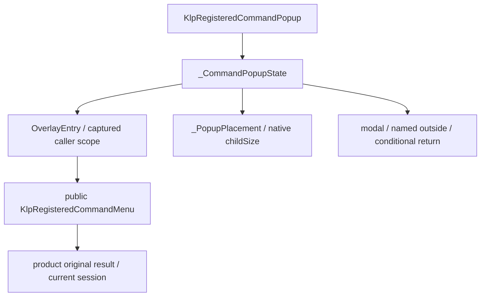

# Registered command popup

FLUTTER-COMMAND-POPUP-r1 COMPLETE，current stage為[WB-COMMAND-POPUP-r1](../../../../../../docs/architecture/workbench-command-popup-contract.md)的受控錨定／point宿主。BUILD d17be03f 只新增來源與foundation匯出；直接組合menu，不新增row／handler模型。後續consumer及網站另packet，shortcut不在此slice。

## 公開與責任

`klp_command_popup.dart`擁有KlpRegisteredCommandPopup<C>、KlpCommandPopupDismissReason。Widget參數registry／getContext／items／label／emptyLabel／onResult沿menu，另required open:bool、anchor:Rect、onDismiss:ValueChanged<KlpCommandPopupDismissReason>，可選key，constconstructor。foundation單向匯出；不依palette的dismiss enum，避免popup→palette功能依賴。

privateState只擁有session／overlay／modal focus／returnFocus；validation拒絕非法anchor／必填文字，closed不queryregistry、不插overlay、不讀getContext。OverlayEntry每owner build刷新同Theme／Directionality／locale；BlockSemantics在locale投影外層，named transparent scrim接原生tap／dismiss。WidgetsBindingObserver只處理metrics，geometry取overlay有限constraints與anchor的global→overlay座標轉換。SingleChildLayoutDelegate直接依原生受限childSize選側及定位，不維持第二份menu size，也不安排逐frame量測；postframe僅合併overlay刷新。dispose／close安全移除並釋放owner資源，條件還原Focus。

menu autoFocus=true、既有onDismiss接escape、onResult先交產品再同session success→executed；同session意圖去重，registry replacement提升session。閉合原生Focus及Tab，不改既有menu鍵盤或新增IME權威。樣式沿context.klp與同capturedTheme；不能讀menu私有State或palette私有helper。

## Slice

FLUTTER-COMMAND-POPUP-1 write_paths只有新`klp_command_popup.dart`與`flutter/lib/kallopis_foundation.dart`；本arch／rootarch／menu／palette／core／theme／config／example／所有tests唯讀。fresh TestAuthor只`flutter/test/registered_command_popup_test.dart`，以公開Widget/core/theme及原生操作保護共同契約；原menu29及palette26checks保持。原生modal risk由新公開測試承擔，不重寫既有tests。

cold-start6k～12k tokens／30～60分鐘，參照FLUTTER-COMMAND-PALETTE-1／MODAL-1；本機Flutter3.44.2／已有packageconfig。M1公開popup與有限位置／modal／session（6k／30分鐘）；M2新protected checks、publicanalyze、scope2（12k／60分鐘）；15k／75分鐘或其他source需求回PLAN。consumer browser、人類感官及完整style矩陣另pending，不能宣稱WB-09～14全完成。

## 實際責任與證據

| 類別／函式 | 來源與責任 |
| --- | --- |
| KlpRegisteredCommandPopup／createState | klp_command_popup.dart；公開generic inputs、建立唯一宿主State |
| _CommandPopupState | 同source；initState／didChangeMetrics／dispose原生observer；didUpdateWidget隔離session；build驗證並捕捉caller scope |
| _schedule／synchronize | 合併postframe插入或刷新overlay，不持續排程 |
| _remove | 解除entry、條件回焦，不釋放產品registry |
| _current／_dismiss／_result | 原結果、最新callback、session及意圖去重；callback原錯誤由menu宿主通道處理 |
| _overlay／layout／outside／escape／result | captured Theme／locale／direction、BlockSemantics、命名barrier及同公開menu |
| _finiteLength | 非有限／負幾何退化0 |
| _PopupPlacement | 同source；_inset夾有效邊距；_edge／_anchor安全有限邊；getConstraintsForChild量測較大側；getPositionForChild依實際childSize選側；shouldRelayout只追蹤輸入 |

fresh TestAuthor最終SHA256 A9548A90DD6D99C0D71086329733F5B735EF11972EAA20AF6E29D8EC15C3D15B，16checks Green；原23 menu checks Green且hash未改。初次14/16的兩個失敗來自背景fixture Stack收縮，TestAuthor獨立修正填滿並加入實際Overlay尺寸校验，未弱化assertions。原生FocusScopeNode參數位置compile失敗修正後publicanalyze No issues；scope exact2通過。消費者browser及感官另pending。
