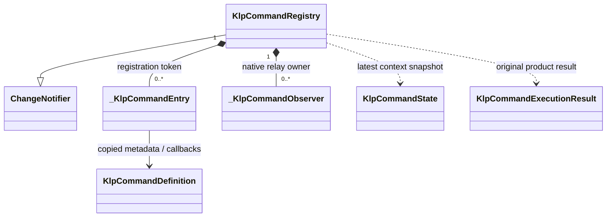
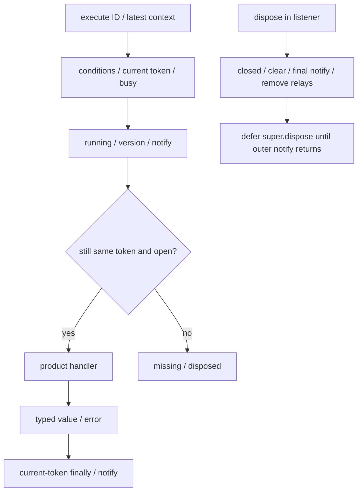

# Flutter 命令 registry

FLUTTER-COMMAND-CORE-r1 READY。依[WB-COMMAND-r1](../../../../../../../docs/architecture/workbench-command-contract.md)固定產品無關的metadata、條件與執行生命週期；不持有context、產品storage、UI/theme或預設命令。既有CommandMenu／WorkspaceCommand／KeyBindingController本slice唯讀，後續入口統一引用ID。

## 公開契約

單一`klp_command_registry.dart`由stable `kallopis_foundation.dart`匯出；只依dart:async、Flutter foundation與現有KlpIconData。definition constructor可const，register才驗證並複製metadata/list；id、label及提供的description/category/每個keyword須含非空白內容，保留原字串。非法定義/ID/duplicate以ArgumentError拒絕，closed mutation為StateError。

- `KlpCommandDefinition<C>({required String id, required String label, required FutureOr<Object?> Function(C context) handler, String? description, String? category, List<String> keywords = const [], KlpIconData? icon, bool Function(C context)? isVisible, bool Function(C context)? isEnabled, bool Function(C context)? isChecked})`；final欄位但caller keywords直到register由產品擁有。
- `KlpCommandConditionError`唯讀`Object error`，state以nullable記錄存在判斷失敗；Dart null不合法throw，捕獲實際原error。
- `KlpCommandState`唯讀id/label/description/category/keywords/icon及bool visible/enabled/checked/running、KlpCommandConditionError? conditionError。keywords unmodifiable，產品icon/context/value不深複製。沒有公開snapshot建構需求。
- `KlpCommandExecutionStatus` enum names：executed/missing/hidden/disabled/busy/disposed/error。`KlpCommandErrorPhase` enum names：condition/handler。`KlpCommandExecutionResult`唯讀String commandId/status/Object? value/Object? error/KlpCommandErrorPhase? phase；executed才有value，error才有error及phase，不作JSON。
- `KlpCommandRegistry<C>() extends ChangeNotifier`：`VoidCallback register(KlpCommandDefinition<C> definition)`、`KlpCommandState? getState(String id, C context)`、`List<KlpCommandState> list(C context)`（unmodifiable、UTF16 ID排序）、`Future<KlpCommandExecutionResult> execute(String id, C context)`、`VoidCallback subscribe(VoidCallback listener)`、`void refresh()`、`int version`初始0、`bool isDisposed`及`void dispose()`。
- 沿共同契約gates／開始及完成各一次通知／tokenbusy／已開始Promise不取消／stale結果不通知新owner。開始通知中remove/replace回missing、dispose回disposed，原handler不能啟動。observer沿原生FlutterError，不轉成business result。
- 原生addListener/removeListener／hasListeners仍可用；subscribe每個owner獨立，即使callback相同。dispose立即closed、清commands、最後一次通知，再清listeners，重複dispose無效果。通知中dispose同樣合法。dispose後register/subscribe/addListener/refresh明確StateError，removeListener/disposer無效果，query null/list空/execute disposed。

## 責任與生命週期

| 型別／函式 | 來源 | 責任 |
| --- | --- | --- |
| KlpCommandDefinition / State / ConditionError / ExecutionResult / Status / ErrorPhase | klp_command_registry.dart | 原生公開資料、純條件與結果，產品副作用仍屬handler |
| _KlpCommandEntry | 同上 | 複製metadata及註冊identity，pending不跨token共享 |
| _KlpCommandObserver | 同上 | listener及唯一relay owner，原生重複callback可精確解除 |
| KlpCommandRegistry | 同上 | 公開registry與Listenable；驗證/copy/evaluate/snapshot/current、emit及observer收尾 |

採一個registry與private token，不加repository/controller/adapter層。metadata/pending及subscriber生命周期屬同一owner。ChangeNotifier原生dispose禁止notify中即時super.dispose，故只延後原生資源收尾到最外層notify返回；公開closed/clear/finalnotify/解除observer立即完成，不延後產品語意。addListener以獨立relay記錄供原生removeListener精確解除；沿super.notifyListeners的FlutterError處理，避免再造通知錯誤通道。與每個UI自有handlers比較，集中registry才能保證disabled與busy一致。

## 目前slice與必要證據

FLUTTER-COMMAND-CORE-1 BUILD只`flutter/lib/src/features/actions/command_registry/klp_command_registry.dart`及`flutter/lib/kallopis_foundation.dart`。architecture/tests/config/theme/UI/其他module唯讀。fresh獨立TestAuthor只寫`flutter/test/command_registry_test.dart`，publicfoundation及共同契約，不讀React實作；typed publictest本身驗證generic API，必要analyze/publicbuild。風險是跨語言結果、非同步stale與notification中dispose，不能由BUILD作者改斷言。

M1metadata/conditions/sorted immutable snapshots，M2pending/stale/subscription/原生listener-dispose与公開consumer。cold-start6k–12k tokens／35–70分鐘，參照REACT-COMMAND-CORE-1及FLUTTER-DOCK-OPS-1；18k/100分鐘或需共同契約変更回PLAN。接受證據為保護hash不變、獨立局部checks Green、public analyze及2path scope，無感官或全stage完成宣稱。
