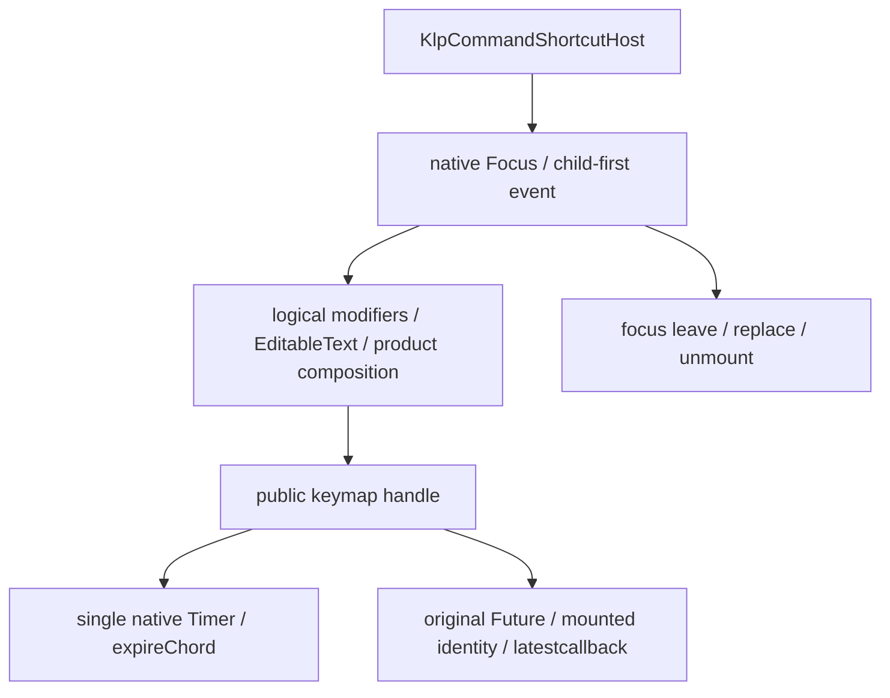
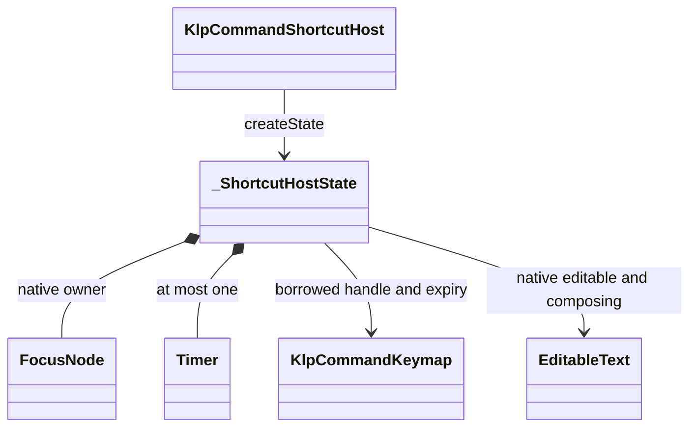
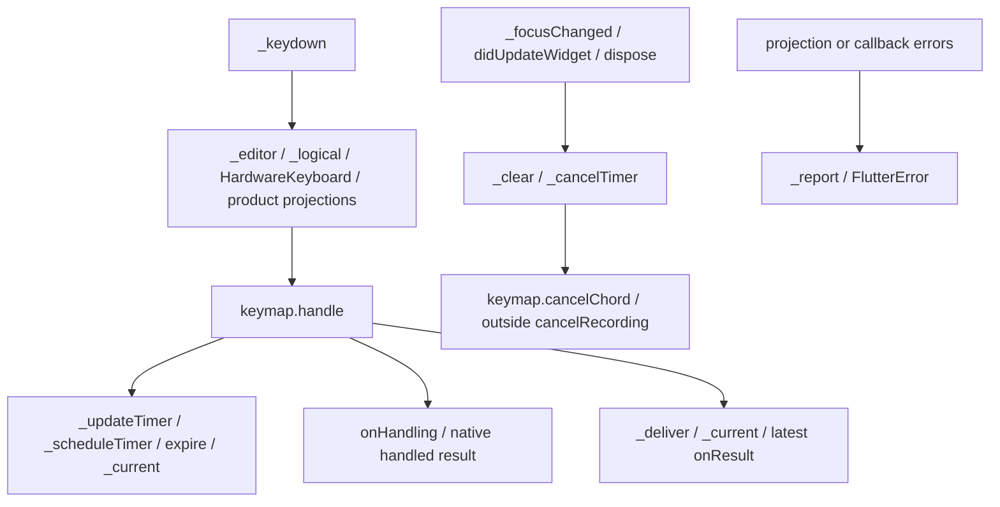

# Registered 快捷鍵原生宿主

FLUTTER-COMMAND-SHORTCUT-HOST-r1 COMPLETE，依[共同宿主契約](../../../../../../docs/architecture/workbench-shortcut-host-contract.md)。只新klp_command_shortcut_host.dart與stablefoundation export exact2，purecore／registry／legacykeybinding／theme／tests／config／example唯讀。State擁有非可聚焦FocusNode、single native Timer、session identity與focus listener；publicWidget借用keymap/getContext/getFocus/getIsComposing/onHandling/onResult/child。child先處理鍵盤，keymap獨立權威不dispose；native EditableText及產品composition OR保護文字。

一般Focus 包 child不加visual style或layout尺寸；logical named mapping、HardwareKeyboard modifier、repeat/synthesized、context保護、nativefocus cleanup、same-session Future/latestcallback及FlutterError診斷同新source。不存在另一registry／focus schema／全域keyboard listener，舊API不改。跨module需要先回PLAN。

cold-start5k～10k／25～50分鐘，參照FLUTTER-COMMAND-POPUP-1及KEYMAP-1；M1公開native事件/IME/lifetime protectedchecks（5k／25）；M2 analyze／scope2（10k／50）；13k／65或其他write回PLAN。fresh TestAuthor只test/command_shortcut_host_test.dart，以公開foundation與原生test events測timer/focus/session，不能讀新私有source。基線缺API Yellow，nativebrowser及GUI human-pending。具體private functions待BUILD後owner從actualcode維護，不將本圖當已實作索引。

## 實作與可觀察證據

BUILD4a3b1088 exact2source；protected10 publicWidget checks SHA256 C4333601BD67F8087824B4A193AAAC52933F6F5240AB4F5827A5CDE047C92566、publicanalyze No issues／scope2／diffcheck通過，暫時diagnostic已移除。首次local函式宣告順序及LogicalKeyboardKey非primitive const map編譯失敗，由新source修正。原fixture直接HardwareKeyboard不經Focus，由fresh作者改原生平台/tester管線；ignored synthesized arrow又觸發Material原生方向巡覽使後續B事件離開host，作者完成巡覽後refocus、加入down/repeat實際到達數量assertion，全部原assertions保留。沒有建立repeat產品behavior Red，不將fixture錯誤算產品修正。nativebrowser／consumer仍下一slice。

| 實際型別 | 來源與責任 |
| --- | --- |
| KlpCommandShortcutHost<C> | [klp_command_shortcut_host.dart](klp_command_shortcut_host.dart)：required borrowed props／child；createState建立原生owner |
| _ShortcutHostState<C> | 同來源：FocusNode、native Timer、session及nativeprimary觀察，不dispose借用keymap |

實際所有方法：initState註冊FocusManager listener並記錄原生identity；didUpdateWidget只在keymap identity變化更新session／清舊資源；dispose解除listener／timer及ownFocusNode。_focusChanged比primaryidentity，呼叫_clear以內移取消prefix／外離取消錄製；_clear／_cancelTimer只清owned timer與publiccore session。_keydown排除keyup／synthesized，以_editor、_logical、HardwareKeyboard與產品回呼轉輸入，借同keymap.handle，_updateTimer後交onHandling，_deliver保留原Future；診斷不改handled。_editor查primaryFocus context及EditableText祖先，_updateTimer只在新prefix重排、ignored保留deadline，_scheduleTimer的expire closure依_current與publicexpireChord到期/重試。_current核對mounted/session/keymap，_deliver等待原execution後交latest widget.onResult；build只Focus包child。top-level _logical維護named map／keyLabel，_report交FlutterError且診斷通道失敗不重試dispatch。無其他class／helper／事件callback。

