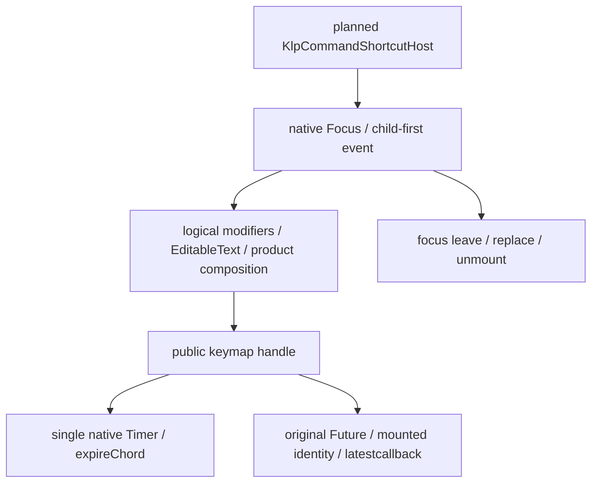

# Registered 快捷鍵原生宿主

FLUTTER-COMMAND-SHORTCUT-HOST-r1 READY，依[共同宿主契約](../../../../../../docs/architecture/workbench-shortcut-host-contract.md)。只新klp_command_shortcut_host.dart與stablefoundation export exact2，purecore／registry／legacykeybinding／theme／tests／config／example唯讀。State擁有非可聚焦FocusNode、single native Timer、session identity與focus listener；publicWidget借用keymap/getContext/getFocus/getIsComposing/onHandling/onResult/child。child先處理鍵盤，keymap獨立權威不dispose；native EditableText及產品composition OR保護文字。

一般Focus 包 child不加visual style或layout尺寸；logical named mapping、HardwareKeyboard modifier、repeat/synthesized、context保護、nativefocus cleanup、same-session Future/latestcallback及FlutterError診斷同新source。不存在另一registry／focus schema／全域keyboard listener，舊API不改。跨module需要先回PLAN。

cold-start5k～10k／25～50分鐘，參照FLUTTER-COMMAND-POPUP-1及KEYMAP-1；M1公開native事件/IME/lifetime protectedchecks（5k／25）；M2 analyze／scope2（10k／50）；13k／65或其他write回PLAN。fresh TestAuthor只test/command_shortcut_host_test.dart，以公開foundation與原生test events測timer/focus/session，不能讀新私有source。基線缺API Yellow，nativebrowser及GUI human-pending。具體private functions待BUILD後owner從actualcode維護，不將本圖當已實作索引。

