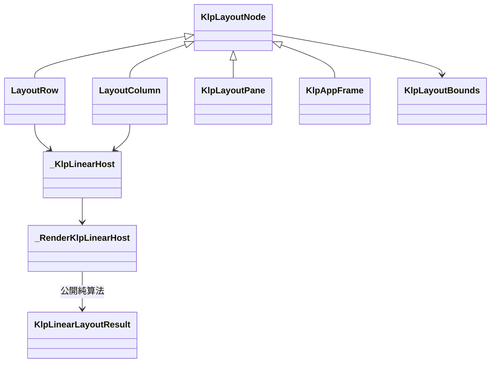

# Workspace Layout Architecture

## FLUTTER-LAYOUT-2（READY）

修訂 `FLUTTER-LAYOUT-r2`，接入共通 [WB-LINEAR-UI-r1](../../../../../../docs/architecture/workbench-linear-contract.md)。公開 KlpLayoutBounds／KlpLayoutDivider 與各 node 的 bounds、Column alignment 為可逆增量；舊 LayoutResizeHandle.onResize 相容保留，新展示使用無手勢 divider。

`klp_app_layout.dart` 擁有直接 Widgets／公開 bounds、semantic 投影與現有 floating／Frame；`internal/klp_linear_render.dart` 為同 library 的私有 part，擁有 `_KlpLinearSpec`、`_KlpLinearHost`、`_RenderKlpLinearHost`，只量測／配置同 compound 的 RenderBox children，使用既有 resolveKlpLinearLayout。它不對外暴露 state、序列化 UI 或 panel 模型。

有限軸只用 solver 結果，內容每槽 clip；沒有 preferred 的 flex child 不預先索取自然主軸尺寸，保持 Expanded 行為。零 flex 量測自然值；unbounded main 時量測全部內容並以自然值建有限预算，flex 不增長。交叉軸有上限則填滿，否則量測 natural 最大值。無法得到有限自然值明確拒絕，不回傳 Infinity／NaN。Root inset、gap 與顯式 divider 只讀 scope space2，有限極端值按共通規則壓縮。

BUILD 只寫主檔及 private render part；其餘唯讀。Test Author 只寫 `flutter/test/workbench_layout_test.dart`；highest local subject 是公開 Widget tree 幾何與重新布局，不寫 visual golden。沿用既有 restored workspace checks 保護 floating／8px 預設。M1 native 有限幾何與新的 bounds／divider，M2 unbounded fallback／更新／公開 analyze／既有 Catalog render。cold-start 8k–16k tokens／60–120分鐘，超過24k tokens或180分鐘回PLAN。



狀態：IMPLEMENTED

## FLUTTER-LINEAR-1（完成）

當前增量階段為 [WB-LINEAR-r1](../../../../../../docs/architecture/workbench-linear-contract.md) 的純尺寸算法接入前置，保留全部既有 Widget／手勢／public API。`klp_linear_layout.dart` 擁有 `KlpLinearItem`、`KlpLinearLayoutResult` 及 `resolveKlpLinearLayout`，foundation 匯出；不依賴 UI、Dock 或 style pack。完整數值、immutable 與退化契約由共通文件擁有。

BUILD 允許 `flutter/lib/src/features/workspace/layout/klp_linear_layout.dart` 與 `flutter/lib/kallopis_foundation.dart`；其餘唯讀。獨立測試為 `flutter/test/linear_layout_test.dart`。M1 實作確定性尺寸與公開邊界，M2 跨語言保護／analyze／scope；cold-start 3k–6k tokens／20–45 分鐘。此 slice 完成後才規劃 min／max Widget 投影、極端 inset／gutter 及裁切。一般 divider 和既有 onResize 相容性差異在 Widget slice 處理，不能在此刪除 API。

目前階段：App Layout Restore v1

規格：[KLP-0024](../../../../../spec/decisions/KLP-0024-workbench-and-dock-layout-boundary.md)

## 目的與邊界

本 module 以直接 Flutter Widget API 提供 `KlpAppLayout` 系列，恢復歷史 Row／Column、
Pane、Frame、Spacer 與 divider gutter 行為。它只負責一般 Workbench 幾何與共用視覺，
不擁有 Dock panel、tab、drag／drop、resize state、導航或產品流程。

能力地平線只包含本輪還原；互動 resize 繼續由 `workspace/shell/docking` 擁有。

## 公開介面

- `KlpAppLayout`：第一層 layout root，套用一次 8px semantic inset。
- `KlpAppLayout.floatingAction`：可選的 draggable Widget，位置由本元件於呈現期保存。
- `KlpLayoutNode`：封閉的 layout child 資格與 flex 契約。
- `LayoutRow`／`LayoutColumn`：遞迴線性布局。
- `LayoutResizeHandle`：占據一份 8px gutter，不提供手勢。
- `LayoutSpacer`：正 flex 的空白內容節點。
- `KlpLayoutPane`：無材質內容 pane；trailing 使用 secondary pane width。
- `KlpAppFrame`：有語意角色與 flat／raised surface 的第一層 frame。
- `KlpFrameGroups`／`KlpFrameGroup`：Frame 內的受控內容分群、divider 與固定 footer。

Consumer 直接注入 Widget 內容；不使用 id、node adapter、bound model 或 renderer。

## 不變條件

- Row／Column 至少有一個 child；所有 flex 非負，Spacer flex 必須大於零。
- standard spacing 在相鄰普通 child 間加入一份 8px gap；none 不加入。
- `LayoutResizeHandle` 自己占據一份 8px，前後不再加入普通 gap。
- Root inset、linear gap 與 handle extent 使用同一個現行 8px semantic spacing。
- Frame 不加入內容 padding；bare role 不繪製 surface 或 relief。
- Frame group 的 horizontal inset、standard content gap、transparent gap 與 section gap
  均解析為 8px；divider stroke 與 color 使用現行 shape／color token。
- Footer 存在時只捲動主 groups，footer 固定在底部中央。
- Floating action 預設右下；拖曳不觸發 child tap，位置會在 rebuild 保留並在 resize 後
  clamp 至 8px inset 及 semantic header 下方。
- Dock module 不依賴或包裝本 module，兩套公開狀態模型保持獨立。

## 依賴方向

```text
KlpAppLayout／KlpLayoutNode widgets
	→ Kallopis semantic theme
	→ Flutter layout／painting
```

不得依賴 application、composition、runtime、bound presentation、private renderer 或 Dock
models。

## ALR-S1：直接 Flutter 系列還原

可觀察結果：consumer 可從 `kallopis_foundation.dart` 建立巢狀 App Layout；8px gap 與
handle 不重複計算；Frame role、固定 pane width、flat／raised surface 可呈現。

允許寫入：

- `lib/src/features/workspace/layout/**`
- `lib/kallopis_foundation.dart`

驗收：公開入口局部 analyze 通過；既有完整測試不因新 export 失敗；視覺由 Catalog 後續
切片人工接受。必要新 deterministic tests 由獨立 Test Author 擁有，本 BUILD 不修改 test。

Milestones：

1. API 與線性幾何：所有 node 可直接組合且 gap／handle 遵守歷史規則。
2. Pane／Frame 呈現與公開 export：角色、寬度、表面及 relief 使用現行 semantic theme。

估計：cold-start，參照歷史 `KlpAppLayout` 與現行 `KlpPanelFrame`；預期 12k–22k tokens、
60–120 分鐘。超過 30k tokens 或 180 分鐘時停止檢查 direct Widget 與歷史 API 邊界。

ALR-S1 已完成：直接 Flutter Layout 系列由 foundation 匯出，公開入口 analyze 與既有
layout primitives tests 通過。

## ALR-S2：Frame Groups 還原

可觀察結果：`KlpFrameGroups`／`KlpFrameGroup` 以直接 Flutter API 提供一個以上主群組、
可選固定 footer、8px inset／內容節奏，以及 invisible／dashed／solid／transparent／section
divider。

允許寫入：

- `lib/src/features/workspace/layout/**`
- `lib/kallopis_foundation.dart`

驗收：公開入口 analyze；既有 layout 局部測試；source scan 不含 declarative runtime。
必要新 deterministic tests 仍由獨立 Test Author 擁有。

Milestones：

1. Group API 與 divider：直接 Widget 內容、8px 語意與五種 divider 完成。
2. Groups container：主區捲動、固定 footer 與 foundation export 完成。

估計：cold-start，參照歷史 `KlpFrameGroups` adapter／renderer；預期 10k–18k tokens、
45–100 分鐘。超過 26k tokens 或 150 分鐘時停止檢查 scroll／footer constraints。

ALR-S2 已完成：直接 Flutter Frame Groups、五種 divider、8px 語意與固定 footer
已由 foundation 匯出；公開入口 analyze、既有 layout primitives tests 與 scope check 通過。

## ALR-S3：Floating Action 還原

可觀察結果：`KlpAppLayout` 可選擇顯示 consumer Widget 作為浮動操作；預設右下、可拖曳，
拖曳不執行 child action，rebuild 保留位置，viewport 改變後仍位於合法範圍。

允許寫入：

- `lib/src/features/workspace/layout/klp_app_layout.dart`

驗收：公開入口局部 analyze；既有 layout tests；source scan 不含 declarative runtime。
必要新 deterministic tests 由獨立 Test Author 擁有，本 BUILD 不修改 tests。

Milestones：

1. Root API 與呈現 surface：可選 Widget、semantic inset／header boundary 完成。
2. Drag lifecycle：drag／tap 分離、rebuild retention 與 resize clamp 完成。

估計：cold-start，參照歷史 floating renderer；預期 8k–14k tokens、40–80 分鐘。
超過 20k tokens 或 120 分鐘時停止檢查 gesture ownership。

ALR-S3 已完成：`KlpAppLayout.floatingAction` 提供右下預設、拖曳位置保留、8px 邊界、
header 避讓與 viewport clamp；公開入口 analyze、既有 layout tests 與 scope check 通過。

FLUTTER-LINEAR-1 實作 a8124a62：21 項公開 checks、analyze、scope gate 通過。resolveKlpLinearLayout 驗證、分配並回不可變 result；_proportional 擁有巨大數值正規化，_sum 彙總尺寸。沒有接入 Widget，不能宣稱一般布局全部完成。
