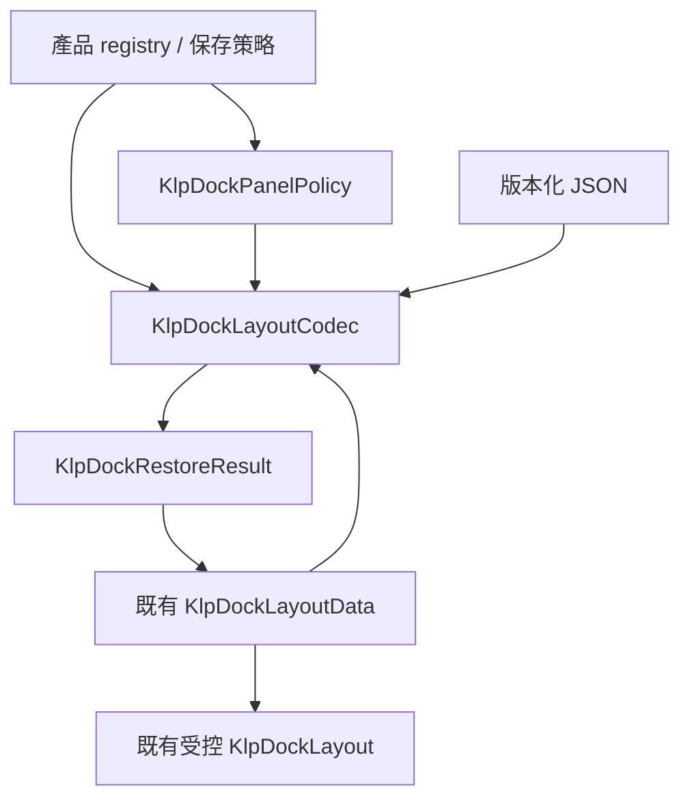

# Flutter Dock

修訂 `FLUTTER-DOCK-STATE-r1`；PLAN READY。擁有此 docking 目錄；公開入口由 foundation 匯出。保留直接 KlpDockLayout／Panel／Area／Group；不引入通用 node tree、renderer 或產品 storage。

## 當前 slice FLUTTER-DOCK-STATE-1（完成）

依 [WB-DOCK-STATE-r1](../../../../../../../docs/architecture/workbench-dock-contract.md) 完成 JSON 保存／載入／registry reconciliation。BUILD 僅可寫 `flutter/lib/src/features/workspace/shell/docking/klp_dock_layout_codec.dart` 與 `flutter/lib/kallopis_foundation.dart` 的新增 export。既有模型、Widget、私有拖放算法、theme、style、example、config、architecture、tests 唯讀。Test Author 唯一可寫 `flutter/test/dock_layout_codec_test.dart`。

codec 擁有外部資料驗證及 immutable snapshot；既有 model 繼續擁有原 caller 的 const／copyWith API。policy 是產品 registry 的資料投影，不持有 Widget；result 擁有 reconciliation 診斷。方法：encode 驗證 model → wire；restore 驗證 wire／policy → 過濾 missing → immutable model／diagnostics。錯誤由 FormatException 暴露；不捕捉錯誤假裝成功、不自動更新產品 state。

替代方案直接替既有 model 加 storage 與 registry：會改變 const caller 及 UI 責任，因此採獨立 codec。codec 只依 dart:convert、Flutter Axis 及既有公開 model；無 filesystem、network、theme 或 private state dependency。

M1 完整 schema／encode／restore：手寫 JSON 與拒絕證據；M2 reconciliation／immutable／公開入口：獨立 checks、analyze、scope。cold-start 6k–10k tokens／40–80分鐘，參照 FLUTTER-STYLE-1 的資料邊界；10k tokens／80分鐘或需要改既有 model／UI 時回 PLAN。保存及跨語言風險由 fresh Test Author 保護，不建 screenshot tests。尚未交付 tabs close／pinned／dirty、geometry 保護、React Dock 與 GUI／docs embed；後續按同一已接受 Workbench stage 接續。

## 實作清冊及完成證據

69771496：KlpDockPanelPolicy 的 id／allowSide／allowBottom 投影能力；KlpDockRestoreResult 的 layout／missingPanelIds／availablePanelIds 不可變。KlpDockLayoutCodec.encode 使用 _wire → _snapshot 驗證後 jsonEncode；restore 使用 jsonDecode → _snapshot → reconcile，保持原模型 API。_object 檢查 exact fields、_id 檢查非空、_extent 檢查有限數值、_invalid 擁有 FormatException。wire／snapshot／reconcile 分別擁有邊界轉換、全域 identity 與清冊診斷，沒有新增 renderer。

7 項獨立 checks、公開 foundation／codec analyze、scope gate 通過；測試 SHA256 129D62D2C11882215D2FB652A3DA99CCF64FBCBD547845270D7CACD0FDE9781C 未變。Test Author 基線35332e86僅有缺新符號的 compile Yellow；實作後全部 Green，沒有宣稱未存在的 behavior Red。BUILD 僅改兩個允許路徑，無感官結果。React codec 與 Dock UI 仍待接續；後續 owner 修改本 architecture 不回算為 BUILD worker scope。
