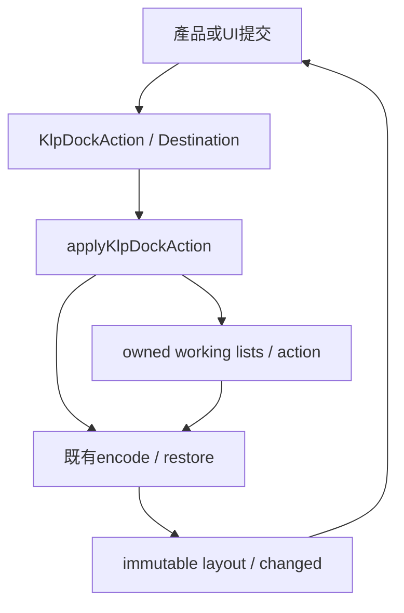
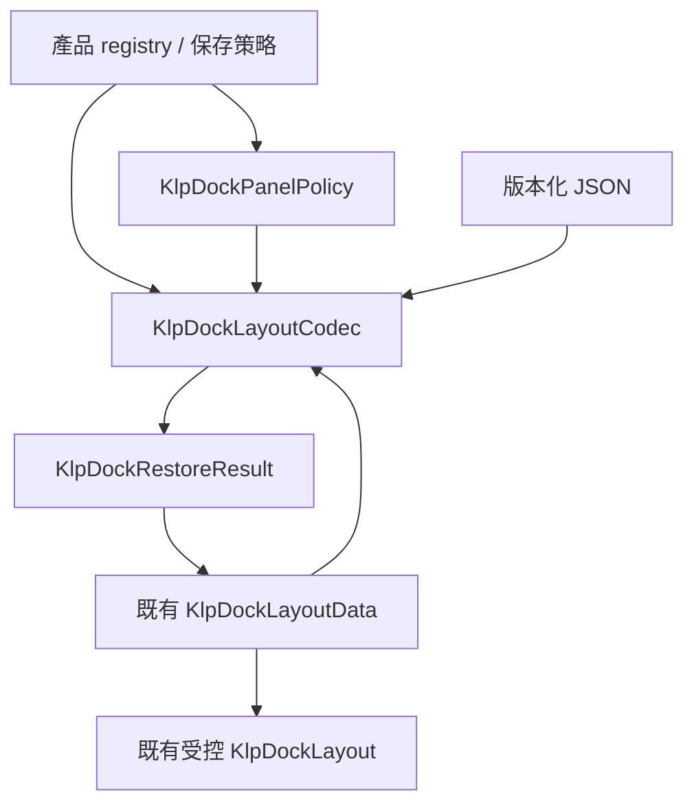
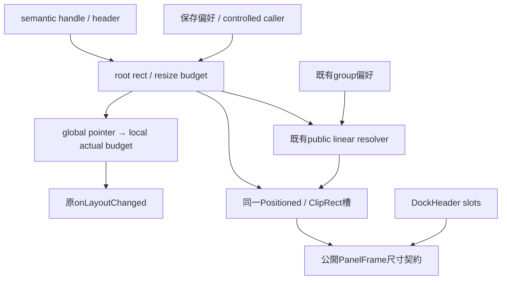

# Flutter Dock

修訂 `FLUTTER-DOCK-OPS-r1`；PLAN READY。擁有此 docking 目錄；公開入口由 foundation 匯出。保留直接 KlpDockLayout／Panel／Area／Group；不引入通用 node tree、renderer 或產品 storage。

## 當前 slice FLUTTER-DOCK-OPS-1（完成）

依共通 WB-DOCK-OPS-r1，公開 applyKlpDockAction({required KlpDockLayoutData layout, required List<KlpDockPanelPolicy> panels, required KlpDockAction action}) → KlpDockActionResult（layout／changed），由 foundation 匯出。保留全部原 const model／Widget API，純操作不認識產品內容、theme 或 storage。

公開 enum KlpDockArea 為 left／right／bottom。const KlpDockDestination.tab({required area, required String groupId, required int index})、.group（同欄位加 required double extent）擁有 readonly area／groupId／index／nullable extent／createsGroup。const KlpDockAction 的 named constructors：select({required panelId})、move／open({required panelId, required destination})、merge({required sourceGroupId, required targetGroupId, required int index})、close({required panelId, required bool approved})、visibility({required area, required bool isVisible})、resizeArea({required area, required double extent})、resizeGroup({required groupId, required double extent})。所有identity為String、area為KlpDockArea、destination為KlpDockDestination；Action私有tag／payload由typed constructors維持合法形狀，不提供JSON action parser或通用Widget schema。index為int，extent在apply驗證finite／range；constructor不以assert阻止負數，以便在operation邊界用FormatException明確拒絕。new group id依操作前全域groups檢查，index依移除source後列表長度驗證。

來源 klp_dock_layout_operations.dart 擁有 typed action／destination及單步操作；使用現有 codec.encode／restore 驗證目前與結果，不複製保存parser。working collections必為自己的lists；最後用codec產生深層immutable快照。非法目前layout、缺清冊、capability、unknownpanel/group、identity、index或extent全部FormatException；close false合法no-op；pure action不執行關閉callback，UI必先交產品批准。resize只是偏好尺寸，不替代UI finite constraints。

BUILD僅write flutter/lib/src/features/workspace/shell/docking/klp_dock_layout_operations.dart、flutter/lib/kallopis_foundation.dart新增export；architecture、所有tests、codec／model／Widget／theme／style／example／config及其他module唯讀。TestAuthor唯一可寫flutter/test/dock_layout_operations_test.dart，採React operations test同一初始layout及成功／拒絕情境；typed Dart不能表示錯誤primitive類型，不用compile failures冒充behaviorRed。

M1 tabs／groups／close／visibility及atomic rejection，M2 resizepreferences／immutable／publicanalyze／scope。cold-start5k–9k tokens／40–70分鐘，參照REACT-DOCK-OPS-1；12k tokens／90分鐘或需要改現有codec／Widget回PLAN。根module擁有publicexport，細節責任在此module；GUI與Dock尺寸保護接續同一Workbench stage。

## 已完成 slice FLUTTER-DOCK-STATE-1

依 [WB-DOCK-STATE-r1](../../../../../../../docs/architecture/workbench-dock-contract.md) 完成 JSON 保存／載入／registry reconciliation。BUILD 僅可寫 `flutter/lib/src/features/workspace/shell/docking/klp_dock_layout_codec.dart` 與 `flutter/lib/kallopis_foundation.dart` 的新增 export。既有模型、Widget、私有拖放算法、theme、style、example、config、architecture、tests 唯讀。Test Author 唯一可寫 `flutter/test/dock_layout_codec_test.dart`。

codec 擁有外部資料驗證及 immutable snapshot；既有 model 繼續擁有原 caller 的 const／copyWith API。policy 是產品 registry 的資料投影，不持有 Widget；result 擁有 reconciliation 診斷。方法：encode 驗證 model → wire；restore 驗證 wire／policy → 過濾 missing → immutable model／diagnostics。錯誤由 FormatException 暴露；不捕捉錯誤假裝成功、不自動更新產品 state。

替代方案直接替既有 model 加 storage 與 registry：會改變 const caller 及 UI 責任，因此採獨立 codec。codec 只依 dart:convert、Flutter Axis 及既有公開 model；無 filesystem、network、theme 或 private state dependency。

M1 完整 schema／encode／restore：手寫 JSON 與拒絕證據；M2 reconciliation／immutable／公開入口：獨立 checks、analyze、scope。cold-start 6k–10k tokens／40–80分鐘，參照 FLUTTER-STYLE-1 的資料邊界；10k tokens／80分鐘或需要改既有 model／UI 時回 PLAN。保存及跨語言風險由 fresh Test Author 保護，不建 screenshot tests。尚未交付 tabs close／pinned／dirty、geometry 保護、React Dock 與 GUI／docs embed；後續按同一已接受 Workbench stage 接續。

## 實作清冊及完成證據

69771496：KlpDockPanelPolicy 的 id／allowSide／allowBottom 投影能力；KlpDockRestoreResult 的 layout／missingPanelIds／availablePanelIds 不可變。KlpDockLayoutCodec.encode 使用 _wire → _snapshot 驗證後 jsonEncode；restore 使用 jsonDecode → _snapshot → reconcile，保持原模型 API。_object 檢查 exact fields、_id 檢查非空、_extent 檢查有限數值、_invalid 擁有 FormatException。wire／snapshot／reconcile 分別擁有邊界轉換、全域 identity 與清冊診斷，沒有新增 renderer。

7 項獨立 checks、公開 foundation／codec analyze、scope gate 通過；測試 SHA256 129D62D2C11882215D2FB652A3DA99CCF64FBCBD547845270D7CACD0FDE9781C 未變。Test Author 基線35332e86僅有缺新符號的 compile Yellow；實作後全部 Green，沒有宣稱未存在的 behavior Red。BUILD 僅改兩個允許路徑，無感官結果。React codec 與 Dock UI 仍待接續；後續 owner 修改本 architecture 不回算為 BUILD worker scope。

## Operations 清冊及完成證據

b08d80e6／243d9f98：KlpDockArea、Destination、Action及ActionResult公開typed const API，applyKlpDockAction依codec驗證before／after；_DockWorking只持有owned replacements，原snapshot保持不可變。_findPanel／_placedPanel／_group定位，_setGroup／_deleteGroup／_removePanel統一copyWith及active fallback；_permitted驗證destination能力，_identity／_insertion／_extent／_invalid擁有FormatException。named constructors用私有tag/payload維持shape，不提供JSONaction或Widgettree。

10獨立checks（React同fixture／情境）、publicfoundation analyze No issues、scope通過；SHA256 3D9FEBC3F5B44A602CE755482FE66D3DD849225632BA1120CE42B293BBD4E3DF未變。TestAuthor基線ca9a4efd缺symbol為compileYellow。建構子清理中發現private initializing formal的callsite名稱編譯錯誤，已按diagnostic修正並重跑相同checks，無測試／contract改動及無Greenfallback。BUILD僅兩個allowedpaths，scope於243d9f98閉合；後續owner修改architecture與docs不回算worker。兩框架pure操作已完成，UI、有效handle／viewport geometry與pinned／dirty呈現待接入。

## 有限 geometry 前置

共通 WB-PANEL-GEOMETRY-r1 已 READY；Panel 模組先處理 finite chrome／inset／State continuity，Dock 只使用公開 PanelFrame。Dock root/group/gutter/overlay 的 packet 尚未發出；目前保存 extents 仍直接排版，不宣稱有限 viewport 保護完成。Panel slice 不改本目錄，後續 Dock slice 不複製 Panel chrome 算法。

## FLUTTER-DOCK-GEOMETRY-1（READY）

修訂FLUTTER-DOCK-GEOMETRY-r1；依WB-DOCK-GEOMETRY-r1接入有限viewport。klp_dock_layout.dart 擁有native positioned composition／group resolver接入／actual handle傳入resize/drop；新 private part internal/klp_dock_geometry.dart 只擁有 root rect 與handle配額，依公開resolveKlpLinearLayout，不建立第二份演算法。布局root用stable keyed Positioned/ClipRect保留原Stage/area/header內容；root需finite axes，不持有保存state。

private geometry回傳left/right/bottom/stage/header rect、各area handle rect與可提交max budget；areas可見條件沿用visible且groups非空。commoncontract固定全部數值規則。groups改用既有resolver結果的extents/gutter，最後group填剩餘。arearesize callbacks用當前geometry，groupresize沿用pair逻辑但使用effectivegutter。horizontalgroup header判定讀PanelFrame公开chrome/margin契约，不看私有Panel实现。

BUILD allowed_write：klp_dock_layout.dart、internal/klp_dock_geometry.dart、internal/klp_dock_header_state.dart、primitives/klp_dock_resize_handle.dart。models／codec／pureoperations／旧dataoperations／Panel／theme／style／example／config／architecture／tests全部唯讀。TestAuthor只寫flutter/test/dock_geometry_test.dart。不修改hover開area與cancel、更不在此聲稱close/pinned/dirty完成。Header state僅slots數值／高度安全，保留overflow菜单和callbacks。resizehandle僅safe lineLength/clip，不改手勢。

M1 root/area/group有效gutter守恆、normal/zero/extreme style；M2 area/group resize同一配額、Header zero slots與State continuity、protectedchecks/publicanalyze/scope。cold-start8k–14k tokens/60–100min，參照FLUTTER-LAYOUT-2與PANEL-GEOMETRY-1；20k tokens/120min或需要改pureoperations/Panel/model回PLAN。直接同一geometry配額避免仅ClipRect隐藏溢出；独立puregeometry part有root placement/resize共同reason to change，不引入genericruntime。

