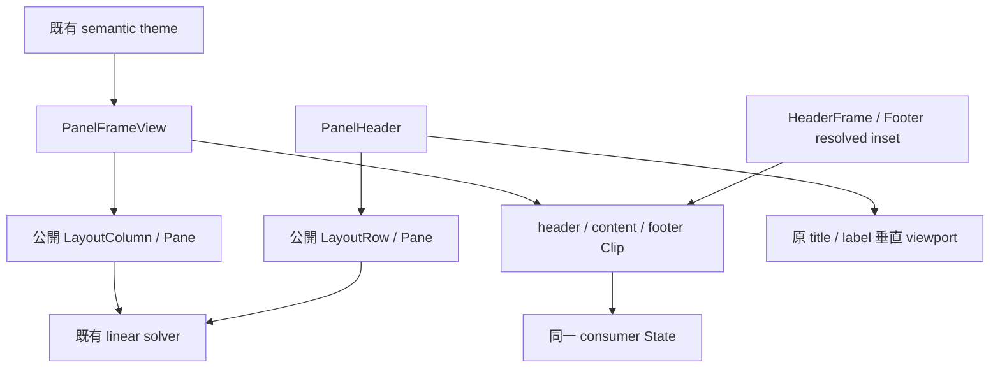

# Flutter Panel

修訂 FLUTTER-PANEL-GEOMETRY-r1；PLAN READY。擁有此 panel 目錄。公開 PanelFrame／Header／Footer constructor 及 foundation export 不改；元件讀既有 context.klp，不匯入品牌 pack。

## 當前 slice FLUTTER-PANEL-GEOMETRY-1（完成）

依共通 WB-PANEL-GEOMETRY-r1。PanelFrameView 擁有 bounded chrome 分配、有限外距、槽裁切、非負內半徑及 scrollbar 組合；使用 workspace/layout 公開 LayoutColumn／KlpLayoutPane／KlpLayoutBounds（既有 linear resolver 的直接 native 元件），spacing none、header/footer flex0 且 preferred/max=semantic height、content flex1。不得另造尺寸 solver。PanelHeader 擁有 leading/content/actions 原次序與 title/label 同一 vertical scroll viewport；使用公開 LayoutRow／Pane 配置自然 leading/actions、flex content 與明確 semantic gap，spacing none，槽自帶裁切。PanelHeaderFrame／Footer 擁有 native resolved inset clamp：每軸若 padding 合計超出有限空間，以共同比例縮小；其餘照原值。全部 wrapper shape 在 resize／theme 改變時穩定，不能以移除或 remount 内容通過測試。

公開使用前提：PanelFrame 需要 bounded height（舊 Expanded 亦如此）；有界各軸 geometry 非負有限。沒有新增 unbounded natural PanelFrame 規格。庫控制自己的 chrome，consumer content 負責自身内部，不攔截完整 tree。保留 theme color override、surface、elevation、headerSize、scrollbar ownership；shape.card-shape.stroke 可小於0，native inner radius clamp0。純 linear/public native layout module 唯讀。

BUILD write_paths 只有 panel/klp_panel_frame.dart（新增 layout import）、panel/primitives/klp_panel_frame_view.dart、panel/klp_panel_header.dart、panel/primitives/klp_panel_header_frame.dart、panel/klp_panel_footer.dart。architecture、tests、Dock、theme、style、example、foundation/config 與其他module唯讀。TestAuthor唯一可寫 flutter/test/panel_geometry_test.dart；測試使用公開 constructor/theme，不能讀 product internals。具體風險為 finite geometry、zero-size、theme resize 不丟 State；已存在 general layout checks 不涵蓋 PanelFrame fixed chrome。

M1 finite PanelFrame chrome/margin/radius 與 normal geometry；M2 header/footer inset、窄低原生 layout、State continuity、protected checks/public analyze/scope。cold-start 5k–10k tokens／40–80分鐘，參照 FLUTTER-LAYOUT-2；超過15k tokens／100分鐘或需要改 layout／Dock／style 回 PLAN。直接公開 layout 元件取代手寫 Row/Column 更小且共用已接受不足空間規則；自製 render object 沒有新的必要責任，因此不採用。

Dock 模組只依公開 PanelFrame；後續 finite Dock viewport slice 以此為前置，不在本 slice 改 Dock drag、hover、resize 或 metadata。

## 清冊與證據

5e18ccd6：PanelFrameView 使用有限 margin、max0 inner radius 及既有 LayoutColumn 的 chrome/content 槽；ScrollController ownership 保留。PanelHeader 的 _slot 擁有自然 chrome 寬度與垂直置中，_gap 擁有明確 semantic tight 配額；原 chromeToolbar 間距保留公開 KlpGap 對映，不發明不存在的 spacing getter。文字 title/label 同一 SingleChildScrollView；HeaderFrame bounded inset；Footer resolved RTL padding 每軸同比例縮配並 clip。所有 caller State/Element 保留。

獨立 TestAuthor2b0180b6：9 checks，baseline4pass/5behavioralRed；implementation9Green、publicPanelanalyze No issues、scope5paths通過，protected SHA256 90B1B2CAE6705E5D13B8930EFE8FFB1A1FFD3AA8FED338442BDBC13786FB0BE7 未變。作者校正footer caller probe的default inset，不是worker修改tests。實作首次新import replace沒命中material導致compileYellow，及chromeToolbar不存在getter，已依diagnostic用正確import與原公開KlpGap修正；同一checks通過，無Green fallback。

本slice只有確定性geometry證據，無感官接受。scope於5e18ccd6閉合；後續owner docs修改不回算worker。Dock root/group/effectivehandle、DockHeader overflow及drag/cancel/close接入仍未完成。
