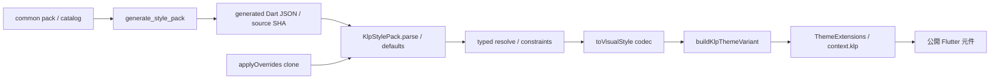

# Flutter style pack

修訂 `FLUTTER-STYLE-r1`；FLUTTER-STYLE-1 READY。共通 [style pack](../../../../../styles/architecture.md) 擁有格式與 metadata，本 module 只擁有 Dart 執行及 ThemeExtension codec。

## 公開契約

公開從 kallopis_theme.dart 可達 `KlpStylePack`：factory `KlpStylePack.defaults()` 取 generated common default；factory `KlpStylePack.parse(Object? input)` 接受 JSON string／object，完整驗證 schemaVersion1、非空身份、所有 canonical primitive／semantic／recipe ID、四模式、p／s／list／numeric add、引用及 semantic／recipe 循環。回傳 data（Map<String,Object?>）深度 unmodifiable 且與 caller 隔離；不得使用 eval。

`resolve(KlpThemeVariant variant)` 回傳深度 unmodifiable 的 Map<String,Object?>，350 ID 的 scalar／array 值，保持 ARGB／package family；曲線轉四點 finite array。`.applyOverrides(Map<String,Object?> overrides)` 僅 primitives既有ID及semantics既有ID的部分 mode，可原子覆寫、四 mode 全驗證，回新 pack，失敗來源與既有 snapshots 不變。`.toVisualStyle(KlpThemeVariant variant)` 使用 resolved tokens 轉既有 KlpVisualStyle；350項都具備既有 theme 欄位映射，禁止不明 ID 靜默忽略。

公开 top-level `klpStyleParameters` 深度 unmodifiable Map<String,Object?>，來源為 common catalog.parameters，所有 type／unit／min／max／integer／exclusiveMin／purpose／affectedRecipes／assetKind 不人工複製。common constraints ordered／fits 不可由 pack 降低。recipes 原文保存，不宣稱 typed recipe 展開。

`buildKlpThemeVariant` 增加 optional `KlpStylePack? stylePack`，與既有 `style` 同時提供時 ArgumentError。沒有 pack 時保留既有呼叫行為；有 pack 時由其完整 toVisualStyle 進入現有 _buildKlpThemeData，透過 ThemeExtensions／context.klp 供 native 元件使用。pack 指定四模式完整色彩，因此不再呼叫舊 preset withWindowTransparency（transparencyEnabled 對 pack 不改色，宿主透明能力由產品提供）；accent 保留既有明確覆寫權限。不同 Theme tree 可同時持有不同 pack，無全域 mutation。

## codec 與限制

所有 semantic path 去除 theme.，colors／typography／spacing／shape／motion／surface／components／geometry／dataVisualization 對應既有層，geometry 保留 control／data／layout／optical 子層。ARGB 保持，六位色補 FF；字型不移除 package prefix，資產不自動載入URL。曲線轉 Cubic，weight1..1000 轉本機 SDK 支援的 FontWeight(value)，duration logical ms 轉 Duration microseconds（不能無損表示時帶 semantic ID 拒絕，不靜默取整）。控制與框架容納算法在後續布局 slice。

可借既有 KlpVisualStyleJson decoder 處理完整 nested fields，但不可把 legacy 的100..900字重／整數ms限制誤套於共通有效範圍；這兩組字段需直接轉換並整體組裝。common 允許的負 shadow spread 亦明確映射，不可忽略。若 native model 確實無法表達有效值，診斷含完整 semantic ID 與原因，公開平台限制；不得私改 common catalog。parse／resolve 在四 mode 與 Node reference 應完全一致；native conversion 另行檢查可表示性。

`tool/generate_style_pack.mjs` 驗證共通 default 四 mode，將 default／catalog 以 JSON literal 生成 Dart module-owned data及來源 SHA manifest；--check 精確比對內容。套件 consumer 不讀 checkout 根 styles/；生成資料不手改。先不切換正式 Markdown 值權威。

## 責任與呼叫链

維護：`_validate` 驗證交換圖與 canonical 完整性；`_resolve`／`_typed` 執行 catalog 型別範圍及 constraints；`_copy`／`_freeze` 隔離 caller 與 snapshot；`native_codec.dart` 的 `_nativeStyle` 擁有完整 path 映射及原生曲線／時長／字重轉換。generated source 與 manifest 只由 generator 更新。

## FLUTTER-STYLE-1 完成證據

實作 commit `17119f2be35f7e8cc62db9a3e8b678dc1985c23c`。19 項獨立公開測試全通過，四模式 1400 resolved 值與 Node 公開 resolver 一致，350 native 欄位逐项 encode 對照；包含 immutable、atomic、非法圖／型別／constraints、精確微秒、字重與 Theme scope。Test Author SHA256 `15B43CF1A61888D208B32785716163BEFD4B101D8ED02FB3ABF7D985C4527129` 未變。

局部 analyze 無問題；generator --check 與 scope gate 通過。既有 ThemeExtension／VisualStyle 36 checks 及 accent／四模式 builders 5 checks 通過。未執行全庫 release suite；既有失敗仍見根整合紀錄。沒有宣稱 recipe 展開、布局保護、所有元件已完成視覺對齊或 GUI 人工接受。
