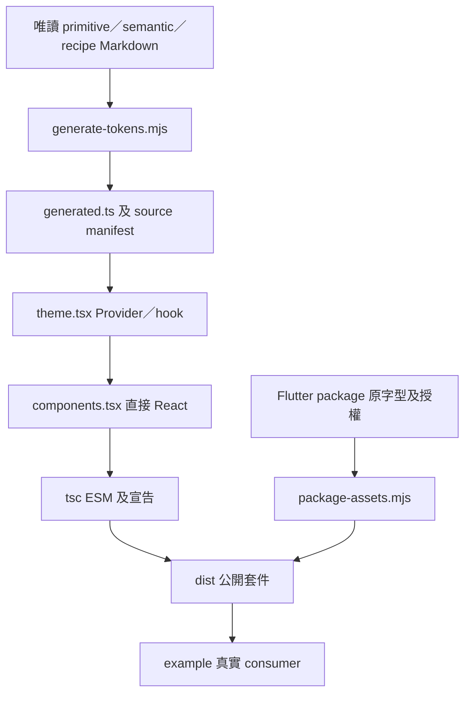
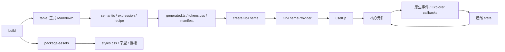
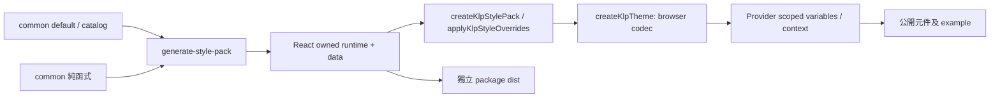

# React Foundation

## REACT-LINEAR-1（完成）

沿用 [WB-LINEAR-r1](../docs/architecture/workbench-linear-contract.md)，新增純幾何公開 utility `resolveKlpLinearLayout` 與 `KlpLinearItem`／`KlpLinearLayoutResult` 型別，為下一個 Row／Column／Pane slice 提供算法。`src/linear-layout.ts` 僅依賴 JS 數值運算；`src/index.ts` 匯出；不依賴 DOM、React、style pack 或產品 UI 模型，不修改既有 components。

BUILD write_paths 只有 `react/src/linear-layout.ts`、`react/src/index.ts`；其他配置、架構、tests、example 與 styles 唯讀。Test Author 只可寫 `react/test/linear-layout.test.mjs`。幾何、不足空間、巨大有限值、immutable 與非法輸入依共通契約保護；build、受保護 checks、scope 全過才算本 slice 完成，不宣稱 UI 布局完成。M1 公開算法、M2 checks／build／scope；cold-start 3k–6k tokens／20–45 分鐘，參照 STYLE-PACK-2 的不可變邊界。

修訂：`REACT-FOUNDATION-r1`；已實作；需求見 [React v1](../spec/react-foundation-v1.md)。Module 擁有 `react/`，正式規範與 Flutter 資產來源唯讀。

## 公開入口

套件 `@kallopis/react` 匯出 React 19 元件、TypeScript 型別、`klpPrimitives`、`klpRecipes`、`klpThemes`、`createKlpTheme(mode)`、`useKlp()` 與 `KlpThemeProvider`；`@kallopis/react/styles.css` 接入 package 字型與共用元件樣式。React 為 peer dependency，不把另一份 React 打入庫。

第一版元件：`KlpText`、`KlpSurface`、`KlpCard`、`KlpBadge`、`KlpButton`、`KlpIconButton`、`KlpTextField`、`KlpFrame`、`KlpWorkspace`、`KlpFileExplorer`。不宣稱完整 Flutter API 等價。原生 React children／DOM 與 consumer state 可直接使用，不建立 declarative node／adapter／renderer runtime。

Provider 必須明確出現在 tree；`useKlp` 缺 provider 時拋出可辨識錯誤。預設 mode 為規範 light；mode 支援 light／dark／ultraDark／transparent。透明模式不替產品建立宿主視窗。所有 350 個語意在每個 mode 皆可取得；不存在的語意或 recipe 必須失敗。

Explorer props：`sections` 為平坦 section 與 item 投影（id、label、items、可選 icon）；`expandedIds` 與 `selectedId` 由產品提供；`onToggle(id)`、`onSelect(id)` 回到產品。section 使用原生 button 的 `aria-expanded`，item 使用可按鈕化選取列表，Enter／Space 可操作；不另設產品 node 模型。`KlpIconButton` 的 `label` 必填；`KlpTextField` 的 `label` 必填並連接 input ID。

## 資料與建置

`scripts/generate-tokens.mjs` 只讀正式 `primitives.md`、`semantics.md`、`recipes.md`；完整解析 primitive 值、四主題 semantic 引用／array／add 與所有 recipe ID／繼承／設計參數。引用缺失、重複 ID、semantic／recipe 繼承循環、未知 theme 表達式皆拒絕，不使用 eval 或 snapshot JSON。原 recipe 表達式與未實作角色完整保留供語意查表，不宣稱所有 recipe 已可轉任意 DOM。

生成 `src/generated.ts` 與 CSS variables；生成檔不手改。manifest 記錄 primitive／semantic／recipe ID 清單及正式來源 SHA256。`--check` 比對產物與現行來源，不能只確認數量。字型從 Flutter package 的原始資產取得，打包時複製至 React 自己的 dist/fonts 並保留授權；Web 的 family 移除 Flutter package 前綴是明確平台轉換，不新增字型預設。

`src/theme.tsx` 提供 Provider／hook、配方取得、顏色及字體平台轉換。`src/components.tsx` 為直接 React 元件；有獨立 style resolver 的原語可抽到 `src/styles.ts`。`src/styles.css` 提供互動 selector、鍵盤 focus 及 layout，只使用語意或從配方導出的 CSS 變數。`src/index.ts` 為公開 barrel。

Library 以 TypeScript 編譯成 ESM＋宣告，style 與字型由 build script 安裝到 dist；`package.json` exports 不指向原始 TS。`example/` 是以公開套件入口建立的 consumer，使用 Vite 預覽及 production build；不要把 example 當庫入口。React 19、TypeScript、Vite 的實際版本由 npm registry 與 lockfile 固定，不發布 npm。

## Slice 與範圍

唯一 slice：`REACT-FOUNDATION-1`，涵蓋 RF-01～07。Implementation write_paths：`react/src/**`（排除 Test Author 路徑）、`react/scripts/**`、`react/package.json`、`react/package-lock.json`、`react/tsconfig.json`、`react/vite.config.ts`、`react/example/**`、`react/README.md`。`architecture.md`、共通規範、其他 module 及 tests 唯讀。

獨立 Test Author 擁有 `react/test/**`，以公開 ESM export、Node tests、React DOM／SSR 及必要 jsdom 觀察 deterministic 契約；tests 必須在 build 後執行。必要新測試的風險是規範轉為四主題資料的跨語言轉換、provider 範圍與受控 callbacks。不可用視覺 baseline 或弱化斷言驗收。

驗收：生成全部正式 primitive、350 semantic／四主題與118 recipe；生成引用及新鮮度 checks；完整 TypeScript build；public import／package tarball；Provider error、四模式、disabled／error／label 與 Explorer callback tests；example consumer build；桌面／窄畫面實際操作及字型載入。感官品質 human-pending。

里程碑：M1 規範生成與測試契約；M2 Provider／核心元件及 public import；M3 真實 consumer 展示、打包與渲染驗證。cold-start 預估 10k–22k tokens／60–150 分鐘（無足夠歷史實測）；需修改正式值、引入業務模板或移植全部 Flutter 元件時回 PLAN。

## 字段與維護

`package.json`：name 為套件身份、version 為框架庫版本、private 防止無意發布、type 為 ESM、files 限定打包資產、exports／types 指向建置入口、peerDependencies 指定 consumer 的 React、devDependencies／scripts 支援可重建建置與檢查。`tsconfig` 的 target／module／moduleResolution 是編譯邊界，jsx 是 React transform，strict 為公開型別驗證，declaration／outDir 指定套件宣告與輸出，include 限定庫 source。

函式與 props 的維護責任如下；驗證見根整合紀錄。

| 函式／欄位 | 維護責任 |
| --- | --- |
| table／browserValue／semantic／expression／recipe | 解析正式表格、平台轉換、引用及循環驗證；outputs 保存生成資料與來源雜湊 |
| createKlpTheme／getKlpRecipe | 只讀正式生成資料，拒絕未知 ID |
| useKlp／KlpThemeProvider | 提供 scope；mode 指定四主題，tokens 提供完整語意，semantic 嚴格查詢；原生 props 供產品佈局 |
| KlpText／Surface／Card／Badge | role 或 tone 指定正式配方；header／footer 限定自有 slot 次序；children 是產品內容 |
| KlpButton／IconButton | tone／size／selected 指定控制狀態；label 提供圖示可及名稱；native disabled 與事件交回產品 |
| KlpTextField | label／id 連接輸入，error 與 hint 指定回饋；value／onChange 保留原生受控契約 |
| KlpFrame／Workspace | Frame 自有 header／body／footer；Workspace 安裝共同間距，產品決定 layout |
| KlpFileExplorer | sections 投影資料，expandedIds／selectedId 為產品狀態，onToggle／onSelect 為產品回呼，label 為導覽名稱；ID 唯一且非空 |
| package-assets | 複製字型與授權至 package dist，合併語意 CSS 與元件樣式，安裝樣式型別與來源清單 |
| example App／SemanticSample | 用公開入口持有展示 state；呈現主題、元件操作與語意查詢，不提供業務模板 |

驗證：15項獨立契約測試通過；build／check:tokens／真實展示型別與 production build 已通過。Generated 三檔不得手改；新增規範表達式須先更新解析契約。視覺感官品質由人類接受。

## React 風格接入：REACT-STYLE-1（READY）

沿用已接受 SP-03／04／05；本 slice 接入 typed semantic，recipe 原文保留，尚不宣稱任意 recipe 視覺參數都已執行。正式表格仍是遷移值權威，common default pack 與 catalog 由 generator 驗證後進入框架產物；不可手改第二份值。

公開 `createKlpStylePack(input?: unknown)`：省略時取 default；字串須為 JSON；完整 pack 必須具備 canonical 全部 primitive／semantic／recipe ID，四 mode 依 common catalog 驗證，回傳隔離 frozen pack。`applyKlpStyleOverrides(pack, overrides)` 使用 common 原子覆寫並回傳 frozen 新 pack。公開 `klpStyleParameters` 是 readonly catalog.parameters；不得藉 pack 降低 metadata constraints。

`createKlpTheme(mode = 'light', stylePack?)` 保持舊單參數 API 與 default 值；新 pack 以 common resolver 解析後做 browser codec（#AARRGGBB → #RRGGBBAA；移除字型 package 前綴）。Provider 增加 `stylePack`，依 mode／pack 更新 scoped 全部 CSS variables，巢狀及兄弟 provider 不互相污染，useKlp 回傳同一 scoped tokens。Consumer style 原生 props 維持。

CSS encoding 延續既有 styles.css：typography size、motion duration 留 numeric 供 calc(*1px／*1ms)；geometry／spacing／shape／components 長度依 catalog 單位輸出 px；ratio／opacity／count 等不帶 px；curve 轉 cubic-bezier；字型 array 轉 quoted family list。此為 CSS 平台儲存 codec，不改变 catalog logical px 語意。

Generator `scripts/generate-style-pack.mjs` 驗證 default pack，複製 common 純 runtime／交換入口及宣告到 `src/style-runtime/`，生成 `src/style-pack-data.ts` 與來源 SHA manifest；--check 拒絕過期產物。build 將這些 JS／宣告安裝到 dist，發布 tarball 不引用 checkout 的 styles/。零新增 runtime dependency；existing generate-tokens CLI fixture 契約不變。

BUILD write_paths：`react/src/**`、`react/scripts/**`、`react/package.json`、`react/README.md`、`react/example/**`；architecture／tests／lockfile／common styles／其他 module 唯讀。Test Author 僅可寫 `react/test/style-pack.test.mjs`。必要驗證：四模式 default parity、JSON 與非法 pack 拒絕、原子 override、provider scoped CSS／hook 更新與隔離、generator freshness、tarball runtime ownership；以公開 example 操作替換風格。字型資產仍由 package 擁有。

M1 public pack／theme codec／generator；M2 Provider／example／tarball。預估 6k–12k tokens／45–90 分鐘，超出或需要 recipe DSL 展開時回 PLAN。風格改變下的通用 Workbench 容納／clamp 算法在其 layout slice 驗證，不以本 slice 假称已完成。

## REACT-STYLE-1 實作與證據

`src/style-pack.ts`：createKlpStylePack 驗證 canonical IDs／四 mode 後 clone／freeze；applyKlpStyleOverrides 交給 common resolver 原子套用；browserStyleValue 保留平台 codec；styleVariables 依 catalog 輸出 CSS（字級及時間 numeric；曲線 cubic-bezier；generic 字型 fallback 不加引號）。resolveBrowserStyle 供 createKlpTheme，Provider 在 scope 內輸出全部語意。

`generate-style-pack` 讀 common default／catalog／純 runtime，驗證四 mode，生成 readonly 資料、副本及 SHA；package-assets 安裝 dist 自有 runtime。`example` 只持有風格／輸入／錯誤 state，透過公開元件提供 JSON／檔案套用和還原。

21 項 React checks 通過（其中新6項），含獨立 tarball consumer；build／freshness／example／scope gate 通過，test hash 未改。瀏覽器確認 spacing 8→12px、app 色白色替換、非法 JSON 保留原值與還原；深色及窄畫面實際檢視，字型 loaded，error logs 空。感官品質 human-pending；Vite 505KB example chunk 提示保留，後續網站採需載入分割。commit `2243c4a7`。尚未接入所有 typed recipe 視覺參數或 Workbench geometry。

REACT-LINEAR-1 實作 dcc15e4f：21 項獨立 checks、library build、scope gate 通過；Test Author SHA256 AAE3EEF26F5530F4D5002BEA3698FF9F42B13722C547746021C58C9138145803 未變。nonnegative 驗證數值、proportional 正規化比例、resolveKlpLinearLayout 分配並凍結結果；沒有修改 DOM 元件或 style pack。
