# React Foundation

## REACT-DOCK-OPS-1（完成）

修訂 `REACT-DOCK-OPS-r1`；沿用 WB-DOCK-OPS-r1。公開 applyKlpDockAction(layout, panels, action) → KlpDockActionResult（readonly layout／changed）。KlpDockArea 是 left／right／bottom；KlpDockDestination 是 kind tab（area／groupId／index）或 group（同欄位加extent）；KlpDockAction discriminated type 為 select(panelId)、move／open(panelId／destination)、merge(sourceGroupId／targetGroupId／index)、close(panelId／approved)、visibility(area／isVisible)、resizeArea(area／extent)、resizeGroup(groupId／extent)。type及上述欄位全數 required、無未知欄；destination同樣strict。indexes是最終非負整數，不能clamp。

src/dock-layout-operations.ts 擁有受控單步資料操作、destination validation、group查找／移除／active fallback；透過已完成 encode／restore 驗證當前與結果snapshot，不複製第二套保存parser。只在提交操作時使用JSON純資料clone，不持有UI或全域registry。既有codec無改動，UI需在有效尺寸及close callback同意後才提交。pinned／dirty只屬產品metadata及後續呈現，不改保存schema。

BUILD唯一write_paths：react/src/dock-layout-operations.ts、react/src/index.ts。Test Author唯一write react/test/dock-layout-operations.test.mjs；architecture、既有codec／tests、style、example、配置、其他module唯讀。M1 tab／group／visibility／close操作及非法atomic rejection；M2 resize preferences／immutable／publicbuild／typedconsumer／scope。cold-start 5k–9k tokens／40–70分鐘，參照 REACT-DOCK-STATE-1；12k／90分鐘或需改codec／UI回PLAN。整體Dock UI與style幾何仍待接入，不以pureutility宣稱互動完成。

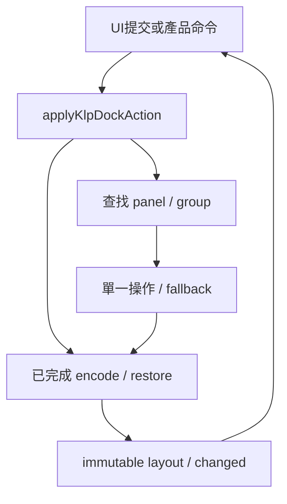

## REACT-DOCK-STATE-1（完成）

修訂 `REACT-DOCK-STATE-r1`；沿用 [WB-DOCK-STATE-r1](../docs/architecture/workbench-dock-contract.md) 的完整 wire／拒絕／reconciliation 契約。src/dock-layout-state.ts 是純資料邊界，不依賴 React、DOM、theme 或 storage；公開函式 encodeKlpDockLayout(layout) → string、restoreKlpDockLayout(source, panels) → KlpDockRestoreResult，由 index 匯出。TypeError 擁有非法 JSON／資料／清冊／capability 錯誤，失敗不修改產品原 layout。

公開 readonly interfaces：KlpDockLayoutData 必含 left／right／bottom；KlpDockAreaData 的 axis 是 horizontal／vertical，isVisible boolean、extent number、groups readonly KlpDockGroupData[]；KlpDockGroupData 必含 id、panelIds readonly string[]、activePanelId、mainAxisExtent。KlpDockPanelPolicy 必含 id，allowSide／allowBottom optional boolean（undefined 視為 true）；KlpDockRestoreResult 必含 layout、missingPanelIds、availablePanelIds。encode 驗證 native layout 的同一完整欄位，不自動刪除未知欄；restore 只接受 JSON string，所有 schema 欄位依共通 strict 契約。registry 接受純 policy（id、兩個 optional capability）；拒絕未知欄及非 boolean capability。空 area／registry 合法，結果所有物件及 arrays 深層 freeze，原輸入不 freeze、不寫入。schemaVersion 數值1接受 JSON lexical1.0，保持 JS／Dart 一致。

資料 parser 擁有 exact fields／id／finite／全域 identity；serializer 只對 validated snapshot JSON.stringify；reconcile 擁有 missing 順序／active fallback／empty group／available 清冊順序。使用 pure functions 是因無 lifecycle 或 storage；不新增 repository、通用 UI node 或第二套正文權威。已有 Flutter codec 是跨語言契約參考，只讀公開 wire 及 Test Author inline sample，不引用其私有 implementation。

BUILD write_paths 僅 react/src/dock-layout-state.ts、react/src/index.ts；architecture、其他 modules／components、theme、generators、example、CSS、配置、styles、tests 唯讀。Test Author 唯一可寫 react/test/dock-layout-state.test.mjs，從 dist/index.js 測公開 API，採 flutter/test/dock_layout_codec_test.dart 同一手寫 wire 成功／拒絕樣本。不改 Flutter tests、fixtures 或實作。

M1 公開 native interfaces／strict parser／encode／restore：手寫 wire 與拒絕 checks；M2 reconciliation／freeze／package boundary：protected tests、library build、typed consumer、scope。cold-start 4k–8k tokens／30–60分鐘，參照 FLUTTER-DOCK-STATE-1（7 checks、兩個write paths）；超過12k tokens／90分鐘或需要重設 Flutter model／Dock UI 時回 PLAN。保存與跨語言風險由 fresh Test Author 固定測試，無感官驗收。此 slice 不代表雙框架Dock UI補齊已完成。

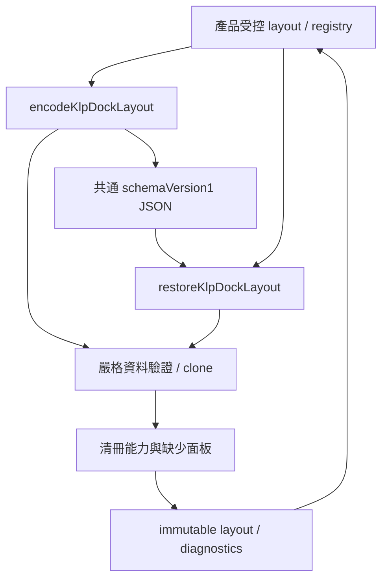

## REACT-LAYOUT-2（完成）

修訂 REACT-LAYOUT-r1；沿用共通 WB-LINEAR-UI-r1 與已完成 resolveKlpLinearLayout。此 slice 提供一般直接元件，不修改 Dock、命令、風格權威或既有 Frame。公開新增 KlpAppLayout、KlpLayoutRow、KlpLayoutColumn、KlpLayoutPane、KlpLayoutSpacer、KlpLayoutDivider、KlpLayoutBounds 與 props 型別；原有 KlpWorkspace／KlpFrame API 保持。

KlpLayoutBounds 是 readonly optional minimum／maximum／preferred，預設 minimum0、無額外上限、無 preferred。Row／Column／Pane 的 flex 預設1，有限非負（可 fractional）；Spacer flex 預設1且必須大於0。Row／Column 的 spacing 是 standard（預設）／none，alignment 是 start（預設）／end，sizing 是 fill（預設）／content。Pane 不預設材料／角色寬度，接受原生內容；產品固定大小由 bounds 或自然內容指定。Divider 只接受 key／原生 div 可及屬性，無 drag 行為與 flex／bounds。

Row／Column 接受至少一個直接 layout child，允許 React Fragment／null 條件組合，合法 child 為 Row／Column／Pane／Spacer／Divider；只檢查本 compound 的直接 slots，不檢查 Pane 內產品 tree。Root 只接受單一 Row／Column／Pane，inset standard（預設）／none。所有元件接受原生 div 屬性／ref；children 為 React 直接內容，沒有外部 node schema 或 adapter。預設沒有第二份品牌風格。

fill 使用 enclosing definite CSS content box，寬高100%、min-width／height0，尺寸由 ResizeObserver 與掛載前量測取得，不從 window 推估。有限主軸使用公開 solver，無 preferred 正 flex 從 minimum，零 flex 使用有限自然尺寸。content 明確要求主軸自然尺寸（Web 沒有 Flutter 的 Infinity constraint 訊號），此軸 flex 不增長，budget 是 clamped natural／preferred 與 gutter 總和；cross 為有限 enclosing 尺寸或內容自然最大值。未給 enclosing definite 高度時 CSS 自然高度是有限 budget，不保證填滿視窗。消費者需提供符合欲用 fill 軸的 enclosing CSS 尺寸；沒有隱藏 viewport fallback。

自然量測可暫時讓現有 slot 脫離配置、使用 max-content／auto，量測後同一同步階段恢復；不得 clone／duplicate React 內容、重掛載、改輸入 state 或 callback。每槽 overflow hidden 與 min尺寸0；本庫鎖定內部 grid／track／gap／box sizing 防止 consumer style 破壞分配；consumer 可指定宿主外部 width／height 等。原生產品內容自身是否支援有限自然尺寸仍是 caller 契約。

gutter、explicit divider、root inset 沿用 common；spacing 只讀 scoped theme.spacing.space2（logical px）。Root 每側 min(gap,width／2) 與 min(gap,height／2)。Row／Column 每層只扣自己的 gap；divider 抑制相鄰隱式 gap，連續各一份，none 僅取消隱式。最大尺寸 unused 依 alignment 留白。非法 bounds／flex 於 render 或量測前同步 Error（需辨識欄位），不寫 caller；natural 或容器無法產生有限值明確拒絕。

首次 client useLayoutEffect 量測，ResizeObserver 追蹤宿主／直接 slot 內容，內容 childList／characterData 變更與 load／字型完成也觸發重新量測；不得用自身 style MutationObserver 無限循環。數值／tracks 相同不更新；父 compound 完成槽或 inset 配置後，以私有、不冒泡的 DOM 尺寸通知讓直接子 Row／Column 同步重算，避免首次掛載巢狀錯用尚未配置的尺寸；它不暴露 state／產品事件 API。observer、事件與暫態樣式在 cleanup 還原，StrictMode及 unmount 不留全域狀態。沒有 ResizeObserver 時保留首次量測與 resize listener fallback，不能假裝持續尺寸觀察已完整。SSR／hydration 使用相同可及 DOM 與有限 CSS fallback，server 不執行 DOM，掛載後才完成算法配置。

來源 src/workbench-layout.tsx 擁有公開元件／直接 child 合法組合／hooks。src/workbench-layout-dom.ts 擁有宿主 content box、自然量測、DOM solver 投影及 observer lifecycle；理由是 DOM 幾何邊界與 React state 不同變更來源。兩者只讀 theme 與公開 pure utility。index.ts 匯出新元件。每個 direct slot 以 inline px width／height 投影 solver 尺寸；root 以 inline px padding 投影有效 inset。測試可從標記定位並觀察此配置，原生瀏覽器另驗證實際 geometry。初次內容尺寸優先讀 computed px content box，無 CSS layout 引擎時可由 getBoundingClientRect 觀察替代；ResizeObserver 通知重新量測同一邊界。公開 DOM 標記 data-klp-layout 為 root／row／column／pane／spacer／divider；配置槽 data-klp-layout-slot 為 content／gutter，供可及診斷與外部測試定位，不是 state API。

BUILD write_paths 僅 react/src/workbench-layout.tsx、react/src/workbench-layout-dom.ts、react/src/index.ts。architecture／所有 tests／example／CSS／配置／generator／styles／其他 module 唯讀。Test Author 唯一寫 react/test/workbench-layout.test.mjs，使用公開 dist、jsdom 原生測量／observer seam；必要 Browser evidence 後續透過公開 consumer 同時觀察 default／极大 gap／bounds／容器及 scope 更新，不能由 jsdom synthetic rect 冒充原生瀏覽器 geometry。example 新展示由下一個獨立 slice 接入，BUILD 不擴張。

驗收：public exports／typed API／SSR、nested slot bounds、dividers／minimum 退化／極大 gap／root inset、自然 sizing、native slot clipping、容器與 theme 更新、caller identity／input state、非法值／child診斷、observer cleanup。掛載執行不依賴 private consumer imports；感官品質 human-pending。M1 API與DOM geometry，M2 lifecycle／protected checks／package build／scope。cold-start 8k–16k tokens／60–120分鐘，參照 FLUTTER-LAYOUT-2 與 REACT-STYLE-1；超過24k tokens／180分鐘或需改既有元件回 PLAN。

採量測後 grid track 是為執行同一數值 solver 並遵守極端不足退化；單靠 CSS flex 無法保證同一 minimum 壓縮與 capped redistribution 契約，因此不另留一條正式算法。

[React useLayoutEffect 官方契約](https://react.dev/reference/react/useLayoutEffect) 支持 paint 前 client 量測與 cleanup；[ResizeObserver 文件](https://developer.mozilla.org/en-US/docs/Web/API/ResizeObserver) 支持元素 content box 更新觀察。


## REACT-LINEAR-1（完成）

沿用 [WB-LINEAR-r1](../docs/architecture/workbench-linear-contract.md)，新增純幾何公開 utility `resolveKlpLinearLayout` 與 `KlpLinearItem`／`KlpLinearLayoutResult` 型別，為下一個 Row／Column／Pane slice 提供算法。`src/linear-layout.ts` 僅依賴 JS 數值運算；`src/index.ts` 匯出；不依賴 DOM、React、style pack 或產品 UI 模型，不修改既有 components。

BUILD write_paths 只有 `react/src/linear-layout.ts`、`react/src/index.ts`；其他配置、架構、tests、example 與 styles 唯讀。Test Author 只可寫 `react/test/linear-layout.test.mjs`。幾何、不足空間、巨大有限值、immutable 與非法輸入依共通契約保護；build、受保護 checks、scope 全過才算本 slice 完成，不宣稱 UI 布局完成。M1 公開算法、M2 checks／build／scope；cold-start 3k–6k tokens／20–45 分鐘，參照 STYLE-PACK-2 的不可變邊界。

修訂：`REACT-FOUNDATION-r1`；已實作；需求見 [React v1](../spec/react-foundation-v1.md)。Module 擁有 `react/`，正式規範與 Flutter 資產來源唯讀。

## 公開入口

套件 `@kallopis/react` 匯出 React 19 元件、TypeScript 型別、`klpPrimitives`、`klpRecipes`、`klpThemes`、`createKlpTheme(mode)`、`useKlp()` 與 `KlpThemeProvider`；`@kallopis/react/styles.css` 接入 package 字型與共用元件樣式。React 為 peer dependency，不把另一份 React 打入庫。

第一版元件：`KlpText`、`KlpSurface`、`KlpCard`、`KlpBadge`、`KlpButton`、`KlpIconButton`、`KlpTextField`、`KlpFrame`、`KlpWorkspace`、`KlpFileExplorer`。不宣稱完整 Flutter API 等價。原生 React children／DOM 與 consumer state 可直接使用，不建立 declarative node／adapter／renderer runtime。

Provider 必須明確出現在 tree；`useKlp` 缺 provider 時拋出可辨識錯誤。預設 mode 為規範 light；mode 支援 light／dark／ultraDark／transparent。透明模式不替產品建立宿主視窗。所有 350 個語意在每個 mode 皆可取得；不存在的語意或 recipe 必須失敗。

Explorer props：`sections` 為平坦 section 與 item 投影（id、label、items、可選 icon）；`expandedIds` 與 `selectedId` 由產品提供；`onToggle(id)`、`onSelect(id)` 回到產品。section 使用原生 button 的 `aria-expanded`，item 使用可按鈕化選取列表，Enter／Space 可操作；不另設產品 node 模型。`KlpIconButton` 的 `label` 必填；`KlpTextField` 的 `label` 必填並連接 input ID。

## 資料與建置

`scripts/generate-tokens.mjs` 只讀正式 `primitives.md`、`semantics.md`、`recipes.md`；完整解析 primitive 值、四主題 semantic 引用／array／add 與所有 recipe ID／繼承／設計參數。引用缺失、重複 ID、semantic／recipe 繼承循環、未知 theme 表達式皆拒絕，不使用 eval 或 snapshot JSON。原 recipe 表達式與未實作角色完整保留供語意查表，不宣稱所有 recipe 已可轉任意 DOM。

生成 `src/generated.ts` 與 CSS variables；生成檔不手改。manifest 記錄 primitive／semantic／recipe ID 清單及正式來源 SHA256。`--check` 比對產物與現行來源，不能只確認數量。字型從 Flutter package 的原始資產取得，打包時複製至 React 自己的 dist/fonts 並保留授權；Web 的 family 移除 Flutter package 前綴是明確平台轉換，不新增字型預設。

`src/theme.tsx` 提供 Provider／hook、配方取得、顏色及字體平台轉換。`src/components.tsx` 為直接 React 元件；有獨立 style resolver 的原語可抽到 `src/styles.ts`。`src/styles.css` 提供互動 selector、鍵盤 focus 及 layout，只使用語意或從配方導出的 CSS 變數。`src/index.ts` 為公開 barrel。

Library 以 TypeScript 編譯成 ESM＋宣告，style 與字型由 build script 安裝到 dist；`package.json` exports 不指向原始 TS。`example/` 是以公開套件入口建立的 consumer，使用 Vite 預覽及 production build；不要把 example 當庫入口。React 19、TypeScript、Vite 的實際版本由 npm registry 與 lockfile 固定，不發布 npm。

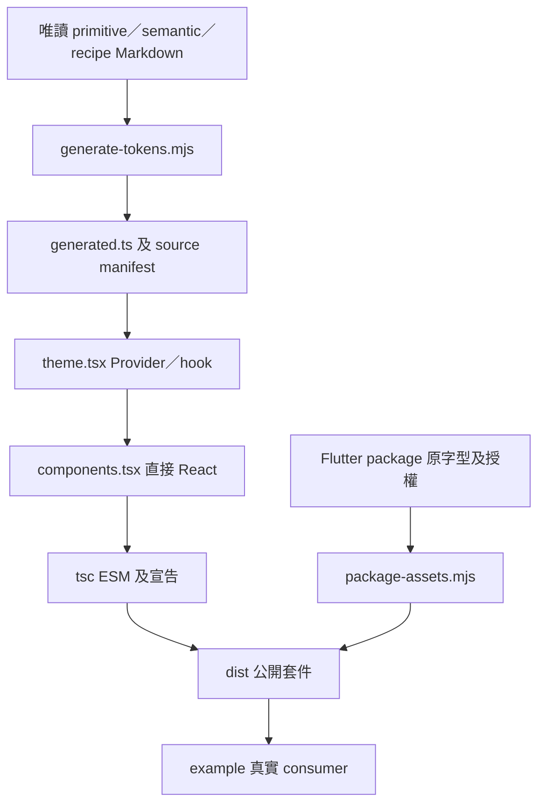

## Slice 與範圍

唯一 slice：`REACT-FOUNDATION-1`，涵蓋 RF-01～07。Implementation write_paths：`react/src/**`（排除 Test Author 路徑）、`react/scripts/**`、`react/package.json`、`react/package-lock.json`、`react/tsconfig.json`、`react/vite.config.ts`、`react/example/**`、`react/README.md`。`architecture.md`、共通規範、其他 module 及 tests 唯讀。

獨立 Test Author 擁有 `react/test/**`，以公開 ESM export、Node tests、React DOM／SSR 及必要 jsdom 觀察 deterministic 契約；tests 必須在 build 後執行。必要新測試的風險是規範轉為四主題資料的跨語言轉換、provider 範圍與受控 callbacks。不可用視覺 baseline 或弱化斷言驗收。

驗收：生成全部正式 primitive、350 semantic／四主題與118 recipe；生成引用及新鮮度 checks；完整 TypeScript build；public import／package tarball；Provider error、四模式、disabled／error／label 與 Explorer callback tests；example consumer build；桌面／窄畫面實際操作及字型載入。感官品質 human-pending。

里程碑：M1 規範生成與測試契約；M2 Provider／核心元件及 public import；M3 真實 consumer 展示、打包與渲染驗證。cold-start 預估 10k–22k tokens／60–150 分鐘（無足夠歷史實測）；需修改正式值、引入業務模板或移植全部 Flutter 元件時回 PLAN。

## 字段與維護

`package.json`：name 為套件身份、version 為框架庫版本、private 防止無意發布、type 為 ESM、files 限定打包資產、exports／types 指向建置入口、peerDependencies 指定 consumer 的 React、devDependencies／scripts 支援可重建建置與檢查。`tsconfig` 的 target／module／moduleResolution 是編譯邊界，jsx 是 React transform，strict 為公開型別驗證，declaration／outDir 指定套件宣告與輸出，include 限定庫 source。

函式與 props 的維護責任如下；驗證見根整合紀錄。


| 函式／欄位 | 維護責任 |
| --- | --- |
| table／browserValue／semantic／expression／recipe | 解析正式表格、平台轉換、引用及循環驗證；outputs 保存生成資料與來源雜湊 |
| createKlpTheme／getKlpRecipe | 只讀正式生成資料，拒絕未知 ID |
| useKlp／KlpThemeProvider | 提供 scope；mode 指定四主題，tokens 提供完整語意，semantic 嚴格查詢；原生 props 供產品佈局 |
| KlpText／Surface／Card／Badge | role 或 tone 指定正式配方；header／footer 限定自有 slot 次序；children 是產品內容 |
| KlpButton／IconButton | tone／size／selected 指定控制狀態；label 提供圖示可及名稱；native disabled 與事件交回產品 |
| KlpTextField | label／id 連接輸入，error 與 hint 指定回饋；value／onChange 保留原生受控契約 |
| KlpFrame／Workspace | Frame 自有 header／body／footer；Workspace 安裝共同間距，產品決定 layout |
| KlpFileExplorer | sections 投影資料，expandedIds／selectedId 為產品狀態，onToggle／onSelect 為產品回呼，label 為導覽名稱；ID 唯一且非空 |
| package-assets | 複製字型與授權至 package dist，合併語意 CSS 與元件樣式，安裝樣式型別與來源清單 |
| example App／SemanticSample | 用公開入口持有展示 state；呈現主題、元件操作與語意查詢，不提供業務模板 |

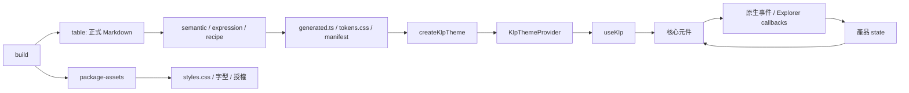

驗證：15項獨立契約測試通過；build／check:tokens／真實展示型別與 production build 已通過。Generated 三檔不得手改；新增規範表達式須先更新解析契約。視覺感官品質由人類接受。

## React 風格接入：REACT-STYLE-1（READY）

沿用已接受 SP-03／04／05；本 slice 接入 typed semantic，recipe 原文保留，尚不宣稱任意 recipe 視覺參數都已執行。正式表格仍是遷移值權威，common default pack 與 catalog 由 generator 驗證後進入框架產物；不可手改第二份值。

公開 `createKlpStylePack(input?: unknown)`：省略時取 default；字串須為 JSON；完整 pack 必須具備 canonical 全部 primitive／semantic／recipe ID，四 mode 依 common catalog 驗證，回傳隔離 frozen pack。`applyKlpStyleOverrides(pack, overrides)` 使用 common 原子覆寫並回傳 frozen 新 pack。公開 `klpStyleParameters` 是 readonly catalog.parameters；不得藉 pack 降低 metadata constraints。

`createKlpTheme(mode = 'light', stylePack?)` 保持舊單參數 API 與 default 值；新 pack 以 common resolver 解析後做 browser codec（#AARRGGBB → #RRGGBBAA；移除字型 package 前綴）。Provider 增加 `stylePack`，依 mode／pack 更新 scoped 全部 CSS variables，巢狀及兄弟 provider 不互相污染，useKlp 回傳同一 scoped tokens。Consumer style 原生 props 維持。

CSS encoding 延續既有 styles.css：typography size、motion duration 留 numeric 供 calc(*1px／*1ms)；geometry／spacing／shape／components 長度依 catalog 單位輸出 px；ratio／opacity／count 等不帶 px；curve 轉 cubic-bezier；字型 array 轉 quoted family list。此為 CSS 平台儲存 codec，不改变 catalog logical px 語意。

Generator `scripts/generate-style-pack.mjs` 驗證 default pack，複製 common 純 runtime／交換入口及宣告到 `src/style-runtime/`，生成 `src/style-pack-data.ts` 與來源 SHA manifest；--check 拒絕過期產物。build 將這些 JS／宣告安裝到 dist，發布 tarball 不引用 checkout 的 styles/。零新增 runtime dependency；existing generate-tokens CLI fixture 契約不變。

BUILD write_paths：`react/src/**`、`react/scripts/**`、`react/package.json`、`react/README.md`、`react/example/**`；architecture／tests／lockfile／common styles／其他 module 唯讀。Test Author 僅可寫 `react/test/style-pack.test.mjs`。必要驗證：四模式 default parity、JSON 與非法 pack 拒絕、原子 override、provider scoped CSS／hook 更新與隔離、generator freshness、tarball runtime ownership；以公開 example 操作替換風格。字型資產仍由 package 擁有。

M1 public pack／theme codec／generator；M2 Provider／example／tarball。預估 6k–12k tokens／45–90 分鐘，超出或需要 recipe DSL 展開時回 PLAN。風格改變下的通用 Workbench 容納／clamp 算法在其 layout slice 驗證，不以本 slice 假称已完成。

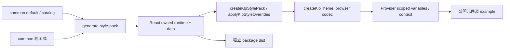

## REACT-STYLE-1 實作與證據

`src/style-pack.ts`：createKlpStylePack 驗證 canonical IDs／四 mode 後 clone／freeze；applyKlpStyleOverrides 交給 common resolver 原子套用；browserStyleValue 保留平台 codec；styleVariables 依 catalog 輸出 CSS（字級及時間 numeric；曲線 cubic-bezier；generic 字型 fallback 不加引號）。resolveBrowserStyle 供 createKlpTheme，Provider 在 scope 內輸出全部語意。

`generate-style-pack` 讀 common default／catalog／純 runtime，驗證四 mode，生成 readonly 資料、副本及 SHA；package-assets 安裝 dist 自有 runtime。`example` 只持有風格／輸入／錯誤 state，透過公開元件提供 JSON／檔案套用和還原。

21 項 React checks 通過（其中新6項），含獨立 tarball consumer；build／freshness／example／scope gate 通過，test hash 未改。瀏覽器確認 spacing 8→12px、app 色白色替換、非法 JSON 保留原值與還原；深色及窄畫面實際檢視，字型 loaded，error logs 空。感官品質 human-pending；Vite 505KB example chunk 提示保留，後續網站採需載入分割。commit `2243c4a7`。尚未接入所有 typed recipe 視覺參數或 Workbench geometry。

REACT-LINEAR-1 實作 dcc15e4f：21 項獨立 checks、library build、scope gate 通過；Test Author SHA256 AAE3EEF26F5530F4D5002BEA3698FF9F42B13722C547746021C58C9138145803 未變。nonnegative 驗證數值、proportional 正規化比例、resolveKlpLinearLayout 分配並凍結結果；沒有修改 DOM 元件或 style pack。


## REACT-LAYOUT-EXAMPLE-1（完成）

修訂 REACT-LAYOUT-EXAMPLE-r1；此 slice 在既有公開 example 新增一般布局展示，不修改庫算法／tests。example/layout-demo.tsx 的 LayoutDemo 接受既有 mode／stylePack，只由 public package imports 建立 Row／Column／Pane／divider 與既有文字、Frame／Surface／按鈕／輸入。嵌套 Provider 用相同 pack 的局部 gap override；控制元件留在父 scope，極大 gap 壓縮內容後仍能還原。不是第二份 theme 或產品範本。

展示可調 width（160／480／760）、height（100／300）、主軸對齊 start／end、root inset、無限大以外的極大語意 gap（p(radiusFull)）；顯示 nested row／column、sidebar preferred120/min80/max160、main minimum80、toolbar preferred40及body maximum140，讓不足 minimum與最大尺寸留白可見。另有content自然尺寸／input state示例。尺寸選擇只是展示state，外觀讀publicsemantic元件，不新增商業邏輯。保持既有展示功能、mode／風格匯入操作。

BUILD only react/example/layout-demo.tsx、react/example/main.tsx、react/example/style.css。其餘 src／architecture／tests／package配置／其他module唯讀。不新增golden或冗餘tests；既有獨立9 checks保護算法，browser實際測root尺寸／slot positions／endalignment／extremegap／input identity／窄viewport，TypeScript和productionexample build保護publicimports。感官品質human-pending。M1可使用公開consumer，M2browser／build／scope；估6k–10k tokens／40–80分鐘，超15k或需改庫回PLAN。

當前責任清冊：workbench-layout.tsx 的 elements／allowed／choice 只驗證直接組合與參數；Linear 投影spec／slot；六publicfunctions組裝原生DOM，useImperativeHandle連接ref，useLayoutEffect安裝本宿主observer。workbench-layout-dom.ts 的 finite／validateLayoutItem 擁有数值前置驗證；px／box 擁有CSS content box轉換；set避免相同配置再寫；natural保存並恢復同一內容的量測樣式；notify只向直接row／column傳遞私有尺寸事件；layoutRoot限縮inset；layoutLinear投影solver及px槽；observeLayout擁有observer／event／font生命週期。KlpLayoutBounds／LinearSlotSpec／LinearOptions是純幾何值，無consumer內容模型。公開Props描述HTML/ref及本compound限制。

REACT-LAYOUT-2實作6a2ca282：9獨立checks含SSR→hydrateRoot節點與已編輯input保留、無recoverableerror；librarybuild、publicconsumerTypeScript（TS7--ignoreConfig）與scope通過。原8斷言未變；新hydration由獨立TestAuthor追加07a25d94。ProtectedSHA256 D3547FAC11B6638E1F74C09E2E981ACFBEF610343136498D6656602BF8AC7495。jsdom尺寸為synthetic，不宣稱nativebrowsergeometry已驗證。

## Layout 當前依賴與完成證據

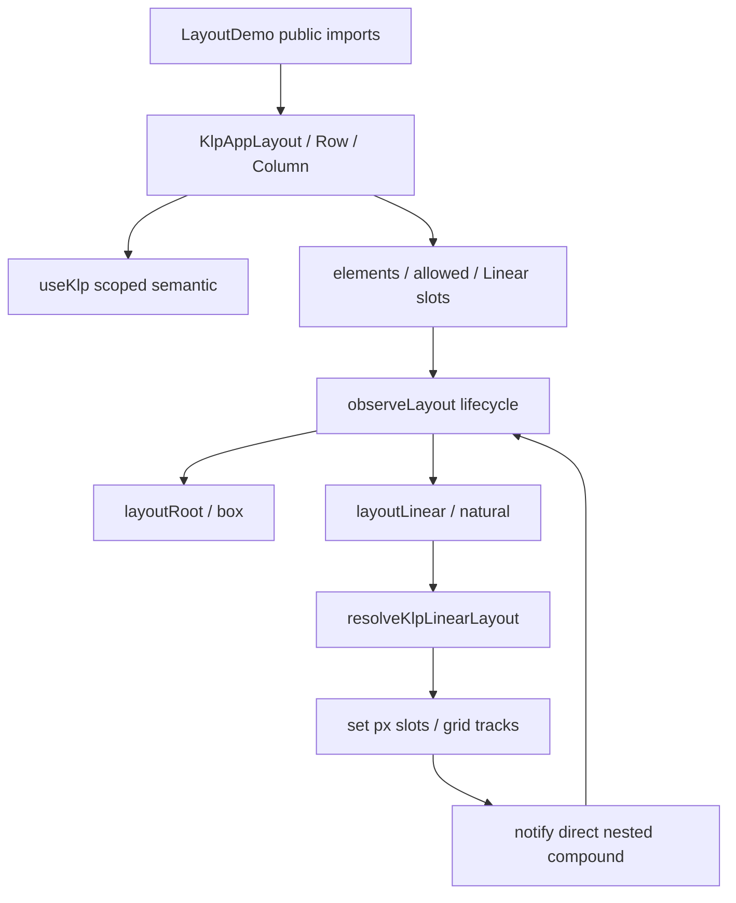

EXAMPLE-1 實作920f0022，LayoutDemo／previewPack useMemo／控制 state 由 example 擁有；main App 嵌入公開 consumer，style.css 只組裝展示外部幾何與 semantic 內容節奏。TypeScript／production build／scope 通過；native browser：480×300 root下 default sidebar120、gutter8、main336；160寬時 minimum80各退化68；end 將 toolbar置於root y104、body bottom292；gap12時sidebar120/main324/height276；極大gap9999時root padding150/80且內容0×0，none inset時gutter占滿160、內容寬0；輸入值保留。content自然量測總108=70+8+30。375px viewport preview寬264、全頁scrollWidth360，無水平溢出；dark、fonts loaded、error／warn logs空。感官品質human-pending。Vite517KBchunk提示仍存在，網站bundle階段按需分割載入，未調高警告閾值。

## Dock state 實作清冊與證據

c6af55f6：dock-layout-state.ts 公開五個 readonly interfaces 與 encodeKlpDockLayout／restoreKlpDockLayout。snapshot 使用 object／identity／extent／list 驗證 exact fields、全域 identity、active及finite；invalid 擁有 TypeError。snapshot及reconcile只建立自己的 frozen 結果；policies是每次呼叫的Map投影，不freeze caller。list拒絕native sparse arrays避免encode產生null群組。encode為snapshot→JSON.stringify；restore為string／JSON→document→snapshot→policy→reconcile→result，無DOM或全域狀態。

7項獨立checks（Flutter同一手寫wire／拒絕樣本）、librarybuild／generators freshness、typedpublicconsumer、scope通過。Test Author SHA256 9D654F0FAA78FF9B02A97B4C7E337585179F25D3254F53F3C4ACB45E4DC77900未變；author基線c0c7fa76缺export為compile Yellow，無behaviorRed。BUILD只改兩個允許路徑；其後owner文件不回算worker scope。一般UI／Dock UI／風格未改，不宣稱感官或完整Workbench已完成。

## Dock operations 清冊及證據

e5d8b0a6：KlpDockArea／Destination／Action／ActionResult公開typed contract。applyKlpDockAction透過encode／restore先驗證完整layout與registry，再只改JSON working copy，最後再次驗證與freeze。record／exact／identity／areaName／index／extent擁有strict request；panelAt／placedPanel／groupAt找local location，removePanel擁有empty cleanup／active fallback，permitted檢查目的能力，invalid擁有TypeError。merge用陣列拼接避免合法大量tabs觸發函式參數上限。

10獨立checks、librarybuild／generatorfreshness、typedpublicconsumer／scope通過。Protectedhash8856C5DC1A404D4B0797BEE8FFD3F5BE0D6295755A7FD48E734F65C5CCDDD14F未變；TestAuthor基線6641d67e只有exportcompileYellow。BUILD僅改兩個允許檔；既有codec、UI、style、Flutter及tests皆未改。人類感官與完整Dock UI仍未驗證。

## Dock finite geometry共同前提

WB-DOCK-GEOMETRY-r1已READY；native React Dock UI需使用既有linear resolver及相同Stage/Left/Right/Bottom、有效gutter、header/resize配額。当前React只有保存及pureoperation，不在Flutter geometry slice修改React。React UI packet接續同一已接受Workbench stage，不能把现有codec/operations宣称UI完成。

WB-DOCK-PREVIEW-r1 READY：hover僅instance presentation，cancel/end清除，success保留保存extent；Flutter當前PREVIEW-1不改publicAPI、geometry或pureoperations，React native Dock接入時遵循同一生命週期，不在此slice修改React。

WB-DOCK-UI-r1 READY：nativeReact Dock使用同一pureOPS提交/一次通知、presentation metadata與同步或Promise批准close/pending stale lifecycle。React native API與errorcallback由後續自己的PLAN固定；Flutter當前UI slice不修改React實作。

## REACT-DOCK-GEOMETRY-1（完成）

修訂REACT-DOCK-GEOMETRY-r1；依WB-DOCK-GEOMETRY-r1先固定native React Dock的root有限配額，非整個UI完成。公開resolveKlpDockGeometry(args: KlpDockGeometryArgs): KlpDockGeometry；new src/dock-geometry.ts只依既有purelinear與codec，無React/DOM/theme/state/storage。index新增export。之後nativeDock只用同一配額組合DOM及pointer，不另建尺寸權威。

KlpDockAreaConstraints readonly minExtent:number、maxExtent?:number；min有限非負，max省略或正Infinity表示無邏輯上限，其餘有限且>=min。KlpDockGeometryArgs readonly width/height有限非負、layout為既有KlpDockLayoutData、leftConstraints/rightConstraints必填、bottomConstraints可選、handleExtent有限非負、headerExtent可選有限非負（省略沒有header，0仍有零高header槽）。Bottomconstraints省略只在bottom hidden且groups空合法。非法nativeargs/layout/constraints TypeError；以既有encode验证layout，不重做parser，不改caller或freeze caller。

KlpDockRect readonly left/top/width/height。KlpDockGeometry readonly stage:rect、left/right/bottom/header:rect|null、leftHandle/rightHandle/bottomHandle:rect、maximumLeft/maximumRight/maximumBottom:number。所有結果deepfreeze；Rect與budgets遵共同位置/gutter/resize前提，包括left fullheight、header跨中央+right、bottom只中央、hiddenhandles clamp尺寸、root shortage比例退化及pref不回寫。最大budget扣另一實際side/有效handles或header且至少0。沒有header時right/body起點0；headerH clamp rootH。hidden/empty side不保留正文/gutter，邊緣handle仍存在；bottomConstraints省略時bottomHandle為底邊零高rect，maximumBottom仍為body可用配額但不能據此宣稱Bottom啟用。

root水平side items min/max/pref/flex0，center min0/pref0/flex1；verticalStage flex1與visibleBottom min/max/pref/flex0，gutterCount按實際visible且非空areas。使用既有resolveKlpLinearLayout，正Infinity轉nullable maximum，不複製水位算法。新helper只處理root，groups由既有linear規則及後續nativeUI投影；本slice沒有UI/metadata/close/dnd/resizecallbacks，也不接入examples。JS數字型別與constraints前置由helper-owned validation，layout validation委派codec。

BUILD allowed_write react/src/dock-geometry.ts、react/src/index.ts；other src/linear/codec/operations/theme/components/CSS/examples/config/architecture/tests及Flutter唯讀。TestAuthor只寫react/test/dock-geometry.test.mjs，使用dist/index.js publicAPI；採common與Flutter publicgeometrycheck已明確fixture的root48/96、header/bottom/zero/hugehandle、maxresize292/immutable/positiveInfinity及非法args，同一actualbudget不依privateFlutter实现。

M1根Rects/有效handles/不足及zero/extreme/Infinity，M2budgets/invalidargs/immutable/publicconsumer/librarybuild/scope。cold-start6k–10k tokens／40–70分鐘，參照FLUTTER-DOCK-GEOMETRY-1及REACT-LAYOUT-2；15k／90分鐘或需要改purelinear/codec/共同geometry回PLAN。選擇純root轉換函式讓nativeCSS與resize依同一值，拒絕分別用CSScalc及pointer各寫一套尺寸。

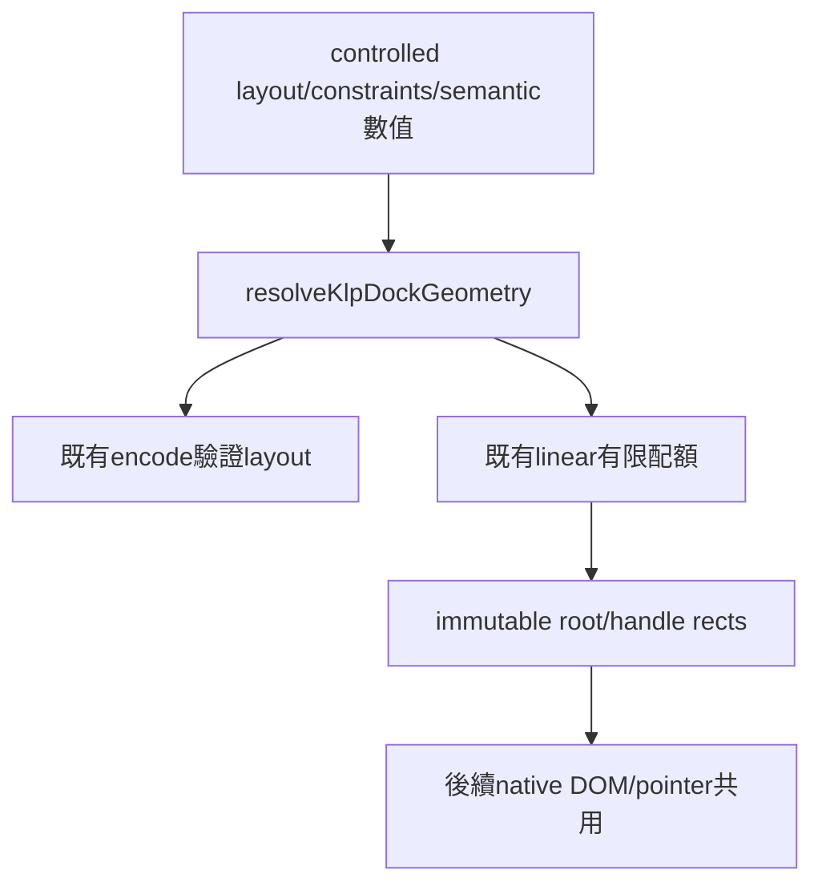

實作08ea39fc：finite／limits擁有native尺寸与限制驗證；item將正Infinity轉為linear的省略maximum；visible排除hidden或空area；rect建立自己的frozen矩形；resolveKlpDockGeometry先委派codec驗證，再各一次水平及垂直linear配額，回傳root／header／handle與resize預算。caller保存偏好及物件未修改，也未freeze caller。

9項獨立checks、librarybuild、typedpublicconsumer及2paths scope通過；protectedhash B617A4EC6DD751B430CB6C697FB7C753D0018C0C3B558FE82296BB5992FAC8C8。獨立TestAuthor65909cb9將292預算的fixture handle明定4（400−100−2×4=292），保留全部assertions；handle8時相同公式應284，未修改算法配合錯誤算術。基線缺export是compileYellow；nativeDOM／pointer及感官尚未驗證。scope於08ea39fc閉合，owner文件不混入BUILD範圍。

## 當前 stage：React native Dock

修訂REACT-DOCK-NATIVE-r1；WB-04/05/06/16既已accepted，採直接受控React元件。native呈現/生命週期與pointer轉換各有不同責任，使用已完成codec/OPS/geometry/linear，不建立node/adapter/runtime或第二份保存狀態。公開KlpDockLayout與KlpDockPanel；沒有新的default layout、產品內容、storage或業務批准邏輯。

公開KlpDockPanel extends KlpDockPanelPolicy：label:string非空供分頁及可及名稱；content:ReactNode由產品擁有；icon?:ReactNode；draggable?:boolean預設true；isPinned?/isDirty?:boolean預設false只呈現；onCloseRequested?:()=>boolean|Promise<boolean>；closeLabel?:string非空、缺省Close加label。政策欄位沿原allowSide/allowBottom。props KlpDockLayoutProps extends Omit<HTMLAttributes<HTMLDivElement>,'children'>：layout:KlpDockLayoutData、panels:readonly KlpDockPanel[]、stage:ReactNode、contentHeader?:ReactNode、leftConstraints/rightConstraints必填、bottomConstraints可選、onLayoutChanged:(layout)=>void必填；onCloseError?:(error:unknown,panelId:string)=>void供產品錯誤呈現；label?:string缺省Workbench；areaLabels?:Partial<Record<KlpDockArea,string>>缺省Left/Right/Bottom。原生style只能組裝宿主外部尺寸，不覆蓋內部配額。提供有限enclosing容器，root填滿，ref連接宿主。

### REACT-DOCK-NATIVE-1（完成）

本slice完成可使用的受控呈現/選取/收合與批准關閉。每次render先以既有codec/registry驗證完整layout；missing/capability/duplicate與非法props TypeError整份拒絕。root宿主量測後使用resolveKlpDockGeometry；SSR首次零尺寸DOM、hydration後量測，不碰storage/window於render。ResizeObserver與現有observeLayout生命週期可重用；box以未transform的CSS尺寸為準，fallback DOMrect，border/padding須在宿主擁有且不改保存。resize/style只重新分配，不通知onLayoutChanged。

各area groups沿WB-GEOMETRY-r1：vertical logicalmin32/horizontal120，非末pref/flex0、末minpref/flex1、gutterCount n−1，同linear resolver；本slice只呈現gutter，不接受pointer resize。Panel margin讀dockMargin，分別clamp到槽半軸；radius讀shape.card、stroke扣clipradius且clamp非負；tab列讀chromeTab並clamp高度，正文占餘並裁切。全部面板內容DOM以panel ID key建立，未active/收合用hidden保留同位置的原生input/state；相同layout重建、style/size更新不remount。Stage/optionalheader各有固定slot；跨group move的mount連續性不在此slice宣稱。

group role=tablist，label採area label與group ID；每個label button role=tab/aria-selected/aria-controls，對應role=tabpanel；close為同列獨立publicKlpIconButton，不巢狀button，包含inactive/singlepanel。分頁click及ArrowLeft/Right/Home/End選取（循環）並聚焦，active tab tabIndex0/其餘−1；選取pureOPS select，no-op0通知。area edge button以areaLabel作aria-label且aria-expanded反映caller visibility，click用purevisibility；空area沒有無效reopen入口。所有成功操作以latest caller snapshot apply，changed一次通知，caller不動。CSS的tab hover/selected讀相同semantic wash、focus/disabled讀正式semantic，圖示metadata可及title不依顏色表示。

pending為instance Map<panelId,requestToken>，只停用該close、不重入。approve false不提交；true從最新layout pureclose（只有changed才通知）。產品提供不同layout仍placed且同callback可從新位置關閉；若曾離開layout/registry、callback替換或unmount則token無效，即使之後再open也不能關掉新面板。同步與Promise丟錯或非boolean回傳保持layout、解除pending並呼叫onCloseError；未提供時用宿主reportError，無該API則console.error，不能假裝批准或吞錯。產品callback需保持identity。metadata不進wire、pinned不擅自禁止drag/close。StrictMode效果setup/cleanup後仍可再次close。

責任：workbench-dock.tsx擁有公開Props/KlpDockLayout、registry投影、group呈現及事件→pureaction；workbench-dock-lifecycle.ts擁有量測和close pending/stale hook（僅private exports）；styles.css僅新增Dock selectors；index.ts公開export。既有geometry/linear/codec/OPS/核心元件/theme不可改；使用公開KlpText/Surface/IconButton與同scope semantic。geometry操作不必每次clone內容資料或freeze產品ReactNode。

BUILD allowed_write react/src/workbench-dock.tsx、react/src/workbench-dock-lifecycle.ts、react/src/styles.css、react/src/index.ts。TestAuthor只寫react/test/workbench-dock.test.mjs；必要風險是async stale批准與受控交易、nativeDOM/input/SSR生命周期，既有puregeometry不能保護。驗收：publicconsumer/SSR/hydration；normal+short+zero+巨大margin/chrome尺寸無非有限槽且不改保存；select/keyboard/no-op/一次通知/immutable；inactive/singleclose、deny/approve/error/pending、latest/moved/removed-reopened/registrycallback/dispose；size/theme/input identity保留。感官human-pending，不以jsdom synthetic尺寸冒充nativebrowser。

M1呈現/配額/受控select/visibility，M2close生命周期/publicbuild/consumer/scope；歷史相似REACT-LAYOUT-2/FLUTTER-DOCK-UI-1，預估8k–15k tokens、45–90分鐘。超20k/120分鐘或需修改共通契約回PLAN。REACT-DOCK-NATIVE-2後續在同stage接pointer move/tabreorder/split/resize/preview與browser example；保留當前公開props/pure依賴，不預建空pointer層。所有GUI/specimens/命令能力仍依完整goal接續。

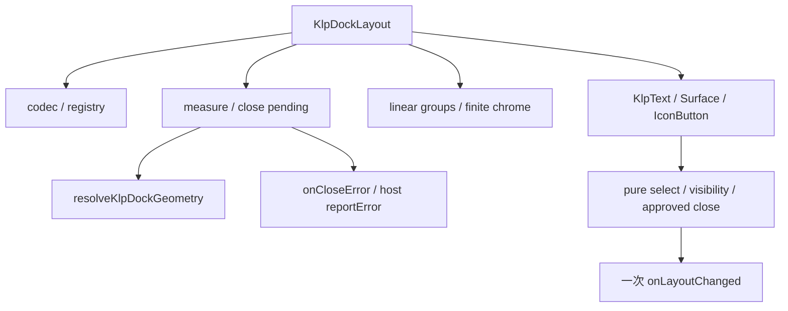

實作7690b23b：9獨立DOM/SSR checks、librarybuild、typedpublicconsumer及4paths scope通過；protectedhash A85874E8854C56A775AA7E049EF40E8BF9BA8C157E8488EB8C752B9B4F9A296B。基線缺publicexport/declarations為compileYellow；同checks全部Green，測試未改。部分asyncclose案例有React act harness警告，沒有console空的證據；尺寸為jsdom synthetic，nativebrowser與感官仍待example。不把native1宣稱完整停靠操作；scope只於7690b23b閉合。

| 當前定義 | 來源 | 責任 |
| --- | --- | --- |
| KlpDockPanel／KlpDockLayoutProps | [workbench-dock.tsx](src/workbench-dock.tsx) | 產品內容/metadata/批准、受控狀態/限制/可及名稱/ref公開邊界 |
| label／validate | 同上 | 非空名稱、純codec及registry前置；不freeze產品ReactNode；semantic數值由private view擁有 |
| position／KlpDockLayout | 同上 | 有限slot styles、宿主與穩定stage/header/areas/內容DOM |
| KlpDockLayout.commit／keyboard／renderArea | 同上 | purechanged一次通知、循環選取與focus、linear groups/有限margin/chrome/metadata |
| CloseRequest／placed | [workbench-dock-lifecycle.ts](src/workbench-dock-lifecycle.ts) | 請求callback/panel身分；查目前仍placed，沒有保存鏡像 |
| useDockSize／dimension | 同上 | CSS內容軸/DOM fallback及observer cleanup，equal尺寸避免循環更新 |
| useDockClose／update／current／report／requestClose | 同上 | instance pending/刷新、stale檢查、產品或宿主錯誤、從最新layout批准提交 |
| useDockClose effect／approval async callback | 同上 | StrictMode setup/dispose、caller替換時失效、boolean結果及finally清理 |

下一slice在同stage接pointer reorder/move/split/resize/preview及公開example；其READY packet另固定輸入生命周期及exactwritepaths。

### REACT-DOCK-NATIVE-2（完成）

修訂REACT-DOCK-INPUT-r1，沿已接受WB-GEOMETRY/PREVIEW/UI-r1。單一宿主的原生HTML drag事件負責tab重排/move/split/create；Pointer Events負責area/group resize。HTML drag的瀏覽器觸控支援由宿主決定，文件明示；不宣稱跨視窗/跨instance drag或自建touch polyfill。保留NATIVE-1 publicAPI及close生命周期；新增optional collapseThresholds:Partial<Record<KlpDockArea,number>>，缺省0，值有限非負，屬產品收合邏輯，非品牌尺寸。

workbench-dock-view.ts（private）集中當前root/group/inner/header/gutter矩形投影，依resolveKlpDockGeometry及resolveKlpLinearLayout；render與hit/resize共用該投影，禁止第二套CSScalc。非末preferred/末flex、32/120logicalminimum、finite margin/chrome/stroke沿native1。preview只淺投影被展開area的visibility/minExtent，保存layout/prefs不動。source registry/bottom capability仍以當前props查詢。

workbench-dock-input.ts（private）擁有此次instance drag source、preview areas、hint、pointer session及document listeners。事件client座標以宿主DOMrect與目前有限CSS內容軸轉成root座標（transform scale還原，零軸不除零）；只有本instance tab dragstart建立的source能命中，不接受外部DataTransfer任意panel ID。nonprimary/multibutton resize及draggable=false不開始；產品close/input等action不可因正文事件開始drag。

dragstart在tab原生draggable=true，DataTransfer只供瀏覽器feedback，不是資料權威；dragover合法target才preventDefault/effect=move，無target清hint。tab按實際DOMrect的左右半部轉before/after，原index轉移除source後finalindex；tablist/header空白append tab。group正文drop為split：扣新增pair的effectivegutter後容納2logical minima才合法；source等於只有一tab的target則拒絕。new groupID由instance prefix/counter產生並避開完整caller IDs；group插於source移除後仍存在的target之後，兩個相同偏好，各用puremove與resizeGroup local batch，changed一次通知。

Stage僅在實際stage邊界帶接受empty area create，帶寬讀theme.geometry.layout.railDropTargetExtent並clamp各軸；left/right/bottom候選以距離最小選擇（同距left/right/bottom穩定順序），area必空及能力合法，Bottom必有constraints。group extent至少其axis logicalmin，area extent以保存pref在logicalmin/max內clamp，不取hoverminimum。Stage中央不接受drop，產品正文不被攔截。提示只在actual Stage/target rect內裁切，stroke/opacity/color讀semantic。

hidden非空area的outer root edge帶使用相同railDropTargetExtent（右/底在header下及中央范围），合法dragover只令presentation以minExtent展開。preview維持到dragend/drop/cancel，dragleave Dock只清hint，仍可移入preview group；不同layout instance立即清preview/hint並取消本次input，同layout的style/size更新保留preview且重算配額。成功drop从原caller puremove/split才令目标visible，保留原extent；end/miss/cancel/unmount/registry source失效清所有presentation，callback0。root/document dragend與Escape在本次source有效時清理，不改其他instance。drop時重新依最新view解析target，不能使用過期hover目的。

area edge沿native1 label/aria-expanded，visible非空時pointerdown可resize；click仍收合/展開，實際拖移後的同一pointer click須抑制，keyboard click不抑制。document pointermove只畫有限resize hint、不提交；pointerup才提交一次pure action；pointercancel/Escape/unmount/不同caller layout取消0通知。左requested=起始actualWidth+dx，右/底為起始actualExtent−dx/dy；requested低於產品collapseThreshold則purevisibility false且不寫小尺寸；否則在logicalmin/max及最新geometry.maximum內clamp，max<min no-op。零threshold不因render/viewport變窄自動收合。非有限座標不產生操作。

group gutter role=separator、aria-orientation/label與相鄰group IDs可辨識。pointer resize使用actual相鄰extents總和（不含gutter），first=起始actualfirst+axisdelta，clamp minimum..pair−minimum；pair不足2minimum no-op，正常pure resizeGroup兩次local batch只一次最終通知。保存extent仍>0；其餘group偏好保持。drag/resize feedback只是presentation，不能把其copy存為第二保存權威。

BUILD write_paths：react/src/workbench-dock.tsx、react/src/workbench-dock-view.ts、react/src/workbench-dock-input.ts、react/src/styles.css。NATIVE-1 lifecycle、publicpurehelpers/theme/components/index/config/examples/architecture/tests及其他module readonly。Private view/input不由index匯出；責任拆分是有限配額與原生輸入生命周期的獨立變動來源。拒絕在JSX各hit handler重算group或用nativeDataTransfer生成保存模型。

獨立TestAuthor僅寫react/test/workbench-dock-input.test.mjs，public native events/DOM roles/caller probes：tab reorder before/after/self no-op/crossarea+capability/source cleanup；split2min/futuregutter/一次通知；Stageempty zero-prefcreate；hiddenpreview/cancel/miss/success pref保持/identity vs same-theme；area/group resize有限budget/shortage/cancel+click抑制；外部drag/非draggable/unmount/source replacement；原NATIVE-1 protectedchecks rerun而不得修改。jsdom synthetic坐標不冒充browser手感。M1拖放/preview/finiteview，M2resize/lifecycle/regression/build/scope；參照FLUTTER-DOCK-UI-1/PREVIEW-1及REACT-LAYOUT-2，估12k–20k tokens、60–120分鐘，超25k/150分鐘或需變更共同geometry/codec回PLAN。之後獨立example slice接存還原/close與nativebrowser，再整合GUI/docs。

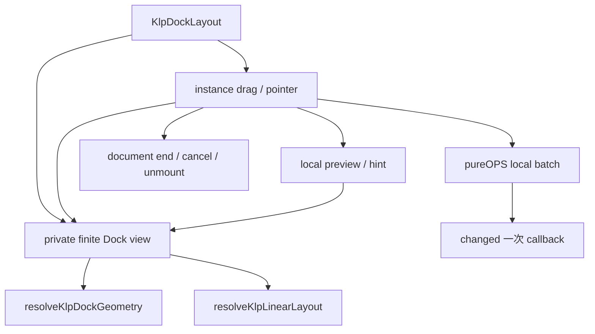

Native2實作681c0f6c，量測修正583818e8，提示線/capture清理6ee63c5e。9項input checks baseline2Green/7behaviorRed；接線後8Green/1scaleRed，修正後9Green，合併原native1共18Green（session77278 exit0）。build/publicconsumer與各自4path/單量測檔/單input檔scope均通過；protectedhash 335DCA352EF2FAAA608AF9294CDA45D00B5A213FB8CAAA2E40A32FEFCAA17403與native1 hash未改。新input checks無act警告，native1原act harness警告仍保留，不宣稱console空。尺寸及事件是synthetic，nativebrowser與感官待公開example；before/after提示線及pointer capture已接線，尚未nativebrowser觀察。

#### REACT-DOCK-MEASURE-1（完成）

修訂REACT-DOCK-MEASURE-r1；只有react/src/workbench-dock-lifecycle.ts可寫，其餘產品/tests/architecture/config唯讀。useDockSize以resolvedCSS px維持原行為；非px時使用未transform的clientWidth/clientHeight扣padding（client不包含border），無可用client尺寸才保留DOMrect fallback。公開API/同一view及pointer座標責任不改，不對root額外除scale；零尺寸及SSR保持合法，observer及close生命周期不改。

原Red為workbench-dock-input.test.mjs area scale2期望210、實際260；修正後同9checks再Green。直接受影響NATIVE-1九個DOM/SSR checks及librarybuild/consumer/單檔scope必驗；兩個protectedhash不得改。預估1k–3k tokens、10–20分鐘；若client fallback仍不能說明失敗回診斷，不修改fixture/expected或把scale從tests拿掉。此小slice完成後以兩個閉合scope共同證明NATIVE-2，owner文件不混入worker範圍。

| 當前定義 | 來源 | 責任 |
| --- | --- | --- |
| DockGroupView／DockView | [workbench-dock-view.ts](src/workbench-dock-view.ts) | root座標的outer/inner/header/gutter、只讀preview投影與semantic度量 |
| dockNumber／dockMinimum／resolveDockView | 同上 | scoped有限值、邏輯32/120、唯一root/group有限投影，render與命中共用 |
| InputArgs／Point／Target／ResizeSession | [workbench-dock-input.ts](src/workbench-dock-input.ts) | 最新依賴、CSS座標、候選typedactions/提示、pointer/capture生命周期；非保存模型 |
| contains／constraints／allowed／location | 同上 | 有效槽、area邏輯限制、registry能力、source群組查詢 |
| useDockInput.clear／point／batch／newGroupId | 同上 | cleanup/capture、transform座標、immutable純交易一次通知、避開caller IDs |
| tabTarget／tabLine／target／previewAt | 同上 | finalindex及實際插入線、tab/split/Stage合法目的、hover只呈現 |
| resizeTarget／startResize／ignoreClick | 同上 | actualpair/viewport限制、有限pointer開始及拖後click抑制 |
| startDrag／onDragOver／onDrop／onDragLeave | 同上 | instance HTMLdrag來源、合法接受、最新target成功提交、離開只清hint |
| useDockInput effects／move／up／cancel／end／key | 同上 | 最新caller替換、document listeners/capture/dispose、feedback/完成/取消/Escape |

下一步公開React Dock example接布局保存/還原/reset、open/merge、批准close與nativebrowser，然後GUI及各component specimen網站整合。此完成不涵蓋commands/keybindings或所有視覺recipe參數。

## REACT-DOCK-EXAMPLE-1（完成；hover preview browser證據待接續）

修訂REACT-DOCK-EXAMPLE-r1。example/dock-demo.tsx是公開API consumer，main.tsx嵌入既有Provider；style.css只擁有宿主尺寸、產品內容及控制區排版。DockDemo擁有layout、保存JSON、操作計數、還原診斷、產品輸入與close批准方式。庫仍擁有全部停靠樣式與事件演算法；不得引用src、複製tab/handle樣式或新增保存格式。

初始Left explorer/search、Right inspector/history兩群組、Bottom output，Stage與header使用公開Surface/Text/Button/TextField。產品panel registry用useMemo，批准callback用useCallback，產品可選批准/拒絕/延遲批准；dirty/pinned僅metadata。保存用encode、還原用restore且錯誤保留目前layout；顯示missing/available，重開缺席panel用pureopen，合併用puremerge。每次changed一次累加callback計數；preview、取消與resize的差異可由計數觀察。320/760/1040宿主寬度、180/460高度與外部主題/風格更新不改保存偏好。JSON文字框使用原生textarea，內容樣式讀semantic。

BUILD allowed_write僅react/example/dock-demo.tsx、react/example/main.tsx、react/example/style.css；library/tests/config/architecture及其他module唯讀。M1可操作consumer與typed/prod build；M2nativebrowser選取、輸入、收合/還原、save/load/reset/open/merge、resize/drop工具可用時驗證，以及scope。無新的高風險library行為，不新增鏡像測試；既有18項保護不變。browser工具不可操作的事件明示pending，不以evaluate合成事件冒充人工操作。感官human-pending。

參照REACT-LAYOUT-EXAMPLE-1，cold-start4k–8k tokens/20–45分鐘，12k/60分鐘或需library修改回PLAN。GUI復刻及docs所有specimens仍另行接續，此例不宣稱三個完整使用場景已交付。

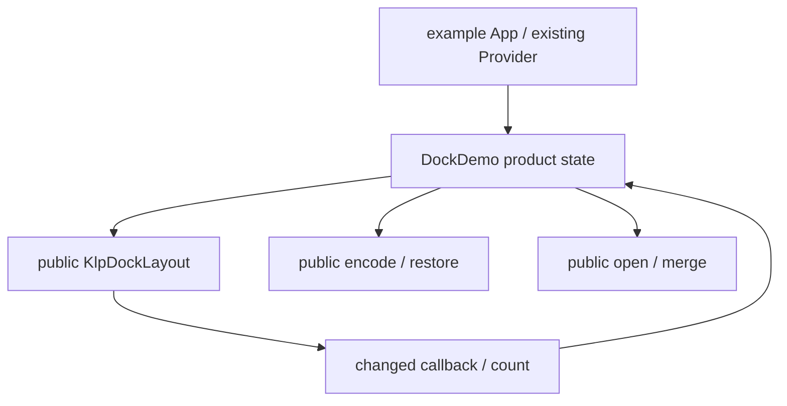

實作9597e484：threepath scope通過，TypeScript與production build通過；550.99KB chunk提示保留。初次browser Red為將完整panel metadata傳給strict保存清冊，example已投影id/allowSide/allowBottom，reload可正常操作，未改codec。原生瀏覽器觀察：select/收合2次、展開1次；拒絕close0次、批准/重開/merge各1次；invalidJSON0次並保留，還原/reset成功；left resize180→210只1次，right第一group200→225只1次；delay close pending停用且完成1次；320×180 root scroll同尺寸且無NaN/Infinity，Stage與Search輸入在theme/size更新保留。native短距離重排、跨區域merge與正文split各1通知，split原200扣gutter8後兩组96。暫時event診斷確認最初長拖只在header送dragover/沒有目的drop；拓寬目的區後實際dragover接受/drop成功，無library修正。診斷已完整移除，原始consumerGit內容不變；移除後再重排及resize各1次。證據mainignored build/evidence/react-dock-example.png呈現最終2次/left210；hover preview尚未nativebrowser觀察，感官human-pending。

| 當前定義 | 來源 | 責任 |
| --- | --- | --- |
| initialLayout／areaNames | [dock-demo.tsx](example/dock-demo.tsx) | 此展示產品的初始偏好與操作順序 |
| DockDemo／panels／policies／approveClose | 同上 | consumer state、stable metadata與closecallback、strict資料清冊投影 |
| commit／action／restore／open／merge | 同上 | 採用public結果、一次計數、JSON失敗保留、重開與合併 |
| main App／demo-dock CSS | [main.tsx](example/main.tsx)／[style.css](example/style.css) | 既有Provider接入、外部有限宿主和semantic產品內容；不改庫内部 |

## REACT-COMMAND-CORE-1（COMPLETE）

修訂REACT-COMMAND-CORE-r1，依[WB-COMMAND-r1](../docs/architecture/workbench-command-contract.md)。新src/command-registry.ts擁有原生generic context的definition/state/result與registry；index.ts公開匯出。無DOM、storage、產品context鏡像或defaultcommands；icon僅ReactNode型別依賴，不執行render。private entry/token擁有隔離metadata、running與stale identity；observer token擁有自己subscription，錯誤交nativehost/error callback，不混入handler結果。

責任：KlpCommandDefinition/C、KlpCommandState/ConditionError、KlpCommandExecutionResult固定共同metadata/predicate/result；KlpCommandRegistry constructor/register/getState/list/execute/subscribe/refresh/dispose/version/isDisposed擁有公開規則；private validate/metadata/snapshot/emit/report/current只處理同owner邊界。採Map token registry，因所有入口需一致查詢且disposer不能刪新owner；拒絕每個入口自己的handlers或將產品context存成第二權威。

BUILD write_paths只react/src/command-registry.ts及react/src/index.ts；原theme/components/Dock/linear/style/examples/config/architecture/tests及其他module唯讀。獨立TestAuthor只寫react/test/command-registry.test.mjs，publicdist API及typedconsumer；必要風險為async stale/owner lifecycle/disabled不可繞過/跨語言結果，不由BUILD作者撰寫測試。

M1metadata/registration/conditions/snapshot與同步結果；M2pending/stale/dispose/observer/publicconsumer/build/scope。cold-start6k–12k tokens/35–70分鐘，參照REACT-DOCK-OPS-1及NATIVE-1；18k/100分鐘或需修改共同契約回PLAN。後續雙框架core/命令入口與keyboard接同一已接受stage，不把core當全部WB09～14完成。

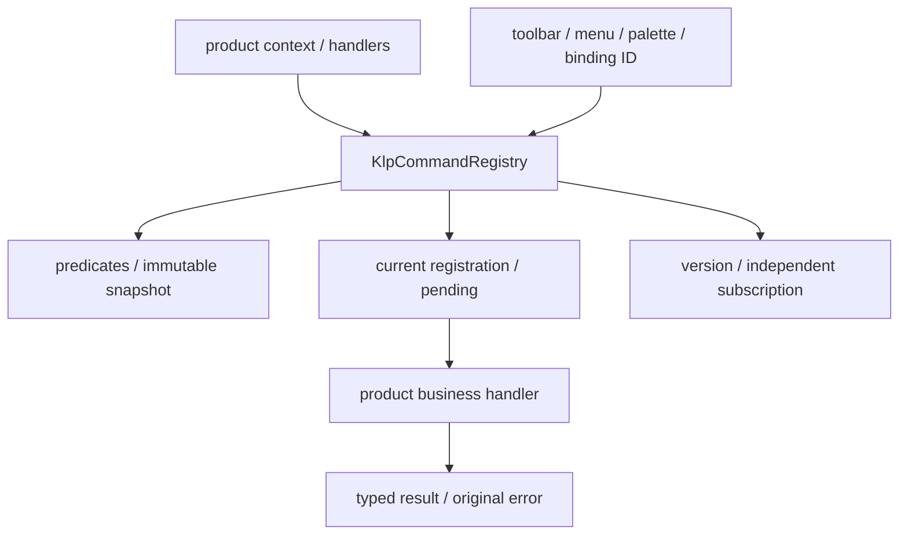

實作53c6ac39，獨立TestAuthor3feb78b9（前版e568ac7c）；11項public checks、library build、typedconsumer與2path scope皆通過。protected test SHA256 `FA7DD79C2A0F187212CC1283570627AE82DD09A5BD36F6709949960167E44010`不變。基線missingexports是compile Yellow；首次實作phase被推導為string的compile Red，修正literal後相同建置及檢查Green，沒有修改tests。沒有DOM、快捷鍵或完整stage完成宣稱。

| 定義 | 來源 | 責任 |
| --- | --- | --- |
| KlpCommandDefinition / KlpCommandState / KlpCommandConditionError / KlpCommandExecutionResult | [command-registry.ts](src/command-registry.ts) | 產品metadata、原生條件、唯讀診斷及typed結果 |
| CommandEntry / Observer | 同上 | 註冊token與獨立subscription identity |
| requireText / copyDefinition | 同上 | 原子驗證含非空白字串；隔離metadata，不改caller與原值 |
| evaluate / snapshot | 同上 | 最新context、boolean條件、throw undefined診斷及唯讀snapshot |
| reportToHost | 同上 | observer nativeerror通道隔離 |
| KlpCommandRegistry | 同上 | constructor與version/isDisposed；register/getState/list/execute/subscribe/refresh/dispose；private requireOpen/isCurrent/emit 保護owner及通知 |
| 公開匯出 | [index.ts](src/index.ts) | 只新增registry入口，既有元件與theme未改 |

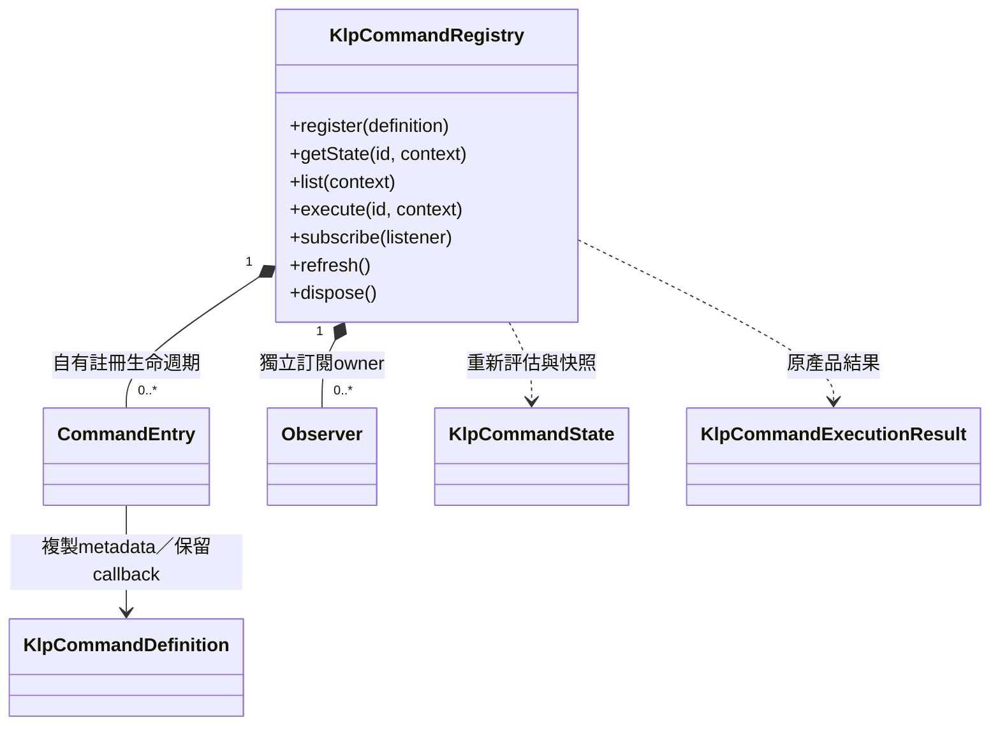

## REACT-COMMAND-ENTRY-1（COMPLETE）

REACT-COMMAND-ENTRY-r1依[WB-COMMAND-ENTRY-r1](../docs/architecture/workbench-command-entry-contract.md)。新`src/command-entries.tsx`擁有KlpCommandReference／兩個props／兩個直接native元件與private hook/row。只讀publicregistry、existingtheme/components；index匯出，styles.css只追加本slice semantic類別，不改existing選擇器。無defaultcommands/context鏡像/DOM全域快捷鍵/overlay或palette。

`KlpCommandReference { readonly commandId:string; readonly kind?:'action'|'toggle' }`。共同props `registry:KlpCommandRegistry<C>; getContext:()=>C; items:readonly KlpCommandReference[]; label:string; onResult:(result:KlpCommandExecutionResult)=>void; className?:string; id?:string; style?:CSSProperties`；Menu另`emptyLabel:string; autoFocus?:boolean; onDismiss?:()=>void`。required字串含非空白內容，items不能有重複ID/非法kind。Toolbar/Menu直接收props。無任意children替代command內容，外部原生style僅宿主。

private hook依registry.version useSyncExternalStore訂閱；查詢與dispatch各讀最新getContext，不以memo保存context。hook只持host lifetime/registry identity/currentprops與roving selection；不持handler/pending第二權威。registry變更與unmount使舊onResult失效，相同registry完成用最新onResult。Row重用KlpButton/KlpText，icon僅裝飾；toolbartoggle selected與menutoggle aria-checked是registry snapshot投影。keyboard prevents native default避免Enter/Space雙激活；disabled項不進可用索引。

BUILD write_paths只`react/src/command-entries.tsx`、`react/src/index.ts`、`react/src/styles.css`。architecture/core/tests/config/example/theme/Dock/stylepack/其他module唯讀。fresh TestAuthor只`react/test/command-entries.test.mjs`，publicindex+JSdom/React act；typedconsumer可ignoredbuild。M1共享條件/metadata/order/result，M2pending/stale/keyboard/empty/publicbuild/scope。cold-start5k–10k tokens／25–50分鐘，參照REACT-COMMAND-CORE-1／DOCK-NATIVE-1；15k/75分鐘或需core/public契約變更回PLAN。

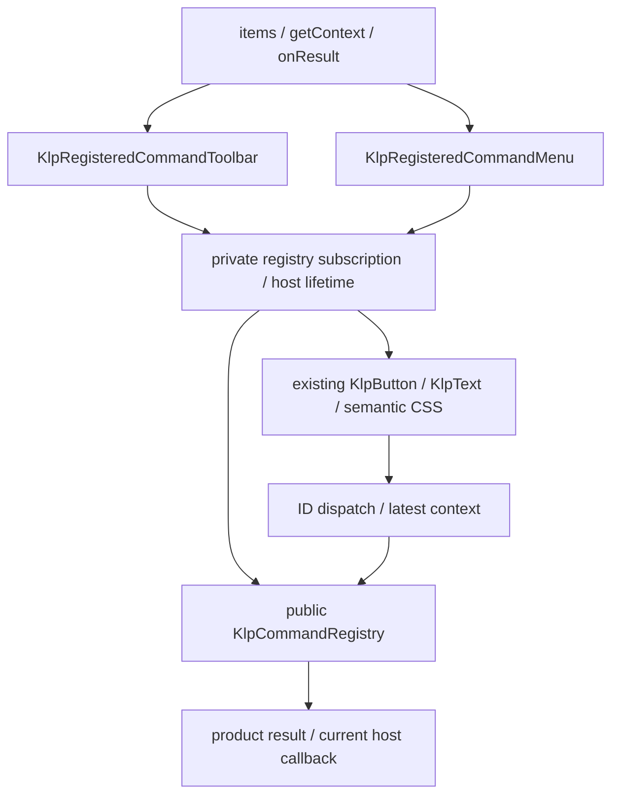

實作d05dca0e；3path scope通過，CSS只追加入口選擇器。12項public SSR/DOM/lifecycle/typedconsumer檢查與library build通過；protected SHA256 72BB8ACAD50A754D376EE3CB38D80A0B1A2BE02317F2131F1079233C03449561未改。最初activeId推導string的compile Red以明確string|null修正；未改registry/tests/config。測試存在React act時機警告；browser與感官接受待展示slice，不以DOM checks代替。

| 來源／定義 | 責任 |
| --- | --- |
| command-entries.tsx：KlpCommandReference／ToolbarProps／MenuProps／CommandRowData／CommandRowProps | 公開ID引用及宿主契約、內部readonly投影與row callback |
| requireText／copyReferences／copy | 字串／kind／重複ID驗證、複製caller排列 |
| reportToHost | callback/context例外交原生宿主通道，不改業務結果 |
| useCommandEntries／subscribe／getVersion／attachLifetime | registry外部store訂閱、最新props與宿主generation，不保存context/pending鏡像 |
| focus／activate／keyDown | 本地原生焦點、最新context ID dispatch、過期宿主結果隔離、方向與單次鍵盤啟動 |
| CommandRow | KlpButton/Text、metadata及toggle角色投影 |
| KlpRegisteredCommandToolbar／KlpRegisteredCommandMenu／autofocus | 公開水平／垂直原生入口、可選初始聚焦及空清冊回饋 |

## REACT-COMMAND-PALETTE-1（COMPLETE）

REACT-COMMAND-PALETTE-r1依[WB-COMMAND-PALETTE-r1](../docs/architecture/workbench-command-palette-contract.md)。新`src/command-palette.tsx`擁有KlpCommandDismissReason stringunion、KlpRegisteredCommandPaletteProps<C=unknown>及publicpalette/private search helpers/row/nativeportal lifecycle。required registry/getContext/open/label/searchLabel/emptyLabel/onResult/onDismiss(reason)，可選className/id。無items鏡像或自訂handler；全registry可見命令為資料源。

責任：private search(token/field score) deterministic UTF-16排序；registryuseSyncExternalStore版本、query/active UI狀態；open session generation/registry identity/latestprops保護async；原生document portal與scoped styleVariables(theme.tokens)保留stylepack；mounted gate確保SSR零輸出/hydration一致。輸入DOM持focus並透過aria-activedescendant投影candidate，native input/mouse/IME及backdrop；舊focus獨立於registry保存、close/unmount條件還原，不偷產品externalfocus。渲染重用KlpTextField/Button/Text，不改舊元件；input ref可由宿主root.querySelector取得，無core新增API。

BUILD exactwrite `react/src/command-palette.tsx`、`react/src/index.ts`、`react/src/styles.css`（只追加palette選擇器）。architecture/core/command-entries/components/theme/stylepack/config/example/test/default資料唯讀。fresh TestAuthor只`react/test/command-palette.test.mjs`，publicdist ReactDOM/JSdom SSR/hydration/nativeevents與typedconsumer，可ignored react/build/consumers；不依private helper/State或pixel。protectedchecks/build/publictypes/3pathscope必要；browser/極端風格及全goal另記。

cold-start8k–15k tokens／40–75分鐘，參照REACT-COMMAND-ENTRY-1／REACT-DOCK-NATIVE-2；Node24/TS7/React19.3/librarybuild假設。M1完整search/query/conditions/nativekeyboard/portalstyle（6k/30分鐘），M2open/focus/IME/async/stale/publicbuild/scope（12k/60分鐘）；18k/90分鐘或需core/舊controls public變更回PLAN。

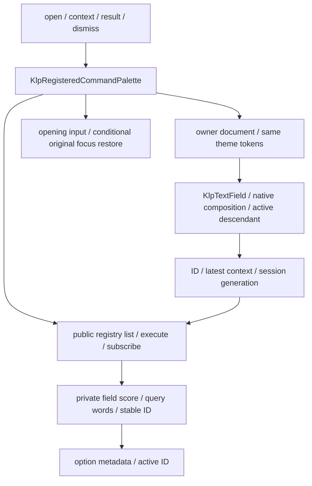

實作邊界澄清：portal使用原生HTMLDialogElement.showModal top layer/inert（無此宿主API時顯式open供DOM harness），role=dialog對應panel，外部portalhost對應backdrop。native backdrop pointer需依panel rect判斷外部，panel本身click不dismiss；無手寫全域z-index/theme。physical scope以aria-hidden hidden span取得ownerDocument及目前Provider CSS投影（含derived variables），portal從同tokens/同scope複製，不建立第二份defaultresolver；此marker不是overlay/元件展示，SSR不輸出modal。modal close/unmount依既定焦點契約，native close自動restore若遇產品externalfocus，保護最終externalfocus。

原生依[HTML dialog標準](https://html.spec.whatwg.org/multipage/interactive-elements.html#the-dialog-element)、[React createPortal](https://react.dev/reference/react-dom/createPortal)、[CSS backdrop繼承](https://drafts.csswg.org/css-position-4/#backdrop)。不修改ThemeProvider public型別；全部新邏輯仍限3paths。finite geometry private helper由viewport及同semantic數值先clamp inset/width/height/padding；resize只更新UI，不改命令清冊。

BUILD160f2c18，11項public native/SSR/hydration/type檢查、library build及3pathscope通過，CSS僅追加palette規則；protected SHA256 2753CE7F881BF0C0B56B8FE22EB0637EF4401F8023E64E057D55621A0FF7E6E5未改。初跑CSSStyleDeclaration不可迭代的runtime Red，改標準length/item讀法後同checks Green；不改tests/core/舊Theme。原生browser接續下列exampleslice，sensory未接受。

| 定義／來源 | 責任 |
| --- | --- |
| command-palette.tsx：KlpCommandDismissReason／PaletteProps／Viewport | 公開dismiss/controlled輸入與private有限視窗尺寸 |
| requireText／fieldScore／search／compare | 名稱驗證、UTF-16 field scoring、多詞最小score與ID排序 |
| reportToHost／finite／geometry | 原生error通道、數值有限化、同token派生幾何 |
| KlpRegisteredCommandPalette／subscribe／getVersion／mountClient／attachLifetime | 公開元件、外部清冊版本、SSR mount與host generation |
| copyScope／observeViewport／resize／focusSession／revealActive | actualscope CSS、native viewport、原生modal焦點與scroll |
| isCurrent／dismiss／activate／changeQuery／keyDown／outside／renderCandidate | session結果隔離/原值callback、controlled close/input/IME/nativekeys/backdrop/metadata row與portal |

## REACT-COMMAND-EXAMPLE-1（COMPLETE）

REACT-COMMAND-EXAMPLE-r1：新example/commands-demo.tsx以publicindex消費registry/registeredtoolbar/menu/palette，main.tsx只import及嵌入。只有兩path可寫，library/tests/config/architecture/style/其他example唯讀；使用既有demo-stack/row/card外部宿主，無新共用theme/command權威。產品state擁有canSave/grid/showFailure、open/results/dismiss與registry初始化/cleanup；effect每次setup建立新registry，StrictMode cleanup不重用disposed owner；getContext读最新ref，外部state改變refresh。

示範save async、checked grid、hidden/error、onResult原錯誤與onDismiss受控open。M1公開consumer+TypeScript/prod build（2k/10分鐘），M2nativebrowser開啟/搜尋/方向Enter/escape/outside/focus/theme及failure/disabled（5k/25分鐘）。cold-start3k–6k tokens／15–35分鐘，參照REACT-DOCK-EXAMPLE-1；8k/45分鐘或需library修改回PLAN。無新風險library行為，不新增鏡像tests；browser未覆蓋的IME/矩陣明示pending，不以evaluate合成input/events冒充native操作。此例不等於全部specimens或三GUI×兩框架。

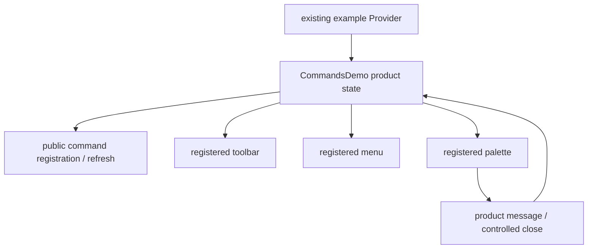

BUILD9999e289只新增[commands-demo.tsx](example/commands-demo.tsx)及main兩行整合；TypeScript/prod build及2path scope通過，569.17KB chunk提示保留。native browser：sv 文件跨field/subsequence、中文與canvas搜尋、空結果、ArrowDown/Enter一次、結果後return-focus開啟按鈕；disabled可見不可active、失敗保留面板、Tab留input、Escape/outside理由；800ms async pending時三入口儲存disabled，完成一次結果/關閉；dark與320×180有限面板、草稿跨開關/theme/viewport保留，最後error/warn空。main ignored build/evidence/react-command-example.png保存實際dark/search畫面。IME/外部焦點轉移/完整極端style與嵌套modal矩陣未於browser執行，感官human-pending。

| example定義 | 責任 |
| --- | --- |
| DemoContext／toolbarItems／menuItems | 產品條件及入口ID排列 |
| CommandsDemo／getContext | 產品state及最新ref讀取 |
| createCommands／save／wait／toggleGrid／fail／disposeCommands | 每setup新owner、async範例業務及cleanup |
| refreshContext／onResult／onDismiss | 清冊失效通知、產品原值結果及受控關閉 |
| openPalette／toggleSave／toggleFailure | 明確產品控制，範例不提供全域快捷鍵 |

## REACT-COMMAND-PALETTE-VIEWPORT-1（COMPLETE）

REACT-COMMAND-PALETTE-VIEWPORT-r1：native大參數匯入成功後window.innerWidth1280、document clientWidth1265（捲軸），panel1264/left0.4小於inset8；320viewport亦left0.4。原geometry對inner尺寸有限但與fixed containing block可用寬不同。bounded修復只`react/src/command-palette.tsx` observeViewport及private有效viewport讀取；首選ownerDocument.documentElement實際clientWidth/Height，無layout DOM client0合理fallback原window有限尺寸；若native client viewport變動，windowresize或可用原生ResizeObserver刷新同state。theme/query/session/commands/CSS及公開型別保持契約，不改其他module。

fresh隔離TestAuthor只new react/test/command-palette-viewport.test.mjs，保護client1265×705 vsinner1280×720的有效width<=1249/height<=689、同session視窗改變與finite fallback；既有11 palette checks hash不變。M1窄regression Red→Green（1k/10分鐘）、M2同11 public checks/build/native大參數/320邊距及exact1pathscope（3k/20分鐘）；cold2k～4k/15～25分鐘參照palette原BUILD；6k/35分鐘或CSS/其他來源要變回PLAN。

author a00fe4a2四項中3 behavior Red/1 fallback Green，SHA256 EECF13F973E41D40825EB784DFFF62A8E284336089BE7798583E7CF62C885925。修正observeViewport讀client（無layout合理fallback）、同window resize／native ResizeObserver；同尺寸保留state及cleanup listening guard。4新＋11既有全部Green、library/consumer prod build、1pathscope及兩tests hash不變；569.46KB chunk提示保留。native極大style import實際client1265→panel1249/左右約8，320inner/client305→panel289/左右約8；同open query sv 文件跨resize保留，還原style與dark操作後error/warn空。浮點位置7.9為native量測，不宣稱精確pixel；全部style參數與IME矩陣仍pending。新增private stopObserving只擁有observer cleanup，無CSS/其他module變更。


## REACT-COMMAND-ENTRY-GEOMETRY-1（COMPLETE）

修訂REACT-COMMAND-ENTRY-GEOMETRY-r1，依[共同有限入口](../docs/architecture/workbench-command-entry-geometry-contract.md)。publicconstructor與same command registry維持；既有command-entries.tsx的共享host／row沿現有nativeclient量測與局部有效CSS變數限制menu actualwidth／outerpadding及row padding／icon／gap，styles.css只入口區段接收effective變數；不能改其他component或stylepackauthority。有限父槽優先而非window寬，native可用ResizeObserver監測及samevalue防loop／cleanup；無layout DOM自然fallback，零尺寸native仍零。height由原scrollport保持自然內容，不以CSS巨大padding撐出有限邊界。

既有ID／order／condition／checked／async／focus節點及callback規則不改；style／size不重建core或產品state。只command-entries.tsx與styles.css入口區段兩writepaths；theme／core／palette／index／tests／config／example／arch唯讀。fresh TestAuthor只new react/test/command-entry-geometry.test.mjs；原12入口protectedtests保持。M1新finite公開checks與原12（3k／20分鐘），M2library／consumer TypeScript／scope2及nativebrowser正常／極端量測（6k／40分鐘）；cold-start3k～7k tokens／20～45分鐘，參照REACT-COMMAND-PALETTE-VIEWPORT-1及REACT-COMMAND-ENTRY-1；10k／60分鐘或需其他source回PLAN。無新公開geometrymodel／第二theme；感官仍human-pending。

BUILDaff1eaf4只上述兩path。fresh authordb3d4eef新11 Node tests基線3pass／8fail（含兩父項），SHA256 4A0A1367AF446966EAAB2237705DB0CE014AEA6DB5F5A4E92AAAE87816E3957A；修正後新11＋原12共23Green，原hash未改。librarybuild／tsconfig.example.json consumer型別／scope2／diffcheck通過。首次TS closure nullability失敗已以guard後const修正；錯誤的example/tsconfig.json檢查入口已更正，未改config。既有原tests的act警告仍保留記錄。

native tab10正常menu300px／outer4px、toolbarpadding16px；共用格線結果1同步。正式JSON匯入百萬pixel tight／padding／icon／gap／menuWidth後，parent client861下toolbarrow861／padding430.5，menu有效padding限制且row0；還原default後草稿與checked保持、error／warn空。native有限高度／精確窄viewport矩陣pending：此次viewport override並未套用tab10，actual仍1280×720，不宣稱320×180通過。

| 私有責任 | 呼叫與邊界 |
| --- | --- |
| `finiteLength` | 非有限／負值退化0，不改原pack |
| `useEntryGeometry`／`observe`／`measure` | parent內容client槽優先，入口client扣除捲軸；原生observer及resize listener cleanup、同值不重建 |
| 局部CSS變數 | 同semantic padding／border／icon／gap與有效menu外距；只作用入口區段 |

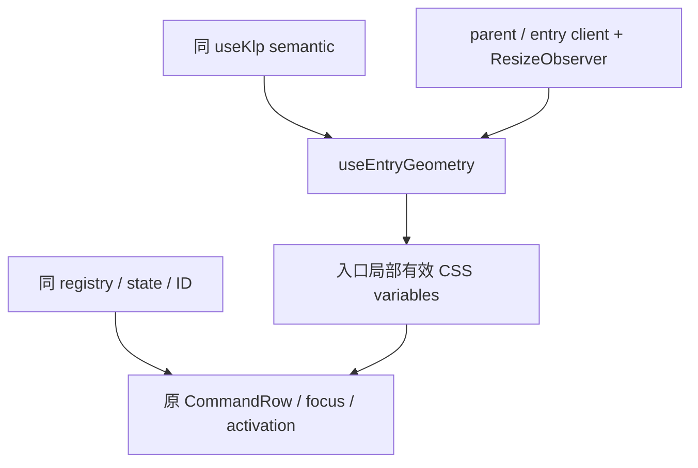

## REACT-COMMAND-POPUP-1（COMPLETE）

REACT-COMMAND-POPUP-r1，依[共同popup](../docs/architecture/workbench-command-popup-contract.md)。新`command-popup.tsx`擁有KlpRegisteredCommandPopup<C>／props、readonly KlpCommandPopupAnchor（x／y／width／height邏輯viewport像素）及KlpCommandPopupDismissReason union。props沿既有menu的registry／getContext／items／label／emptyLabel／onResult，另required open／anchor／onDismiss，可選className／id；不繼承geometry可覆蓋的style。index單向匯出。

同Provider DOM內native dialog showModal擁有top layer／inert；透明全viewport宿主可捕捉outside並提供非Tabstop的命名dismiss。有限positioned容器直接收KlpRegisteredCommandMenu autoFocus=true，不改rows／core。native client viewport優先，ResizeObserver與window resize更新client viewport／menu scrollHeight，cleanup與samevalue guard；自然無layout fixture可有有限window fallback。placement privatehelper與session/ref/focus lifecycle在同source。direction讀同scope原生direction；pack沿useKlp，不copy預設值／另Provider／portal全theme投影。

sameopen session的onResult先交最新產品callback、success且仍current再executed；error保持，callback拋錯沿hosterror。關閉／重開／卸載／registry replacement隔離stale；只在焦點仍屬此dialog時返回原仍可用owner，native dialog自帶returnfocus需要保留產品外部移焦選擇。closed不query／getContext／subscribe、不showModal。menu key handlers不重寫；Tab在menu可用元素閉合，無可用項root。anchor非法TypeError，point合法，style／viewport更新不重建registry或產品State。

BUILDwrite_paths：新`react/src/command-popup.tsx`、`react/src/index.ts`只新增exports、`react/src/styles.css`只追加popup scope；rootarch／theme／palette／core／entries／config／example／alltests唯讀。fresh TestAuthor只`react/test/command-popup.test.mjs`，公開DOM／SSR／typedconsumer與原生fixture保護共同anchor／finite／modal／state／session契約，不讀private實作。既有menu23及palette15checks保持。

cold-start5k～10k tokens／25～50分鐘，參照REACT-COMMAND-PALETTE-1／VIEWPORT-1；既有React19.3／TS7與DOM工具。M1controlled menu popup／finite geometry（5k／25分鐘）；M2fresh checks／librarybuild／scope3（10k／50分鐘）；13k／65分鐘或其他source需求回PLAN。consumer keyboard／右鍵browser與網站另packet；感官human-pending。

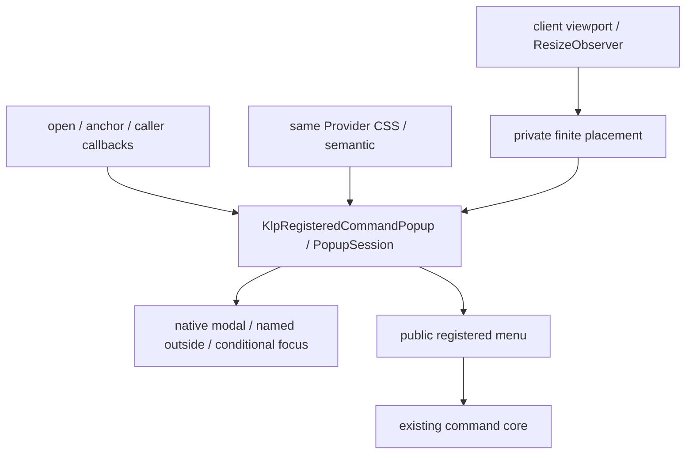

BUILD75c24b4e exact3通過；fresh TestAuthor SHA256 BBAA33EB6E318F8278871A295DB87E68A61CB468B411AACA2D331C2CFFAC898D，12checks含typedconsumer全部Green；原12 entry checks及hash保持，既有act警告保留。librarybuild／consumer TypeScript與diffcheck通過。RTL fixture缺computed direction時沿最近原生dir屬性，沒有第二方向權威。原生layout／inert／click-through與感官另browser-pending。

| 實際函式／介面 | 來源与責任 |
| --- | --- |
| KlpCommandPopupAnchor／KlpRegisteredCommandPopupProps／dismiss union | command-popup.tsx；readonly viewport anchor、同menu公開資料、受控開關與意圖，無style覆寫入口 |
| length／trailingEdge／placement | 同source；有限長度、先夾邊避免加總溢位、方向與上下較大側scrollport |
| KlpRegisteredCommandPopup | 驗證即使closed、registry replacement隔離key、closed不mountmenu |
| PopupSession／dismiss／result | 同Provider DOM與同公開menu；latest callback、controlled去重與active owner |
| attachModal／detach | native showModal／close、條件回焦及externalfocus保護 |
| observe／measure／update | native client／menu scrollHeight／direction，observer＋resize cleanup、同值guard |
| key／outside／escape／cancel／namedOutside | Tab閉合、只原生outside／Escape意圖，named nonTabstop dismiss |

## REACT-COMMAND-POPUP-EXAMPLE-1（COMPLETE）

REACT-COMMAND-POPUP-EXAMPLE-r1：只example/commands-demo.tsx增加同registry公開popup；產品以button.currentTarget.getBoundingClientRect提供anchor、contextmenu clientX/Y提供point並preventDefault。既有palette／handler／draft保持，popupOpen／anchor／dismissReason由產品state擁有；觸發及context區域用庫Button／Card／Text，不新增共用風格。library/tests/main/CSS/config/其他module唯讀。

M1公開consumer型別與exact1scope（1k／10分鐘）；M2 nativebutton／右鍵／outside／Escape／一次執行／focus／draft與同theme觀察（3k／20分鐘）；cold1k～4k／10～25分鐘，參照REACT-COMMAND-EXAMPLE-1；6k／35分鐘或其他路徑返回PLAN。reversibleconsumer不新增鏡像tests，未觀察native項與感官明示pending。

BUILDcb1c392d只該consumer source，TypeScript／scope1通過；showPopup／openButtonPopup／openPointPopup／dismissPopup擁有產品觸發及關閉。native tab10原生`:modal` true，client1265×720／panel300×85有限；button及右鍵point、Escape／outside無click-through／一次grid結果1、returnfocus開啟按鈕、draft「React 快顯保留草稿」與同Provider dark overlay #35322DFF觀察通過，error／warn空。main build/evidence/react-command-popup.png；窄尺寸／完整style矩陣pending，未用JSDOM充當native layout。

## REACT-COMMAND-KEYMAP-1（COMPLETE）

REACT-COMMAND-KEYMAP-r1依[共同快捷鍵core](../docs/architecture/workbench-shortcut-core-contract.md)，目前純core新增src/command-keymap.ts與index export exact2。KlpCommandKeymap<C>只擁有binding owner token／default及override／chord clock／explicit recorder；公開immutable types與constructor options沿同契約。validation、actual modifier投影、scope／priority／UTF-16 ID順位、chord與atomic import helper同source。execution只用既有registry，沒有另一handler、DOM／timer／focus／theme／l10n／storage權威，也不改menu或palette。

fresh TestAuthor只test/command-keymap.test.mjs；public exports/dist declarations、共同contract、既有purecore測試慣例與assigned file可讀，newcore私有實作不可讀。protectedpaths包括所有tests／registry／theme／components／config／example／architecture／Flutter。crosslanguage、atomic設定與chord風險必要新checks；基線缺API為Yellow，不宣稱behavior Red。cold5k～10k／25～50分鐘，參照REACT-COMMAND-CORE-1與POPUP-1；M1同public protectedchecks（5k／25），M2library build與scope2（10k／50）；13k／65或其他source回PLAN。native keyboard／editable／composition／focus adapter与GUI另packet；fixed順位、defaults還原及serialization只由common contract擁有。

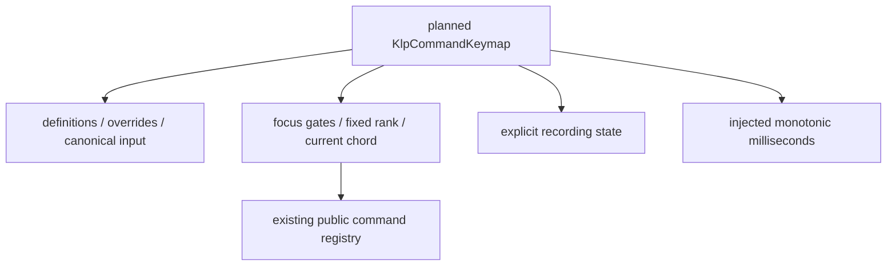

以上是READY責任，BUILD後owner補實際function／class索引；不能預寫聲稱已存在的helpers。

BUILD0b996490 exact2source，protected9 checks SHA256 127E0B72A6B61B190A5B6DD15F39436BF2953C3C07995913452F7F09584B4D6E保持、build／scope2／diffcheck通過。首次8Green／1Red為export DTO null-prototype不同於普通object，Object.fromEntries修正邊界後同9全Green，保留__proto__ ID安全；未改tests。native adapter另stage。

實際型別全部在[src/command-keymap.ts](src/command-keymap.ts)：KlpCommandKeymap唯一class；KlpShortcutStroke／Input／Focus／Binding／Handling／Conflict／Overrides及KlpCommandKeymapOptions為readonly公開shape；Platform／Scope／HandlingState／ConflictKind為union；Candidate借用當次owner及effective sequence。constructor驗證options及原生performance clock，getters公開disposed／recording／pending／recorded。register及disposer控制唯一owner。handle依copyStroke／copyFocus／flag／readTime→expireAt／sameFocus／composition→canonical／project→record或active→select→registry.execute。cancelChord／expireChord控制一步期限；conflicts以active／matches／compareConflicts產生穩定ID pair；setOverride／restore經requireBinding；exportOverrides產生普通immutable DTO；importOverrides以object／fields／copySequence原子替換。beginRecording／finishRecording／cancelRecording只管理explicit session，dispose只清自己的binding／override／session。requireOpen／requireBinding保護mutation；readTime驗證單調clock；expireAt清期限；record最多四stroke；active查when／同registry gates後compareCandidates；select取第一個匹配prefix。

所有top-level helpers：text驗證非空；flag驗證strict bool；object／fields保護wire object及unknownfields；canonical驗證logical scalar／named keys；copyStroke／copySequence／copyBinding／copyFocus隔離資料；project消解primary；sameStroke／matches精確modifier／prefix；sameFocus比整鏈；scopeActive檢查有效scope；lexical維持UTF-16 ID順序；compareCandidates比較scope／priority／ID，compareConflicts比較ID pairs；plainEscape辨識取消；handling製作非dispatch結果。constructor defaultclock、register disposer、select find及copy／matches／fields predicates是所屬函式的局部callback，無另一事件來源。

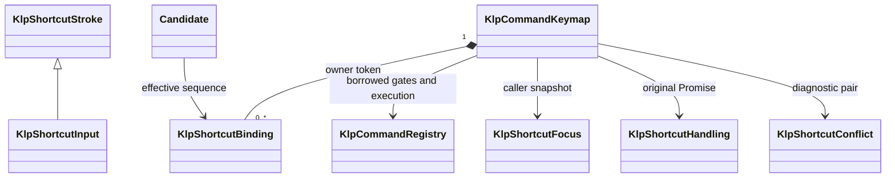

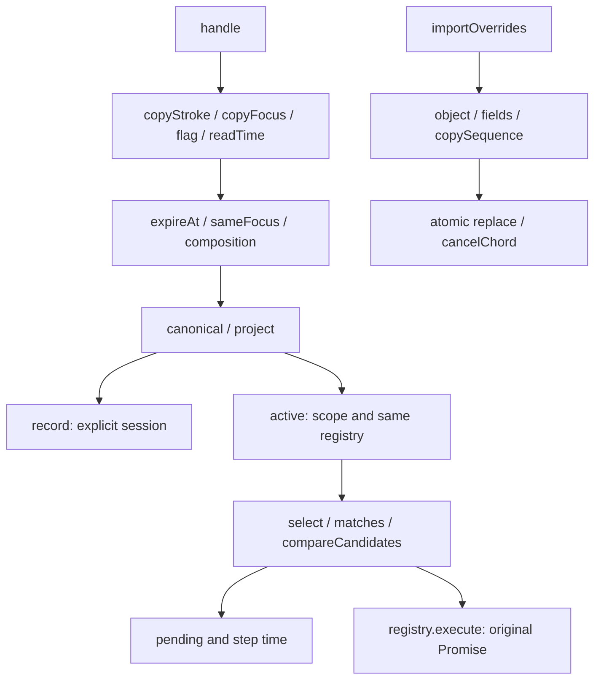
## REACT-COMMAND-SHORTCUT-HOST-1（COMPLETE）

REACT-COMMAND-SHORTCUT-HOST-r1依[共同native宿主](../docs/architecture/workbench-shortcut-host-contract.md)，新src/command-shortcut-host.tsx＋index export exact2。readonly public Props與neutral display:contents wrapper，同keymap借用/getContext/getFocus/onHandling/onResult/children；native keydown bubble／defaultPrevented保護、原生editable／composition／229、single timer、blur cleanup與same-session/latestcallback，不註冊document listener。不加共用style，不改core／registry／所有tests／config／example／Flutter。cold4k～9k／20～45分鐘，參照REACT-COMMAND-POPUP-1與KEYMAP-1；M1protected公開SSR/DOM/lifetime checks4k／20，M2build／scope2 9k／45，12k／60或其他write回PLAN。fresh TestAuthor只test/command-shortcut-host.test.mjs；基線missingAPI Yellow，nativebrowser／GUI另stage，act warnings不當作code結果。

BUILD64d9883f exact2source，protected6 publicSSR/DOM/lifetime checks SHA256 F73747DFCA15446033AED1DA46886EC01FC80B2E45E1913E3A0F6D7FCF0A57FB、build／scope2／diffcheck通過。最初5Green／1fixturefailure為JSDOM focus的zero-delay selectionchange錯算hosttimer，fresh作者僅將zero工作委派native scheduler、追蹤所有非零timeout，原期限/清理斷言保持。consumer／nativebrowser另stage。

實際[src/command-shortcut-host.tsx](src/command-shortcut-host.tsx)無class；readonly KlpCommandShortcutHostProps定義借用keymap、context/focus與兩結果回呼及children；private HostSession擁有mounted identity、single timer及composition。KlpCommandShortcutHost函式使用latest／owner refs及useLayoutEffect；nested attach/cleanup支援StrictMode、current核對alive/identity，keydown轉logical/native modifiers/原生文字組字與產品focus，先prevent/stop決定再onHandling，nested deliver保留原Promise並交同session latestcallback；blur清prefix、外離錄製，compositionStart取消prefix/timer、compositionEnd清nativeflag。回傳neutral display:contents div。top-level editable沿Element/Text父鏈保護input/textarea及最近有效contenteditable，false子區終止；cancelTimer解除owned timeout；clearSession清prefix及外離錄製/組字；updateTimer只新prefix重排期限、ignored保留；scheduleTimer/expire closure只publicexpiry，report交原生reportError或console诊斷且不破壞清理。此為所有helpers／callbacks，無global keyboard listener、無第二default theme。

```mermaid
flowchart TD
	Host[KlpCommandShortcutHost / attach] --> Owner[HostSession / latest refs]
	Key[keydown] --> Input[editable / logical modifiers / composing]
	Input --> Core[same keymap.handle]
	Core --> Timer[updateTimer / scheduleTimer / expire]
	Core --> Result[deliver / current / latest onResult]
	Core --> Handled[preventDefault / stopPropagation / onHandling]
	Blur[blur / compositionStart / cleanup] --> Clear[clearSession / cancelTimer]
	Clear --> Cancel[public core cancellation]
	Failure[projection or callbacks] --> Report[report / native diagnostic]
```
## REACT-COMMAND-SHORTCUT-EXAMPLE-1（COMPLETE）

REACT-COMMAND-SHORTCUT-EXAMPLE-r1只example/commands-demo.tsx exact1，公開KlpCommandKeymap／KlpCommandShortcutHost與同既有registry組合。產品effect擁有keymap及dispose，StrictMode每setup建freshowner；原命令handler／draft／toolbar／menu／palette／popup保持單一份，沒有另一handler。platform從產品瀏覽器環境投影mac/other，UI明示目前平台，OS保留鍵不保證可收到。

預設綁定：app document.save.primary為primary+s並allowInEditable，app document.save.chord為primary+k→s並allowInEditable；page commands的view.grid.primary與低priority duplicate同primary+g產生same-scope exact診斷；component draft的view.grid.editor同primary+g、allowInEditable，示範精確scope勝過page；region commands的document.fail.region為alt+shift+f，沿既有showFailure gate。getFocus(target)由產品WeakMap給原生Element穩定非空ID；有效鏈page/region commands，草稿component draft，其餘component可缺省。純core用同context/ref，onHandling顯示原state／binding／prefix／record與最新有效conflicts，onResult沿原產品result出口。

所有UI用public庫Button／Card／Text／TextField，neutral nativeWrap/Focus區域只作產品布局及事件，不另寫共用視覺。新增可聚焦的KlpSurface等效Card/Text錄製區（public Card／Text），產品按鈕先原生focus再beginRecording該focusID；explicit錄製最多4stroke，不dispatch，finish非空才setOverride(document.save.primary)，cancel／restore可操作。以publicTextField呈現JSON overrides，save/export、load/JSON.parse/import及invalid message；錯誤保留原keymap設定，不在產品重實作validation。產品outer blur重繪讀core現在狀態，不建第二錄製權威。local settings不持久化業務資料，單一產品輸入draft跨操作/theme保持。最後unmount產品disposekeymap，再dispose同registry；library／tests／config／main／CSS／Flutter唯讀。

此reversibleconsumer由既有protectedcore/host tests保護，不新增鏡像tests。cold3k～7k／20～40分鐘，參照REACT-COMMAND-POPUP-EXAMPLE-1；M1 typedconsumer／scope1（3k／20），M2 nativebrowser focusedbutton與draft save/grid/chord／ignoredtext／scope/conflict／record不執行／apply/cancel/restore／valid-invalidimport／draft／一次result（7k／40）；10k／55或跨path需求回PLAN。nativeIME全套及保留OSkeys、感官human-pending，未觀察項明示。websitebundle/全部component specimen另stage。

實作e56976aa exact1source，公開consumer TypeScript、scope gate與diff check通過。native browser已觀察草稿Ctrl+S、Ctrl+K→S各沿原save結果，draft Ctrl+G勝出view.grid.editor、錄製區Ctrl+G勝出view.grid.primary並顯示same-page exact衝突；停用save時ignored，region Alt+Shift+F沿原錯誤出口。explicit錄製Ctrl+Shift+Y不增加執行次數，套用後實際儲存；a→b→c→d後第五鍵ignored，Escape與取消按鈕清錄製；restore匯出空bindings並恢復Ctrl+S。有效JSON改Ctrl+Shift+U可儲存，unknown binding／JSON語法錯誤有原錯誤回饋且保留舊覆寫；深色切換保留草稿「快捷鍵仍保留的草稿」。結果從0到8對應save×5（primary初次、錄製、匯入、chord、restore primary）、grid×2、failure×1；錄製操作不增加命令執行次數。完整IME／四模式／極端風格／窄viewport矩陣及感官仍pending。

### CommandsDemo 快捷鍵增量職責

| 定義 | 實際責任 |
| --- | --- |
| getFocus | WeakMap原生Element穩定ID；產品page／region／draft與設定欄位editable投影 |
| createCommands／disposeCommands | 同effect新registry與keymap，六個預設binding；keymap先dispose |
| refreshShortcuts／onHandling | 觸發重新讀core及保存原handling顯示；不維持第二錄製權威 |
| beginRecording | 聚焦recorder實際節點再開始錄製 |
| applyRecording／cancelRecording／restoreShortcut | finish非空套save.primary；取消／恢復預設 |
| exportSettings／importSettings | 公開DTO序列化及核心原子匯入；捕捉原錯誤 |
| describeStroke | 顯示平台primary及原始修飾鍵，沒有鍵盤轉換演算法 |
| CommandsDemo state／refs／derived JSX | keymap同owner生命週期；handling為最後事件；revision僅重繪；settings／settingsMessage屬產品暫存；recorder／focusIds／focusCounter為原生目標識別；focus／conflicts讀當次核心；shortcutContent／content以public元件組裝 |

```mermaid
flowchart TD
	Setup[createCommands] --> Registry[既有 registry 與 handler]
	Setup --> Keymap[產品 keymap / 六個 binding]
	Native[實際原生鍵盤] --> Host[KlpCommandShortcutHost]
	Host --> Focus[getFocus / getContext]
	Host --> Handle[onHandling / refreshShortcuts]
	Host --> Result[既有 onResult]
	Record[beginRecording / 原生 focus] --> Keymap
	Apply[applyRecording / cancelRecording / restoreShortcut] --> Keymap
	Settings[exportSettings / importSettings] --> Keymap
	Keymap --> View[describeStroke / conflicts / public 元件]
	Cleanup[disposeCommands] --> MapDispose[keymap.dispose]
	MapDispose --> RegistryDispose[registry.dispose]
```

## REACT-REFERENCE-COMPONENTS-1（COMPLETE）

修訂 REACT-REFERENCE-COMPONENTS-r1，依共同 IDOC-COMPONENT-REGISTRY-r1，只建立scripts/reference-components.mjs。BUILD不改公開庫／example／網站／package／tests／architecture。公開boundary為export function extractReactComponents(entrypoint, packageRoot)，必要參數為絕對d.ts entry檔及package root；不改原build scripts。CLI node scripts/reference-components.mjs --output <path>讀目前package dist/index.d.ts，預設輸出ignored build/reference-components.json；先完成診斷及JSON資料再write，失敗保留舊檔。

TypeScript compiler解析真實public export symbols，alias解析到實際declaration；只接受function或callable variable的明確React return annotation（JSX.Element、ReactElement、ReactNode，qualified/import type及nullable union），排除同名其他模組的Element／非React物件、type-only export、一般函式、data class與private unexported。namespace JSX僅來源為react／react JSX namespace才可；return annotation alias解析到React定義，不能用字串包含比對。由export名形成id/name，source為package-relative POSIX且不能越root，signature為原callable declaration文字，propsType為首參數型別文字或空字串。stable UTF-16排序，每個export一筆，alias與original可各有自己的publicID；不存在／invalidpath／compiler errors拒絕。

真實cross-module runtime registry需要正確辨認barrel／alias與排除data，其邊界不能用人工清單或固定數目證明。fresh TestAuthor只react/test/reference-components.test.mjs，用暫存d.ts fixture及既有public exports保護，implementation不可改tests。cold3k～6k/20～35分鐘，參照website canonical manifest；M1 protected公開extract success/exclusion/alias/failure Green（3k20）；M2真實dist全量JSON、source/scope1/diff（6k35）；8k45或需private/config write回PLAN。兩端registry／React route與website renderer後續各module BUILD，不以清單宣稱展示完成。

```mermaid
flowchart TD
	Public[dist/index.d.ts exports] --> Compiler[TypeScript program / diagnostics]
	Compiler --> Alias[resolve public alias]
	Alias --> Return[React return annotation identity]
	Return --> DTO[extractReactComponents / stable components]
	CLI[CLI output argument] --> DTO
	DTO --> Write[成功後寫ignored JSON]
```

### REACT-REFERENCE-COMPONENTS-1 實作證據與職責

1ae31d6f exact1source；fresh TestAuthor fa952106 protected6 checks全部Green，SHA256C0192DC517D076B39AB52D550ECE8F17C6EF79C4F932DD14FE409ACC4A3612ED保持。真實dist產生23個public components／108個exports，含generic nativehost與nullablepopup；資料class／interface／utility排除。NodeCLI成功、失敗保留原JSON、宣告越root拒絕、type-only named／star與alias真正Reactidentity有獨立證據；scope1/diff Green。TS7.0.2公開unstable/sync API使用native process，API/snapshot在finally清理；虛擬config強制skipLibCheck=false且不改repo config。不宣稱23個展示已完成。

| 定義 | 實際責任 |
| --- | --- |
| extractReactComponents | 根與entry驗證、虛擬config、全diagnostics、runtime graph／return identity、排序DTO；finally清nativeAPI |
| nested isConfig／fileExists／readFile | 虛擬config限定投影，不寫設定檔 |
| inside | realpath後package ownership與POSIX source轉換 |
| compareComponents | UTF-16名稱排序 |
| unalias | TypeScript公開symbol alias解析 |
| typeOnly | 檢查宣告及祖先type-only旗標 |
| runtimeNames | own value與named/star re-export graph、剔除type-only、循環分支停止 |
| reactReturn | qualified/import/nullable/alias annotation回到@types/react權威，排除fake與Promise |
| main／entryguard | script所屬package、嚴格CLI args、成功後寫JSON、stderr原錯誤非零exit |
| callbacks | diagnostic message映射、signature declaration解析／尋找、DTO id去重；runtime modifiers與source handles、return union檢查皆無額外權威 |
| DTO／config fields | schemaVersion／framework／entrypoint／components維護輸出識別；id/name公開alias、sourcepackage-relative、signature原宣告、propsType首參數；compilerOptions/files僅本次檢查，fs投影限定單config |

## REACT-COMPONENT-SPECIMENS-1（COMPLETE）

修訂REACT-COMPONENT-SPECIMENS-r1，依IDOC-COMPONENT-REGISTRY-r1與真實23公開清單，只write example/specimens.tsx、example/main.tsx（入口讀specimen query的最小分支），example/commands-demo.tsx（可選public target以集中compound入口；不要求必須改）。public imports @kallopis/react／styles.css；舊App總覽仍獨立。registry以真實public names逐一fn/component，23項全部要有實際target，不以counter或空placeholder補項；函式資料型別不放進清單。unknown／empty specimen query顯示明確錯誤及返回展示入口，不退總覽。

SpecimenApp由publicProvider承載四模式、baseline及另一pack（applyKlpStyleOverrides調語意間距，不複製預設style）、320/760可用寬度；style切換保持產品state，重設以key重新建立當前fixture與輸入。每頁h1/public import/use example與自己的params及callback state可看，width容器只定義產品測量空間，不寫共用style。Text／Surface／Badge／Card以自己的text/tone/header等props變化；Button／IconButton size/tone/selected/disabled與clickcount；TextField實際value/error/disabled；Frame／Workspace以header/footer/sidebar與產品輸入；ThemeProvider mode/pack及semantic讀值示範。layout compound各target傳自己的flex/bounds/alignment/inset與publicPane/Spacer/Divider組装；target顯示名稱，每個route選中的實際變數可操作，不能用一個無關Layout總覽冒充六項。DockLayout沿既有DockDemo（同公開dock及原生操作控制）。registered toolbar/menu/palette/popup/shortcut host共享產品registry，但route須呈現對應target與相應open/items/gate/result／nativefocus或recordcontrols；public入口共用原registryhandler，不造fakecommand，不複製library內部視覺。共享fixture以props target選actual element，沒有反向library依賴。

reversibleconsumer不新增鏡像tests，必要check為publicTS、registry names與真實extract inventory雙向核對、scope exactpaths、nativebrowser全部route可達及主要props/callback/reset/style/draft/鍵盤。cold8k～14k/45～75分鐘參照CommandsDemo/layout/dockconsumer；M1全部23publicfixtures typed／manifest對照（7k40）；M2native route及control/reset/draft/style/unknown error（14k75）；18k95或library/CSS/config write返回PLAN。網站iframe/generator/build-prefix與Flutterconsumer歸後續module，不以此consumer宣稱全部網站已完成；感官human-pending。

### 專屬展示實作證據與函式職責

BUILD bdd22417 exact3來源；公開TypeScript與production example build通過，scope3與diff check Green。真實extract inventory與展示導覽皆23個公開identity，各route在原生browser載入實際target；16個basic/layout route的專屬參數可操作。Button click一次、reset只重建fixture並保留展示環境；Explorer selection／collapse回呼2次。Provider寬鬆pack contentStackGap解析24、ultraDark與transparent切換後原草稿保留；Button深色／寬鬆／320可用寬度保留state。命令palette搜尋格線Enter與popup/menu格線各一次原結果；shortcut草稿Ctrl+G勝出view.grid.editor；Dock切Search提交1次、保存JSON及深色／寬鬆保留場景輸入。unknown route明確報錯。這是專屬route增量觀察，原dock完整drag／resize與快捷鍵完整矩陣沿先前證據，不重複宣稱本次全部執行。320是展示測量容器，不冒充瀏覽器viewport。感官及網站iframe/bundle仍pending；production bundle602.51KB警告保留。

原生載入曾因展示自訂pack引用不存在space500造成空頁；原因是consumer寫錯正式primitive ID，改用已存在space600後原載入回歸成功，未改validator／tests／default權威。

| 來源／定義 | 實際責任 |
| --- | --- |
| specimens.tsx／SpecimenProps、specimens、reactSpecimenNames、modes | name為當次公開route identity；own key映射真實fixture；排序導覽及四模式環境，資料型別不冒充元件 |
| SpecimenApp、reset、togglePack、toggleWidth | Provider擁有mode／alternate／width，base與spacious均由同正式pack生成；epoch只explicit reset；own-property registry查找拒絕unknown／prototype名字 |
| BasicSpecimen、click、toggle、toggleDisabled、select、expand | text／changed／disabled供自己的target props；count觀察原回呼，selection／expanded為Explorer caller資料；switch呈現10種實際publictarget；input與event callbacks保存caller state |
| LayoutSpecimen、toggle | changed僅影響當次target的inset、preferred、flex、hidden或alignment／spacing；text保存compound內草稿；finite測量容器與合法公開Row／Column／Pane／Spacer／Divider，不改其他target參數 |
| ThemeSpecimen | useKlp顯示Provider真正mode／semantic解析值；uncontrolled原生欄位證明Provider切換不重建consumer |
| CommandSpecimen | 選定public入口與其必填props使用片段，呼叫同CommandsDemo，無第二命令handler |
| DockSpecimen | 同公開DockDemo與真正required constraints/onLayoutChanged使用片段；panel close由既有callerpanel callback負責 |
| CommandsDemo新增specimen／showPalette／showPopupEntry／JSX條件 | 可選公開target，專頁只呈現當次入口及其controls；無query時保留原overview各入口，仍同keymap／registry／結果出口 |
| main.tsx query／入口 | query存在才SpecimenApp，空值交明確error；無query維持原App，不引用private庫 |
| nested callbacks | modes.map設定環境；names.map導覽；各state updater／輸入onChange只保存當次caller state，無共享style或layout演算法 |

```mermaid
flowchart TD
	Query[main query specimen] --> Lookup[SpecimenApp own public registry]
	Lookup --> Error[unknown / empty 明確錯誤]
	Lookup --> Theme[同公開 Provider / mode / pack]
	Theme --> Basic[BasicSpecimen / props / callbacks]
	Theme --> Layout[LayoutSpecimen / own target / finite compound]
	Theme --> Provider[ThemeSpecimen / useKlp]
	Theme --> Commands[CommandSpecimen / selected CommandsDemo]
	Commands --> Core[既有 registry / keymap / 原結果]
	Theme --> Dock[DockSpecimen / 同 DockDemo]
	Reset[explicit reset / epoch] --> Lookup
	Pack[theme 或 pack 切換] --> Theme
	Pack --> Preserve[fixture identity / 原草稿保留]
```

## REACT-SPECIMEN-REGISTRY-1（COMPLETE）

修訂REACT-SPECIMEN-REGISTRY-r1，依IDOC-COMPONENT-REGISTRY-r1。exact example/specimen-registry.mjs、example/specimen-registry.d.mts、example/specimens.tsx。將既有23個真實name→fixture種類資料移到example持有的純ESM registry，Node網站可直接import，不解析TSX或另複製名稱表。mjs export reactSpecimenRegistry（name→basic/layout/command/dock/theme），d.mts只公開既有fixture種類的聯集與唯讀record；specimens.tsx用五個既有實際factory解引用，reactSpecimenNames仍由同registry derivation取得。既有所有fixture props/state與unknown query保持，null overview/main入口不改。

此步不建立網站iframe或coverage完成宣告，後續website module以公開registry與reference-components清單完整對照。僅移資料權威，沒有新增持久格式/演算法；沿用example type/prod build、Node registry對正式清單雙向比較23，native一個原route與unknown；scope exact3/diff。library/tests/config/website皆readonly。感官human-pending。歷史React23 specimen與Flutterconsumer估2k～4k/15～30分鐘；M1 ESM public boundary/type/build（3k20），M2 inventory/native/scope（4k30）；6k45或需config變更回PLAN。

| source／function | 責任 |
| --- | --- |
| example/specimen-registry.mjs | 同example與網站共用的name→實際fixture種類唯一資料 |
| example/specimen-registry.d.mts | ESM公開readonly record與fixture種類型別 |
| example/specimens.tsx specimens／reactSpecimenNames | 五種實際factory與registry組裝，不建立第二名稱權威 |

```mermaid
flowchart LR
	Registry[example ESM registry] --> Example[specimens / factory mapping]
	Registry --> Website[網站 consumer / 後續slice]
	Example --> Existing[既有23 own fixture]
```

BUILD exact3source，Node讀公開ESM清單與fresh extractor23完全雙向一致，type/prod example build成功（602.78KB既有bundle超500KB提示保留），scope3/diff通過。native原Pane preferred90→150、unknown明確拒絕且不退總覽。fixture/state/公開庫/config未改，感官human-pending。初次預設artifact不存在，執行既有extractor生成後比較成功，不從不存在產物推測coverage。ESM registry Object.freeze固定name與種類，d.mts限制readonly聯集；specimens由Object.entries＋既有五factory建立Record，names由同資料Object.keys排序，沒有第二名稱表。
