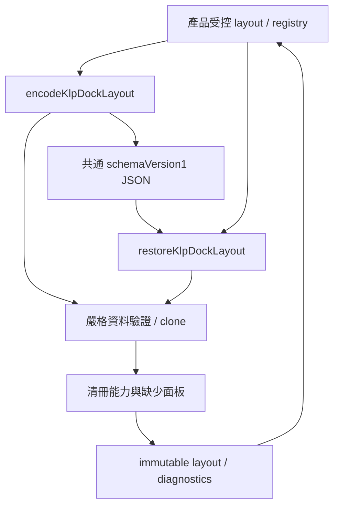
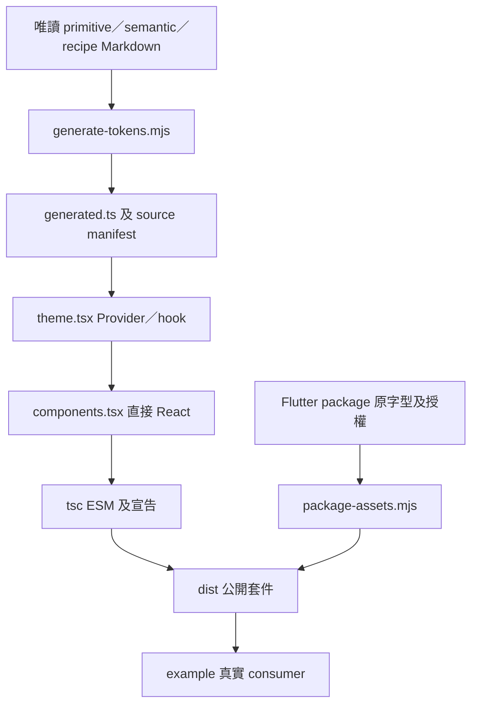
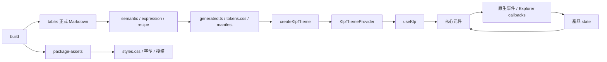
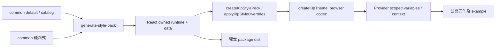
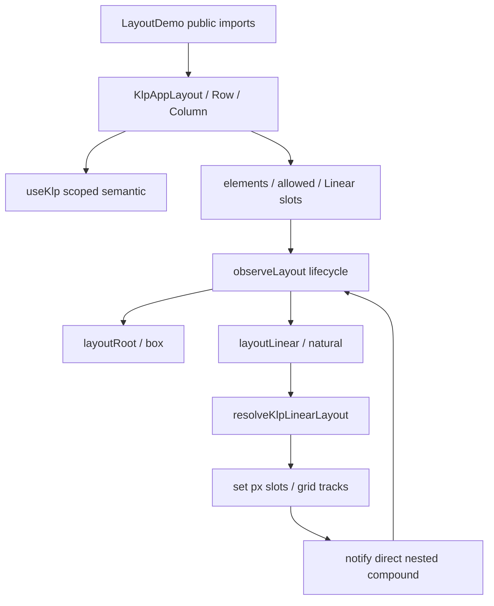

# React Foundation

## REACT-DOCK-STATE-1（完成）

修訂 `REACT-DOCK-STATE-r1`；沿用 [WB-DOCK-STATE-r1](../docs/architecture/workbench-dock-contract.md) 的完整 wire／拒絕／reconciliation 契約。src/dock-layout-state.ts 是純資料邊界，不依賴 React、DOM、theme 或 storage；公開函式 encodeKlpDockLayout(layout) → string、restoreKlpDockLayout(source, panels) → KlpDockRestoreResult，由 index 匯出。TypeError 擁有非法 JSON／資料／清冊／capability 錯誤，失敗不修改產品原 layout。

公開 readonly interfaces：KlpDockLayoutData 必含 left／right／bottom；KlpDockAreaData 的 axis 是 horizontal／vertical，isVisible boolean、extent number、groups readonly KlpDockGroupData[]；KlpDockGroupData 必含 id、panelIds readonly string[]、activePanelId、mainAxisExtent。KlpDockPanelPolicy 必含 id，allowSide／allowBottom optional boolean（undefined 視為 true）；KlpDockRestoreResult 必含 layout、missingPanelIds、availablePanelIds。encode 驗證 native layout 的同一完整欄位，不自動刪除未知欄；restore 只接受 JSON string，所有 schema 欄位依共通 strict 契約。registry 接受純 policy（id、兩個 optional capability）；拒絕未知欄及非 boolean capability。空 area／registry 合法，結果所有物件及 arrays 深層 freeze，原輸入不 freeze、不寫入。schemaVersion 數值1接受 JSON lexical1.0，保持 JS／Dart 一致。

資料 parser 擁有 exact fields／id／finite／全域 identity；serializer 只對 validated snapshot JSON.stringify；reconcile 擁有 missing 順序／active fallback／empty group／available 清冊順序。使用 pure functions 是因無 lifecycle 或 storage；不新增 repository、通用 UI node 或第二套正文權威。已有 Flutter codec 是跨語言契約參考，只讀公開 wire 及 Test Author inline sample，不引用其私有 implementation。

BUILD write_paths 僅 react/src/dock-layout-state.ts、react/src/index.ts；architecture、其他 modules／components、theme、generators、example、CSS、配置、styles、tests 唯讀。Test Author 唯一可寫 react/test/dock-layout-state.test.mjs，從 dist/index.js 測公開 API，採 flutter/test/dock_layout_codec_test.dart 同一手寫 wire 成功／拒絕樣本。不改 Flutter tests、fixtures 或實作。

M1 公開 native interfaces／strict parser／encode／restore：手寫 wire 與拒絕 checks；M2 reconciliation／freeze／package boundary：protected tests、library build、typed consumer、scope。cold-start 4k–8k tokens／30–60分鐘，參照 FLUTTER-DOCK-STATE-1（7 checks、兩個write paths）；超過12k tokens／90分鐘或需要重設 Flutter model／Dock UI 時回 PLAN。保存與跨語言風險由 fresh Test Author 固定測試，無感官驗收。此 slice 不代表雙框架Dock UI補齊已完成。

## REACT-LAYOUT-2（完成）

修訂 REACT-LAYOUT-r1；沿用共通 WB-LINEAR-UI-r1 與已完成 resolveKlpLinearLayout。此 slice 提供一般直接元件，不修改 Dock、命令、風格權威或既有 Frame。公開新增 KlpAppLayout、KlpLayoutRow、KlpLayoutColumn、KlpLayoutPane、KlpLayoutSpacer、KlpLayoutDivider、KlpLayoutBounds 與 props 型別；原有 KlpWorkspace／KlpFrame API 保持。

KlpLayoutBounds 是 readonly optional minimum／maximum／preferred，預設 minimum0、無額外上限、無 preferred。Row／Column／Pane 的 flex 預設1，有限非負（可 fractional）；Spacer flex 預設1且必須大於0。Row／Column 的 spacing 是 standard（預設）／none，alignment 是 start（預設）／end，sizing 是 fill（預設）／content。Pane 不預設材料／角色寬度，接受原生內容；產品固定大小由 bounds 或自然內容指定。Divider 只接受 key／原生 div 可及屬性，無 drag 行為與 flex／bounds。

Row／Column 接受至少一個直接 layout child，允許 React Fragment／null 條件組合，合法 child 為 Row／Column／Pane／Spacer／Divider；只檢查本 compound 的直接 slots，不檢查 Pane 內產品 tree。Root 只接受單一 Row／Column／Pane，inset standard（預設）／none。所有元件接受原生 div 屬性／ref；children 為 React 直接內容，沒有外部 node schema 或 adapter。預設沒有第二份品牌風格。

fill 使用 enclosing definite CSS content box，寬高100%、min-width／height0，尺寸由 ResizeObserver 與掛載前量測取得，不從 window 推估。有限主軸使用公開 solver，無 preferred 正 flex 從 minimum，零 flex 使用有限自然尺寸。content 明確要求主軸自然尺寸（Web 沒有 Flutter 的 Infinity constraint 訊號），此軸 flex 不增長，budget 是 clamped natural／preferred 與 gutter 總和；cross 為有限 enclosing 尺寸或內容自然最大值。未給 enclosing definite 高度時 CSS 自然高度是有限 budget，不保證填滿視窗。消費者需提供符合欲用 fill 軸的 enclosing CSS 尺寸；沒有隱藏 viewport fallback。

自然量測可暫時讓現有 slot 脫離配置、使用 max-content／auto，量測後同一同步階段恢復；不得 clone／duplicate React 內容、重掛載、改輸入 state 或 callback。每槽 overflow hidden 與 min尺寸0；本庫鎖定內部 grid／track／gap／box sizing 防止 consumer style 破壞分配；consumer 可指定宿主外部 width／height 等。原生產品內容自身是否支援有限自然尺寸仍是 caller 契約。

gutter、explicit divider、root inset 沿用 common；spacing 只讀 scoped theme.spacing.space2（logical px）。Root 每側 min(gap,width／2) 與 min(gap,height／2)。Row／Column 每層只扣自己的 gap；divider 抑制相鄰隱式 gap，連續各一份，none 僅取消隱式。最大尺寸 unused 依 alignment 留白。非法 bounds／flex 於 render 或量測前同步 Error（需辨識欄位），不寫 caller；natural 或容器無法產生有限值明確拒絕。

首次 client useLayoutEffect 量測，ResizeObserver 追蹤宿主／直接 slot 內容，內容 childList／characterData 變更與 load／字型完成也觸發重新量測；不得用自身 style MutationObserver 無限循環。數值／tracks 相同不更新；父 compound 完成槽或 inset 配置後，以私有、不冒泡的 DOM 尺寸通知讓直接子 Row／Column 同步重算，避免首次掛載巢狀錯用尚未配置的尺寸；它不暴露 state／產品事件 API。observer、事件與暫態樣式在 cleanup 還原，StrictMode及 unmount 不留全域狀態。沒有 ResizeObserver 時保留首次量測與 resize listener fallback，不能假裝持續尺寸觀察已完整。SSR／hydration 使用相同可及 DOM 與有限 CSS fallback，server 不執行 DOM，掛載後才完成算法配置。

來源 src/workbench-layout.tsx 擁有公開元件／直接 child 合法組合／hooks。src/workbench-layout-dom.ts 擁有宿主 content box、自然量測、DOM solver 投影及 observer lifecycle；理由是 DOM 幾何邊界與 React state 不同變更來源。兩者只讀 theme 與公開 pure utility。index.ts 匯出新元件。每個 direct slot 以 inline px width／height 投影 solver 尺寸；root 以 inline px padding 投影有效 inset。測試可從標記定位並觀察此配置，原生瀏覽器另驗證實際 geometry。初次內容尺寸優先讀 computed px content box，無 CSS layout 引擎時可由 getBoundingClientRect 觀察替代；ResizeObserver 通知重新量測同一邊界。公開 DOM 標記 data-klp-layout 為 root／row／column／pane／spacer／divider；配置槽 data-klp-layout-slot 為 content／gutter，供可及診斷與外部測試定位，不是 state API。

BUILD write_paths 僅 react/src/workbench-layout.tsx、react/src/workbench-layout-dom.ts、react/src/index.ts。architecture／所有 tests／example／CSS／配置／generator／styles／其他 module 唯讀。Test Author 唯一寫 react/test/workbench-layout.test.mjs，使用公開 dist、jsdom 原生測量／observer seam；必要 Browser evidence 後續透過公開 consumer 同時觀察 default／极大 gap／bounds／容器及 scope 更新，不能由 jsdom synthetic rect 冒充原生瀏覽器 geometry。example 新展示由下一個獨立 slice 接入，BUILD 不擴張。

驗收：public exports／typed API／SSR、nested slot bounds、dividers／minimum 退化／極大 gap／root inset、自然 sizing、native slot clipping、容器與 theme 更新、caller identity／input state、非法值／child診斷、observer cleanup。掛載執行不依賴 private consumer imports；感官品質 human-pending。M1 API與DOM geometry，M2 lifecycle／protected checks／package build／scope。cold-start 8k–16k tokens／60–120分鐘，參照 FLUTTER-LAYOUT-2 與 REACT-STYLE-1；超過24k tokens／180分鐘或需改既有元件回 PLAN。

採量測後 grid track 是為執行同一數值 solver 並遵守極端不足退化；單靠 CSS flex 無法保證同一 minimum 壓縮與 capped redistribution 契約，因此不另留一條正式算法。

[React useLayoutEffect 官方契約](https://react.dev/reference/react/useLayoutEffect) 支持 paint 前 client 量測與 cleanup；[ResizeObserver 文件](https://developer.mozilla.org/en-US/docs/Web/API/ResizeObserver) 支持元素 content box 更新觀察。

## REACT-LINEAR-1（完成）

沿用 [WB-LINEAR-r1](../docs/architecture/workbench-linear-contract.md)，新增純幾何公開 utility `resolveKlpLinearLayout` 與 `KlpLinearItem`／`KlpLinearLayoutResult` 型別，為下一個 Row／Column／Pane slice 提供算法。`src/linear-layout.ts` 僅依賴 JS 數值運算；`src/index.ts` 匯出；不依賴 DOM、React、style pack 或產品 UI 模型，不修改既有 components。

BUILD write_paths 只有 `react/src/linear-layout.ts`、`react/src/index.ts`；其他配置、架構、tests、example 與 styles 唯讀。Test Author 只可寫 `react/test/linear-layout.test.mjs`。幾何、不足空間、巨大有限值、immutable 與非法輸入依共通契約保護；build、受保護 checks、scope 全過才算本 slice 完成，不宣稱 UI 布局完成。M1 公開算法、M2 checks／build／scope；cold-start 3k–6k tokens／20–45 分鐘，參照 STYLE-PACK-2 的不可變邊界。

修訂：`REACT-FOUNDATION-r1`；已實作；需求見 [React v1](../spec/react-foundation-v1.md)。Module 擁有 `react/`，正式規範與 Flutter 資產來源唯讀。

## 公開入口

套件 `@kallopis/react` 匯出 React 19 元件、TypeScript 型別、`klpPrimitives`、`klpRecipes`、`klpThemes`、`createKlpTheme(mode)`、`useKlp()` 與 `KlpThemeProvider`；`@kallopis/react/styles.css` 接入 package 字型與共用元件樣式。React 為 peer dependency，不把另一份 React 打入庫。

第一版元件：`KlpText`、`KlpSurface`、`KlpCard`、`KlpBadge`、`KlpButton`、`KlpIconButton`、`KlpTextField`、`KlpFrame`、`KlpWorkspace`、`KlpFileExplorer`。不宣稱完整 Flutter API 等價。原生 React children／DOM 與 consumer state 可直接使用，不建立 declarative node／adapter／renderer runtime。

Provider 必須明確出現在 tree；`useKlp` 缺 provider 時拋出可辨識錯誤。預設 mode 為規範 light；mode 支援 light／dark／ultraDark／transparent。透明模式不替產品建立宿主視窗。所有 350 個語意在每個 mode 皆可取得；不存在的語意或 recipe 必須失敗。

Explorer props：`sections` 為平坦 section 與 item 投影（id、label、items、可選 icon）；`expandedIds` 與 `selectedId` 由產品提供；`onToggle(id)`、`onSelect(id)` 回到產品。section 使用原生 button 的 `aria-expanded`，item 使用可按鈕化選取列表，Enter／Space 可操作；不另設產品 node 模型。`KlpIconButton` 的 `label` 必填；`KlpTextField` 的 `label` 必填並連接 input ID。

## 資料與建置

`scripts/generate-tokens.mjs` 只讀正式 `primitives.md`、`semantics.md`、`recipes.md`；完整解析 primitive 值、四主題 semantic 引用／array／add 與所有 recipe ID／繼承／設計參數。引用缺失、重複 ID、semantic／recipe 繼承循環、未知 theme 表達式皆拒絕，不使用 eval 或 snapshot JSON。原 recipe 表達式與未實作角色完整保留供語意查表，不宣稱所有 recipe 已可轉任意 DOM。

生成 `src/generated.ts` 與 CSS variables；生成檔不手改。manifest 記錄 primitive／semantic／recipe ID 清單及正式來源 SHA256。`--check` 比對產物與現行來源，不能只確認數量。字型從 Flutter package 的原始資產取得，打包時複製至 React 自己的 dist/fonts 並保留授權；Web 的 family 移除 Flutter package 前綴是明確平台轉換，不新增字型預設。

`src/theme.tsx` 提供 Provider／hook、配方取得、顏色及字體平台轉換。`src/components.tsx` 為直接 React 元件；有獨立 style resolver 的原語可抽到 `src/styles.ts`。`src/styles.css` 提供互動 selector、鍵盤 focus 及 layout，只使用語意或從配方導出的 CSS 變數。`src/index.ts` 為公開 barrel。

Library 以 TypeScript 編譯成 ESM＋宣告，style 與字型由 build script 安裝到 dist；`package.json` exports 不指向原始 TS。`example/` 是以公開套件入口建立的 consumer，使用 Vite 預覽及 production build；不要把 example 當庫入口。React 19、TypeScript、Vite 的實際版本由 npm registry 與 lockfile 固定，不發布 npm。

## Slice 與範圍

唯一 slice：`REACT-FOUNDATION-1`，涵蓋 RF-01～07。Implementation write_paths：`react/src/**`（排除 Test Author 路徑）、`react/scripts/**`、`react/package.json`、`react/package-lock.json`、`react/tsconfig.json`、`react/vite.config.ts`、`react/example/**`、`react/README.md`。`architecture.md`、共通規範、其他 module 及 tests 唯讀。

獨立 Test Author 擁有 `react/test/**`，以公開 ESM export、Node tests、React DOM／SSR 及必要 jsdom 觀察 deterministic 契約；tests 必須在 build 後執行。必要新測試的風險是規範轉為四主題資料的跨語言轉換、provider 範圍與受控 callbacks。不可用視覺 baseline 或弱化斷言驗收。

驗收：生成全部正式 primitive、350 semantic／四主題與118 recipe；生成引用及新鮮度 checks；完整 TypeScript build；public import／package tarball；Provider error、四模式、disabled／error／label 與 Explorer callback tests；example consumer build；桌面／窄畫面實際操作及字型載入。感官品質 human-pending。

里程碑：M1 規範生成與測試契約；M2 Provider／核心元件及 public import；M3 真實 consumer 展示、打包與渲染驗證。cold-start 預估 10k–22k tokens／60–150 分鐘（無足夠歷史實測）；需修改正式值、引入業務模板或移植全部 Flutter 元件時回 PLAN。

## 字段與維護

`package.json`：name 為套件身份、version 為框架庫版本、private 防止無意發布、type 為 ESM、files 限定打包資產、exports／types 指向建置入口、peerDependencies 指定 consumer 的 React、devDependencies／scripts 支援可重建建置與檢查。`tsconfig` 的 target／module／moduleResolution 是編譯邊界，jsx 是 React transform，strict 為公開型別驗證，declaration／outDir 指定套件宣告與輸出，include 限定庫 source。

函式與 props 的維護責任如下；驗證見根整合紀錄。

| 函式／欄位 | 維護責任 |
| --- | --- |
| table／browserValue／semantic／expression／recipe | 解析正式表格、平台轉換、引用及循環驗證；outputs 保存生成資料與來源雜湊 |
| createKlpTheme／getKlpRecipe | 只讀正式生成資料，拒絕未知 ID |
| useKlp／KlpThemeProvider | 提供 scope；mode 指定四主題，tokens 提供完整語意，semantic 嚴格查詢；原生 props 供產品佈局 |
| KlpText／Surface／Card／Badge | role 或 tone 指定正式配方；header／footer 限定自有 slot 次序；children 是產品內容 |
| KlpButton／IconButton | tone／size／selected 指定控制狀態；label 提供圖示可及名稱；native disabled 與事件交回產品 |
| KlpTextField | label／id 連接輸入，error 與 hint 指定回饋；value／onChange 保留原生受控契約 |
| KlpFrame／Workspace | Frame 自有 header／body／footer；Workspace 安裝共同間距，產品決定 layout |
| KlpFileExplorer | sections 投影資料，expandedIds／selectedId 為產品狀態，onToggle／onSelect 為產品回呼，label 為導覽名稱；ID 唯一且非空 |
| package-assets | 複製字型與授權至 package dist，合併語意 CSS 與元件樣式，安裝樣式型別與來源清單 |
| example App／SemanticSample | 用公開入口持有展示 state；呈現主題、元件操作與語意查詢，不提供業務模板 |

驗證：15項獨立契約測試通過；build／check:tokens／真實展示型別與 production build 已通過。Generated 三檔不得手改；新增規範表達式須先更新解析契約。視覺感官品質由人類接受。

## React 風格接入：REACT-STYLE-1（READY）

沿用已接受 SP-03／04／05；本 slice 接入 typed semantic，recipe 原文保留，尚不宣稱任意 recipe 視覺參數都已執行。正式表格仍是遷移值權威，common default pack 與 catalog 由 generator 驗證後進入框架產物；不可手改第二份值。

公開 `createKlpStylePack(input?: unknown)`：省略時取 default；字串須為 JSON；完整 pack 必須具備 canonical 全部 primitive／semantic／recipe ID，四 mode 依 common catalog 驗證，回傳隔離 frozen pack。`applyKlpStyleOverrides(pack, overrides)` 使用 common 原子覆寫並回傳 frozen 新 pack。公開 `klpStyleParameters` 是 readonly catalog.parameters；不得藉 pack 降低 metadata constraints。

`createKlpTheme(mode = 'light', stylePack?)` 保持舊單參數 API 與 default 值；新 pack 以 common resolver 解析後做 browser codec（#AARRGGBB → #RRGGBBAA；移除字型 package 前綴）。Provider 增加 `stylePack`，依 mode／pack 更新 scoped 全部 CSS variables，巢狀及兄弟 provider 不互相污染，useKlp 回傳同一 scoped tokens。Consumer style 原生 props 維持。

CSS encoding 延續既有 styles.css：typography size、motion duration 留 numeric 供 calc(*1px／*1ms)；geometry／spacing／shape／components 長度依 catalog 單位輸出 px；ratio／opacity／count 等不帶 px；curve 轉 cubic-bezier；字型 array 轉 quoted family list。此為 CSS 平台儲存 codec，不改变 catalog logical px 語意。

Generator `scripts/generate-style-pack.mjs` 驗證 default pack，複製 common 純 runtime／交換入口及宣告到 `src/style-runtime/`，生成 `src/style-pack-data.ts` 與來源 SHA manifest；--check 拒絕過期產物。build 將這些 JS／宣告安裝到 dist，發布 tarball 不引用 checkout 的 styles/。零新增 runtime dependency；existing generate-tokens CLI fixture 契約不變。

BUILD write_paths：`react/src/**`、`react/scripts/**`、`react/package.json`、`react/README.md`、`react/example/**`；architecture／tests／lockfile／common styles／其他 module 唯讀。Test Author 僅可寫 `react/test/style-pack.test.mjs`。必要驗證：四模式 default parity、JSON 與非法 pack 拒絕、原子 override、provider scoped CSS／hook 更新與隔離、generator freshness、tarball runtime ownership；以公開 example 操作替換風格。字型資產仍由 package 擁有。

M1 public pack／theme codec／generator；M2 Provider／example／tarball。預估 6k–12k tokens／45–90 分鐘，超出或需要 recipe DSL 展開時回 PLAN。風格改變下的通用 Workbench 容納／clamp 算法在其 layout slice 驗證，不以本 slice 假称已完成。

## REACT-STYLE-1 實作與證據

`src/style-pack.ts`：createKlpStylePack 驗證 canonical IDs／四 mode 後 clone／freeze；applyKlpStyleOverrides 交給 common resolver 原子套用；browserStyleValue 保留平台 codec；styleVariables 依 catalog 輸出 CSS（字級及時間 numeric；曲線 cubic-bezier；generic 字型 fallback 不加引號）。resolveBrowserStyle 供 createKlpTheme，Provider 在 scope 內輸出全部語意。

`generate-style-pack` 讀 common default／catalog／純 runtime，驗證四 mode，生成 readonly 資料、副本及 SHA；package-assets 安裝 dist 自有 runtime。`example` 只持有風格／輸入／錯誤 state，透過公開元件提供 JSON／檔案套用和還原。

21 項 React checks 通過（其中新6項），含獨立 tarball consumer；build／freshness／example／scope gate 通過，test hash 未改。瀏覽器確認 spacing 8→12px、app 色白色替換、非法 JSON 保留原值與還原；深色及窄畫面實際檢視，字型 loaded，error logs 空。感官品質 human-pending；Vite 505KB example chunk 提示保留，後續網站採需載入分割。commit `2243c4a7`。尚未接入所有 typed recipe 視覺參數或 Workbench geometry。

REACT-LINEAR-1 實作 dcc15e4f：21 項獨立 checks、library build、scope gate 通過；Test Author SHA256 AAE3EEF26F5530F4D5002BEA3698FF9F42B13722C547746021C58C9138145803 未變。nonnegative 驗證數值、proportional 正規化比例、resolveKlpLinearLayout 分配並凍結結果；沒有修改 DOM 元件或 style pack。

## REACT-LAYOUT-EXAMPLE-1（完成）

修訂 REACT-LAYOUT-EXAMPLE-r1；此 slice 在既有公開 example 新增一般布局展示，不修改庫算法／tests。example/layout-demo.tsx 的 LayoutDemo 接受既有 mode／stylePack，只由 public package imports 建立 Row／Column／Pane／divider 與既有文字、Frame／Surface／按鈕／輸入。嵌套 Provider 用相同 pack 的局部 gap override；控制元件留在父 scope，極大 gap 壓縮內容後仍能還原。不是第二份 theme 或產品範本。

展示可調 width（160／480／760）、height（100／300）、主軸對齊 start／end、root inset、無限大以外的極大語意 gap（p(radiusFull)）；顯示 nested row／column、sidebar preferred120/min80/max160、main minimum80、toolbar preferred40及body maximum140，讓不足 minimum與最大尺寸留白可見。另有content自然尺寸／input state示例。尺寸選擇只是展示state，外觀讀publicsemantic元件，不新增商業邏輯。保持既有展示功能、mode／風格匯入操作。

BUILD only react/example/layout-demo.tsx、react/example/main.tsx、react/example/style.css。其餘 src／architecture／tests／package配置／其他module唯讀。不新增golden或冗餘tests；既有獨立9 checks保護算法，browser實際測root尺寸／slot positions／endalignment／extremegap／input identity／窄viewport，TypeScript和productionexample build保護publicimports。感官品質human-pending。M1可使用公開consumer，M2browser／build／scope；估6k–10k tokens／40–80分鐘，超15k或需改庫回PLAN。

當前責任清冊：workbench-layout.tsx 的 elements／allowed／choice 只驗證直接組合與參數；Linear 投影spec／slot；六publicfunctions組裝原生DOM，useImperativeHandle連接ref，useLayoutEffect安裝本宿主observer。workbench-layout-dom.ts 的 finite／validateLayoutItem 擁有数值前置驗證；px／box 擁有CSS content box轉換；set避免相同配置再寫；natural保存並恢復同一內容的量測樣式；notify只向直接row／column傳遞私有尺寸事件；layoutRoot限縮inset；layoutLinear投影solver及px槽；observeLayout擁有observer／event／font生命週期。KlpLayoutBounds／LinearSlotSpec／LinearOptions是純幾何值，無consumer內容模型。公開Props描述HTML/ref及本compound限制。

REACT-LAYOUT-2實作6a2ca282：9獨立checks含SSR→hydrateRoot節點與已編輯input保留、無recoverableerror；librarybuild、publicconsumerTypeScript（TS7--ignoreConfig）與scope通過。原8斷言未變；新hydration由獨立TestAuthor追加07a25d94。ProtectedSHA256 D3547FAC11B6638E1F74C09E2E981ACFBEF610343136498D6656602BF8AC7495。jsdom尺寸為synthetic，不宣稱nativebrowsergeometry已驗證。

## Layout 當前依賴與完成證據

EXAMPLE-1 實作920f0022，LayoutDemo／previewPack useMemo／控制 state 由 example 擁有；main App 嵌入公開 consumer，style.css 只組裝展示外部幾何與 semantic 內容節奏。TypeScript／production build／scope 通過；native browser：480×300 root下 default sidebar120、gutter8、main336；160寬時 minimum80各退化68；end 將 toolbar置於root y104、body bottom292；gap12時sidebar120/main324/height276；極大gap9999時root padding150/80且內容0×0，none inset時gutter占滿160、內容寬0；輸入值保留。content自然量測總108=70+8+30。375px viewport preview寬264、全頁scrollWidth360，無水平溢出；dark、fonts loaded、error／warn logs空。感官品質human-pending。Vite517KBchunk提示仍存在，網站bundle階段按需分割載入，未調高警告閾值。

## Dock state 實作清冊與證據

c6af55f6：dock-layout-state.ts 公開五個 readonly interfaces 與 encodeKlpDockLayout／restoreKlpDockLayout。snapshot 使用 object／identity／extent／list 驗證 exact fields、全域 identity、active及finite；invalid 擁有 TypeError。snapshot及reconcile只建立自己的 frozen 結果；policies是每次呼叫的Map投影，不freeze caller。list拒絕native sparse arrays避免encode產生null群組。encode為snapshot→JSON.stringify；restore為string／JSON→document→snapshot→policy→reconcile→result，無DOM或全域狀態。

7項獨立checks（Flutter同一手寫wire／拒絕樣本）、librarybuild／generators freshness、typedpublicconsumer、scope通過。Test Author SHA256 9D654F0FAA78FF9B02A97B4C7E337585179F25D3254F53F3C4ACB45E4DC77900未變；author基線c0c7fa76缺export為compile Yellow，無behaviorRed。BUILD只改兩個允許路徑；其後owner文件不回算worker scope。一般UI／Dock UI／風格未改，不宣稱感官或完整Workbench已完成。
