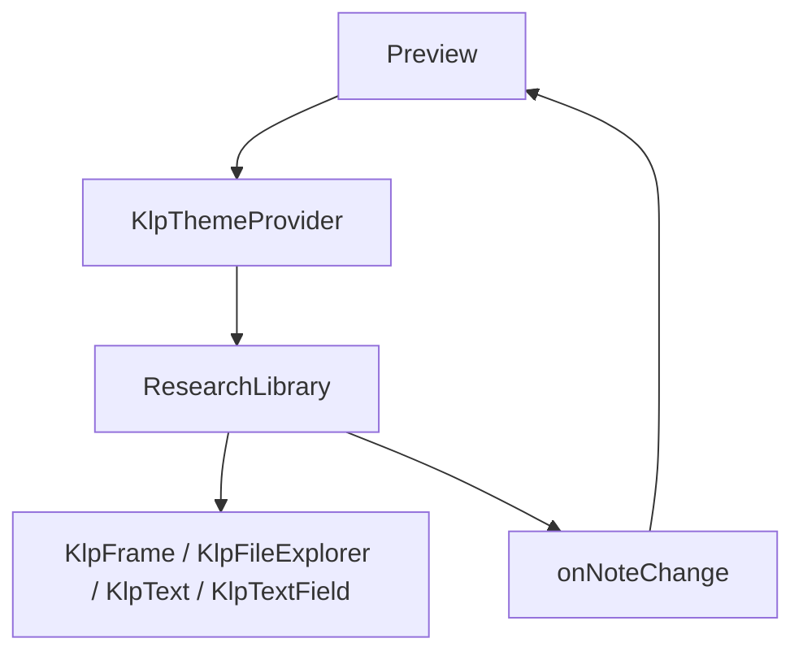

# 研究資料庫 Example

## 本輪人工回饋修訂

列表項目需保留外部間隔：資料結果固定使用 space2（8px），不跟隨緊湊模式的內部文字 gap 收縮；Explorer 項目間距由共用元件 CSS 擁有。

三個 Frame 明確選 `surface="raised"`，共用微立體由 React KlpFrame 擁有；example 不複製陰影。緊湊／基準內容內距為 12px、舒展為 16px，外距維持 space2；緊湊內容 gap 為 4px，其餘 8px。閱讀與搜尋內容不重複加頂部 padding，標題至內容保留 header 的下內距。輸入高度沿用共用語意 24px，移除舊的 30px example 覆寫。

正式資料只查得 flat／raised 配方；使用者提及的第三種「立體」尚待定位，不以自訂陰影冒充既有設計。

本階段為可評估的 React 畫面，依 spec/style-scenario-lab-v1.md。獨立入口 index.html 由既有 Vite dev server 提供；不改既有展示路由或共用庫。消費端採用 ResearchLibrary、research.css 並在外層提供 KlpThemeProvider。

## 責任與契約

| 檔案／函式 | 責任 |
| --- | --- |
| library.tsx / ResearchLibrary | 接受 records、notes、onNoteChange；持有搜尋、分類與選取，呈現公開元件 |
| preview.tsx / Preview | 示範資料、備註狀態、mode 與密度變體；provider 不因切換而重新掛載內容 |
| research.css | 僅情境布局，所有視覺值引用 semantic CSS variables |
| index.html | 本機預覽入口 |

ResearchRecord 的 id 為穩定唯一鍵，title 為名稱、category 為分組、source 為示範來源標示、summary 為摘要、body 為段落。所有文字為虛構示範內容。notes 依 id 記錄；onNoteChange(id, value) 交還 consumer 處理，預覽只保存記憶體，重新整理即還原。

實作範圍限本目錄。M1：可互動畫面與獨立 consumer 介面；M2：TypeScript 與瀏覽器確認。估 10–20 分鐘，冷啟動；不新增測試或改基準。視覺驗收由使用者完成。此入口先供本機評估，不宣稱已接入既有發布 bundle。

## 桌面 Catalog 收斂

ResearchLibrary → KlpWorkspace → KlpFrame → KlpList；records 投影為共用清單 items，onSelect 更新本地選取。列表內部 padding、gap 與狀態由 KlpList 擁有；research.css 僅設定欄寬及換行。
