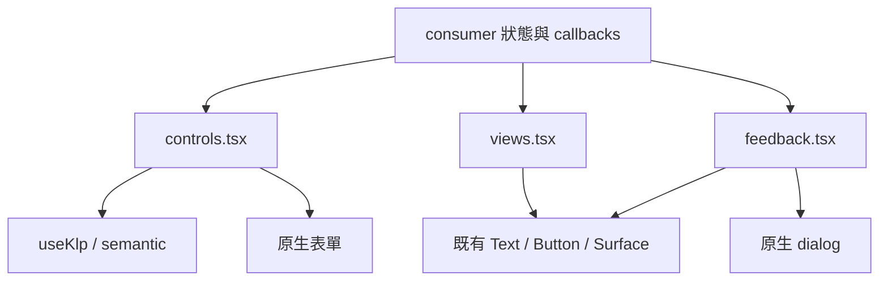
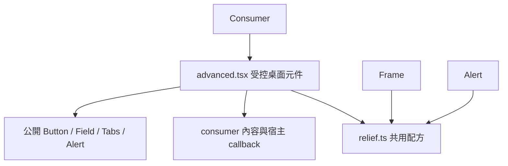

# 桌面通用元件

依 desktop-component-catalog-v1 契約，從 `../index.ts` 公開 export；元件只依賴 React、theme 與既有 components。外觀由同目錄 styles.css 擁有，package-assets 合併至公開 styles.css。全部延用 semantic CSS variables，native input/dialog 保留瀏覽器鍵盤及可及行為。

## 介面與責任

controls.tsx：KlpTextArea、KlpCheckbox、KlpSwitch、KlpRadioGroup、KlpSelect、KlpComboBox、KlpSlider。資料透過 value/checked 與事件由 consumer 持有；id/label 由 useId 關聯。options 的 value/label/disabled 代表穩定選項值、顯示標籤及可用性。原生 picker 不重做。

views.tsx：KlpList（受控單選，原生 button）、KlpTabs（單選、方向鍵／Home／End、panel 關聯）、KlpTable（語意表格，產品持有資料排序）、KlpAccordion（原生 details）、KlpBreadcrumb（連結）、KlpPagination（頁碼回呼）。所有 ID 由 consumer 提供唯一穩定值；tabs 自動避開 disabled，選取不存在時保留可操作 fallback。

feedback.tsx：KlpProgress、KlpAlert、KlpEmptyState、KlpDialog、KlpTooltip、KlpStatusBar、KlpSeparator、KlpLink、KlpAvatar、KlpSkeleton。Dialog 透過原生 showModal 管理 modal focus，close/cancel 回呼交還 consumer，卸載時還原焦點。Tooltip 支援 focus、hover、Escape。無延遲計時器、網路或全域 store。

## 目前 slice

DC-REACT-1：新元件、公開 exports、CSS 打包、既有 basic specimen 路由接入、桌面 Catalog 頁與採用文件。保護所有既有 tests／fixtures。M1 元件與型別、M2 路由與 bundle、M3 瀏覽器操作與研究清單採用。冷啟動估 30–60 分鐘；無儲存副作用，不新增資料模型框架。既有 components／reference-components checks、TypeScript、實際瀏覽器驗證為證據；未觀察項不宣稱通過。

## 驗證紀錄（2026-10-16）

TypeScript library/example 與 Vite build 通過；既有核心與隔離測試作者新增的桌面契約合計 14 passed（含完整化 6 項）。瀏覽器實測 Catalog 分類切換、Dialog 開啟時焦點進入輸入框、Escape 關閉後焦點回到啟動按鈕。視覺品質待使用者接受；未宣稱已完整驗證各瀏覽器。Vite 提示示範 bundle 超過 500 kB。

## Alert 呈現修訂

依使用者最新回饋，禁止細邊框。KlpAlert 使用無框淡色微立體，與 Frame 共用 resolveRelief，狀態透過標題與文字呈現；Switch、Dialog 與 Tooltip 同步移除裝飾細框，保留鍵盤焦點提示及語意分隔線。由共用 styles.css 擁有，Catalog 與所有 consumer 一致套用，不增加頁面覆寫。

## 通用桌面完整化契約

READY；新增 advanced.tsx 擁有 Tree（展開與單選，方向鍵）、MultiSelect（勾選與移除）、VirtualList（固定列高視窗）、DataGrid（儲存格文字編輯與排序回報）、Popover（錨定與 Escape）、Drawer（原生 modal）、ToastRegion（受控集合與關閉）、Spinner（載入狀態）、SplitButton、Ribbon（公開動作組合）、ContentHost（外部引擎內容槽）、SystemAction（產品宿主 callback 的 pending/error）。所有資料與業務持久化屬 consumer。relief.ts 為 Frame 與強調表面唯一共用配方。

目前 slice DC-REACT-2：src/desktop/advanced.tsx、styles.css、src/relief.ts、components.tsx 的配方委派、feedback.tsx 的強調、index.ts 公開 export、example/advanced-specimens.tsx、desktop-specimens.tsx 與 catalog data；文件及模組契約由協調者維護。tests 由隔離 Test Author 擁有，不由實作者改動。M1 公開元件與型別；M2 每項接可操作 Catalog；M3 契約、建置與瀏覽器。冷啟動估 30–60 分鐘，視覺 human-pending。

### 內部函式責任

Tree.visit 依展開集合投影可見階層；Tree.focus 管理 roving focus。MultiSelect.toggle 產生新選取集合。VirtualList.move 捲動至鍵盤作用列，保留 active descendant 在 DOM。Popover.place 依錨點與 viewport 重算位置，effect 清理捲動監聽與 top layer。SystemAction.run 防止重入並將 Promise 失敗轉為可重試訊息，卸載後不更新狀態。其餘元件直接呈現受控 props，無全域資料來源。

KlpTreeGrid 擁有階層表格；visit 投影可見列與同層可及位置，focus 管理列導航並跳過 disabled。rows 的 id／label／cells／children／disabled 由 consumer 提供，展開、選取與儲存格內容回到產品。

完整化實測：13 個新增入口在瀏覽器可渲染；Popover 開啟、輸入、Escape 後值保留並返回觸發按鈕；Drawer 原生 modal 開啟與 Escape 焦點還原；10,000 筆 VirtualList 的 End／Enter 可選最後一筆。公開宣告與 registry 雙向對照共 60 項通過。專業引擎與真實 OS adapter 不在本輪實作範圍；系統展示明確為本地替身。

## 方形圓角與尺寸契約

所有控制部位使用方形／長方形加圓角，幾何讀正式 semantics。Checkbox／Radio 採原生 input 保留鍵盤及受控行為，用 appearance:none 和 CSS 標記接管外觀；Range 在 WebKit／Gecko 均提供矩形 track/thumb。Spinner 小點、Avatar 與 Progress 不使用圓形。checkbox 15×15、toggle 34×16、thumb 14×14、field 24px。選取語意與焦點提示保持；瀏覽器／OS 的日期、檔案等原生彈窗不是本庫繪製，不宣稱可控制其系統內部外觀。

## 欄位焦點與選單風格契約

欄位聚焦採內描 inset shadow，包含在 fieldHeight 24px 內，不在欄位外增加 outline。表格、separator 與相鄰群組使用低對比 hairline dashed divider；不恢復高對比實線邊框。Select 保留原生 select 表單／label／onChange／disabled，透過 appearance:base-select 與 picker 完整呈現微立體、間距與同色狀態；這項原生 popup 風格需支援 customizable select 的瀏覽器。

ComboBox 改由本庫繪製 listbox，原 input 仍持有表單值與事件。onChange 以受控值或 draft 篩選字串，方向鍵改 active descendant，Enter 選取並發送原生 input 事件；Escape／Tab／blur／外部點擊關閉，IME composition 不攔截 Enter，自由文字不受限。disabled/readOnly 不開建議。place 以 viewport 重新定位，effect 清理 top layer 與監聽；沒有匹配時呈現可自由輸入提示。選取 callback 不覆寫 consumer 的 value。

對話框上下 padding 為 loose（32px）、內容段落 gap 為 comfortable（24px）；選單列共用 menuItemHeight（40px）。Dialog、Select picker、ComboBox 與命令選單採 hairline／divider 的低對比虛線外框，保留微立體陰影。欄位仍為 24px。
