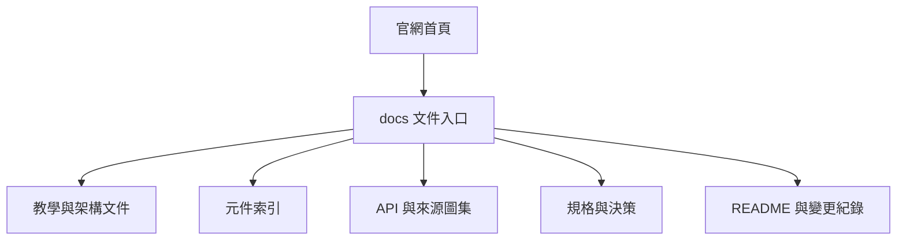
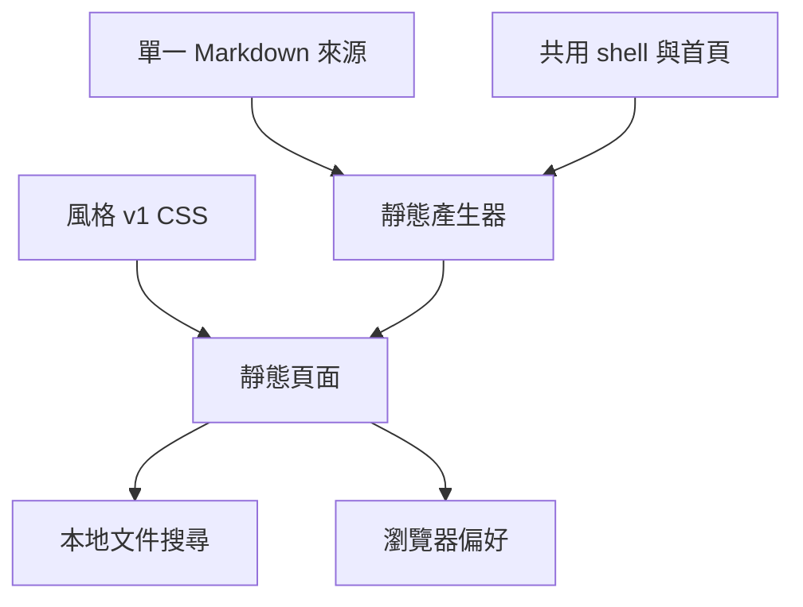

# Kallopis 官網與文件子站

目前 stage：通用視覺規範整合 v1（2026-10-11），Iteration；擁有 module：`tool/reference_site`。需求 READY：使用者已指定採用既有視覺統整、整合 docs 網頁，並指示推進下一步。此 stage 不重新設計視覺、不搬移框架庫、不發布網站。

專案定位以 [跨框架核心目標](multi-framework-design-system.md) 為準；正式視覺內容以 [規範索引](../docs/design-tokens/KALLOPIS-DESIGN-MAP.md) 及其章節為準。網站落實 [維護規則的整合契約](../docs/design-tokens/maintenance.md)，不擁有另一份視覺內容。

| ID | 目標版本 | 優先級 | 需求 | 可觀察驗收 | 狀態 |
| --- | --- | --- | --- | --- | --- |
| VDOC-01 | 整合 v1 | P1 | 在 docs 中提供正式通用視覺入口，與 Flutter API 區分 | docs 首頁與文件導覽可進入規範索引；網站不宣稱 React 元件已交付；既有 Flutter API 路由保留 | accepted |
| VDOC-02 | 整合 v1 | P1 | 由單一 Markdown 來源產生分章頁面與可用連結 | 索引、維護規則與六章皆可讀取；索引中的匯出快照另有明示快照頁；相對連結與 anchor 在專案前綴下正確 | accepted |
| VDOC-03 | 整合 v1 | P1 | 完整呈現 token／配方表格及記號 | 真正表格、程式記號、色碼、運算與繼承說明不遺失；窄畫面可操作並讀取完整表格 | accepted |
| VDOC-04 | 整合 v1 | P1 | 以內容搜尋規範 | 查詢 `parchment50` 或 `button-size-md` 可找到包含它的規範章節；既有 API 搜尋及無結果／載入失敗行為保留 | accepted |
| VDOC-05 | 整合 v1 | P1 | 對來源、頁面、路由與搜尋進行完整性檢查 | 必要來源缺失、漏頁、多頁、無效本地連結／anchor 或遺失規範搜尋內容時，產生或驗證失敗；既有 API 驗證不弱化 | accepted |

目前能力地平線包含跨框架規範與各框架文件；本 stage 只接入已採用的規範和現有 Flutter reference，不規劃 React API 或套件搬移。

以下既有網站要求仍適用於目前 Flutter Reference：GitHub Pages 從 theme、foundation、experimental 三個 public barrels 產生 module 分類及每個公開 class 一頁的正式 Reference；不保留 declarative／compatibility API，網站工作不改 Flutter 元件。

## 需求與權限

- 首頁介紹 Kallopis 實際提供的 semantic theme、Flutter 共用元件與產品組合邊界；不搬用 Planist 的 agent、執行績效、定價或下載宣稱。
- 正式 API 來源只包含 `kallopis_theme.dart`、`kallopis_foundation.dart`、`kallopis_experimental.dart`；不得產生 declarative、runtime、adapter、bound 或 private renderer 頁面。
- 同一來源宣告被多個 public barrels 匯出時只產生一頁並列出全部入口；同名不同來源保留各自頁面。
- 參考 https://miudog.github.io/Planist/ 的精簡導覽、中央主標題、工作區視覺、編號分段與進入產品的行動入口。
- 所有頁面依 [style-v1](style-v1.md) 使用暖灰、平整 Frame、12px 圓角、子內容 padding、內容紙色與微浮陰影；表單／選單以底色分層、區域分隔使用虛線。
- 預設淺色；可切換深色、暖灰／中性灰與內容微浮偏好，跨子頁保存。深色主內容比側欄亮。
- 讀者為開發者與 AI；主入口為首頁「閱讀文件」，文件入口提供開始使用、架構、元件、API 與規格。
- 原有 docs、spec、README、CHANGELOG 的 Markdown 保留為單一來源，建立靜態 HTML 子頁與相對連結轉換。`.agents` 不是公共文件站的遷移範圍。
- 不刪 Markdown，不另維護文章副本；舊 URL 提供相對轉址以支援 GitHub Pages 專案前綴。
- 本次只建立可本地預覽與既有 CI 部署的產物，不自動 push 或改 GitHub Pages 設定。

## 畫面與生命週期





```text
Markdown source → source-to-route mapping → parser → 共用文件 shell → docs 子頁
風格預設 → 可選瀏覽器偏好 → CSS 根層變數 → Frame／內容／控制
舊路由 → 相對新路由轉址；無登入、編輯或後端寫入
```

桌面文件頁為左側導覽＋中央文章＋右側段落索引；窄畫面收合導覽並改單欄。搜尋應含 API、指南、規格與元件，提供無結果／讀取失敗狀態；文章表格、程式碼、標題 anchor、圖片與 Mermaid 不得靜默遺失。鍵盤可操作導航與偏好，保留可見焦點。

## 驗收

- 產生器與既有 Pages workflow 一致，首頁／docs／舊路由可到達。
- 文件數量與來源清單一致，檢查相對連結、anchor、表格與程式碼。
- 目視桌面／窄視窗首頁與文件頁，操作搜尋、導覽、明暗與自訂風格。
- 記錄原來源中的失效連結，不以未驗證內容冒充完整遷移。
