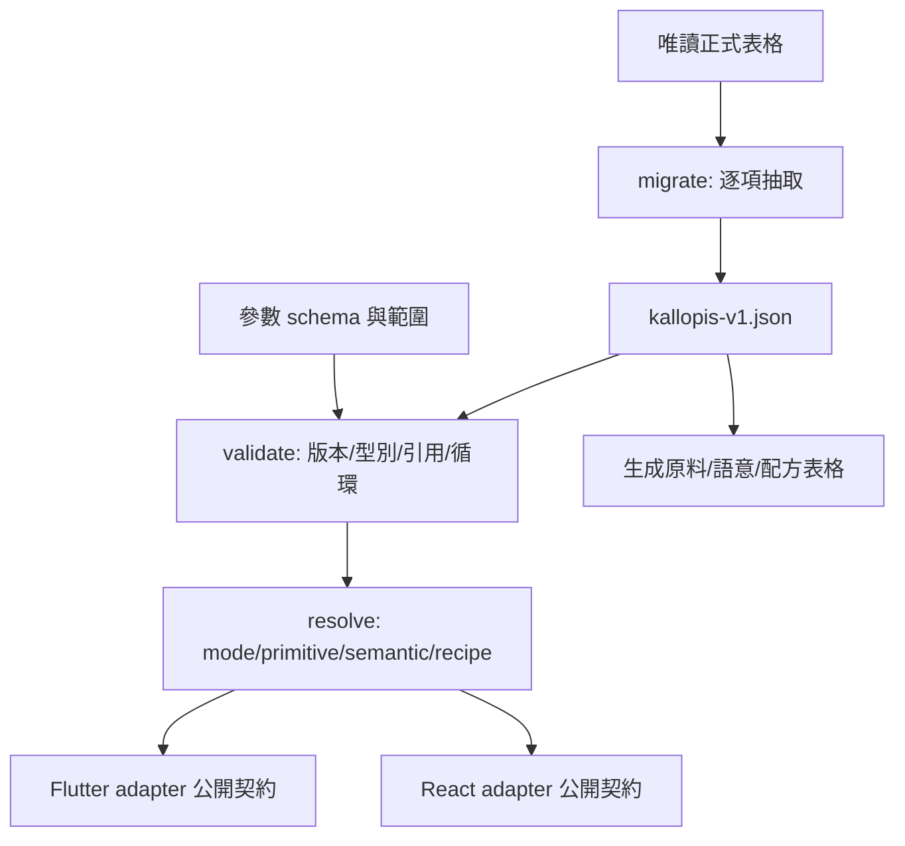
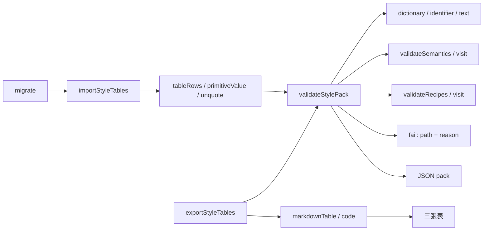
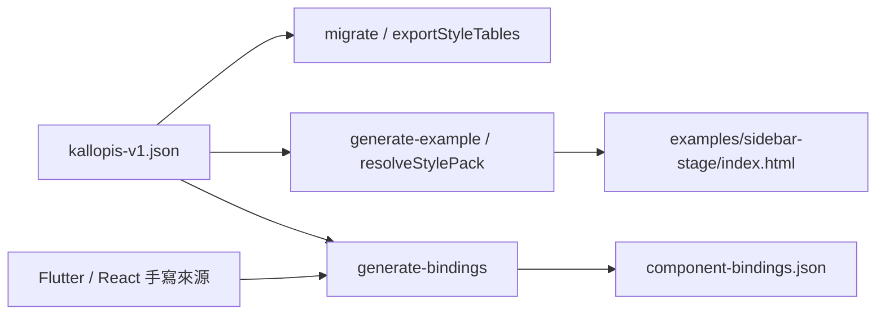

# Style Pack

## DESIGN-LIBRARY-STYLE-1

依[共通風格與互動展示 v1](../spec/design-library-v1.md)，共通風格來源切片為 PLAN READY。沿用 `kallopis-v1.json` 作為主要色彩檔，保留 pack 版本、現有 ID、四種模式與既有格式。`catalog.json` 繼續維護型別與約束；`styles/examples/` 維護具名組合程式碼、資產及貼用說明。正式 Markdown 仍保有現在的連結、章節說明與合法組合規則，其中原料、語意及配方的資料表由 pack 生成。

以現行正式 Markdown 三表為一次性切換基準。已觀察到工作樹的 `migrate.mjs --check` 回報 pack 過期，逐項比較發現 `recipes.badge-status` 一筆有差異，primitive、四模式 semantic 及描述資料一致。切換時依現行正式配方匯入並保留差異紀錄。使用既有 `importStyleTables`、`exportStyleTables` 與 `resolveStylePack`，避免新增資料格式與第二個 resolver。React 現有 `--source-dir` 仍可餵入測試 fixture，正式生成的預設來源改讀 pack。

| 里程碑 | 證據 |
| --- | --- |
| M1 共通資料可生成文件 | 比對所有原料、語意、配方及描述；只更新三份文件的表格資料區。四模式解析有效。驗證輸出過期、缺 ID 或引用非法會失敗。累計估 4k–8k tokens、25–45 分鐘。 |
| M2 兩框架由同一來源生成 | React 主題及 CSS、Flutter pack 與 manifests 可重現。既有公開 API 測試、相容 smoke check、現有 style pack tests 與生成新鮮度檢查通過。舊有 fallback 預設須核對一致，涉及元件或 API 行為改動時回 PLAN。累計估 8k–15k tokens、50–100 分鐘。 |

M1 寫入路徑限 `styles/kallopis-v1.json`、`styles/scripts/migrate.mjs`、`styles/package.json`、`styles/README.md`、`docs/design-tokens/{primitives,semantics,recipes,maintenance}.md`。M2 由整合責任人協調框架交接，寫入路徑見各框架架構。由獨立測試角色保護逆向生成及預設來源切換，實作不改既有斷言或 fixture。驗收以 Node 24、既有 Flutter SDK 與既有 CLI 為前提，估算參照 STYLE-PACK-1／2 與既有 React token generator，屬冷啟動估算。累計超過 18k tokens 或 120 分鐘時回 PLAN 檢討權限範圍或未辨識的資料差異。

切換以 M1 與 M2 同時通過為完成條件，使用 Git 可回復此次切換。單一樣式權威在切換前仍為正式 Markdown，切換後為 `styles/kallopis-v1.json`。既有組合範例的位置與可攜內容在網站交接時由對應切片處理。

## 既有風格包實作

修訂：`STYLE-PACK-r2`。目前 stage：v1；STYLE-PACK-1／2 已完成，框架 adapter 待接入。契約：[Style Pack v1](../spec/style-pack-v1.md)。

## 責任與公開格式

本 module 擁有 `styles/`：版本化 pack、參數 schema、純資料解析／驗證、遷移與文件生成。框架 adapter 位於各框架 module；本站不提供產品全域狀態或 GUI renderer。

v1 JSON 以 `schemaVersion: 1`、`id`、`version`、`primitives`、`semantics`（每個 ID 對应四 mode 表達式）、`recipes`（aliases／inherit／parameters）表示現有資料。遷移先保存正式表格的表達式原文，解析後供 framework adapter 使用。色碼保留來源格式，跨平台轉換由 adapter 擁有。參數 catalog 帶型別與單位，不以英文 ID 猜測數值限制。

配方視覺值可覆寫；合法 role／child／狀態組合獨立於 pack。初始 migration 採正式表格，通過後預設 pack 才成為值權威。JSON 不能放註解，字段中文用途與理由由本文件及 schema description 維護。

## 目前 slices

STYLE-PACK-1 公開 ESM 入口 `styles/src/index.mjs`：`importStyleTables(documents, identity)` 接收三份 Markdown 字串及 `{id, version}`，回傳完整 pack；`validateStylePack(pack)` 成功回傳有效 pack，失敗拋出帶路徑的 Error；`exportStyleTables(pack)` 回傳三張表格的 Markdown 字串。`semantics[id]` 為 light／dark／ultraDark／transparent 表達式物件；`recipes[id]` 帶 aliases、inherit、parameters 原文；`primitiveDescriptions[id]` 保留原料說明。表格比較以所有原始 cell 為準，非以格式換行。

`documents`／export 回傳物件 keys 固定為 `primitives`、`semantics`、`recipes`；`semanticDescriptions[id]` 保留第一欄 ID 後的 ` ` 與雙語說明，避免首次遷移丟失索引。兩個 descriptions map 是文件 metadata，與風格值分離，不是另一份值權威。

Validation 必須拒絕 unknown version、非 object／array dictionary、空 ID、重複表格 ID、遺漏 mode、非法 primitive、缺失 p／s 引用與 semantic／recipe 繼承循環。合法 primitive 是 finite number／string／僅含 finite number 或 string 的 array；preserve `none`、`—` 及現有原文記號。此 slice 不新增任意表達式，不對文字 recipe 使用 eval。CLI `node styles/scripts/migrate.mjs --check` 比對現有 pack 與正式表格内容；無 check 時只寫 module 的 default JSON。schema 暫描述交換結構；參數範圍在 slice 2 完成。

| Slice | write_paths | 責任／證據 | 狀態 |
| --- | --- | --- | --- |
| STYLE-PACK-1 | `styles/schema-v1.json`、`styles/kallopis-v1.json`、`styles/src/**`、`styles/scripts/**`、`styles/package.json`、`styles/README.md` | SP-01／02：純 JSON 遷移、內容逐項對照、驗證與既有表格 round trip，不切換框架權威 | 完成 |
| STYLE-PACK-2 | `styles/src/**`、`styles/scripts/**`、`styles/README.md` | SP-02／04／05／07：typed semantic 參數、範圍、資產標記與解析輸出，供兩框架 adapter 同 fixture 驗證；catalog 是 PLAN-owned 唯讀契約 | 完成 |

Test Author 唯一可寫 `styles/test/**`；implementation 不可改測試、spec、architecture、docs、框架或 CI。檔案不存在前不建立空執行層。BUILD packet 必須基於乾淨隔離 worktree 真實 revision；測試 author 的新保護需先提交到基線。

STYLE-PACK-1 冷啟動估算 5k–10k tokens／30–70 分鐘；參考 REACT-FOUNDATION-1 的同來源解析（無可靠歷史成本），假設 Node 24、零新增執行相依。M1 提取與 round trip；M2 拒絕非法輸入及公開驗證；兩者均完成才可聲稱本 slice 完成。超過 12k tokens 或 90 分鐘需重新評估，不降低驗收。

P1 對應：SP-01／02 本 module；SP-03／05／06／07 框架 adapter，SP-04 本 module 與 adapter coverage，SP-08 reference site。所有後續框架權威切換須由整合 owner 更新維護規則、生成器契約及兩框架架構，不能由本 worker 私自改跨 module 檔案。

## STYLE-PACK-2 公開契約

`catalog.json`（schemaVersion 1）逐一列出全部 350 semantic 的 type／unit／min／max／integer／purpose／affectedRecipes／assetKind；不存在的值用省略表示，不虛構上限。catalog 的型別及 constraints 不隨 style pack 替換，禁止用 consumer pack 降低安全限制。type 為 color、color-array、font-family、font-family-array、length、ratio、opacity、duration、weight、count、curve、symbol。目錄從現有用途與 notation 明確分類後保存為 ID 對照，不在 runtime 猜英文 ID。

公開 `resolveStylePack(pack, mode, catalog)`：先結構驗證，解析 p／s／primitive list／numeric add，轉曲線字串為四點 array；成功回傳深度 frozen 的 `{id,version,mode,tokens,recipes}` snapshot，tokens 保留 #AARRGGBB 與 package 字型身份，不能在 common 層改 CSS 格式。recipe 本階段只完整保存原文，typed recipe 展開屬 adapter 前另行 slice。每個 semantic 必須有 catalog，缺項或 type 不合拒絕並定位參數；不修改輸入。

公開 `applyStyleOverrides(pack, overrides, catalog)`：overrides 可含 primitives（已存在 ID → 值）及 semantics（已存在 ID → 部分 mode 表達式）；不接受其他 root key、不新增 ID、不覆寫 catalog／行為。在 clone 上整體套用，再解析所有四 mode，成功回傳新 pack；失敗保留原始 pack。consumer 更換完整 pack 仍使用同一 catalog 驗證。

curve 長度4，x1／x2 ∈ [0,1]，y 有限但可 overshoot；color 為 #RGB 不接受，僅 #RRGGBB 或 #AARRGGBB；opacity ∈ [0,1]，duration／length 一般非負，字重整數1～1000，count 正整數，ratio > 0。tracking、optical offset、陰影 offset／spread 及 Explorer 高度 adjustment 明確允許負值，其他長度不默認放行。font-family 保留字串及 package ownership，不自動載入 URL。

Catalog constraints 的 kind 為 ordered（依序非遞減）或 fits（child + 2×inset ≤ min(containers)）。v1 只宣告已有可驗證關係：field minLines ≤ maxLines；settings navigation minimum ≤ width ≤ maximum；toggle thumb 加 inset 可置於寬／高；segmented dense item 加 inset 可置於 track。沒有宣告的字型／control 容納由框架 layout algorithm 決定，不能由此假稱所有布局已驗收。

Test Author 新路徑 `styles/test/style-runtime.test.mjs`，不得改 slice1 tests；以 default catalog 及明確 fixture 驗證四 mode、add、字型與曲線、非法值、原子覆寫、隔離／freeze、缺 metadata 及 cross-token constraints。冷啟動估算 5k–10k tokens／30–75 分鐘，參考 STYLE-PACK-1（只以已完成功能作參考，不假稱已量測精確成本）。M1 typed resolve／catalog；M2 atomic override／constraint evidence。implementation 所有 catalog／architecture／tests 唯讀；slice 前需把新保護提交為 clean base。

## 已實作責任與呼叫鏈

| 函式／檔案 | 責任 |
| --- | --- |
| [importStyleTables](src/index.mjs) | 以 tableRows 讀三份正式文件，建立身份、值、四模式、配方及描述後整體驗證 |
| validateStylePack | 驗證 dictionary、身份、primitive scalar／array、模式、配方字段及描述；不修改輸入 |
| exportStyleTables | 驗證後輸出三張 Markdown 資料表；不重建章節排版 |
| tableRows／primitiveValue／unquote | 抽取 ID 列、拒絕重複及格式錯誤；數字轉 finite number，其他來源記號保留原文 |
| validateSemantics／visit | 各 mode 的 p／s／array／add 語法、引用與 DFS 循環驗證；尚非 typed runtime resolver |
| validateRecipes／visit | 繼承 DFS、p／s 引用驗證；自然語言配方保留原文，不使用 eval |
| dictionary／identifier／text／fail | 拒絕非法物件、危險 ID、非法文字，錯誤帶路徑與原因 |
| markdownTable／code | 純資料表與 inline code 輸出，交給 docs renderer 做 HTML escape |
| [migrate CLI](scripts/migrate.mjs) | 讀正式三表；產生 default JSON 或以 --check 比較全部內容；失敗回非零 exit |
| [schema](schema-v1.json)／[package](package.json) | schema 定義交換型別；package 提供 ESM 公開入口及 Node24 指令，不發布 npm |

JSON 字段：schemaVersion 是交換版本；id／version 是風格身份；primitives 是 scalar／array 原料值；semantics 是 ID → 四 mode 表達式；recipes 的 aliases／inherit／parameters 保存查詢名、繼承及參數原文；primitiveDescriptions／semanticDescriptions 保存文件說明。曲線的陣列記號保留字串以逐 cell 還原，下一 slice 的 typed resolver 解析其數值，不能將 lexical JSON 當程式執行。schema 的 defs/value／scalar／modes／recipe／descriptions 分別約束交換結構。package name／version／private 管理套件身份及發布限制，exports 是公開 ESM 入口，scripts／engines 擁有執行方式及 Node 下限。

證據：269 primitive、350 semantic × 4、118 recipe 完整逐 cell round trip；11 個主測試／65 個含子測試檢查全通過，migration --check 及 packet scope check 通過。原本陣列轉換改變原文字面值的失敗已修正，測試 hash 未變。未執行框架 adapter、元件渲染或布局測試，本 slice 不宣稱其完成。

## STYLE-PACK-2 實作證據

`src/index.mjs` 是 facade；交換／表格函式位於 `src/pack.mjs`，typed resolve／atomic override 位於 `src/runtime.mjs`，公開宣告為 `src/index.d.mts`。runtime 的 typedValue 依 catalog 驗證型別／範圍，validateConstraints 驗證 ordered／fits，freeze 遞迴保護 snapshot；四 mode 都通過才提交 clone。

共 114 項檢查通過、零失敗／跳過；migration --check、TypeScript 宣告、packet scope 通過。以既有 React 公開資料比較四模式全部 1400 值，依明確 ARGB／字型 codec 後一致。這是資料轉換證據，尚非 provider 風格替換或布局驗收。實作 commit `9a002003cde0302faa9bff2610bc3b746f77556a`。

## COMPACT-DEFAULT-STYLE-r1 整合契約

依根architecture.md的已接受使用者preset修訂，正式semantic權威與既有生成流程保持，模組algorithm/config/既有tests唯讀。common主動作底色低對比、parent總gap8及dockMargin0；framework generated artifact僅由既有generator更新。example alternative pack改buttonPaddingX而不改block/action gap。此為值修訂，不切換正式值權威。獨立common測試由styles/test/compact-default-style.test.mjs擁有，其餘worker不得改tests。

2026-10-16 桌面幾何更新：正式語意定義方形圓角、field 24px、checkbox 15px 與 toggle 34×16px；kallopis-v1.json 仍由正式章節生成，既有 toggleThumb fit constraint 保留。

## 共通來源工具責任

`migrate.mjs` 驗證主檔並逐 ID 生成文件資料列，保留周圍說明。`generate-example.mjs` 以 `resolveStylePack` 產生四模式色彩與獨立 HTML。`generate-bindings.mjs` 掃描兩框架手寫來源，輸出 token 名稱與直接引用位置。三者的 `--check` 均比對完整產物。圖片位於 `styles/images/`。

