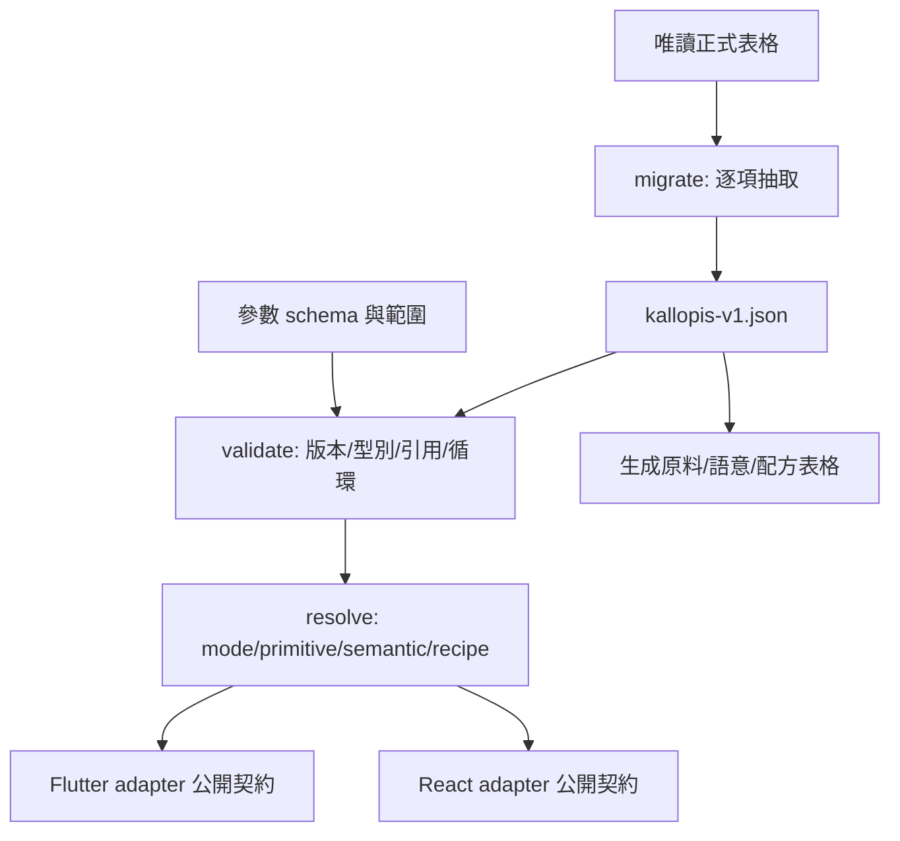

# Style Pack

修訂：`STYLE-PACK-r1`。目前 stage：v1；PLAN READY，尚未 BUILD。契約：[Style Pack v1](../spec/style-pack-v1.md)。

## 責任與公開格式

本 module 擁有 `styles/`：版本化 pack、參數 schema、純資料解析／驗證、遷移與文件生成。框架 adapter 位於各框架 module；本站不提供產品全域狀態或 GUI renderer。

v1 JSON 以 `schemaVersion: 1`、`id`、`version`、`primitives`、`semantics`（每個 ID 對应四 mode 表達式）、`recipes`（aliases／inherit／parameters）表示現有資料。遷移先保存正式表格的表達式原文，解析後供 framework adapter 使用。色碼保留來源格式，跨平台轉換由 adapter 擁有。參數 catalog 帶型別與單位，不以英文 ID 猜測數值限制。

配方視覺值可覆寫；合法 role／child／狀態組合獨立於 pack。初始 migration 採正式表格，通過後預設 pack 才成為值權威。JSON 不能放註解，字段中文用途與理由由本文件及 schema description 維護。

## 目前 slices

STYLE-PACK-1 公開 ESM 入口 `styles/src/index.mjs`：`importStyleTables(documents, identity)` 接收三份 Markdown 字串及 `{id, version}`，回傳完整 pack；`validateStylePack(pack)` 成功回傳有效 pack，失敗拋出帶路徑的 Error；`exportStyleTables(pack)` 回傳三張表格的 Markdown 字串。`semantics[id]` 為 light／dark／ultraDark／transparent 表達式物件；`recipes[id]` 帶 aliases、inherit、parameters 原文；`primitiveDescriptions[id]` 保留原料說明。表格比較以所有原始 cell 為準，非以格式換行。

Validation 必須拒絕 unknown version、非 object／array dictionary、空 ID、重複表格 ID、遺漏 mode、非法 primitive、缺失 p／s 引用與 semantic／recipe 繼承循環。合法 primitive 是 finite number／string／僅含 finite number 或 string 的 array；preserve `none`、`—` 及現有原文記號。此 slice 不新增任意表達式，不對文字 recipe 使用 eval。CLI `node styles/scripts/migrate.mjs --check` 比對現有 pack 與正式表格内容；無 check 時只寫 module 的 default JSON。schema 暫描述交換結構；參數範圍在 slice 2 完成。

| Slice | write_paths | 責任／證據 | 狀態 |
| --- | --- | --- | --- |
| STYLE-PACK-1 | `styles/schema-v1.json`、`styles/kallopis-v1.json`、`styles/catalog.json`、`styles/src/**`、`styles/scripts/**`、`styles/package.json`、`styles/README.md` | SP-01／02：純 JSON 遷移、內容逐項對照、驗證與既有表格 round trip，不切換框架權威 | 可發 packet |
| STYLE-PACK-2 | `styles/src/**`、`styles/scripts/**`、`styles/catalog.json` | SP-04／05／06／07：typed 參數、範圍、資產與解析輸出，供兩框架 adapter 同 fixture 驗證 | 依賴 slice 1 |

Test Author 唯一可寫 `styles/test/**`；implementation 不可改測試、spec、architecture、docs、框架或 CI。檔案不存在前不建立空執行層。BUILD packet 必須基於乾淨隔離 worktree 真實 revision；測試 author 的新保護需先提交到基線。

STYLE-PACK-1 冷啟動估算 5k–10k tokens／30–70 分鐘；參考 REACT-FOUNDATION-1 的同來源解析（無可靠歷史成本），假設 Node 24、零新增執行相依。M1 提取與 round trip；M2 拒絕非法輸入及公開驗證；兩者均完成才可聲稱本 slice 完成。超過 12k tokens 或 90 分鐘需重新評估，不降低驗收。

P1 對應：SP-01／02 本 module；SP-03／05／06／07 框架 adapter，SP-04 本 module 與 adapter coverage，SP-08 reference site。所有後續框架權威切換須由整合 owner 更新維護規則、生成器契約及兩框架架構，不能由本 worker 私自改跨 module 檔案。
