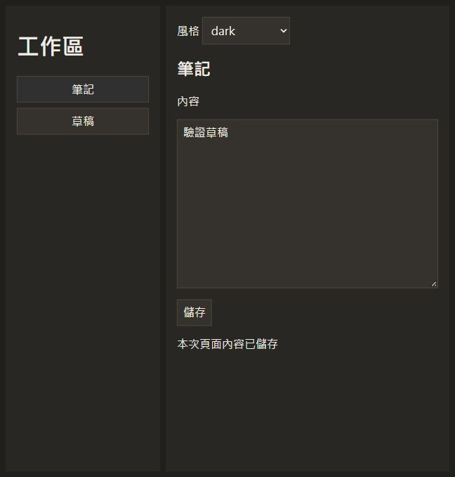

# 可複製風格與組合

[側欄與工作區](sidebar-stage/index.html) 可下載後直接由瀏覽器開啟，包含四種模式的 semantic 色彩、原生 HTML／CSS 與頁面內互動。複製整份 HTML 至自己的專案即可使用。文件與頁面內狀態由範例持有。

原料與語意 ID 來源為 `styles/kallopis-v1.json`，範例的 CSS 名稱由 semantic ID 自動轉換，例如 `theme.colors.surface` 對應 `--klp-colors-surface`。色碼由 ARGB 轉為 CSS RGBA，色彩值皆從共通來源生成。

修改風格後執行 `node styles/scripts/generate-example.mjs`。以 `--check` 確認範例與來源一致。

既有框架專案也可沿用 Flutter／React 公開套件入口，操作實際元件的展示由網站的框架展示入口進入。

實際深色模式畫面如下，切換文件與主題後草稿仍保留。

