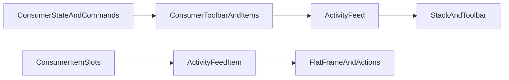

# 活動清單純呈現組裝

契約版本：activity-feed-1，2026-10-18。來源為使用者要求將Unico所有呈現決策與組裝回存Kallopis；沿用既有contentInset間距、flat Frame及button row，不引入新視覺方向。此為可複製模板，不新增公開套件API。

| 定義／來源 | 職責 |
| --- | --- |
| ActivityFeedProps／ActivityFeed，ActivityFeed.tsx | toolbar是操作插槽，children是consumer排序完成的項目，empty由consumer判斷是否顯示，notice為錯誤／提示slot；只有直向stack與toolbar row。 |
| ActivityFeedItemProps／ActivityFeedItem | heading／description／metadata／actions均為ReactNode插槽；flat Frame、直向內容、可換行actions。無資料型別、排序、讀取、路由或API。 |
| activity-feed.css | 只搬移既有stack/contentInset/panel inset/action row規則；沒有產品選擇器或新token。 |

產品擁有未讀／全部、時間格式、事件資料、CAS、保存與路由；不得移入模板。Consumer複製TSX/CSS，必須逐字一致。新增視覺quality與互動接受維持human-pending，編譯只證明code接線。
